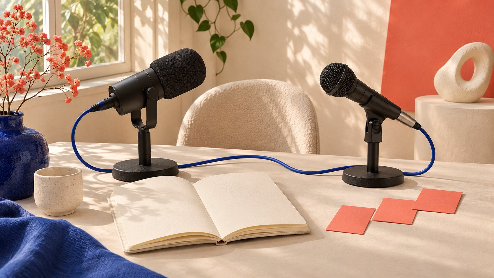

# 回看2025创作者合作：把品牌关注与社区价值连接

状态：本地审阅稿；正式发布日期待确认。

复盘2025年的合作增粉策略，要把共同内容的价值、关注路径、后续体验与历史证据分别说明。曝光机会不等于持续关注。

AI 生成的编辑示意图，不是真实达人、客户、产品或活动。

面向2025年的influencer collaboration strategy grow fan base复盘，应先问合作给受众什么持续价值、受众怎样找到应关注的账号，以及后续内容是否兑现这个理由。2025年8月Instagram公告介绍公开帖子和Reels转发及原发者署名，提供潜在发现机会，但不保证新关注或留存。要评估当年的策略，需要当时的内容、功能可用记录与指标窗口；今天的界面不能补成2025年的历史证据。本文提供复盘与下一轮规划方法，不承诺固定增粉数量或把单次活动前后变化当作全部合作效果。

## 先写关注的理由，再选合作形式

共同内容应让受众理解为什么需要这两个声音，以及关注哪个账号之后还能获得什么。一次互相提及可以制造发现线索，却不自动形成持续内容价值。

品牌可以先写一个明确问题，例如共同解释某种产品选择或创作过程，再判断谁负责什么。不是所有合作都适合以增粉为首要目标，教育、使用理解或服务讨论也可能更适合。

[合作执行指南](/zh/blog/collaborate-with-influencers-brand-workflow/#answer)帮助把目标落到交付和负责人。若选择关注增长，就写清哪个账号、什么受众与后续内容，而不是只把两个粉丝总量相加当作机会规模。

这些是编辑规划建议，不是某种形式天然有效的证据。合作的相关性、实际执行和受众反应需要具体资料，不用“跨圈”之类词语代替研究。

## 使用2025资料，不把今天功能倒填历史

[Instagram 2025转发公告](https://about.fb.com/news/2025/08/new-instagram-features-help-you-connect/)于2025年8月6日说明公开内容转发与原发者署名，并表示内容可能被推荐给转发者的关注者。这里保留“可能”，不扩展为必然分发。

这份日期明确的公告可以说明当年宣布什么，不证明每个项目账号在同一天都出现相同界面、获得相同推荐或实际使用该功能。

复盘资料应包含当时发帖链接、截图日期、账号与具体发布方式。2026年的帮助页如果没有历史版本，只能支持当前说明，不能替代过去设置的证据。

若历史资料缺失，写清无法确认当时是否使用或可用。不要为了做一个完整时间线，把今天的操作经验伪装成过去已经发生的执行记录。

## 画出从内容到账号的真实路径

受众看到内容后，是否知道两个参与者分别做什么、应该去哪个账号以及为何继续看？记录实际署名、提及、账号页面与关注理由，不假设每个观众都会依次经过所有步骤。

路径可以用于找沟通断点，不代表已经取得逐个人的完整行为轨迹。公开页面通常不足以证明某次曝光对应哪次关注，更不应为了补齐链路收集无关私人资料。

假设一段共创教程在结尾指向持续系列，可复查系列是否存在、是否容易找到、内容是否与承诺一致。这是编辑检查，不保证受众转化。

同时区分品牌账号与创作者账号的目标。一个账号增长而另一个没有，并不自动证明合作失败；需要回到双方原本确认的目标与所能观察的资料。

## 让后续内容兑现第一次关注的期待

如果合作只提供一次热闹，而后续账号内容与关注理由无关，团队至少应把这种体验差异记录为可能问题，而不是一看到增长放缓就归咎算法。

安排后续内容主题、实际负责人和可兑现的节奏。这里不提供所有品牌都必须遵循的发布频率，也不编造固定连续几天就能提升留存的规则。

合作双方可以各自延续不同贡献，例如一个继续解释产品使用，另一个继续展示创作过程。关联要真实，不要求两边机械复制同一批内容。

复盘时核对实际完成了什么，而非仅审阅计划表。未发出的系列、延迟发布和范围改变都保留状态，使团队知道问题出在假设、执行还是尚未取得足够观察。

例如，若承诺的后续内容尚未发布，就不能在同一个时间点宣布受众不愿继续看这个系列。先说明系列实际状态，再记录可取得的受众反应。执行缺口与受众反应是不同问题，把它们分开，也让下一轮知道应先补内容还是调整价值主张。

## 区分新增、取消关注与净变化

[粉丝观察指南](/zh/blog/instagram-follower-tracker-campaign-observation/#answer)讨论活动窗口中的记录。净变化是期末与期初总量差，不能单独说明新增多少、取消多少或每位新增者来自哪里。

假设账号从10000变为10100，净增100；若另有可靠字段显示新增300、取消200，才能进一步描述这两个动作。这里全部是假设，不是实际账号表现。

如果没有流量来源或匹配归因，不把净增100全部归给这次共创。同期其他内容、推广、新闻或计数修订都可能相关，具体原因仍需证据。

截图保留日期、时区、字段与来源。缺失数据不补成零，供应商估计也不改写成平台确认的逐个人归因记录。

## 互动与持续受众不要互相替代

[月度互动解释指南](/zh/blog/social-media-engagement-rate-monthly-explanation/#answer)区分组内反应与组合变化。合作期间高互动可以提出后续研究问题，但不能直接当成持续关注或长久品牌偏好的测量。

观察适当窗口内后续内容的相关反应、访问与业务记录，先说明字段能支持什么。如果没有个人级留存数据，就不声称已测出某批新粉留存。

也不把单个评论、点赞或一次取消关注解释为明确意图。可以记录可见动作与语境，但满意、不满、购买或放弃都需要相应证据。

为项目选择合理的复查时点，并说明为什么适合这个任务。本文不给出统一天数；不同内容周期、产品和可用数据需要不同观察安排。

## 将下一轮改进写成可核对假设

[Google实验指南](https://support.google.com/google-ads/answer/7281575?hl=en)在Google Ads语境中强调目标、假设与测试变量。这可以提醒团队事先定义问题，但不能证明一次Instagram共创已随机实验。

下一轮可以研究更清楚的系列入口是否与适当行为改善相关。若设计不支持因果推断，就写观察性比较，并记录其他同时改变的内容与分发条件。

不要同时改合作对象、主题、媒体预算与账号定位，最后把全部变化归给一句新CTA。若多个方面确实必须改变，就如实保留，缩小结论范围。

决定需要什么证据后再执行，避免结果出现才挑指标。即使未支持原假设，也能保留具体学习，而不是为了增长故事修改成功定义。

## 把增粉目标放回更完整的业务问题

[AMEC评估框架](https://amecorg.com/amecframework/)区分传播产出、受众变化与组织结果。新增关注可以是一个观察，不自动代表销售、利润或更好的合作关系。

[活动衡量指南](/zh/blog/creator-campaign-measurement/#answer)帮助把目标层次写清。若团队真正要解决售前疑问或产品采用，应保留相应记录，而不是因为粉丝数量公开可见就把它作为全部成功定义。

也不要声称关注数没有价值；其价值取决于问题、内容与后续行为证据。报告要解释为什么观察这个字段，以及它不能单独回答什么。

这样复盘2025时既保留当时的目标，也允许下一轮根据实际学习调整，不必用一个越来越大的总量证明所有决定都正确。

## 交付一份有历史边界的策略复盘

交付当年目标、内容、功能资料、实际执行、观察窗口、指标定义与未知项。计划、公告、实际动作和结果分别列出，不让它们互相替代。

2025合作增粉策略的有效复盘，应解释共同内容提供什么、受众路径怎样、后续兑现如何，以及数据支持多强结论。缺失历史资料仍标缺失。

QuickKOL可以帮助研究相关创作者作品与准备下一次任务；增长、授权、执行和业务结果需实际资料核验。先建立可解释的关注理由，再讨论扩大合作。

## 2025复盘中不同证据的作用

| 证据 | 可支持 | 不自动支持 |

| --- | --- | --- |

| 当年功能公告 | 当时公开宣布的功能 | 每个账号都使用且有效 |

| 内容与入口 | 受众可见的价值与路径 | 每位观众经过完整链路 |

| 粉丝期初期末 | 指定窗口净变化 | 新增、取消及全部归因 |

| 后续内容记录 | 承诺是否实际交付 | 某批粉丝已被测得留存 |

10000→10100、300新增及200取消均为假设，不是实际账号或行业目标。

## 合作增粉复盘清单

按真实历史记录填写，不预测增粉。

- [ ] 共同内容为何值得持续关注？

- [ ] 功能依据来自当年吗？

- [ ] 实际入口与后续是否一致？

- [ ] 新增、取消与净变化是否分开？

- [ ] 结论是否超出设计与资料？

- [ ] 下一轮假设与证据提前定义了吗？

## 研究日期与使用边界

资料核验于 2026 年 11 月 3 日。文中方法、表格和决策规则为编辑建议，标为假设的示例不是实际客户结果或行业基准。外部资料的适用地区与时期按各段说明；本稿处于独立本地审阅阶段，正式发布日期待确认。

## 来源

- [Instagram 2025转发公告](https://about.fb.com/news/2025/08/new-instagram-features-help-you-connect/)

- [Google实验指南](https://support.google.com/google-ads/answer/7281575?hl=en)

- [AMEC评估框架](https://amecorg.com/amecframework/)
