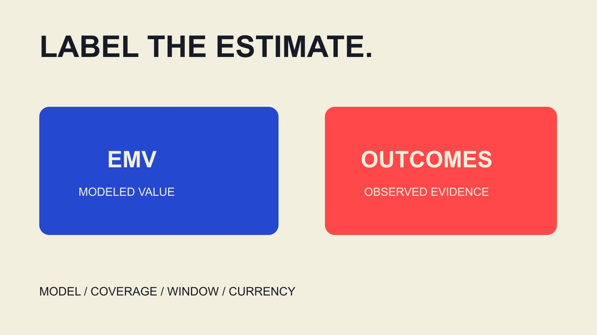

# EMV Meaning: Annotate the Executive Report

Status: local review draft; confirm the publication date before release.

Make EMV understandable in an executive report: label model and scope, separate valuation from spend and outcomes, and use an adaptable reporting note.

QuickKOL editorial graphic; not actual account metrics or a platform interface.

In influencer marketing, EMV usually means Earned Media Value: a monetary estimate assigned to exposure or interaction under a particular valuation method. An executive report should name the model owner, included activity, reporting window and currency, then state what the number cannot establish. It is not automatically received revenue, profit or saved advertising expenditure, and it does not independently establish causal ROI. This guide concerns report labels and annotations. Choosing a calculation model is a separate task; combining values from different sources does not make them a common measurement standard. The useful question is what a reader may reasonably conclude from this specific estimate.

## Give the acronym a scoped first sentence

Avoid a standalone label such as EMV: ten thousand. First explain that the number is a content valuation in this context, then name source, object and period. A shared acronym does not establish shared calculation across tools.

An adaptable editorial sentence is: this report uses the named provider’s model to estimate media-equivalent value for included content in the reporting period. This is reporting language, not an official universal definition or a statement that equivalent cash was received.

Align the title, chart label and first explanation. If a headline calls the number earnings while a footnote calls it an estimate, readers may retain the stronger headline. Put the qualification beside the main information rather than at the back of the report.

For colleagues unfamiliar with creator measurement, keep the explanation independently understandable. A chart screenshot should still communicate that this is modeled valuation, whose definition applies and which period is represented. A short label can be useful, provided it leads to an accessible complete note rather than replacing it.

## Use provider documentation to establish model ownership

The [HypeAuditor EMV guide](https://help.hypeauditor.com/en/articles/6379512-what-is-emv-and-how-is-it-calculated), dated July 20, 2026, describes its TikTok measure as proprietary and assigns valuations to interactions. That supports explaining how this provider describes its own metric, rather than establishing a universal industry method or independent verification.

Record provider, method link, export time and available version. If coefficients, adjustments or the complete calculation are not disclosed, retain the reproducibility limit. Do not invent a plausible-looking rate card to fill the gap.

A provider may make promotional claims about quality handling or comparability. Keep attribution explicit. Its statement about excluding a type of activity should not become the reporting team’s assertion that every inauthentic interaction has been independently removed.

The [EMV-method comparison](/blog/influencer-marketing-platforms-emv-calculation-methods/#answer) helps investigate suitability further. The reporting task here is to show where the figure came from and avoid silently switching models while retaining the same legend. If documentation does not identify a revision, record the reviewed page and export date without fabricating a version number or claiming a formula was held constant.

## Separate valuation, actual cost and observed outcome

Show EMV, actual spending, business observations and evidence limits in separate fields. Placing them beside one another aids reading; it should not diagram an established causal relationship.

The [Google ROI guide](https://support.google.com/google-ads/answer/1722066?hl=en) discusses return through profit and costs in a Google advertising context. It reinforces the need to define outcomes and costs; it does not justify inserting EMV as profit or supply universal influencer attribution.

The [EMV and ROI field guide](/blog/influencer-emv-roi-calculation-field-dictionary/#answer) develops monetary inputs, costs and denominators. Treat refunds, product costs, production and media expenditure according to the actual question and accounting approach, rather than omit inconvenient items for a more attractive multiple.

When a business outcome lacks an available source, record unknown or not obtained. Filling an empty revenue column with modeled valuation makes the report look complete by changing the field’s meaning. The next colleague cannot correctly compare that number with recorded sales, even if both use the same currency symbol. Separate fields prevent that quiet substitution and preserve the opportunity to add actual outcome evidence later.

## Describe a hypothetical multiple without calling it ROI

Suppose one model values included content at 12,000 currency units and recorded project costs are 3,000. Dividing 12,000 by 3,000 gives four. Describe that as a four-times ratio of this model’s EMV to the listed costs, not four-times observed revenue or profit.

The multiple changes if the cost scope changes. State whether production, media, internal work or other relevant expenses are included and why that scope fits the question. This example contains no client data and is not a market benchmark.

It also does not establish that the team would otherwise have spent 12,000 on advertising and therefore saved 9,000. A savings claim needs a credible alternative and comparable conditions, which valuation alone does not supply.

A clearer report retains valuation, costs and observed outcomes with their respective evidence. A well-defined valuation multiple can still be descriptively useful without being promoted to an unsupported financial result. The distinction should survive in the executive narrative as well as the calculation tab, because the narrative is often what decision-makers actually reuse.

## Explain covered and uncovered activity

State included accounts, formats, platforms and periods. Distinguish inaccessible content, missing fields and excluded channels rather than treating them as zero value.

Where paid collaborations and unsolicited mentions coexist, explain the model’s treatment or the inability to distinguish them. The word earned in a metric name does not independently establish that every item lacks a commercial relationship, or remove disclosure responsibilities.

For cross-platform publication, preserve platform-specific observations and check whether the provider deduplicates, and at which object level. Without evidence, a combined valuation should not be described as the value of unique people across platforms.

Coverage also includes the reporting cutoff. A post may continue accumulating interactions afterwards, producing a different later export. That does not automatically make the first report wrong: compare time and method. An explicit cutoff is more helpful than quietly replacing the earlier number, especially when another department has already used the original figure in a dated management presentation. Both records can remain understandable if their observation times are preserved.

## Separate activity change from model change

Higher EMV this month may reflect more included content, changed interaction, different coverage or revised valuation rules. An upward arrow alone does not establish improved brand influence or actual profitability.

Check model, objects and windows across both periods. If they cannot be aligned, state that direct comparison is unavailable and consider side-by-side display without a growth rate. Where a consistent historical recalculation is available, preserve its relationship to the original series.

The [AMEC evaluation framework](https://amecorg.com/amecframework/) separates communication outputs, audience responses, outcomes and impact. It organizes measurement questions; it does not automatically provide business-causation evidence for a particular EMV change.

Write the change narrative around supported statements: which inputs are comparable, which alterations are established and which differences remain unexplained. Do not assign every residual difference to better creative without evidence. A manager can make a sounder next decision from a qualified explanation than from a precise percentage that combines unlike models and reporting populations.

## Write an annotation that travels with the chart

An annotation can cover metric type, provider, window, coverage, currency, method reference and limits. Put longer methodology somewhere discoverable and keep a short misreading-prevention note next to the chart.

For example: EMV is the named model’s estimated media-equivalent valuation for included content in this period; it is not revenue or profit. See methodology for coverage and cost scope. This editorial example needs actual source and period details before publication.

Do not rely only on color to distinguish estimates from observations. Monochrome exports, copied text or assistive reading can lose that distinction, so field wording should also preserve the estimated or observed state.

The [campaign-measurement guide](/blog/creator-campaign-measurement/#answer) connects the chart with a fuller evaluation question. A management report should show which evidence is needed next rather than ask one valuation to represent all learning. Check the note after export as well: a useful annotation that falls outside the slide crop no longer qualifies the number a reader sees.

## A monetary display does not establish complete data

Suppose one of two content items has an exported valuation and the other has no result because a required field is unavailable. The report may show the available partial valuation, but the heading should say coverage is partial. Filling the missing item with zero and calling the total complete campaign EMV changes the meaning.

A displayed zero also needs interpretation: did the model assign zero, were observed input interactions zero, or did the software display an unavailable state as a default zero? Those states affect aggregation and explanation, so check the actual export and method.

If only rounded monetary displays are available, retain that precision limit. Do not reverse-engineer an exact interaction price from them or add decimal places that imply precision absent from the source.

Make these checks before the report reaches management. Additional information can support an updated valuation, with original coverage and the update reason preserved. Colleagues can then understand that a changed amount may reflect completed data rather than additional communication performance.

## End with a management question rather than the largest number

If the question concerns content visibility, seek suitable observations. If it concerns understanding, inquiry or purchase, select evidence for that outcome. EMV can be a defined supporting valuation without concealing a gap in the primary objective’s data.

At handoff, retain report version, export, method page, coverage list and unresolved questions. The next colleague needs to explain why the number was used, how it can be updated and when comparison should stop.

When the evidence supports an estimate, keep the conclusion at that level. An accurate label makes a report easier to use: readers can distinguish observed outcomes, model-assigned value and matters needing further verification. That distinction is a concrete reporting deliverable, even when no new financial result can responsibly be claimed.

## EMV executive-report annotation fields

| Field | Specify | Misreading prevented |

| --- | --- | --- |

| Model | Provider, available version and method | All EMV is inherently comparable |

| Coverage | Platforms, content, window and gaps | Missing means zero or unique people |

| Monetary type | Valuation, actual cost or observed outcome | Valuation equals revenue or savings |

| Conclusion | Supported and unsupported inferences | A valuation multiple is causal ROI |

Editorial reporting framework; hypothetical 12,000÷3,000=4 is not an observed return or benchmark.

## Before publishing an EMV chart

Keep essential qualifications with the number.

- [ ] Explain EMV at first use.

- [ ] Label model, window and currency.

- [ ] Make coverage and gaps traceable.

- [ ] Keep valuation out of the revenue field.

- [ ] Check method versions before comparisons.

- [ ] Preserve the note in exported charts.

## Research date and limitations

Sources reviewed November 3, 2026. Methods, tables and decision rules are editorial recommendations. Hypothetical examples are not actual client results or industry benchmarks. Source geography and periods are specified where relevant. This draft is in independent local review; confirm its publication date before release.

## Sources

- [HypeAuditor EMV guide](https://help.hypeauditor.com/en/articles/6379512-what-is-emv-and-how-is-it-calculated)

- [Google ROI guide](https://support.google.com/google-ads/answer/1722066?hl=en)

- [AMEC evaluation framework](https://amecorg.com/amecframework/)
