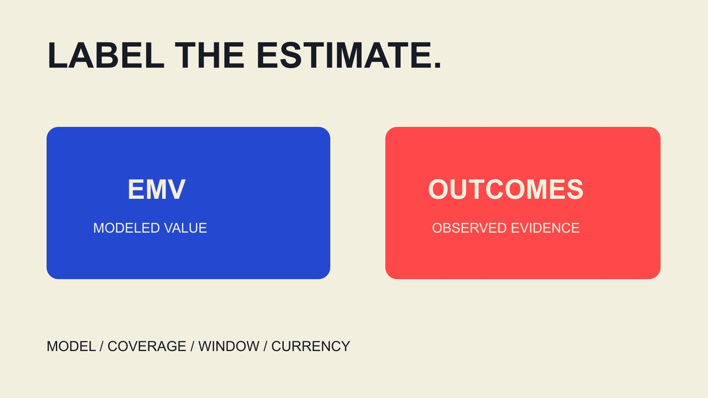

# EMV是什么意思：给管理报告补上正确注释

状态：本地审阅稿；正式发布日期待确认。

把EMV写成可解释的管理报告指标：标明模型与范围，区分估算价值、真实支出和业务结果，并给出可直接改写的报告注释。

QuickKOL 编辑图形；不呈现真实账号指标或平台界面。

在达人营销语境中，EMV通常指Earned Media Value，即用某种估值方法为内容曝光或互动赋予的货币化估算。管理报告应说明是谁的模型、包含什么、哪个窗口和币种，以及不能说明什么。它不是自动收到的收入、利润或已节省广告费，也不单独建立因果ROI。本文帮助写清报告标签与注释；如果需要选择计算模型，应另行核对供应商方法，而不是把不同来源的EMV相加成统一事实。

## 给缩写一个限定明确的第一句话

不要只写“EMV：一万元”。先解释这里的EMV是内容估值，再注明来源、对象与时期；缩写相同不代表每家工具的算法相同。

例如可写“本报告使用指定供应商模型，对本期纳入内容估计媒体等价值”。这是一种可修改的编辑写法，不是官方统一定义，也不暗示已经获得同额现金。

标题、图表标签与正文首次解释应一致。如果标题称为收益，脚注才称估算，读者很可能记住更强的标题。将限定放在主要信息旁边，而不是藏在报告末尾。

当报告流转给不熟悉达人营销的人，保留可单独引用的解释。后续同事截图一个图表时，仍应看得见这是模型估值、来自哪个口径以及适用哪个窗口。

## 用供应商资料解释模型归属

[HypeAuditor EMV说明](https://help.hypeauditor.com/en/articles/6379512-what-is-emv-and-how-is-it-calculated)在2026年7月20日的TikTok资料中，将其EMV描述为专有方法，按互动赋予估值。这支持说明该工具怎样描述自己的指标，不等于它是行业统一或独立验证的事实。

报告可记录供应商、方法说明链接、导出时间与可获得的版本。若系数、调整或完整计算没有公开，就保留不可复算的边界，不自行补一张看起来合理的单价表。

供应商可能对质量处理或可比性提出宣传主张。转述时应明确归属，不能把其声称排除某类活动，改写成团队已经验证所有不真实互动都被清除。

[EMV方法比较](/zh/blog/influencer-marketing-platforms-emv-calculation-methods/#answer)可帮助继续核对适用任务。这里只要求读者知道数字从哪里来，避免同一报告在未说明情况下切换模型却沿用相同图例。

## 把估值、真实成本与结果分栏

用独立字段呈现EMV、实际花费、业务观察与证据限制。相邻展示有助阅读，但不要画成它们已经建立因果关系。

[Google ROI说明](https://support.google.com/google-ads/answer/1722066?hl=en)将投资回报讨论放在利润与成本关系中。它是Google广告语境的资料；本文借此强调结果与成本需要定义，不将EMV直接代入利润，也不声称该页面提供通用达人归因。

[EMV与ROI字段指南](/zh/blog/influencer-emv-roi-calculation-field-dictionary/#answer)适合继续整理金额、成本和分母。退款、产品成本、制作与媒体支出按实际目标和核算方法处理，不能为了一个更漂亮的倍数随意遗漏。

当业务结果暂时没有可用来源，写未知或未取得。用估值填入空白收入栏，表面上让报告完整，实际改变了字段含义，也让下一位同事无法正确比较。

## 假设倍数怎样写才不冒充ROI

假设某一模型给纳入内容估值12,000个货币单位，已记录项目成本3,000。12,000÷3,000=4，可称该模型EMV与所列成本之比为4倍；这不是观察到4倍收入或4倍利润。

如果成本范围改变，倍数也改变。需要同时说明是否计入制作、媒体、内部工作或其他项目相关费用，以及为什么采用该范围。本例没有实际客户数据，不是市场基准。

不能据此说“本来要花12,000广告费，现在只花3,000，所以节省9,000”。这种节省推论还需要可靠的替代方案和实际可比条件，模型赋值本身不提供它们。

更稳妥的报告同时保留估值、成本与可观测结果，将各自证据放在正确位置。一个清楚的估值倍数仍有描述用途，不必把它升级为未经证明的财务结果。

## 在报告中交代覆盖与未覆盖内容

说明纳入哪些账号、内容形式、平台和时间。无法访问的内容、缺失字段与未纳入渠道应分别标明，不把它们默认为零价值。

如果同时有付费合作与自然提及，解释模型如何处理或目前是否无法区分。指标名称包含earned，不自行证明所有内容都没有商业关系，也不免除披露要求。

内容跨平台重复发布时，保留不同平台观察，并核对供应商是否去重、按什么对象去重。没有证据不能把多个平台的合计估值解释为独立受众总值。

覆盖说明也包括报告截止点。帖子在截止后继续获得互动，后续导出可能与首次报表不同；这不自动证明首次错误，需要对照时间与方法。

## 报告变化时分清活动与模型变化

本月EMV高于上月，可能来自纳入内容增加、互动变化、覆盖不同或估值规则调整。不要只凭一个上涨箭头断言品牌影响力或实际盈利提高。

先核对两个时期的模型、对象和窗口。无法对齐时明确不可直接比较，必要时并列显示而不计算增长率。可获得同口径历史重算时，也要保留原版与重算版的关系。

[AMEC评估框架](https://amecorg.com/amecframework/)区分传播产出、受众反应、结果与影响。它提供组织问题的结构，不为某个EMV变化自动提供业务因果证据。

将变化说明写成证据支持的句子：哪些输入可比较、哪些改变已经确认、哪些仍待解释。不要把没有资料的剩余差额都归因于创意更好。

## 写一条随图表一起传播的注释

注释可以依次包含指标类型、供应商、窗口、覆盖、币种、方法出处和边界。将长方法说明放在可找到的位置，图表旁保留足以阻止误读的短句。

例如：“EMV为指定模型对本期纳入内容的估计媒体等价值；不是收入或利润。覆盖及成本口径见方法说明。”这是一句编辑示例，需要补实际来源和时期后才能发布。

不要只在图形里用颜色区分估计与观察。导出黑白、复制文本或辅助阅读时，颜色意义可能丢失；字段文字本身也应保留“估计”或“观察”状态。

[活动衡量指南](/zh/blog/creator-campaign-measurement/#answer)可帮助把图表接到更完整的评估问题。管理报告应让读者知道接下来需要哪种证据，而不是用一个估值替代所有学习。

## 有金额外观不等于数据已经齐全

假设两份内容里，一份导出了模型估值，另一份因字段不可用没有结果。报告可以展示已取得的部分估值，但标题需写明部分覆盖，不能自动把缺失内容填零后称完整活动EMV。

同样，一条显示为零的值需要知道含义：模型确实给零、输入互动观察为零，还是软件用默认零显示不可用？这些状态会影响汇总与解释，应回到实际导出和方法确认。

如果只有四舍五入后的显示金额，就保留精度限制。不能用显示值反推精确互动单价，也不通过补小数位制造原始资料没有提供的精确性。

这类检查适合在报告进入管理层前完成。补齐资料后可以更新估值，同时保留原先覆盖及更新原因，让同事知道金额变化可能来自资料补录，而不是新增传播效果。

## 用管理问题结束，而不是用最大数字结束

如果问题是内容是否被看见，寻找适合的观察；如果问题是人是否理解、咨询或购买，选择相应证据。EMV可作为有定义的辅助估值，不应掩盖主要目标的数据缺口。

交接时保留报告版本、导出文件、方法页面、覆盖清单和未决问题。下一位同事需要能解释为什么采用这个数字、怎样更新，以及何时应停止比较。

当证据只支持估算，就把结论留在估算。准确的标签不会削弱报告；它让读者知道哪些结果已经观察到，哪些是模型赋值，哪些仍需要进一步核验。

## EMV管理报告注释字段

| 字段 | 写清什么 | 防止什么误读 |

| --- | --- | --- |

| 模型 | 供应商、可得版本与方法 | 所有EMV天然可比 |

| 覆盖 | 平台、内容、窗口与缺失 | 缺失即零或独立人数 |

| 金额类型 | 估值、实际成本或真实结果 | 估值等于收入或节省 |

| 结论 | 支持与不支持的推断 | 估值倍数就是因果ROI |

本表为编辑报告框架；假设12,000÷3,000=4不代表真实回报或行业基准。

## 发布EMV图表前

让关键限定与数字一起流转。

- [ ] 第一次出现解释EMV。

- [ ] 标明模型、窗口和币种。

- [ ] 覆盖与缺失可追溯。

- [ ] 估值没有填进收入栏。

- [ ] 变化对比检查方法版本。

- [ ] 导出图表仍能看见注释。

## 研究日期与使用边界

资料核验于 2026 年 11 月 3 日。文中方法、表格和决策规则为编辑建议，标为假设的示例不是实际客户结果或行业基准。外部资料的适用地区与时期按各段说明；本稿处于独立本地审阅阶段，正式发布日期待确认。

## 来源

- [HypeAuditor EMV说明](https://help.hypeauditor.com/en/articles/6379512-what-is-emv-and-how-is-it-calculated)

- [Google ROI说明](https://support.google.com/google-ads/answer/1722066?hl=en)

- [AMEC评估框架](https://amecorg.com/amecframework/)
