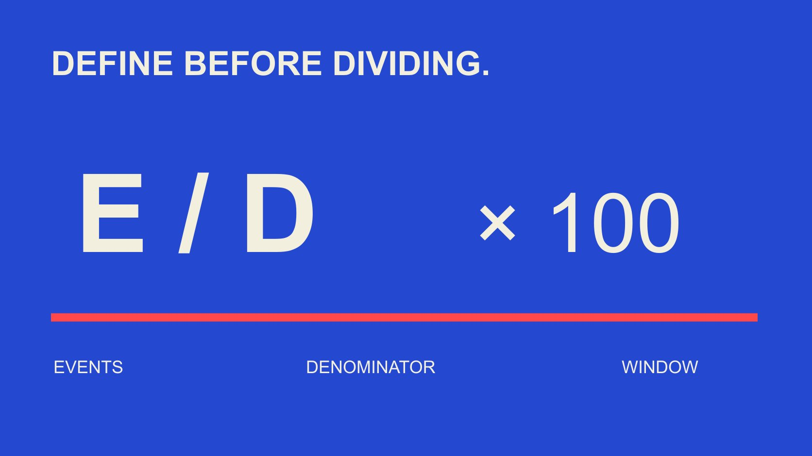

# Engagement Rate Formula: Write the Metric Contract

Status: local review draft; confirm the publication date before release.

When engagement rates move between reports, providers and teams, document actions, object, window, unit and version so an unchanged label does not conceal a changed measure.

QuickKOL editorial graphic; not actual account metrics or a platform interface.

An engagement rate formula needs more than interactions divided by audience. This guide uses the descriptive structure defined interaction events divided by a defined denominator, multiplied by 100 for percentage display. Actions, object, window and aggregation still need an agreement. A metric contract records these fields, source, availability state and version so a report or provider change can be distinguished from performance change. Followers, views, reach and impressions are not interchangeable, and an action-based rate is not automatically the proportion of unique people engaging. The contract is an editorial data specification, not a legal document or a universal platform formula.

## State the question the metric answers

Decide whether the object is one item, an account or a content collection, then state the observation intended. The same displayed percentage can answer different questions. A shared column name does not make measures a valid trend.

A metric contract should contain purpose, object, numerator, denominator, unit, window and aggregation. It lets another person reproduce the arithmetic and identifies unsuitable comparisons. A short formula is difficult to review without these fields.

The [engagement-denominator guide](/blog/engagement-rate-denominators/#answer) helps select a basis for the question. The task here is preserving that selection so a changed product, team or source does not leave an old name carrying a new definition.

For example, this post’s interaction events per view is narrower than audience quality. The first describes a limited observation; the second may imply identity, authenticity, relevance and commercial value far beyond the formula. Accurate naming makes the metric useful without asking it to answer several unrelated research questions.

## The numerator needs an inclusion list

List included and excluded actions and what the source actually supplies. Likes, comments, shares, saves and other actions should not be exchanged between reports merely because all are called engagement. Unavailable is different from observed zero.

The [Rival IQ interaction-events guide](https://help.rivaliq.com/en/articles/4792538-what-is-included-in-engagement-metrics), in January 2025 product documentation, lists different public-channel inclusion, including differences between Instagram and TikTok. It illustrates why a provider definition needs its coverage, not a complete statement of every current native-platform field.

Retain event name, source field, availability conditions and exclusions. If an authorized native source adds an action category, update definition and version before interpreting the additional field as improved performance.

For a multi-action total, explain that it counts events rather than deduplicated people. One person can perform several actions, so a sum cannot establish how many distinct viewers interacted. The reporting label should preserve that distinction even if the interface offers only a short column heading.

## Align denominator, snapshot and window

Specify a follower snapshot, period views, reach or impressions, retaining the source definition. Do not join a numerator and denominator from different windows into an apparently stable ratio. State whether followers refer to publication or observation time.

The [Rival IQ engagement-rate guide](https://help.rivaliq.com/en/articles/2043672-understanding-engagement-rates) distinguishes formulas in its public and private reporting. Its product usage is not a worldwide standard and does not establish that followers equal actual viewers. Return to the fields before comparison.

For several content objects, specify aggregation separately. A mean describing a typical item, an explicitly weighted proportion and an account-period measure are different tasks. An attractive interface should not make them share an unexplained average.

The [creator-data interpretation guide](/blog/read-creator-engagement-data/#answer) puts these measures back into the assignment. A formula should explain whose inputs it uses and when they apply, instead of only displaying a precise decimal. That context becomes especially important when a file moves to someone who did not create the original report.

## A unit error can turn correct division into an incorrect report

A quotient of 0.05 and a display of 5% can represent the same proportion. If a system already supplies a percentage, multiplying by 100 again changes the meaning. Record raw unit and display rule rather than infer units from magnitude.

In this hypothetical, one post has 90 likes and ten comments, totaling 100 events, with 2,000 appropriately defined views. Dividing 100 by 2,000 and multiplying by 100 gives 5%. These are teaching inputs, not an actual post or benchmark.

If 20 shares are also known for the set and a new definition includes them, 120 divided by 2,000 times 100 is 6%. Here the difference from 5% to 6% comes from inclusion, not proof that the content suddenly improved.

Name old and new measures separately and retain applicability. Do not overwrite 5% with 6%, draw a growth line and attribute the change to optimization. Reproducible arithmetic needs an interpretable label as well as correct calculation.

## Preserve zero, missing, invalid and estimated states

Confirmed zero events with a positive denominator can yield 0%. A missing numerator does not automatically become zero. A zero denominator makes the ratio unavailable under this structure; negative or otherwise invalid count inputs return to the source for investigation.

An event-based rate may exceed 100%, depending on the quantities. If a hypothetical 100 unique viewers generate 150 included actions, 150% describes actions per hundred viewers, not 150% of a population. Do not cap it merely for appearance.

If the source labels data estimated, preserve that state in subsequent results. More decimal places do not add precision to rounded inputs. A missing state should not silently become an apparently authoritative numeric output.

The [engagement-calculator guide](/blog/engagement-rate-calculator-formulas/#answer) provides a next arithmetic exercise. Any tool still needs input definitions appropriate to the question. The ability to produce a number does not establish that all proposed comparisons are valid.

## Put platform-definition changes into the version record

The current [YouTube metric-counting guide](https://support.google.com/youtube/answer/2991785?hl=en) states that from August 24, 2026 public views are counted at playback start across formats, while distinguishing related advertising and monetization measures. This is a definition change, not equivalence among similarly named metrics.

For a report spanning such a boundary, check actual comparability. A field still called views does not establish unchanged collection throughout the year. A public-view definition should not replace every paid-ad or earnings denominator.

Record effective time, source explanation, affected field, historical reprocessing status and owner. Keep unspecified historical treatment unknown instead of promising it for the platform.

The same version discipline applies to a provider rename, field update or the team’s changed action set. Explain the boundary so readers know where interpretation may need separate periods, rather than present a definitional jump as a sudden turning point in content quality. The documented change can trigger review even before a numerical difference has been observed.

## Use a handoff sample to compare reports

Choose an authorized, well-scoped example and retain input fields, source state, calculation and display. A screenshot containing only a final percentage should not require a new provider to reconstruct unknown underlying data.

Ask the recipient to explain field mapping, unit conversion, missing handling and aggregation before comparing results. For a discrepancy, inspect definitions instead of first declaring a product more accurate. Agreement also does not establish independent data sources.

The static field template supports that handoff. It does not read platforms, fill missing information or verify actual accounts. The operator supplies applicable evidence, and blank rows are neither zero defaults nor benchmarks.

After confirmation, retain the applicable version and unresolved differences. A colleague should know which future change requires another check. The deliverable is more than a table that happened to produce the expected value on one day; it is an explanation of why that result remains interpretable under the recorded conditions.

For example, two exports might both call a field views while one provides an exact record and the other labels it estimated. Matching column names alone misses the difference. Retain the original flag, explain whether it affects this comparison and return unresolved questions to the source owner. An aggregate report using the same arithmetic should not conceal different levels of certainty in its inputs.

## Keep a short label beside the complete definition

A chart can use a short name if the complete contract is available. A note preserves actions, denominator, window and version, marking estimates or incomparability where needed. Concise design should not remove essential limits.

Where sources offer different measures, show them alongside each other rather than force a common ranking. A brand’s monthly management report and a creator’s single-item observation need not share aggregation.

Separate definition changes and observed performance changes in the narrative. Readers should know whether a difference concerns an added field, content mix or an observation under comparable conditions instead of guessing from an arrow.

Before publication, align title, headers, download and explanation. Updating a formula while leaving an old caption creates technically correct calculation with incorrect communication. The metric owner needs to maintain the current explanation as a whole, including material handed to colleagues who will not inspect the calculation file themselves.

## Use the contract for judgment rather than a universal score

Engagement rate describes behavioral records under particular conditions. Alone, it cannot establish audience authenticity, unique people, trust, sales or causal incrementality. A clear contract assigns the metric an appropriate question rather than enlarging its powers.

When a team discusses selection, another test or an anomaly, bring the contract and actual source. If evidence is insufficient, narrow the conclusion or obtain suitable information instead of switching formulas until the result looks desirable.

A reviewable handoff answers what the inputs are, why the calculation is chosen, when comparison is valid and what remains unknown. Keeping those questions answerable supports brand research and review better than pursuing an unscoped highest engagement rate. It also gives the next operator a basis for correcting a result without reinventing the definition.

## Engagement-rate metric contract

| Field | Specify | Common misreading |

| --- | --- | --- |

| Numerator | Included events and exclusions | All engagement fields are identical |

| Denominator | Object, unit, snapshot/window | Followers equal actual viewers |

| State | Zero, missing, invalid, estimated | Blank automatically means zero |

| Version | Effective time and history treatment | Same name means permanently comparable |

Teaching structure E÷D×100; actions and sets need definition, not a universal native-platform formula.

## Metric handoff checks

The download is a blank field template with no automatic platform connection.

- [ ] Document purpose, object and fields.

- [ ] Align raw unit and display.

- [ ] Do not silently convert states to zero.

- [ ] Version definition changes.

- [ ] Reproduce the sample from the same inputs.

- [ ] Connect the short label to the full definition.

[Download Chinese metric-contract CSV](/downloads/engagement-metric-contract.zh.csv)

[Download English metric-contract CSV](/downloads/engagement-metric-contract.en.csv)

## Research date and limitations

Sources reviewed November 3, 2026. Methods, tables and decision rules are editorial recommendations. Hypothetical examples are not actual client results or industry benchmarks. Source geography and periods are specified where relevant. This draft is in independent local review; confirm its publication date before release.

## Sources

- [Rival IQ interaction-events guide](https://help.rivaliq.com/en/articles/4792538-what-is-included-in-engagement-metrics)

- [Rival IQ engagement-rate guide](https://help.rivaliq.com/en/articles/2043672-understanding-engagement-rates)

- [YouTube metric-counting guide](https://support.google.com/youtube/answer/2991785?hl=en)
