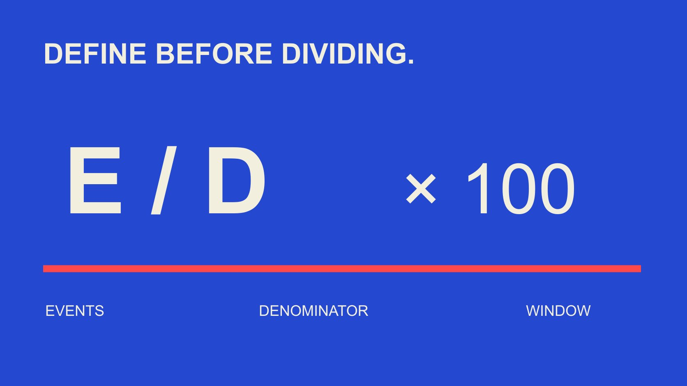

# 互动率公式：先写指标约定，再接报表

状态：本地审阅稿；正式发布日期待确认。

在报表、供应商和团队之间交接互动率时，写清公式的动作、对象、窗口、单位和版本，让同名指标不再偷偷改变含义。

QuickKOL 编辑图形；不呈现真实账号指标或平台界面。

互动率公式不能只有“互动除以受众”几个字。本篇采用的描述性结构为：已定义互动事件数除以已定义分母，再乘100，显示为百分比；具体动作、对象、窗口和汇总方法需要另行约定。将它写成指标约定，记录来源、可用状态和版本，才能在换报表或换供应商时知道变化来自表现还是定义。粉丝、观看、触达和展示不可自动互换；动作率也不等于互动的独立人数比例。

## 先写指标回答的具体问题

先决定准备描述单条内容、某个账号还是一个内容集合，再说明想观察什么。不同对象即使显示同一个百分比，也可能回答不同问题；不能仅因报表列名相同就把它们连成趋势。

指标约定至少应包含目的、对象、分子、分母、单位、窗口和汇总方式。它让接手的人知道怎样复算，也说明哪些比较不适用。没有这些字段，公式再简短也难以审核。

[互动率分母指南](/zh/blog/engagement-rate-denominators/#answer)可帮助选择适合问题的基础。这里的重点是把选择保存下来，防止产品、团队或数据源变化后，旧名称继续承载一个新定义。

例如“此帖按观看的互动事件率”比“受众质量”更准确。前者说明有限观察，后者可能暗示身份、真实性、相关性与商业价值，远超一个公式能够建立的范围。

## 公式的分子需要一份计入清单

写出哪些动作计入、哪些不计入，以及来源能提供什么。点赞、评论、分享、保存或其他动作不应仅因为都叫互动，就在不同报告中随意替换。某项不可见与实际为零不同。

[Rival IQ互动事件说明](https://help.rivaliq.com/en/articles/4792538-what-is-included-in-engagement-metrics)在2025年1月的产品文档中列出不同公开渠道的计入方式，例如Instagram与TikTok并不使用完全相同的动作集合。这说明供应商定义需要连同覆盖范围阅读，不是今天所有原生平台数据的完整清单。

指标约定应保留事件名称、来源字段、可用条件和排除规则。若换成获授权原生资料后多出某类动作，先更新定义和版本，不能让新增字段被解释为表现自然提高。

对多动作合计，说明它是事件数，不是去重人数。一个人可能做多种动作；不能从一次相加推导有多少不同观众与内容互动。

## 分母、快照和窗口必须对得上

明确分母是某次粉丝快照、指定期间观看、触达或展示，并保留来源定义。不要把不同期间的分子与分母拼成一个看似稳定的比率。使用发布时还是观察时粉丝，也需要说明。

[Rival IQ互动率说明](https://help.rivaliq.com/en/articles/2043672-understanding-engagement-rates)区分其公开与私有资料中的不同公式。该供应商用法不是全球标准，也不证明粉丝数等于实际看见内容的人数。比较前需要回到具体字段。

如果报表跨越多个内容对象，另外写汇总规则。典型内容的均值、按明确权重汇总的比例与账号期间指标不是同一件事，不要为了整齐界面共用一个没有说明的平均值。

[创作者数据阅读指南](/zh/blog/read-creator-engagement-data/#answer)帮助把这些数字放回任务语境。公式应能解释输入属于谁、覆盖什么时候，而不是只显示一个足够精确的小数。

## 单位错误可以让正确除法变成错误报告

除法结果0.05与显示5%可以表示同一比率；如果一个系统已经提供百分数，导入后再次乘100就会改变意义。记录原始单位与显示规则，不从数值大小猜单位。

本篇假设一个帖子有90次点赞与10次评论，合计100次事件，配同口径2,000次观看，则100除以2,000乘100为5%。这些是教学输入，不是实际帖子或平台基准。

如果同一已知集合另有20次分享，并且新定义决定纳入，结果为120除以2,000乘100，即6%。从5%到6%的差别在此来自事件集合改变，不证明内容突然更好。

将旧、新指标分别命名并记录适用时间。不要把新的6%覆盖旧的5%后画成增长线，再声称优化导致了提升。可复算的数字需要可解释的标签。

## 保留零、缺失、无效与估计的区别

已确认零次事件与正分母可以得到0%；缺失分子不能自动算作零。分母为零时，该结构下的比率不可计算；负数或不符合计数定义的输入应交回来源核对。

事件率也可能超过100%，取决于分子与分母。假设100名独立观看者产生150次计入动作，150%描述的是每百名观看者的动作数，不是150%的人口。不要为了界面好看硬截断。

如果平台数据标为估计，后续结果也需要保留估计状态。输入经过取整时，显示更多小数不会增加真实精度。不能把缺失状态静默转换成一个看似可信的高精度结果。

[互动率计算工具指南](/zh/blog/engagement-rate-calculator-formulas/#answer)提供下一步算术练习。使用任何工具前，仍需确认其输入定义适合当前问题，不能因为计算器能输出一个数就视为所有比较已经成立。

## 平台定义变化要进入指标版本

[YouTube指标计数说明](https://support.google.com/youtube/answer/2991785?hl=en)当前页面注明，自2026年8月24日起，公共观看在各形式开始播放时计数，并另行区分相关广告与获利指标。这里引用的是定义变化，不把所有名称相近指标视为同一事件。

报表跨过这种时间点时，应核对实际资料是否可比。不能只因为字段仍叫views，就假设全年趋势一直用相同记录方式；也不能把公共观看定义替换成所有付费或获利计算的分母。

指标约定记录生效时间、来源说明、受影响字段、历史是否重算和负责人。来源未说明的历史处理保留未知，不替平台作承诺。

这种版本管理也适用于供应商更名、字段更新或团队自行调整计入动作。清楚变化点，让读者知道什么时候应该分段阅读，而不是把定义跳变当成内容表现的突然转折。

## 用一份交接样例核对新旧报表

选择一个有权使用、范围清楚的样例，分别保留输入字段、来源状态、计算和显示。不要用只有最终百分比的截图要求新供应商复现不知道的底层数据。

让接收方说明字段映射、单位转换、缺失处理和汇总方法，再比较结果。若不同，逐项检查定义，不先宣布哪个产品更准确。相同结果也不证明数据来源独立。

静态字段模板可用于这种交接；它不会自动读取平台、补齐缺失或验证实际账号。填写人需要按项目资料提供依据，模板中的空行不是零值默认或行业基准。

确认完成后，保留适用版本与尚未解决的差异。报告应让同事知道以后改了什么需要重新核对，而不是只有一张在某天算对的表。

例如两个导出都把字段命名为views，但一份是精确记录，另一份标为估计。只匹配列名会漏掉状态差别。接收方应保留原始标记，说明该差别是否影响当前比较，并将未解决问题交回来源负责人。这样汇总报告即使采用同样的公式，仍然不会隐去输入的不同确定程度。

## 在报告里同时保留短名与完整定义

图表可以使用短名称，但应能找到完整指标约定。脚注说明动作、分母、窗口与版本，必要时标记不可比或估计，不让简洁设计抹掉关键限制。

如果多个来源只提供不同范围的指标，可以并排展示，不强行合成统一排名。一个品牌的月度管理报告与一个创作者单帖观察也不必使用相同的汇总方式。

把定义变更与实际结果变化在叙述中分开。读者应该知道本月差别来自新增字段、内容组合还是可比较条件下的观察，而不是根据一个箭头猜原因。

最终发布前核对标题、表头、下载和解释是否一致。只更新公式文件而留下旧图注，会让技术正确却交流错误；指标负责人需要负责整套说明的当前状态。

## 让指标约定服务判断，而非变成万能评分

互动率可以描述特定条件下的行为记录，不能单独确认受众真实性、独立人数、信任、销售或因果增量。把它写清楚不是扩大能力，而是让它承担恰当的问题。

当合作团队讨论选择、继续测试或解释异常时，带上指标约定和实际来源。若证据不足，缩小结论或寻找合适资料，不通过更换公式让结果看起来符合期待。

一个可复查的交接应回答：输入是什么，为什么这样计算，何时能比较，什么仍未知。保持这些问题可回答，比争取一个没有范围的最高互动率更适合品牌研究和项目复盘。

## 互动率指标约定

| 字段 | 必须说明 | 常见误读 |

| --- | --- | --- |

| 分子 | 计入事件与排除项 | 所有来源的互动都相同 |

| 分母 | 对象、单位与快照/窗口 | 粉丝等于实际观看者 |

| 状态 | 零、缺失、无效与估计 | 空白自动为零 |

| 版本 | 生效时间与历史处理 | 同名字段永久可比 |

本篇教学结构为E÷D×100；具体动作和集合需定义，不是所有平台通用的原生公式。

## 指标交接核对

下载为空白字段模板，不含自动平台连接。

- [ ] 用途、对象与字段完整。

- [ ] 原始单位和显示规则一致。

- [ ] 数据状态没有静默转零。

- [ ] 定义变化保留版本。

- [ ] 样例可按相同输入复算。

- [ ] 报告短名能找到完整说明。

[下载中文指标约定CSV](/downloads/engagement-metric-contract.zh.csv)

[下载英文指标约定CSV](/downloads/engagement-metric-contract.en.csv)

## 研究日期与使用边界

资料核验于 2026 年 11 月 3 日。文中方法、表格和决策规则为编辑建议，标为假设的示例不是实际客户结果或行业基准。外部资料的适用地区与时期按各段说明；本稿处于独立本地审阅阶段，正式发布日期待确认。

## 来源

- [Rival IQ互动事件说明](https://help.rivaliq.com/en/articles/4792538-what-is-included-in-engagement-metrics)

- [Rival IQ互动率说明](https://help.rivaliq.com/en/articles/2043672-understanding-engagement-rates)

- [YouTube指标计数说明](https://support.google.com/youtube/answer/2991785?hl=en)
