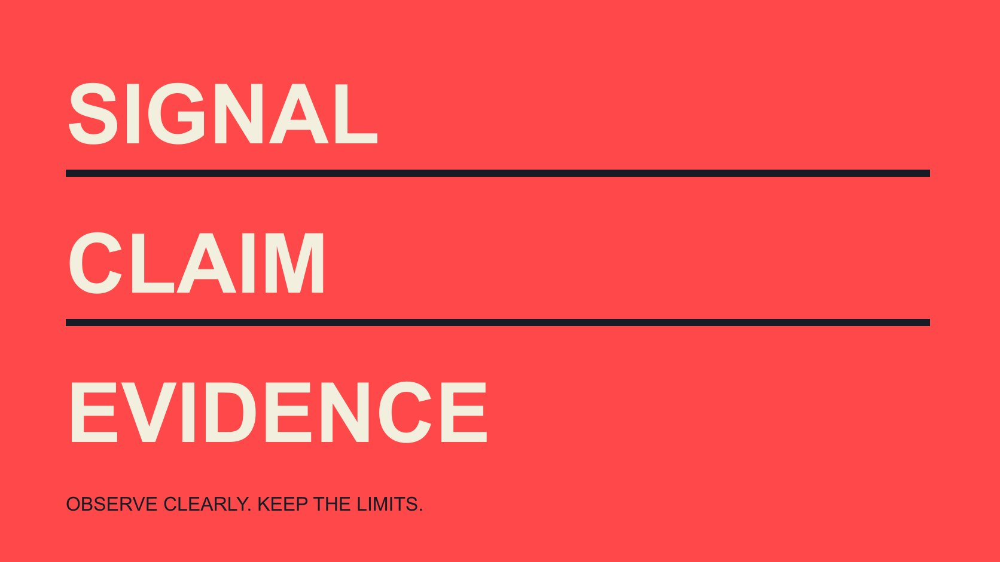

# Fake Instagram Followers: Separate Signals From Claims

Status: local review draft; confirm the publication date before release.

An educational guide to fake-Instagram-follower claims: distinguish public metrics, suspected flags and established conduct, check sources and preserve uncertainty in reports and corrections.

QuickKOL editorial graphic; not actual account metrics or a platform interface.

Claims about fake Instagram followers need three distinct layers: visible counts or interactions, suspected classifications from platforms or tools, and specific facts supported by sufficient evidence. Low interaction, rapid growth, repeated comments or an account’s appearance cannot independently establish that someone purchased followers or deliberately misled anyone. This educational guide helps brand teams learn source checks, evidence limits and responsible wording. It supplies no individual list, authenticity score, screening service or promise of complete identification. Understanding risk does not require turning unknowns into accusations. A clearer report states what was observed, how it might be interpreted and what remains unresolved.

## Separate the different claims hidden inside fake

A report may use fake for suspected platform spam, a model classification, inactivity, duplicate accounts or a particular established form of false indicator. Without definitions, different objects can collapse into the same accusation.

Start with the source’s actual label, provider and explanation rather than convert vendor terminology directly into a fact about personal conduct. If no method description is available, preserve the missing definition instead of supplying a certain meaning yourself.

Clarify that the article concerns interpretation of information, not who belongs on a list. Educational material can explain the risk of fabricated social proof without using appearance, language or one percentage as a substitute for evidence.

A citable sentence retains scope: the source assigned a suspected classification for the specified window, with method and coverage described separately. That is more accurate than removing qualifications and writing proven fake followers. It also gives the next reader a concrete question to check rather than an emotionally strong conclusion that cannot be traced to the underlying observation.

## Public interactions are not unique people

The [Rival IQ interaction-events guide](https://help.rivaliq.com/en/articles/4792538-what-is-included-in-engagement-metrics) describes its provider definitions, including likes and comments for public Instagram engagement. This explains a tool’s organization of visible events; it does not establish that every current native-platform interaction consists only of those fields.

An action and a person are different units. One person can perform different actions, and followers are not necessarily the actual viewers of every item. Dividing visible interactions by followers does not produce the proportion of real followers.

The [Instagram metric explanation](/blog/instagram-analytics-format-decision-matrix/#answer) helps distinguish formats and measurement purposes. Before comparing reports, check object, window and access rather than treat authorized account metrics and public fields as the same complete dataset.

Mark unavailable fields unknown instead of zero. A source’s inability to observe an interaction does not establish its absence or the absence of real audience members. Keeping the field definition visible prevents a technically correct arithmetic result from acquiring an unsupported meaning about identity, authenticity or intention once it moves into a management slide.

## Interpret a platform’s suspected flag on its own terms

The [Meta spam-interaction tools announcement](https://about.fb.com/ltam/news/2023/12/protegiendo-a-los-creadores-de-interacciones-no-deseadas-con-nuevas-herramientas-proactivas-de-seguridad/), published in 2023 with a 2024 update marker, describes a review area for suspected spam or bot followers and a route to approve accounts considered not to be spam. The mechanism includes review rather than providing a public verdict about personal misconduct.

This citation establishes the published background, not identical access for every account now. It does not support an exact current-menu walkthrough without checking the relevant interface.

Flagged for review should not be shortened to confirmed purchase. A flag concerns a system classification; purchase concerns conduct; knowledge concerns another factual question. Combining them skips necessary links in the evidence chain.

Likewise, absence of a flag does not establish that no issue exists. An educational explanation retains limits in both directions. It should neither present a perfect detector nor ignore genuinely observable information because uncertainty exists. The practical result is a more accurate description of the flag, including its provider, scope and date, without extending it into a personal allegation.

## Use arithmetic to understand denominator changes

Suppose two teaching records use the same action definition and each contains 500 interactions, with follower denominators of 20,000 and 25,000. The descriptive rate changes from 2.5% to 2%, a decrease of 0.5 percentage points. These are hypothetical records, not accounts or benchmarks.

The example shows that a rate can change with its denominator. It does not identify where 5,000 additional follows came from or classify them all as fake. Different windows, content mixes or fields would introduce further comparability questions.

The [engagement-rate metric contract](/blog/engagement-rate-formula-metric-contract/#answer) preserves actions, denominator, unit and version. Check comparability before asking why a change occurred. Falling below an internally chosen threshold should not produce a precise estimate of an unknown proportion.

A growth chart has similar limits. Net movement does not fully explain gross additions, departures, platform moderation, recording errors or other causes. List possible explanations as questions to check rather than describe one of them as an established event. Arithmetic can explain a chart without resolving the identity or motivation behind it.

## Cross-check sources rather than average two scores

When reading two reports, inspect original inputs, observation time, coverage and model definition. Two tools relying on the same public material do not automatically provide two independent pieces of evidence.

If scores differ, first ask whether objects and definitions match. Preserve disagreement when that cannot be established. Do not average one tool’s percentage with another’s category to create a supposedly more objective result.

Label model outputs as estimates or classifications and state missing fields. Even a promotional accuracy claim needs a test population and method to be interpreted. This article has performed no accuracy experiment and provides no detection ranking.

An educational report can say that one source uses a particular label while another uses a different definition and the available information cannot align them. That preserves reviewable facts without resolving disagreement by deciding someone must be at fault. The value of cross-checking is to understand whether evidence converges under comparable conditions, not simply to increase the number of logos shown beside an unsupported conclusion.

## Comments and account appearance do not represent an entire audience

A few repeated comments can support a description of textual similarity without automatically establishing a common source, automation or direction by the account owner. An observed example and a population proportion require different information.

Comment language, avatar, limited posting or inactivity cannot independently establish authenticity. People may choose limited public visibility or communicate in different languages; appearance that differs from expectations is not a sufficient basis for a definitive negative classification.

Educational examples should be fictional or appropriately de-identified and labeled for their purpose. Avoid publishing ordinary users’ names, avatars or unrelated information to make an allegation feel stronger. Screenshots need necessary context without unnecessary exposure.

When describing a sample, explain selection, size and omissions. A convenience sample supports observations within that scope, not a precise estimate for the entire follower population. This is a reporting principle, not an instruction to inspect more private profiles until a preferred conclusion appears. Sometimes the responsible conclusion is that the available sample cannot answer the question.

## Do not derive a regulatory finding from an unusual chart

The [FTC fake-indicator FAQ](https://www.ftc.gov/business-guidance/resources/consumer-reviews-testimonials-rule-questions-answers) explains a US provision concerning particular conduct and conditions, including distribution or purchase, while distinguishing real people choosing to follow. Here it explains why specific facts matter; it supplies no finding about an individual’s liability.

Suspected followers being present does not automatically establish purchase or knowledge by an account owner. A report using fake does not establish every element of a regulatory definition. Keep a source label separate from a legal conclusion.

Brand education can emphasize avoiding fabricated social proof while routing particular concerns through appropriate channels and authorized people. A public article should not encourage harassment or demand private identity documents from ordinary users.

Regulatory material helps explain concepts without officially validating this guide’s teaching arithmetic, a tool estimate or personal speculation. State geography and the limited purpose beside the citation. This prevents a regulatory link from making an educational discussion appear to be an official investigation or an independently confirmed accusation.

## Rewrite an unsupported conclusion into a reviewable statement

Replace 20% are definitely fake with a statement that the source estimates 20% within its stated classification and window, with method, sample and limits explained—only if the source actually provides that value. Here 20% is a wording exercise, not observed research.

If method or denominator is unavailable, adding possibly is not enough to preserve a precise percentage. State the verification limit, remove unsupported precision and retain what can actually be observed.

During correction, check heading, summary, table, caption and sharing copy together. Mark previously distributed versions as replaced so the stronger old conclusion does not continue through screenshots.

The [historical audience-evidence guide](/blog/web3-instagram-follower-quality-2024-evidence-literacy/#answer) explains timing and provenance further. Newly acquired evidence may support an update without pretending that an originally unsupported claim was already proven at the time. A correction should identify what changed and which uncertainties remain, giving readers a usable account of the evidence rather than an unexplained edit that leaves the original inference intact.

## Deliver data literacy rather than an individual verdict

The final learning record retains object, source, window, observation, interpretation and unknowns. It helps a team recognize inferential gaps in a report rather than attach an authenticity label to a person.

The [campaign-measurement guide](/blog/creator-campaign-measurement/#answer) further distinguishes counts, audience response and outcomes. A single metric cannot replace the actual question, and this article does not turn education into an entry point for creator screening or discovery services.

Readers should leave with three habits: understand the metric, cross-check the evidence and express conclusions at the supported strength. Explicit unknowns and correction paths make follower-quality discussions more citable, fair and reviewable.

## Educational distinctions between signals and claims

| Material | Supported wording | Unsupported leap |

| --- | --- | --- |

| Growth or interaction change | A difference was observed within scope | Someone purchased or directed it |

| Platform review flag | The system flagged a suspected state | Personal fraud is established |

| Model classification | An estimate or label under that method | An official platform accuracy guarantee |

| Limited examples | Description within the sample | Exact authenticity share of the whole audience |

Educational framework, not a detector, individual score or list. The 500/20,000 and 500/25,000 calculations are hypothetical.

## Before publishing a follower-quality claim

Match the strength of wording to the evidence.

- [ ] Separate labels, observations and facts.

- [ ] Do not turn interaction events into real-person counts.

- [ ] Retain suspected states and model limits.

- [ ] Check independence across sources.

- [ ] Do not extrapolate a complete share from examples.

- [ ] Correct every visible expression of the claim.

## Research date and limitations

Sources reviewed November 3, 2026. Methods, tables and decision rules are editorial recommendations. Hypothetical examples are not actual client results or industry benchmarks. Source geography and periods are specified where relevant. This draft is in independent local review; confirm its publication date before release.

## Sources

- [Rival IQ interaction-events guide](https://help.rivaliq.com/en/articles/4792538-what-is-included-in-engagement-metrics)

- [Meta spam-interaction tools announcement](https://about.fb.com/ltam/news/2023/12/protegiendo-a-los-creadores-de-interacciones-no-deseadas-con-nuevas-herramientas-proactivas-de-seguridad/)

- [FTC fake-indicator FAQ](https://www.ftc.gov/business-guidance/resources/consumer-reviews-testimonials-rule-questions-answers)
