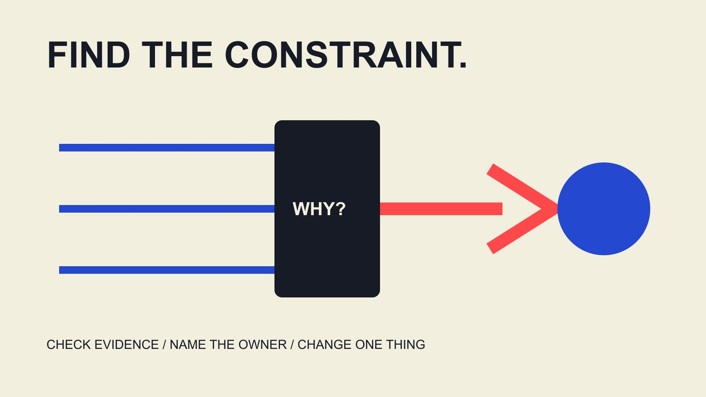

# How to Optimize Influencer Campaigns: Diagnose the Bottleneck

Status: local review draft; confirm the publication date before release.

During an influencer campaign, use evidence, bottlenecks and controllable conditions to choose the next change without mistaking simultaneous changes for a proven improvement.

QuickKOL editorial graphic; not actual account metrics or a platform interface.

To optimize influencer campaigns, identify what is limiting the current objective before choosing a change. Check data comparability, whether the content is accurate and understandable, distribution conditions and the task after arrival. Design an explainable adjustment around one main question, retaining owner, version, cost, observation window and stopping conditions. More views, a higher engagement rate or a larger reported amount cannot alone establish business improvement. This guide concerns diagnosis during execution rather than a guaranteed uplift percentage. A useful optimization decision explains why this change addresses the observed problem and what evidence would make the team keep, revise or abandon it.

## Name the result currently being constrained

Write the objective as a task the audience should be able to perform: understand installation conditions, make a useful inquiry, locate store information or complete another appropriate next step. Do not redefine the entire campaign around whichever metric looks disappointing today.

The [AMEC evaluation framework](https://amecorg.com/amecframework/) separates activity and outputs from audience response, outcomes and impact. It supplies an evaluation structure rather than project result data. Place available observations at the appropriate level instead of calling every percentage effectiveness.

Delivered video is an execution state. A specific audience question is limited feedback. A useful inquiry requires its own definition. All may matter without substituting for each other. The [campaign-measurement guide](/blog/creator-campaign-measurement/#answer) helps preserve those relationships. If the objective remains unclear, repair it before changing assets. Otherwise a team can become very efficient at improving a number that does not resolve the audience’s problem or support the decision the organization originally wanted to make.

## Verify the record before interpreting performance

Ask whether the objects, windows, sources and definitions being compared align. Organic post views, paid impressions, website visits and useful inquiries belong to different stages. Sharing a spreadsheet does not give them identical audiences or a complete identity connection.

The [engagement-denominator guide](/blog/engagement-rate-denominators/#answer) explains why follower-, view- and reach-based percentages cannot simply be exchanged. If a definition, export filter or data connection changed, record that first. Missing data remains missing rather than becoming zero for convenient arithmetic.

Separate observed facts from explanations needing verification. A decline may involve behavior, definition, period or coverage. Complete the checks you can substantiate before changing content. Otherwise rapid intervention makes the original problem harder to reconstruct. Where access is limited, ask the authorized owner for an appropriately scoped record instead of assuming an unavailable field supports the desired explanation. A diagnosis can remain incomplete without becoming useless, provided its limitations are visible.

## Locate the issue across content, distribution and destination

At the content layer, ask whether people can understand the question, steps and next action. At distribution, inspect the actual conditions. At destination, ask whether the page or event can fulfill the promised task. This is an editorial diagnostic framework, not a validated universal industry funnel.

If comments repeatedly ask about one basic condition, investigate a missing explanation. Comment volume alone does not establish popularity. If the destination presents different conditions after a click, check continuity before demanding a stronger recommendation from the creator.

Technical failure, unavailable products or an incorrect address need their appropriate owner. They may justify pausing a particular distribution before an attractive performance report exists. Optimization does not mean everyone reshoots. It means the relevant person repairs the relevant issue. Document how the proposed repair connects to the observation, so a later review can distinguish a necessary operational correction from an experiment intended to learn about audience response.

## Separate controllable adjustments from fixed conditions

List what can still change in this round: explanations in later assets, a brand-owned destination, support information, scheduling or appropriately authorized ad settings. Confirm whether published work can change and whether additional production and compensation are needed under the actual arrangement.

The [collaboration workflow guide](/blog/collaborate-with-influencers-brand-workflow/#answer) helps route work to the right role. Creator, product specialist, destination owner and paid-media operator have different capabilities and permissions. An instruction to optimize should not silently expand anyone’s commitment.

For fixed conditions such as an ended event, weather or a historical window, narrow the question or revise future planning. Do not rewrite earlier conditions to make results appear better. A bounded revision with an owner and resources is easier to execute and interpret than an unowned full restart. Keeping constraints visible also prevents a team from blaming a collaborator for a condition that was never theirs to control.

## Write a change as a hypothesis that can be challenged

The [Google experiment guide](https://support.google.com/google-ads/answer/7281575?hl=en) recommends a clear hypothesis, preselected metrics and avoiding simultaneous variable changes. It concerns Google Ads; ordinary organic creator posts do not thereby become randomized experiments. The transferable principle is designing a clear question.

An editorial formulation is: we think this obstacle contributes to this result, so we will change this component and observe these records. State what would weaken the interpretation too. A hypothesis that calls every possible outcome success cannot support a decision.

Preserve other relevant conditions where feasible and record differences where that is impossible. If creator, window and distribution all change, the result can identify a next question without proving one cause. Stronger causal interpretation requires an appropriate design and relevant expertise, not merely filenames labeled A and B. A repair can still be worthwhile when it improves factual clarity, even if the team cannot attribute a later performance difference entirely to that repair.

## A hypothetical case: the constraint may follow arrival

This fictional teaching case is neither a client result nor a benchmark. Under one definition, an owned destination records 1,000 sessions, 100 form starts and 20 completions. Starts are 10% of sessions, completions are 20% of starts and completions are 2% of sessions. These relationships do not automatically explain abandonment.

The team first inspects field errors, unclear conditions or mobile problems and asks the appropriate owner to verify them. Suppose necessary eligibility information is absent. Repairing that explanation may be appropriate; demanding that a creator promise every viewer qualifies is not.

Suppose the next window also has 1,000 sessions and 100 starts but 40 completions. Completions are now 4% of sessions and 40% of starts. Timing consistent with the revision still does not prove it caused the entire change; audience and other conditions require records. The exercise teaches diagnostic order rather than forecasting a doubling in performance. It also shows why the same completion count can be interpreted differently depending on the denominator selected for the question.

## Include cost and delivery constraints in the decision

The [Google ROI guide](https://support.google.com/google-ads/answer/1722066?hl=en) relates return to profit, costs and the specific objective rather than revenue alone. For a creator campaign, the appropriate owner should likewise define the cost scope. More views or orders do not automatically justify additional production.

Compare possible next actions: repair brand information, add an explanation, adjust permitted distribution, continue observing or stop one work item. Record additional expense, time, dependencies and possible learning. Optimization does not always require more content.

If product availability is the constraint, added exposure may not solve it. If evidence is inadequate, better records may be more useful first. Preserve these alternatives in budget discussions. This guide supplies neither a universal profitability formula nor a payback promise. Project owners make the relevant operational and financial judgment from applicable data, including work retained internally rather than only the new supplier invoice.

## Set review conditions for continuing, changing and stopping

Before execution, agree when to review, which records matter and what requires an earlier pause. There is no single day count or sample threshold for every project. Match the window to content, objective and available evidence with appropriate review.

Separate factual corrections or unsupported claims from performance comparisons. Information needing correction should not continue circulating merely to preserve an experiment. Conversely, one small-sample fluctuation should not automatically trigger a complete reshoot.

At the review point, read new observations beside the original hypothesis. Continuing appropriate observation or narrowing the conclusion can be reasonable when uncertainty remains. Explicitly stating that the team cannot yet decide is more useful than switching to a flattering metric. It prevents the next round repeating the same ambiguous work without a clearer question, and makes a pause an explainable management decision rather than an admission invented from incomplete results.

Consider another hypothetical: an event guide gives the wrong entrance, and the venue owner supplies verified information. Correct the material and update applicable locations under the actual arrangement rather than preserve an error to compare visit counts. Record correction time and coverage. Later audience questions may be examined, but necessary correction remains separate from a performance experiment. This lets a team address an established problem promptly without assigning every later change to the intervention.

## Make the optimization log an input to the next brief

Retain observation, explanation, decision, owner, asset or destination version, applicable time and result limitations. Optimized is not an adequate record. A new colleague should understand what changed, why and which questions remain unresolved.

If a change affects creator work or agreed conditions, communicate a clear update. The appropriate owner verifies content facts, while technical and commercial conditions receive their own confirmation. One updated document should not masquerade as every necessary approval.

For the next round, QuickKOL can help interpret a more specific brief, discover relevant work and prepare outreach. Original audience evidence, commercial conditions and outcomes still need verification. Good optimization does not promise that every round wins. It makes decisions more consistent with the evidence, resources and actual audience task, while retaining enough information to revise the next decision when better evidence appears.

## Campaign bottlenecks and appropriate next actions

| Observation layer | Check first | Possible next action |

| --- | --- | --- |

| Record | Definition, window, coverage | Repair the record before creative changes |

| Content understanding | Facts, steps, questions | Add a reliable explanation |

| Distribution | Permission, conditions, configuration | Appropriate authorized adjustment |

| Destination task | Continuity, availability, errors | Route to destination or operation owner |

An editorial diagnostic framework; worked numbers are hypothetical, not uplift benchmarks.

## Next optimization decision

Make the decision explainable before making the change.

- [ ] Name the objective and audience task.

- [ ] Separate observation and explanation.

- [ ] Connect the constraint to a controllable change.

- [ ] Record owner, version and cost.

- [ ] Agree review and stopping conditions.

- [ ] Carry limitations into the next brief.

## Research date and limitations

Sources reviewed November 3, 2026. Methods, tables and decision rules are editorial recommendations. Hypothetical examples are not actual client results or industry benchmarks. Source geography and periods are specified where relevant. This draft is in independent local review; confirm its publication date before release.

## Sources

- [AMEC evaluation framework](https://amecorg.com/amecframework/)

- [Google experiment guide](https://support.google.com/google-ads/answer/7281575?hl=en)

- [Google ROI guide](https://support.google.com/google-ads/answer/1722066?hl=en)
