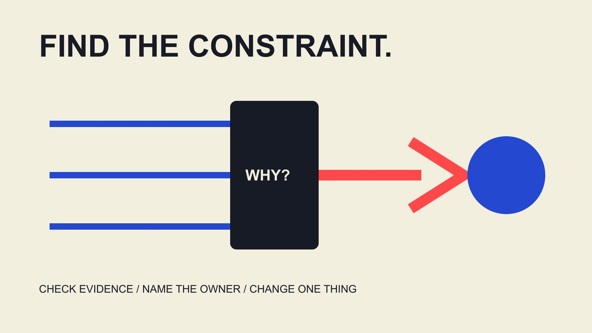

# 达人活动优化：先找瓶颈，再决定改什么

状态：本地审阅稿；正式发布日期待确认。

在达人活动进行中，按证据、瓶颈和可控条件决定下一次调整，避免把同时改变多个环节误认成优化成功。

QuickKOL 编辑图形；不呈现真实账号指标或平台界面。

优化达人活动，应先确认哪里限制了当前目标，再决定能改变什么。核对数据是否可比、内容是否准确且容易理解、分发是否合适，以及落地后的任务是否能完成。一次只围绕一个主要问题设计可解释的调整，保留负责人、版本、成本、观察窗口和停止条件。观看变多、互动率变高或报表金额变大，都不能单独证明业务改善。本篇处理活动进行中的诊断与调整，不提供必然提升的百分比。

## 先确定目前真正受限的结果

把目标写成受众准备完成的任务：理解安装条件、获得有用咨询、找到门店信息，或完成适合项目的下一步。不要在看见某项指标不理想后，临时把该指标改成整场活动的目的。

[AMEC评估框架](https://amecorg.com/amecframework/)区分活动产出、受众反应与更进一步的结果和影响。它提供评估结构，不会替项目生成结果数据。因此先把可见记录放到合适层级，而不是把所有百分比都称为效果。

例如视频已经交付是执行状态，观众提出具体问题是有限反馈，合适咨询则需要自己的定义。三者都可能重要，但不能互相补位。[活动衡量指南](/zh/blog/creator-campaign-measurement/#answer)可帮助保留这种对应关系；若目标本身仍不明确，先修目标再改素材。

## 确认记录可靠，再解释表现

先问比较的对象、窗口、来源和定义是否一致。单帖自然观看、付费展示、网站访问和有效咨询来自不同环节，不能因为出现在同一张表里就拥有相同受众或完整连接关系。

[互动率分母指南](/zh/blog/engagement-rate-denominators/#answer)解释为什么按粉丝、观看或触达计算的百分比不能直接互换。若定义、导出过滤或数据连接刚变过，先记录这项变化。缺失数据保留缺失，不能为了让报表可计算就填零。

把诊断分成两列：已观察事实与需要核对的解释。一个下降可能来自真实行为变化，也可能来自口径、期间或记录覆盖。先完成能够确认的检查，再决定是否有必要修改内容；否则改得越快，原本的问题越难复原。

## 按内容、分发和到达后任务定位瓶颈

内容层问受众能否理解问题、步骤与下一步，分发层问实际面对哪些条件，到达后层问页面或活动是否能完成承诺的任务。这个顺序是编辑诊断框架，不是已经验证的行业统一漏斗。

如果评论反复询问同一个基础条件，可以检查解释是否缺失；不能只靠评论量宣布内容更受欢迎。如果点击后页面展示不同条件，则先检查信息连续性，不要立刻要求创作者加重推荐语气。

技术故障、商品不可用或错误地址需要相应负责人处理。它们可能足以决定先暂停某项传播，而不必等待漂亮的效果报告。优化不是所有人都重新拍摄，而是让最相关的负责人修最相关的问题。

## 把可控调整与无法改变的条件分开

列出本轮还允许改变什么：后续素材解释、品牌自有页面、客服资料、排期，或已经获得适当许可的广告设置。已经发布的作品能否更改、是否需要新制作与费用，按实际安排确认。

[合作执行指南](/zh/blog/collaborate-with-influencers-brand-workflow/#answer)帮助把工作交给适当角色。创作者、品牌产品人员、页面负责人和付费投放人员拥有不同能力与权限；不要让一句“优化一下”自动扩大任何人的承诺。

对无法改变的情境，例如活动结束、天气或历史观察窗口，可以缩小问题或调整后续计划。不能为了让结果变好而改写过去发生的条件。一个小范围、可承担的修订，往往比没有负责人和资源的全面重做更容易执行与解释。

## 把一次变化写成可以反驳的假设

[Google实验指南](https://support.google.com/google-ads/answer/7281575?hl=en)强调清楚假设、预先选择指标及避免同时改变多个变量；该指南针对Google Ads，并不说明普通达人自然发布已经成为随机实验。这里借用的是清楚设计问题的原则。

编辑建议的表达是：“我们认为某个障碍导致某种结果，因此准备修改这一部分，并观察这些记录。”同时写什么结果会使解释不成立。若无论发生什么都要宣称成功，假设就无法帮助决定。

尽可能保留其他相关条件，无法保留时明确记录。不同创作者、窗口和分发同时变化，结果可以帮助找下一问题，却不能直接证明唯一原因。要提高因果判断强度，需要适合项目的设计与相应专业审阅，不是只把文件名改成A/B。

## 一个假设案例：问题可能在表单之后

以下为虚构教学案例，不是客户结果或行业基准。一个自有页面在同一记录口径下有1,000次会话、100次表单开始和20次完成。开始占会话10%，完成占开始20%，完成占会话2%。这些数值描述事件关系，不自动证明未完成的原因。

团队先查看是否存在字段报错、条件说明不清或移动端问题，再请适当负责人核对。假设发现页面缺少必要资格说明，可以修说明；不能直接要求创作者承诺每位观众都会符合资格。

再假设下一观察窗口仍有1,000次会话和100次开始，但有40次完成，则完成占会话4%、占开始40%。变化与修订时间相符仍不证明全部由修订造成，受众和其他条件也需要记录。这个练习用于学习诊断顺序，而不是预测翻倍效果。

## 把成本和交付约束带入决定

[Google ROI说明](https://support.google.com/google-ads/answer/1722066?hl=en)将回报与利润、成本和具体目标联系起来，而非只看收入数字。对于达人活动，同样应让相关负责人确认成本范围；更多观看或订单不自动说明追加制作已经值得。

比较几种下一步：修品牌资料、补一段解释、调整适当投放条件、继续观察或停止某项工作。记录新增费用、工时、依赖和可能学到什么。不是每次优化都要增加内容数量。

若主要问题来自商品供给，追加曝光可能无法解决；若证据本身不足，先改善记录可能更有用。预算讨论应保留这些替代方案。这里不提供通用盈利公式或回本保证，具体经营与财务判断由项目负责人按适用数据完成。

## 为继续、改动和停止设置复盘条件

在执行前约定何时复盘、看哪些记录、什么情况需要先暂停。不必为所有项目规定相同天数或样本阈值；观察窗口应与内容、目标和可用资料匹配，并由适当人员确认。

把事实错误或不适当主张的处理，与表现比较分开。需要纠正的资料不应为了等待实验结束而继续传播。相反，单次小样本波动也不应自动触发全面重拍。

到了复盘点，将新记录与原假设一起阅读。如果仍不确定，可以延长适当观察或缩小结论。明确“尚不能判断”比临时换一个好看的指标更有价值，也能防止下一轮重复同样的不确定工作。

再看一个假设：活动导览写错了入口，团队已经从场地负责人获得正确资料。这时应修正信息并按实际安排更新相关位置，不能为了比较访问量而继续保留错误版本。记录更正时间与覆盖位置，之后可以研究受众问题是否减少，但应将必要纠错与效果实验分开。这样的记录让团队既能及时处理已确认问题，也不会将之后的所有变化都算成某项优化的功劳。

## 让优化日志成为下一次Brief的输入

每次保留观察、解释、决定、负责人、素材或页面版本、适用时间和结果限制。不要只记录“已优化”。新同事应该能够理解改了什么、为什么改，以及哪些问题仍未解决。

如果变化影响创作者工作或已同意条件，用清楚的更新说明沟通。内容事实由适当负责人核对，技术与商业条件分别确认，避免让一份更新代替全部批准。

下一轮研究可用QuickKOL理解更具体的Brief、发现相关作品并准备联系。原始受众证据、合作条件与结果仍需核验。好的优化不是保证每轮都胜出，而是让每轮决定与证据、资源和实际任务更一致。

## 活动瓶颈与适当下一步

| 观察位置 | 先核对 | 可能的下一步 |

| --- | --- | --- |

| 记录 | 定义、窗口、覆盖 | 修记录，不先改素材 |

| 内容理解 | 事实、步骤、疑问 | 补足可靠解释 |

| 分发 | 权限、条件、实际设置 | 适当且获授权的调整 |

| 到达后任务 | 连续性、可用性、错误 | 交给页面或运营负责人 |

编辑诊断框架；算例均为假设，不是行业提升基准。

## 下一次优化决定清单

作出改变前，先让决定可以解释。

- [ ] 当前目标与受众任务明确。

- [ ] 观察和解释分别记录。

- [ ] 瓶颈对应可控的改变。

- [ ] 负责人、版本和成本清楚。

- [ ] 复盘与停止条件已约定。

- [ ] 限制进入下一轮Brief。

## 研究日期与使用边界

资料核验于 2026 年 11 月 3 日。文中方法、表格和决策规则为编辑建议，标为假设的示例不是实际客户结果或行业基准。外部资料的适用地区与时期按各段说明；本稿处于独立本地审阅阶段，正式发布日期待确认。

## 来源

- [AMEC评估框架](https://amecorg.com/amecframework/)

- [Google实验指南](https://support.google.com/google-ads/answer/7281575?hl=en)

- [Google ROI说明](https://support.google.com/google-ads/answer/1722066?hl=en)
