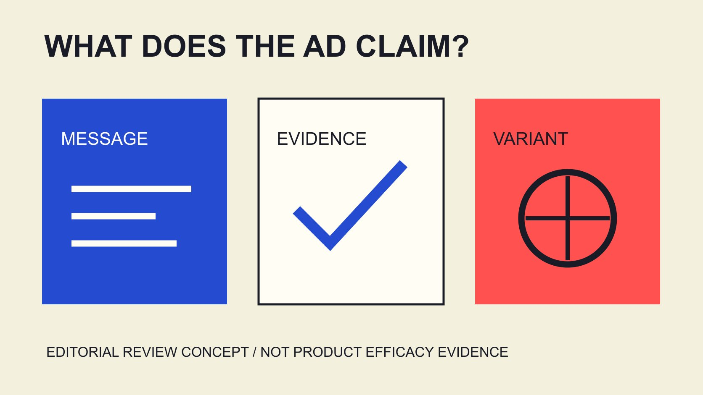

# Skincare and Makeup Meta Ads: Test Creative and Claims

Status: local review draft; confirm the publication date before release.

Begin skincare and makeup Meta advertising with the claim, then organize creative variants, product evidence and measurement. AI labels, interactions and purchases answer different questions.

QuickKOL editorial graphic; not actual account metrics or a platform interface.

Researching skincare makeup Meta advertising trends and engagement rates requires three layers: publicly announced platform changes, the claims in actual brand creative, and advertising results under a defined method. A 2026 AI ad-transparency update does not establish identical features in every account or the truth of a creative claim. Skincare and makeup need product-, version- and statement-specific evidence. Engagement rates need denominator, placement, objective, window and population. This guide organizes research and creative comparison around the advertising claim, without supplying an unmatched universal beauty-ad benchmark or treating high engagement as evidence of efficacy or return on investment. Platform announcements, editorial recommendations and observed outcomes remain separate throughout.

## Make trend research a dated change record

Trend research should not combine tool announcements, creative preferences and average performance into one undifferentiated list. Retain date, publisher, actual scope and unconfirmed account conditions for each change.

The [Meta AI ad-transparency update](https://about.fb.com/news/2025/02/gen-ai-transparency-metas-ads-products/) on June 1, 2026 describes beginning the rollout of About this ad, including AI info and signals associated with third-party tools, with regional variation. This is a public change statement, not an all-account test.

The platform is advancing transparency and every AI ad in this account is correctly labeled are different claims. The latter needs corresponding evidence and cannot be inferred from the former.

A brand should identify which asset step the change affects: production, review, label interpretation or handoff. Converting the announcement into an operating question is more reviewable than saying a tool has already transformed all beauty-ad performance. It also prevents a planning team from using a broad product announcement as proof of functionality or measurable benefits in an account it has not examined.

## Define the skincare and makeup questions separately

One brand may sell both skincare and makeup, but the advertising questions need not match. Start with the specific product, audience situation and information to explain rather than infer identical needs from a category name.

Skincare content might explain actual use and appropriate product wording; makeup content might explain a particular finish or application step. These are researchable assignment examples, not statistical findings about every consumer’s preferences.

For each creative, record one central statement, actual supporting material and conditions that must remain attached. Do not transfer evidence from one product version to another or turn one person’s experience into a universal efficacy conclusion.

Resolve what the brand does not yet know before recording. Creators can explain and demonstrate, but a more confident delivery cannot fill an evidence gap. This separation makes creative development more practical: the team can vary the explanation of a supported fact while keeping an unresolved product question with the owner responsible for answering it.

## Review the whole ad rather than one sentence

The [FTC health-product advertising guide](https://www.ftc.gov/business-guidance/resources/health-products-compliance-guidance) discusses express claims, implied claims and net impression in the US context, with adequate support for objective product claims before dissemination. It is staff business guidance, not a worldwide legal template or safe harbor.

The operating implication is to review picture, sound, subtitle, product name and sequence together. Omitting an efficacy sentence does not establish that the asset communicates no corresponding implication.

Turn the actual statement into a question for the appropriate product and review owners. This article decides no formula’s or individual ad’s legality, supplies no medical advice and selects no clinical conclusion for a brand.

After a creative change, inspect whether the overall expression changed. Retaining a previously approved sentence does not establish that new editing, voiceover or visual context still communicates the same thing. A review record should identify the actual asset version, not just an isolated line that could later be placed into a materially different advertisement.

## Separate product-claim boundaries from platform acceptance

The [FDA cosmetic-claims guide](https://www.fda.gov/cosmetics/cosmetics-labeling/cosmetics-labeling-claims) explains, in the US context, that disease-treatment or prevention and structure-or-function statements can bring a product within drug requirements, while distinguishing cosmetic labeling and advertising responsibilities.

This source cannot become one conclusion for every geography or every skincare phrase. Actual statements, classification and market need appropriate review against specific material.

Platform acceptance is also not product-efficacy certification. Retain product evidence and reviewed versions rather than treat one delivering asset as sufficient support for a stronger statement in another.

Likewise, a creator genuinely liking a product does not independently establish the same result for every consumer. Keep personal use, supportable general statements and unresolved questions separate so creative iteration does not progressively enlarge a narrower evidence base. The practical task is to identify what changed and who needs to review it, rather than assume an earlier acceptance permanently clears every future version of a message.

## Organize variants without silently changing the claim

Start with one confirmed statement and discuss alternative explanation order, opening question or demonstration arrangement. A variant record identifies what changes, what remains and whether a new claim appears.

Suppose A explains a step before showing it while B opens with the same supported question and then explains the step. This is creative planning, not observed advertising performance. Do not prewrite that B has higher engagement or conversion.

AI-generated or edited material still requires version-specific review, particularly where product appearance, operating steps or text could change meaning. A Meta transparency label does not replace that factual check.

Once a variant adds a different product promise, it is no longer merely another expression of the same claim. Resolve added evidence and use scope before deciding whether comparison is appropriate. Otherwise, a result may appear to compare creative presentation while actually comparing different promises, leaving both the interpretation and the unsupported message insufficiently examined.

Language versions need the same treatment. Suppose the original only explains an application step while another language adds a stronger outcome promise. Record the semantic change instead of treating identical pictures as evidence that the translation is an approved copy. Review translated text, subtitles and voiceover within the whole asset. The language owner and product owner should answer their respective questions before that version enters the same comparison. Equivalent file structure is not evidence of equivalent meaning.

## Write a complete measurement definition for engagement

The [metric-definition record](/blog/engagement-rate-formula-metric-contract/#answer) asks for included interactions, denominator, platform, placement, objective, window, source and aggregation. An engagement-rate label does not establish comparability between two ads.

The [2025 ad-statistic scope guide](/blog/beauty-instagram-ads-engagement-2025-scope/#answer) explains why organic-content or company-account tables cannot be renamed paid-ad industry benchmarks. A similar category does not repair a different population or denominator.

The [2026 beauty-statistic scope guide](/blog/beauty-engagement-statistics-2026-platform-scope/#answer) develops observation dates and cross-platform denominators. A recent edition still needs to answer the actual advertising question before its numbers are applied.

The [Emplifi North America beauty scope](https://emplifi.io/resources/q3-2026-beauty-north-america-benchmarks/) also shows that tables within one publication can use different geographic and advertising scopes. Read each table’s method rather than combine paid click cost and organic engagement into one performance score.

If matching statistics are unavailable, state the gap instead of inventing a universal beauty Meta average. Consistently defined internal history can support a working hypothesis, with its limits distinguished from an industry-wide conclusion. That gives the team a starting point for planning while avoiding a false promise that a published percentage applies to its particular campaign.

## Define the comparison before selecting a winning metric

The [Google experiment guide](https://support.google.com/google-ads/answer/7281575?hl=en) emphasizes objectives, hypotheses and testing conditions in its Google Ads context. Here it illustrates advance definition, not a completed Meta randomized experiment or tool setup.

The [campaign-optimization guide](/blog/optimize-influencer-campaigns-bottleneck-decisions/#answer) helps identify the problem: comprehension, arrival at an appropriate destination or a target behavior. Different questions require different measures; more likes for one variant do not make it the winner for every business objective.

If budget, audience, timing and placement also differ, retain those changes and narrow the interpretation. Whether the comparison is observational or supported by a suitable testing design depends on actual execution.

Define the review point, required records and conditions that would change the decision. These depend on the assignment; no universal minimum budget, sample or significance guarantee is invented. A comparison record should make it possible to explain why a decision followed from the evidence, not merely announce a winner after searching through whichever metrics happened to rise.

## Treat corrections and closeout as part of content work

If a product statement is inaccurate, record affected assets, actual versions, related delivery and next owner, then use an appropriate process to decide correction or stopping use. This article operates no ad account and assumes no identical treatment for every issue.

Original material, derivative variants, subtitles, destination pages and a creator’s public post may require separate checks. Updating one master file does not establish synchronization everywhere it was used.

Suppose a brand corrects an application explanation from two steps to three. Identify the versions depending on that information. This is an editorial example concerning no actual product or client.

State what was completed and what remains unknown, retaining appropriate business records. Sending a content issue to another team does not justify reporting every correction as complete. Clear closeout connects the creative record to actual use, so a future operator does not unknowingly restart an older version on the assumption that every item in the asset folder remains current.

## Hand off changes, claims, evidence and measurement

The final package retains source dates, scope of platform changes, each asset’s claim, product evidence, variant differences, actual use and metric definitions. Label supplier statements, editorial recommendations and project results separately.

The practical output of skincare and makeup advertising research is not a percentage apparently suited to every budget. It is a team knowing what has support, what is worth comparing and what still needs an answer.

QuickKOL helps interpret creator assignments and research their work. Product claims, permissions, advertising settings and results still require appropriate sources. Establish what an ad communicates before discussing the response it received.

## Four layers of advertising research

| Layer | Record | Does not mean |

| --- | --- | --- |

| Platform change | Date, scope and account unknowns | Universal account availability or guaranteed results |

| Creative claim | Whole-ad expression and version | One approved line clears all variants |

| Product evidence | Matching product, statement and conditions | Platform review certifies efficacy |

| Measurement | Objective, denominator, placement and window | Engagement equals purchase or ROI |

Editorial framework; the two-to-three-step correction and A/B presentation are hypothetical. US sources retain their jurisdictional context, with no case-specific legal or medical conclusion.

## Pre-release creative-variant review

A content question list; it runs no advertising, diagnosis or performance prediction.

- [ ] Announcement date and scope are retained.

- [ ] Specific skincare and makeup assignments are separate.

- [ ] The overall claim has matching evidence.

- [ ] AI and human variants both receive meaning review.

- [ ] Engagement definitions match actual objectives.

- [ ] Corrections and closeout states have owners.

## Research date and limitations

Sources reviewed November 3, 2026. Methods, tables and decision rules are editorial recommendations. Hypothetical examples are not actual client results or industry benchmarks. Source geography and periods are specified where relevant. This draft is in independent local review; confirm its publication date before release.

## Sources

- [Meta AI ad-transparency update](https://about.fb.com/news/2025/02/gen-ai-transparency-metas-ads-products/)

- [FTC health-product advertising guide (US)](https://www.ftc.gov/business-guidance/resources/health-products-compliance-guidance)

- [FDA cosmetic-claims guide](https://www.fda.gov/cosmetics/cosmetics-labeling/cosmetics-labeling-claims)

- [Emplifi North America beauty scope](https://emplifi.io/resources/q3-2026-beauty-north-america-benchmarks/)

- [Google experiment guide](https://support.google.com/google-ads/answer/7281575?hl=en)
