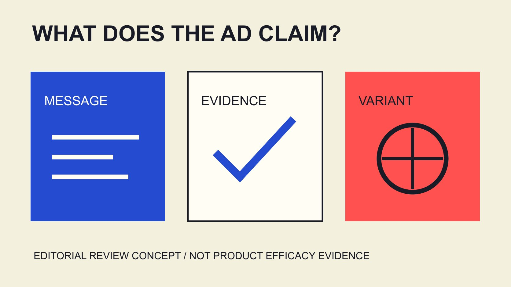

# 护肤彩妆Meta广告：创意与主张复核

状态：本地审阅稿；正式发布日期待确认。

护肤和彩妆Meta广告先写清主张，再组织创意变体、产品依据与测量。AI标签、互动与购买结果各自回答不同问题。

QuickKOL 编辑图形；不呈现真实账号指标或平台界面。

研究skincare makeup Meta advertising trends engagement rates，先分清三层：平台公开宣布的工具或透明度变化、品牌实际制作的广告主张，以及按明确口径取得的广告结果。2026年的AI广告透明度更新不证明每个账号都有相同功能，也不证明素材声明真实。护肤与彩妆需要分别核对具体产品、版本、表达与依据；互动率则需要分母、版位、目标、窗口和样本。本文按广告主张组织研究与创意比较，不提供未经匹配的统一美妆广告互动基准，也不以高互动证明产品功效或投资回报。

## 把趋势研究写成有日期的变化记录

趋势研究不应把工具公告、创意偏好与平均效果混在一张清单。为每个变化保留日期、发布者、实际范围与尚未确认的账户条件。

[Meta AI广告透明度更新](https://about.fb.com/news/2025/02/gen-ai-transparency-metas-ads-products/)在2026年6月1日说明开始推出About this ad，并纳入AI info及第三方工具相关信号；公告也提示地区差异。这里是公开变化说明，不是全账号实测。

因此“平台正在推进透明度”与“这个账号所有AI广告已准确标记”是两种不同说法。后一种需要相应资料，不能从前一种倒推。

品牌应记录变化会影响哪个素材步骤：生产、复核、标签理解或交付。把它变成具体工作问题，比宣称某工具已经改变所有美妆广告效果更可核验。

## 分别写护肤与彩妆要回答的问题

同一个品牌可能同时销售护肤和彩妆，但广告要回答的疑问不必相同。先写具体产品、受众情境和需要解释的信息，不从品类名称推导人人相同的需求。

护肤内容可能需要说明实际使用方式与产品适用表达；彩妆可能需要解释某个妆效或使用步骤。这些是可研究的任务例子，不是对全部消费者偏好的统计结论。

为每个创意列出一句核心主张、支持它的实际资料和需要保留的条件。不要将一个产品版本的依据移到另一个版本，也不让个人体验自动变成普遍功效结论。

在拍摄前解决品牌还不知道什么。创作者可以解释与演示，但不能被要求通过更肯定的语气填补未取得的产品依据。

## 复核整支广告，不只检查一句文字

[FTC健康产品广告指南](https://www.ftc.gov/business-guidance/resources/health-products-compliance-guidance)在美国语境中讨论明示、暗示与整体印象，并要求客观产品说法在传播前有适当依据。它是工作人员业务指南，不是全球法律模板或安全港。

对编辑流程的启发是同时检查画面、声音、字幕、产品名与前后顺序。某一句没有写出功效，不表示整支素材不会传达相应理解。

把实际主张写成可回复的问题交给适当产品与审核负责人。本文不判断某个配方、个案或广告是否合法，不提供医疗建议，也不替品牌选取临床结论。

若创意被修改，再看整体表达是否改变。不能只保留先前批准的句子，就假定新的剪辑、配音或画面组合仍然表达同一件事。

## 产品声明边界与平台通过分别理解

[FDA化妆品声明说明](https://www.fda.gov/cosmetics/cosmetics-labeling/cosmetics-labeling-claims)在美国语境中指出，疾病治疗或预防、影响身体结构或功能等表达可能使产品属于药品要求范围，并区分化妆品标签与广告的监管责任。

这个来源不能直接扩展为所有地区或所有护肤词语的统一结论。实际声明、产品分类与市场需要适当负责人按具体资料核查。

平台审核通过也不是产品功效认证。品牌应保留产品依据与审核版本，不将一条已投放素材作为另一条更强声明的充分证明。

同样，创作者真实喜欢产品，不独立证明所有消费者都能取得同样结果。把个人使用、可支持的一般说法与仍需取证的问题分开，避免创意逐步扩大原来较窄的依据。

## 组织创意变体，不让变体偷偷改变主张

以一个已确认的主张为起点，可以讨论不同解释顺序、开场问题或演示安排。变体表记录改变什么、保持什么，以及是否引入新说法。

假设A先说明步骤再展示，B先提出同一个已支持的问题再说明步骤。这是创意规划，不是实际投放结果；不能先写B互动更高或转化更好。

AI生成或编辑的素材也按实际版本复核，尤其注意产品外观、操作过程与文字是否改变原始含义。Meta的透明度标签不替代这项事实检查。

一旦某个变体增加不同产品承诺，就不再只是同一主张的表现方式。先处理新增依据与使用范围，再决定是否适合继续比较，而不是把它混入原测试。

翻译版本也需要同样处理。假设原文只解释使用步骤，另一语言却增加了更强的结果承诺，应记录语义变化，而不是因为画面相同就视为已批准复制件。把译文、字幕与配音放回整体素材复核，让语言负责人和产品负责人各自回答相应问题，再决定是否进入同一比较。

## 为互动率写完整测量口径

[指标定义记录](/zh/blog/engagement-rate-formula-metric-contract/#answer)要求写明互动组成、分母、平台、版位、目标、窗口、来源与汇总。一个engagement rate标签不足以证明两个广告可比较。

[2025广告统计边界指南](/zh/blog/beauty-instagram-ads-engagement-2025-scope/#answer)说明，自然内容或公司账号表不能直接改名为付费广告行业基准。相似品类并不能补齐不同样本与分母。

[2026美妆统计范围指南](/zh/blog/beauty-engagement-statistics-2026-platform-scope/#answer)进一步说明观察期和跨平台分母。使用最近报告，也仍要确认它实际回答的是本次广告问题。

[Emplifi北美美妆范围说明](https://emplifi.io/resources/q3-2026-beauty-north-america-benchmarks/)也显示，同一份资料不同表格可能采用不同地域与广告范围。按每张表读取方法，不把广告点击成本与自然互动混成一个表现分数。

没有匹配统计时，说清未取得，不编造美妆Meta统一平均。团队可以先用定义一致的实际历史提出工作假设，再说明它与行业普遍结论的区别。

## 比较前定义问题，不见结果再选指标

[Google实验指南](https://support.google.com/google-ads/answer/7281575?hl=en)在其Google Ads语境下强调目标、假设与测试条件。本篇借此说明事先定义的重要性，不声称已完成Meta随机实验或工具设置。

[活动优化指南](/zh/blog/optimize-influencer-campaigns-bottleneck-decisions/#answer)帮助先找问题：受众是否理解、是否进入适当页面、是否发生目标行为。不同问题需要不同指标，不因某个变体点赞更多就宣布所有业务目标都胜出。

如果媒体预算、受众、时间和版位同时不同，记录这些变化，缩小解释范围。将比较称为观察性还是具备适当设计支持的测试，应依据实际执行。

还要规定何时复查、需要哪些资料和什么情况会改变决定。具体安排由项目条件决定，不编造最低预算、固定样本或保证显著性的通用数字。

## 更正与广告结束也属于内容工作

如果发现产品表述不准确，记录影响素材、实际版本、相关投放与下一负责人，再按适当流程决定更正或停止使用。本文不操作广告账户，也不预设每个问题必须同样处理。

原素材、派生变体、字幕、落地页和创作者公开帖子可能分别需要核对。改一个主文件不自动证明全部使用位置已经同步。

假设品牌把适用步骤从两步更正为三步，团队需要找出依赖这项信息的版本。这是编辑例子，不指向真实产品或客户。

最终说明已完成什么、仍有什么未知，并保留业务允许留存的记录。不要把内容问题交给另一个团队后，就在报告里写成所有修改均已完成。

## 交付变化、主张、依据与测量

最终包保留来源日期、平台变化范围、每个素材主张、产品依据、变体差异、实际使用与指标定义。来源自述、编辑建议与项目结果分别标明。

护肤彩妆广告研究的实用结果，不是一个看似适用于所有预算的比例，而是团队知道什么已经有依据、什么值得比较、什么仍需回答。

QuickKOL帮助理解创作者任务与研究作品；产品声明、授权、广告设置和结果仍由适当来源确认。先把广告说了什么讲清楚，再讨论它获得了什么反应。

## 广告研究的四层记录

| 层次 | 记录 | 不等于 |

| --- | --- | --- |

| 平台变化 | 日期、范围与账户未知 | 所有账户可用或效果保证 |

| 素材主张 | 整支广告表达与版本 | 一句话批准覆盖全部变体 |

| 产品依据 | 对应产品、说法与条件 | 平台审核就是功效认证 |

| 测量 | 目标、分母、版位与窗口 | 互动就是购买或ROI |

编辑工作框架；两步改三步、A/B表达均为假设。美国资料按其地区语境使用，不作个案法律或医疗结论。

## 创意变体发布前复核

这是内容问题单，不会运行广告、生成诊断或预测效果。

- [ ] 变化公告的日期与范围已记录。

- [ ] 护肤与彩妆具体任务分开。

- [ ] 整体主张有对应依据。

- [ ] AI或人工变体均复核含义。

- [ ] 互动定义与实际目标匹配。

- [ ] 更正传播与结束状态有负责人。

## 研究日期与使用边界

资料核验于 2026 年 11 月 3 日。文中方法、表格和决策规则为编辑建议，标为假设的示例不是实际客户结果或行业基准。外部资料的适用地区与时期按各段说明；本稿处于独立本地审阅阶段，正式发布日期待确认。

## 来源

- [Meta AI广告透明度更新](https://about.fb.com/news/2025/02/gen-ai-transparency-metas-ads-products/)

- [FTC健康产品广告指南（美国）](https://www.ftc.gov/business-guidance/resources/health-products-compliance-guidance)

- [FDA化妆品声明说明](https://www.fda.gov/cosmetics/cosmetics-labeling/cosmetics-labeling-claims)

- [Emplifi北美美妆范围说明](https://emplifi.io/resources/q3-2026-beauty-north-america-benchmarks/)

- [Google实验指南](https://support.google.com/google-ads/answer/7281575?hl=en)
