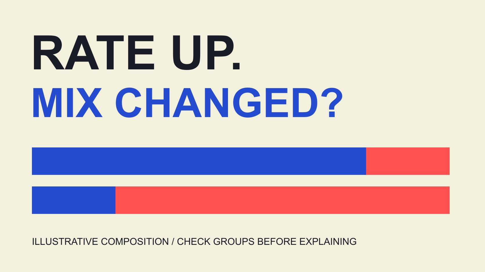

# Social Media Engagement Rate: Explain the Monthly Change

Status: local review draft; confirm the publication date before release.

A monthly engagement-rate increase can reflect stronger responses within groups or a different content mix. A transparent worked example separates those descriptions without claiming causality.

QuickKOL editorial graphic; not actual account metrics or a platform interface.

Social media engagement rate is a ratio of specified interactions to a defined denominator. In a monthly report, higher this month is initially a description, not automatic proof of better creative, algorithm preference or stronger sales. First hold included actions, denominator, observation window and aggregation clear. Then ask two group-level questions: did rates within comparable content change, and did the weights of higher- and lower-rate content change? The hypothetical below preserves the arithmetic while explaining why a fixed-weight analysis does not independently establish cause. This guide addresses monthly interpretation rather than offer another unconditional universal formula or industry threshold. Its purpose is to improve the explanation attached to a result.

## Establish whether both months count the same thing

Retain interaction events, denominator, content set, date window, capture time and aggregation before comparing months. Similar field names do not establish identical definitions or access.

The [Rival IQ interaction-events guide](https://help.rivaliq.com/en/articles/4792538-what-is-included-in-engagement-metrics) distinguishes available actions by platform, and the [Rival IQ engagement-rate guide](https://help.rivaliq.com/en/articles/2043672-understanding-engagement-rates) discusses its own product definitions. They prompt method review rather than supply one rule followed by every native platform.

The [metric-definition record](/blog/engagement-rate-formula-metric-contract/#answer) helps hand off known and unknown fields. If private fields become available or a supplier changes its method, record that change before placing the periods in one continuous series.

Without comparability evidence, present the two rates separately and postpone a change interpretation. A management preference for a growth arrow does not justify joining values whose meaning changed. Keeping this boundary explicit allows a useful report to be delivered while a data owner resolves the missing definition instead of silently making that uncertainty disappear.

## Inspect totals before breaking down the content mix

The [engagement-denominator guide](/blog/engagement-rate-denominators/#answer) distinguishes views, reach, impressions and followers. For this mathematical teaching example, the denominator is additive eligible impression records and the calculation is interactions divided by impressions. Deduplicated reach is not mixed in.

This setup does not establish that every real platform field can be added directly. If an actual export involves cross-post reach deduplication or repeated events, resolve source methods before borrowing the example’s arithmetic.

Inspect numerator and denominator totals rather than only the percent sign. A rate can rise while interactions fall if its denominator falls further; interactions can increase while a rate falls because exposure grew more quickly.

Retain posting count, format, paid state and content age. These are not automatic explanations. They indicate possible grouping questions and identify observations that may require separate comparison. Knowing which total moved is the beginning of the interpretation, not a substitute for learning which content and exposure opportunities produced it.

## Hypothetical inputs: two groups, not actual brand performance

Let A and B represent two groups defined in advance and held consistent across months. Their names imply no platform or format superiority. Every number is editorially constructed, not a client result or industry average.

In January, A has 8,000 impressions and 160 interactions, giving 2%. B has 2,000 impressions and 160 interactions, giving 8%. Pooled interactions are 320 from 10,000 impressions, or 3.2%.

In February, A has 2,000 impressions and 60 interactions, giving 3%. B has 8,000 impressions and 720 interactions, giving 9%. Pooled interactions are 780 from 10,000 impressions, or 7.8%.

Both within-group rates increase one percentage point, while the overall rate increases 4.6 percentage points. That does not mean every kind of content improved 4.6 points or one new strategy created an equivalent growth effect.

The example is calculable because groups, windows and denominator are defined. A real assignment must obtain those fields first; two final percentages cannot reconstruct this table.

## Hold January weights fixed to inspect the description

January’s impression weights are 80% for A and 20% for B. Apply those weights to February’s group rates: 3% times 80% plus 9% times 20% equals 4.2%.

Under this fixed-weight description, movement from 3.2% to 4.2% corresponds to within-group change. February’s actual 7.8% minus the fixed-weight 4.2% is 3.6 percentage points, reflecting composition differences in this example.

This is a descriptive decomposition using January weights, not the only possible decomposition and not a statistical significance test or causal estimate. Changing reference period, grouping or method can change its presentation.

Preserve arithmetic with assumptions. Do not extract composition contributed 3.6 into a formal dashboard where readers could mistake it for a randomized experiment or proof that one content category is inherently superior. The calculation answers a defined reporting question about these inputs. It does not explain why exposure shifted or what would happen if a brand attempted to reproduce that shift next month.

## Choose groups for the question rather than an attractive story

The [Instagram format-analysis guide](/blog/instagram-analytics-format-decision-matrix/#answer) considers content task and format. Monthly groups might follow format, campaign, geography or paid state, but their rationale should match the project question and retain reasons for changes.

Do not try countless partitions after seeing the results and deliver only the one supporting a preferred conclusion. At minimum, state grouping, exclusions and unmatched observations.

Content age, audience and distribution may still vary inside a group. A within-group rate change does not automatically mean the same content worked better for the same people; uncontrolled composition differences can remain.

Excessively narrow groups can also produce sparse or unstable observations. Do not invent a universal minimum sample threshold. Report actual counts and limits, then let the intended analysis determine whether a longer window or another method is needed. A group is useful because it clarifies an operating question, not because it produces an impressive contrast that can be inserted into a slide.

## Keep proposed causes as questions rather than manufacture causality

The [Google experiment guide](https://support.google.com/google-ads/answer/7281575?hl=en) recommends a hypothesis, objective and defined variables in its Google Ads context. It does not establish random assignment for Instagram or every creator campaign.

The hypothetical decomposition can motivate questions: did distribution resources shift, was more content of one category delivered, and were observation windows consistent? The table alone cannot prove those proposed causes occurred.

To evaluate a change, define an appropriate comparison, execution conditions and outcomes before using a suitable tool and design. Do not observe a higher rate and then choose whichever operating action is most convenient to credit.

A useful descriptive conclusion remains possible without an experiment. Separate observation, possible explanation, missing information and next action instead of compressing uncertainty into strategy worked. This preserves what the report actually discovered and makes later investigation more focused, while avoiding a stronger causal claim than the project was designed to support.

## Separate percent change, percentage points and business outcomes

In the hypothetical, moving from 3.2% to 7.8% is a difference of 4.6 percentage points. Relative change is 4.6 divided by 3.2, or 143.75%. These are different expressions, and neither establishes 143.75% revenue growth.

The [campaign-measurement guide](/blog/creator-campaign-measurement/#answer) separates outputs and outcomes. Present monthly engagement interpretation alongside appropriate visits, leads, orders or profit records, without renaming a high rate ROI.

If orders fall while engagement rises, retain both observations and investigate the matching question. Product, audience, pricing, measurement or other conditions may matter. Do not turn one possibility into the conclusion before obtaining evidence.

Use the correct unit in the heading and supply numerator, denominator and window in the explanation. Readers can then judge magnitude while seeing the evidence still needed to connect it to the actual business issue. A report that keeps these questions separate can support a more precise discussion than one success label applied to every metric moving upward.

## Record missing, deleted and late-arriving observations

Real monthly reporting can involve late data, deleted posts, access changes or newly available fields. Retain original export time, revision time and reasons rather than silently overwrite the numbers and imply the earlier report always contained them.

Missing is not automatically zero. If a post lacks an available denominator, do not enter zero or guess average views merely to make the table calculable. Identify exclusions and possible consequences.

If missingness differs between months, explain the comparison limit. Repeatedly collecting more observations does not guarantee removal of selection bias or reconstruction of a complete population.

The final table should distinguish original fields, editorial groups and derived calculations. The next analyst can then reproduce assumptions and identify which layer changed rather than infer an entire process from a screenshot.

Suppose an impression field becomes available for one February post after the original export. Record whether including it changes the content set, group weights and pooled rate. Date the revised and earlier values separately. The newly obtained field is not new engagement in the reporting month, and completing a missing record should not be described as another improvement in content performance. The correction concerns what was known and included, even if the resulting percentage changes considerably. Maintaining this distinction also makes corrections easier to explain without overstating the precision of an incomplete record.

## Hand off observation, interpretation and next action

A useful monthly explanation states how the observed total changed, whether definitions match, what groups show, what the fixed-weight exercise describes, which causes remain unknown and what to obtain next.

The hypothetical demonstrates composition change, not actual brand performance or an industry target. It should not be copied into a project completion record or used to promise future results from a similarly shaped increase.

QuickKOL helps research content and creator assignments; monthly statistics still need actual sources and appropriate interpretation. Explain why the numbers deserve further investigation before deciding how to adjust resources.

## Mix interpretation exercise: all inputs hypothetical

| Month / group | Interactions / impressions | Group rate |

| --- | --- | --- |

| January A | 160 / 8,000 | 2% |

| January B | 160 / 2,000 | 8% |

| February A | 60 / 2,000 | 3% |

| February B | 720 / 8,000 | 9% |

Pooled rate 3.2%→7.8%; February at January weights is 4.2%. Denominators are additive hypothetical impressions, not deduplicated reach. Descriptive exercise, not a causal estimate.

## Monthly interpretation sequence

Verify fields before interpretation; this checklist performs no calculation or prediction.

- [ ] Do definitions and windows match?

- [ ] How did numerator and denominator change?

- [ ] Were groups defined before seeing results?

- [ ] Are within-group and weight changes separate?

- [ ] Do causes and business outcomes have separate evidence?

- [ ] Are missingness and revisions recorded?

## Research date and limitations

Sources reviewed November 3, 2026. Methods, tables and decision rules are editorial recommendations. Hypothetical examples are not actual client results or industry benchmarks. Source geography and periods are specified where relevant. This draft is in independent local review; confirm its publication date before release.

## Sources

- [Rival IQ interaction-events guide](https://help.rivaliq.com/en/articles/4792538-what-is-included-in-engagement-metrics)

- [Rival IQ engagement-rate guide](https://help.rivaliq.com/en/articles/2043672-understanding-engagement-rates)

- [Google experiment guide](https://support.google.com/google-ads/answer/7281575?hl=en)
