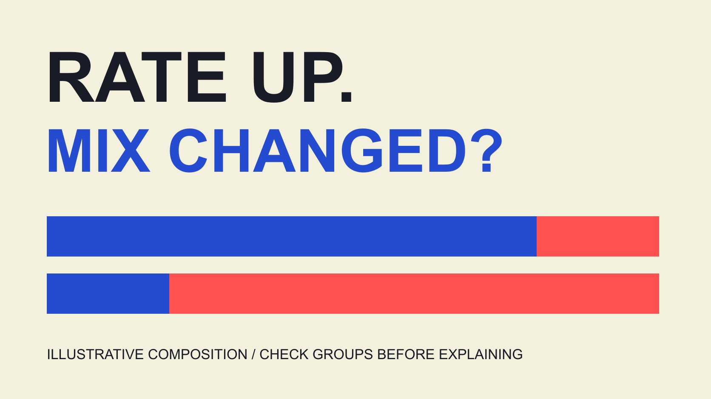

# 社交互动率复盘：解释结构变化与真实变化

状态：本地审阅稿；正式发布日期待确认。

月度互动率上涨，需要分辨同类内容反应改善与发布组合改变。用透明假设数据解释分组、固定权重和仍不能得出的因果结论。

QuickKOL 编辑图形；不呈现真实账号指标或平台界面。

Social media engagement rate，即社交媒体互动率，是指定互动数相对于明确分母的比例。月报中“这个月更高”首先是描述，不能自动写成创意更好、算法更喜欢或销售更强。先固定互动组成、分母、观察窗口与汇总方式，再分组检查：同类内容的比率是否改变，以及高低比率内容的权重是否改变。以下用两组假设数据演示，既保留计算过程，也说明固定权重分析不能独立证明原因。本文解决月度解释，不再重复提供一个无条件通用的公式或行业阈值。

## 先确认两个月是否在算同一件事

月报先保留互动事件、分母、内容集合、日期窗口、抓取时间与汇总方式。字段名称相似，不足以证明来自相同定义或同一种数据权限。

[Rival IQ互动事件说明](https://help.rivaliq.com/en/articles/4792538-what-is-included-in-engagement-metrics)按平台区分可取得动作；[Rival IQ互动率说明](https://help.rivaliq.com/en/articles/2043672-understanding-engagement-rates)也讨论其产品口径。这些资料提醒读者查看方法，不是全部原生平台共同遵循的统一计算标准。

[指标定义记录](/zh/blog/engagement-rate-formula-metric-contract/#answer)帮助把已知与未知写进交接。若新增私人字段或供应商算法换版，先记录定义变化，再决定能否把两个时期放进同一序列。

没有可比依据时，报告可以各自呈现两个比例，并明确暂不作同比解释。不要因为管理层期待一个增长箭头，就把含义改变的数值连接起来。

## 先看总量，再拆分内容组合

[互动分母指南](/zh/blog/engagement-rate-denominators/#answer)说明观看、触达、展示和粉丝的区别。本篇假设分母是可加总的合资格展示记录，计算互动除以展示，不混入去重触达。

这是数学教学设置，不声称现实平台每个字段均可直接相加。实际导出若涉及跨帖触达去重或重复事件，应先按来源方法处理，不能照抄示例的加法。

查看分子与分母总量，避免只读百分号。互动总数减少时，比率仍可能因分母减少更多而上升；总互动增加时，比率也可能因更大分母而下降。

记录发帖数量、格式、付费状态与内容年龄。这些背景不是自动解释，而是告诉团队下一步应如何分组，哪些观察对象可能需要单独比较。

## 假设输入：两组内容，不是真实品牌成绩

设内容A、B代表两个已预先定义且月间一致的组，名称不暗示任何平台或格式优劣。所有数值为编辑构造，不是客户结果或行业平均。

一月A有8000次展示、160次互动，2%；B有2000次展示、160次互动，8%。合计320除以10000，为3.2%。

二月A有2000次展示、60次互动，3%；B有8000次展示、720次互动，9%。合计780除以10000，为7.8%。

两组内部各升1个百分点，但整体升4.6个百分点。整体上涨不等于每种内容都提高4.6个百分点，也不能由此宣称一项新策略创造相同比例增长。

这组数值之所以能算，是因为分组、窗口与分母已经在假设中定义好。现实项目需要先取得这些字段；只有两个最终百分比时，不能倒推出这份表。

## 固定一月权重，观察描述怎样改变

一月展示权重为A占80%、B占20%。把二月组内比例按这组权重计算：3%乘80%加9%乘20%，得到4.2%。

因此，在这套固定权重描述下，3.2%到4.2%对应组内变化；二月实际7.8%与固定权重4.2%的差为3.6个百分点，反映这个例子中的组合差异。

这是选用一月权重的描述性拆分，不是唯一分解方法，更不是统计显著性或因果估计。换基期、分组或方法可能改变分解的呈现。

将运算与假设一起保留。不能只拿“组合贡献3.6”出现在正式看板上，让读者误以为已做随机实验或证实某类内容必然优越。

## 分组要服务问题，而不是追求好看的解释

[Instagram格式分析指南](/zh/blog/instagram-analytics-format-decision-matrix/#answer)提供按内容任务与格式思考的路径。月报可以按格式、活动、地域或付费状态分组，但依据应与项目问题相连，并保留变化理由。

不要在看见数字后试无数组合，只交出最支持既定结论的切法。至少说明采用哪种分组、哪些对象被排除、是否有无法匹配的内容。

一组内仍可能存在内容年龄、受众与分发不同。组内比率改变并不自动意味着同一条内容对同一群人更有效；它仍可能含未控制的构成变化。

分组过细又会造成稀疏或不稳定观察。不要编造统一最低样本阈值，先报告实际数量与不足，并让分析用途决定是否需要更长窗口或不同方法。

## 把原因列为待验证，不从拆分制造因果

[Google实验指南](https://support.google.com/google-ads/answer/7281575?hl=en)建议先明确假设、目标与要测试的变量，属于Google Ads产品语境，不能直接证明Instagram或所有达人活动已随机分配。

本篇假设分解可以提出后续问题：分发资源是否改变、是否投放更多某种内容、观察窗口是否一致。但仅凭这张表无法证明这些原因发生。

若要评估一次改变，先确定适当比较、执行条件与结果指标，再按可用工具和设计进行。不要看到比率上涨后才挑一个最方便归功的执行动作。

没有实验条件时，也可交付有用的描述性结论。将观察、可能解释、缺失资料和下一动作分开，比把全部不确定性压成一句“策略有效”更可复用。

## 百分比变化、百分点与业务结果分别表达

假设整体从3.2%到7.8%，差是4.6个百分点；相对变化为4.6除以3.2，即143.75%。二者不是同一个表达，也不代表收入增长143.75%。

[活动衡量指南](/zh/blog/creator-campaign-measurement/#answer)区分产出与结果。月度互动说明应与适当访问、线索、订单或利润记录分别呈现，不把一个高比例改名成ROI。

如果订单下降同时互动上涨，保留这个并行观察，再寻找匹配问题。可能涉及产品、受众、价格、测量或其他条件；未取证前不把某一种可能写成结论。

报告标题使用准确单位，正文给出分子、分母与窗口。这样读者可以判断变化大小，也能看到它和实际业务问题之间还需要哪些证据。

## 把缺失、删除与迟到数据写入修订记录

实际月报可能遇到迟到数据、删帖、权限变化或补录字段。保留原导出时间、修订时间与变化原因，不悄悄覆盖旧数值后宣称原报告一直如此。

缺失项不自动为零。某帖没有可取得分母，不应为了让整张表可算，就填零或猜测平均观看。标出未纳入对象及其可能影响。

若本月和上月的缺失方式不同，先说明可比性限制。重复取得更多数据，也不保证消除了所有选择偏差或恢复完整总体。

最终表格应能区分原始字段、编辑分组与派生计算。这样下一个人可以复算假设，也能发现资料改变发生在哪一层，而不是从截图猜整个过程。

假设二月有一条帖子在导出后才取得展示字段，新增记录应写清是否改变原本内容集合、分组权重与总比率。更正后的值与先前值分别标日期；不能把新增字段当成本月新增互动，也不该将资料补齐误写为内容表现又提升。

## 交付观察、解释与下一动作

一段可用月报写清：实际总比率怎么变、定义是否一致、分组观察是什么、固定权重结果如何、哪些原因仍未知，以及下次需要补什么。

本文的假设数字演示组合变化，不是实际品牌成绩或行业目标。不能将其复制成项目完成记录，也不能仅凭同样形状的增长承诺未来效果。

QuickKOL帮助研究内容与创作者任务，月度统计仍需真实来源与适当解释。先让团队知道数字为什么值得继续研究，再决定资源如何调整。

## 组合解释练习：全部为假设

| 月份与组 | 互动 / 展示 | 组内比例 |

| --- | --- | --- |

| 一月A | 160 / 8000 | 2% |

| 一月B | 160 / 2000 | 8% |

| 二月A | 60 / 2000 | 3% |

| 二月B | 720 / 8000 | 9% |

总比率3.2%→7.8%；二月按一月权重为4.2%。分母为假设中可加总展示，不是去重触达。描述性练习，不是因果估计。

## 月报解释顺序

核对字段后再解释，不执行计算或预测。

- [ ] 定义和窗口一致吗？

- [ ] 分子与分母怎样变？

- [ ] 分组在结果出现前定义了吗？

- [ ] 组内与权重变化分开了吗？

- [ ] 原因与业务结果有独立证据吗？

- [ ] 缺失与修订有记录吗？

## 研究日期与使用边界

资料核验于 2026 年 11 月 3 日。文中方法、表格和决策规则为编辑建议，标为假设的示例不是实际客户结果或行业基准。外部资料的适用地区与时期按各段说明；本稿处于独立本地审阅阶段，正式发布日期待确认。

## 来源

- [Rival IQ互动事件说明](https://help.rivaliq.com/en/articles/4792538-what-is-included-in-engagement-metrics)

- [Rival IQ互动率说明](https://help.rivaliq.com/en/articles/2043672-understanding-engagement-rates)

- [Google实验指南](https://support.google.com/google-ads/answer/7281575?hl=en)
