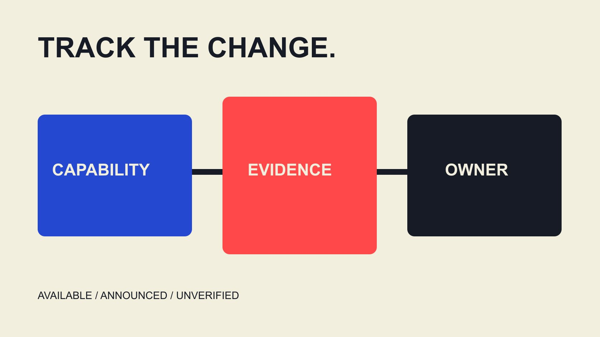

# Technology Disruption in Influencer Marketing: Track the Change

Status: local review draft; confirm the publication date before release.

Use a change register to examine how AI, production tools and platform requirements affect influencer work, separating capability, plans, adoption and demonstrated outcomes.

QuickKOL editorial graphic; not actual account metrics or a platform interface.

Technology disruption in influencer marketing should describe how a technology changes inputs, execution, required judgment or evidence, rather than simply predict replacement of creators or teams. Separate announcement, available capability, actual adoption and observed result, checking dates, account conditions and affected work. Faster generation is not necessarily lower total cost; a platform label is not factual accuracy; and access to a new tool does not establish conditions for using someone else’s material. This guide uses a change register to support operating decisions rather than publish adoption rates or definite growth forecasts. The relevant question is what the team can now do differently and what responsibility still needs an owner.

## Translate disruption into a task change

Select a real task: interpreting a brief, proposing a script direction, editing, translation, review or interpreting results. Identify the constraint in the old workflow and the specific input or action a capability changes. A technology name should not immediately become a business-success conclusion.

Retain current state, proposal, basis and owner for each change. A future announcement is planned. A demonstrated tool is not necessarily stable operation by the team on real assignments.

Change can introduce judgment rather than only remove steps. More generated versions may require clearer naming, factual review and selection reasons. Easier generation does not necessarily make interpretation easier.

Ask who would do different work, which information needs updating and what remains unconfirmed if the team adopts now. If those questions cannot be answered, retain the item as research instead of redesigning the entire process. This keeps discussion focused on a decision someone can actually make rather than an abstract claim that the industry has changed.

## Production tools can change friction without proving content value

The [Meta Edits anniversary update](https://about.fb.com/news/2026/04/one-year-of-edits-built-for-and-with-creators/amp/) in April 2026 reviews teleprompter, ideas and production workflows while also describing future plans. It is the platform’s product-direction account, not proof that every plan is available to every account or that a format will be popular.

Investigate whether a capability removes an actual friction, such as switching between script and recording or repeating preparation across versions. Verify availability on the project’s account and device rather than schedule a future feature as a confirmed dependency.

Content value still concerns the audience question. A smoother production process can leave a piece without reliable product facts or a clear explanation. Capability and content review should complement each other. A convenient interface does not validate an entire strategy.

For a trial, choose a bounded assignment and appropriate existing reference, recording work, inputs and result. Successful demonstration establishes the path demonstrated rather than complete suitability for the project. It can justify a next test without requiring immediate adoption across every production task.

## Generation and editing need an account of what happened

The [YouTube GenAI-disclosure guide](https://support.google.com/youtube/answer/14328491?hl=en) distinguishes realistic generated or meaningfully altered material from some minor or nonrealistic edits. Current documentation describes processes including the AI use setting. It is not a universal rule or identically named control across platforms.

The team should know whether material was recorded, assisted, reconstructed or generated to depict something that did not happen. Retain relevant origin and production information with the selected version so later edits or translations do not lose it.

Disclosure and factual verification answer different questions. Explaining generation does not establish product effects, personal experience or a real location event. Conversely, using one tool does not establish identical processing of everything in the piece.

Before publication, appropriate people review the current platform and assignment requirements. One automatic label should not stand in for all review, and known production context should not be discarded merely to make material appear captured. The task is accurate communication about the work, alongside review of what the work claims.

## More versions need clearer selection and review records

The [Frame.io version-comparison guide](https://help.frame.io/en/articles/9952618-comparison-viewer) describes side-by-side assets and associated comments in V4. It illustrates technology supporting review without establishing that participants have approved commercial use or a content conclusion.

If a workflow easily produces many variants, identify the current version, changes in meaning and format-only changes. Factual approval for one version should not automatically transfer to a substantially different script or scene.

Selection reasons can include clearer explanation, greater factual accuracy or fit with a confirmed placement. They need not all become experimentally proven performance claims. Unpublished work has no actual audience result, and simulated evaluation is not audience behavior.

The [collaboration workflow guide](/blog/collaborate-with-influencers-brand-workflow/#answer) connects review, receipt and follow-up. Version tools supply infrastructure while the relationship still requires decision authority, recheck conditions and conflict handling. A change register should identify those operating needs so generating more files does not create a larger pool of material whose status no one can explain.

## Automated research still needs sources and limits

The [AI creator-research review guide](/blog/ai-creator-shortlist-review/#answer) separates leads from verified facts. Automated summaries may speed organization, while the team still returns to relevant work, public statements or authorized records, particularly for matters affecting outreach or collaboration decisions.

Retain question, source, observation date and necessary limits. An orderly table should not upgrade unconfirmed information into fact, and an estimated proportion should not become a confirmed account count.

When a tool changes visible fields or channel coverage, record that change instead of interpreting sample expansion as real market growth. Several providers using one source do not necessarily supply independent evidence.

Automation can help formulate a more specific question without guaranteeing every candidate fits or will collaborate. Preserving unknowns that require judgment is more useful to a reviewable process than an unexplained universal score. A new research capability should therefore be evaluated by the task it supports and the evidence it preserves, not solely the number of rows it produces.

## A hypothetical: count total work rather than generation time

This editorial hypothetical is not a productivity study. An earlier workflow takes ten hours in total. A tool reduces production to six hours but adds three hours of verification, version handling and handoff. Total work is nine hours, one below ten.

The arithmetic does not establish a 10% saving for every project or better image quality, accuracy or commercial results. Different inputs, assignments or review requirements can change the result. Comparing only minutes spent generating omits other work.

Include fees, appropriate permissions, learning and maintenance where relevant. If the workflow shifts work from producer to brand reviewer, record the transfer instead of announcing that it disappeared.

For a trial, retain the completion definition and actual time categories. A sound decision may be not to replace the workflow yet while continuing a bounded trial for one assignment type. Adoption does not need complete replacement to count as useful learning. It needs a defensible explanation of the work and conditions being changed.

## Retain use conditions and exit when procuring capability

The [content-use scope guide](/blog/creator-rates-usage-rights/#answer) helps separate material use from tool access. Even where software can perform an edit, the team still checks the actual material, people, music and relevant use arrangements for the assignment.

Ask about specific functions, available plan, required data, export and end-of-service handling. Supports AI does not explain how material enters, who can see it, how outputs are retained or whether later use remains possible.

If the provider does not publish a complete method, retain its stated scope and limits rather than supply unverified capabilities. Public-document research and logged-in testing should be identified separately too.

Exit planning does not necessarily stop a currently valid use, but it should explain future access, outstanding work and information handoff. Plan from the actual terms instead of creating a dependency that only the original operator understands. A procurement decision should remain interpretable after a product rename, staffing change or interface update.

## Define the adoption conditions for each change

An editorial register can contain change name, official source and date, current availability, affected task, required verification, owner, cost and next decision. Explain inapplicable fields rather than fill them with false certainty.

The decision may be observe, limited trial, partial adoption or exit. Record why and which new evidence could change it. A platform announcement is not an instruction that every brand must immediately remake its project.

Match observation and stopping conditions to the assignment. Factual, access or other correction needs follow their appropriate process rather than allow unsuitable content to continue merely to complete a technology experiment.

When new information arrives, update the register and affected briefs. Production, research and reporting colleagues need to know the current valid version. That turns a technology development into executable work rather than only a forwarded industry headline, while leaving room to revise an earlier decision when the capability or its conditions actually change.

## Turn technological change into a clearer team capability

Teams can develop questioning, source verification, production, review and interpretation as distinct capabilities rather than compress them into one universal role or product. When a tool removes one operation, identify who still performs the remaining work.

This review has no cross-vendor adoption dataset or independently established universal effect. It therefore offers no technology ranking, replacement percentage or definite return. Company announcements and hypothetical time calculations do not establish industry-wide conclusions.

Describe the change concretely: under these conditions, this capability helps this task and still needs these inputs and judgments. That statement supports budget, training and brief discussions, while telling the next reviewer where to return for evidence. It also permits an appropriate no-change decision when the current process already serves the task reliably. Each adopted capability needs a named recheck owner and a reason to revisit it after a documented product change.

## Technology-change register

| Layer | Record | Avoid inferring |

| --- | --- | --- |

| Announcement | Publisher, date, existing and planned | Universal adoption |

| Capability | Task and availability conditions | Demo equals full implementation |

| Work | Inputs, time, owner and review | Faster generation equals lower total cost |

| Outcome | Appropriate evidence and limits | Technology label proves business impact |

An editorial change framework; the time example is hypothetical, not a measured productivity benchmark.

## Before adopting the change

Confirm how the actual work changes.

- [ ] Separate current capability and plans.

- [ ] Verify account, device and project conditions.

- [ ] Retain source, version and processing context.

- [ ] Include total work and additional review.

- [ ] Confirm access and material use separately.

- [ ] Name adoption conditions and next decision.

## Research date and limitations

Sources reviewed November 3, 2026. Methods, tables and decision rules are editorial recommendations. Hypothetical examples are not actual client results or industry benchmarks. Source geography and periods are specified where relevant. This draft is in independent local review; confirm its publication date before release.

## Sources

- [Meta Edits anniversary update](https://about.fb.com/news/2026/04/one-year-of-edits-built-for-and-with-creators/amp/)

- [YouTube GenAI-disclosure guide](https://support.google.com/youtube/answer/14328491?hl=en)

- [Frame.io version-comparison guide](https://help.frame.io/en/articles/9952618-comparison-viewer)
