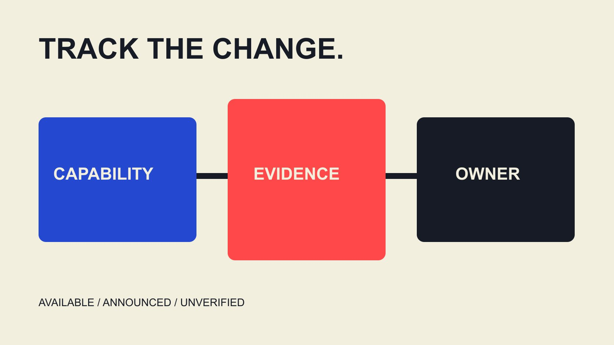

# 技术如何改变达人营销：记录能力、责任与证据

状态：本地审阅稿；正式发布日期待确认。

用变化登记表研究AI、制作工具与平台要求怎样影响达人营销工作，区分能力、计划、实际采用与已证明结果。

QuickKOL 编辑图形；不呈现真实账号指标或平台界面。

Technology disruption在达人营销中应具体解释为：某种技术改变了工作输入、执行方式、所需判断或证据，而不是笼统宣称创作者或团队会被替代。研究时将公告、可用能力、实际采用和已观察结果分开，核对日期、账号条件与受影响任务。更快生成素材不等于更低全部成本，平台标签不等于事实准确，新工具也不自动获得使用他人素材的条件。本文以变化登记支持团队决定，不发布技术采用率或确定增长预测。

## 将颠覆从大词改成任务变化

先选择一个实际工作：整理Brief、提出脚本方向、剪辑、翻译、素材审阅或结果解释。写清旧流程在哪里受限，新能力具体改变什么输入或动作，而不是从技术名称直接推导业务成功。

为每项变化保留现状、提议、依据和负责人。若只是一个未来公告，状态应是计划；若工具已经能演示，也还不等于团队在真实项目中稳定使用。

变化可能增加新判断，而非只减少步骤。例如生成更多版本之后，需要更清楚的版本命名、事实核对和选用理由。更容易生成不代表更容易解释。

不要只问某技术是否重要，要问如果现在采用，哪一个同事会做不同工作，哪项资料需要更新，以及哪些条件仍未确认。回答不了时，先保留研究而不是立即改造全流程。

## 制作工具改变摩擦，不自动改变内容价值

[Meta Edits周年说明](https://about.fb.com/news/2026/04/one-year-of-edits-built-for-and-with-creators/amp/)在2026年4月回顾提词、构思与制作流程，同时列出后续计划。它提供平台自述的产品方向，不能证明所有计划已向每个账号开放或某种内容必然更受欢迎。

品牌可以研究某项能力是否减少实际摩擦，例如脚本与录制之间的切换，或版本准备中的重复步骤。核对本项目账号和设备实际可用情况，不照着公告把未来功能排进已确认交付。

内容价值仍要回到受众问题。一个制作更顺畅的片段，可能仍然缺少可靠产品事实或清楚解释。工具能力与内容审阅应相互配合，不把一种界面变方便当成整个策略已被证明。

如果准备试用，选择有边界的任务与现有合适对照，记录需要的工作、输入和结果。演示成功只说明演示的路径，不能替代完整项目适用性判断。

## 生成与编辑需要说明实际发生了什么

[YouTube生成式内容披露说明](https://support.google.com/youtube/answer/14328491?hl=en)区分需要说明的逼真生成或重要修改，与某些轻微或非逼真编辑。当前文档描述AI use设置等流程；这不是所有平台的同名按钮或通用判定规则。

团队应知道素材是实际拍摄、辅助编辑、重建场景还是生成了没有发生的画面。为选用版本保留必要来源与制作说明，避免在后续剪辑或翻译中丢失相关信息。

披露与事实核对回答不同问题。说明内容经过生成，不证明产品效果、人物经历或地点事件真实。相反，使用某种工具也不自动说明全部内容具有相同处理方式。

发布前由合适人员按当前平台与项目要求核对。不要把一次自动标签当作全部审阅完成，也不要为了让素材看起来像实拍而删除团队已经知道的重要制作信息。

## 更多版本需要更清楚的选用和审阅记录

[Frame.io版本比较说明](https://help.frame.io/en/articles/9952618-comparison-viewer)介绍V4中并排比较素材和对应留言的能力。它可以说明技术怎样帮助审阅，但工具存在不证明实际参与者已经批准任何商业使用或内容结论。

如果新流程很容易产生许多变体，明确哪个是当前版本、哪些改变了意义、哪些仅作格式调整。不要把一个版本的事实批准自动复制到实质不同的脚本或画面。

选用理由可以包括解释更清楚、事实更准确或适合已确认的版位，而不必全部被包装成经过实验验证的高表现。尚未发布的作品没有实际结果；模拟评审也不是观众行为。

[合作执行指南](/zh/blog/collaborate-with-influencers-brand-workflow/#answer)帮助连接审阅、接收与后续动作。版本工具提供基础设施，工作关系仍需要谁能决定、什么需要复核及怎样处理冲突。

## 自动研究输出仍需知道来源和限制

[AI达人研究复核指南](/zh/blog/ai-creator-shortlist-review/#answer)帮助区分研究线索和已核验事实。自动摘要可能让整理更快，但团队仍应回到相关原始作品、公开说明或获授权记录，尤其是会影响联系或合作决定的事项。

为输出保留问题、来源、观察日期和必要限制。无法确认的数据不要因为出现在整齐表格里就升级成事实；估计比例也不能写成已经确认的账号数量。

如果工具改变了可见字段或覆盖渠道，记录这项变化，避免把样本变大当成市场真实增长。不同供应商使用同一来源，也未必提供独立证据。

研究自动化的价值可以是帮助提出更具体的问题，而不是替品牌保证每个候选适合或一定愿意合作。保留人工判断应处理的未知，比让机器生成一个无法解释的全能评分更适合可复查流程。

## 一个假设：计算总工时，而非只看生成速度

以下为编辑假设，不是真实生产率研究。旧流程完成一项任务共用10小时；新工具把制作阶段缩至6小时，但新增核对、版本处理和交接需要3小时，则总计9小时，较10小时少1小时。

这个算例不证明所有项目节省10%，也不说明画质、准确性或商业结果更好。输入、任务和审阅要求一变，结果就可能不同。只比较工具生成的几分钟，会漏掉其他实际工作。

还要考虑费用、适当许可、必要学习与维护。如果某项流程把工作从制作方转移给品牌审阅者，应记录转移，而不是宣称工作消失。

对于一次试验，保留完成定义和实际工时分类。一个可靠的决定可以是暂不替换，只在某类任务中继续试用。技术采用不需要每次都以全面取代现有方式作为成功标准。

## 采购能力时保留使用条件和退出方式

[内容使用范围指南](/zh/blog/creator-rates-usage-rights/#answer)可帮助团队将作品使用与工具访问分开。即使软件允许执行某个编辑动作，也仍需核对当前素材、人物、音乐与相关使用安排是否适合该任务。

采购时问实际功能、可用计划、需要的数据、导出方式和结束后的处理。不要只问是否支持AI；这个标签不能说明素材如何进入、谁能查看、输出怎样保存或未来能否继续使用。

如果供应商不公开完整方法，至少记录其说明的范围与限制，不替它补充未经核实的能力。公开文档研究与实际登录测试也应分别说明。

退出计划不一定意味着停止当前有效使用，但需要知道未来访问、未结工作与资料怎样交接。用实际条件安排，不把某个工具变成只有原操作人员才能解释的关键依赖。

## 为每项变化写明采用条件

编辑建议的登记字段包括变化名称、官方资料与日期、当前可用状态、受影响任务、需要的验证、负责人、成本和下一决定。对不适用的字段保留说明，而不是填一个虚假的确定值。

决定可以是观察、有限试用、局部采用或退出。分别说明为什么，以及哪些新证据会改变判断。平台宣布一项功能不是品牌必须立即重做项目的指令。

观察窗口与停止条件应适合任务。若遇到事实、权限或其他需要纠正的问题，先按适当流程处理，不能为了完成一轮技术实验而继续使用不适当内容。

当新资料出现时，更新登记与受影响Brief。让制作、研究与报告人员知道哪个版本当前有效，才能把技术变化转成可执行工作，而不只是行业新闻转发。

## 把技术变化转成更清楚的团队能力

团队可以分别学习提问、核对来源、制作、审阅与解释结果，不必将所有能力压在一个万能岗位或软件里。新工具减少某一步操作后，仍需知道其他步骤由谁完成。

本篇没有跨供应商采用率或经过独立验证的普遍效果数据，因此不发布技术排名、取代比例或确定收益。个别公司公告和假设工时不能扩展成全行业结论。

最终用一句具体话描述变化：这项能力在这些条件下帮助这项工作，仍需这些输入与判断。这个表达更适合预算、培训和Brief讨论，也让下一次核验知道该回到哪里寻找证据。每项已采用能力都需要复核负责人，并说明哪些已记录的产品变化会触发重新核对。

## 技术变化登记字段

| 层次 | 需要记录 | 避免推断 |

| --- | --- | --- |

| 公告 | 发布者、日期、现有与计划 | 全体账号已采用 |

| 能力 | 实际任务与可用条件 | 演示等于完整上线 |

| 工作 | 输入、工时、负责人和审阅 | 更快生成等于总成本更低 |

| 结果 | 适当证据与限制 | 技术标签证明商业效果 |

编辑变化框架；工时算例是假设，不是实测或行业生产率基准。

## 技术采用前核对

确认具体工作如何变化。

- [ ] 当前能力与计划功能分开。

- [ ] 账号、设备和项目条件核对。

- [ ] 来源、版本和处理方式保留。

- [ ] 总工时与新增审阅计入。

- [ ] 权限与内容使用分别确认。

- [ ] 采用条件和下一决定明确。

## 研究日期与使用边界

资料核验于 2026 年 11 月 3 日。文中方法、表格和决策规则为编辑建议，标为假设的示例不是实际客户结果或行业基准。外部资料的适用地区与时期按各段说明；本稿处于独立本地审阅阶段，正式发布日期待确认。

## 来源

- [Meta Edits周年说明](https://about.fb.com/news/2026/04/one-year-of-edits-built-for-and-with-creators/amp/)

- [YouTube生成式内容披露说明](https://support.google.com/youtube/answer/14328491?hl=en)

- [Frame.io版本比较说明](https://help.frame.io/en/articles/9952618-comparison-viewer)
