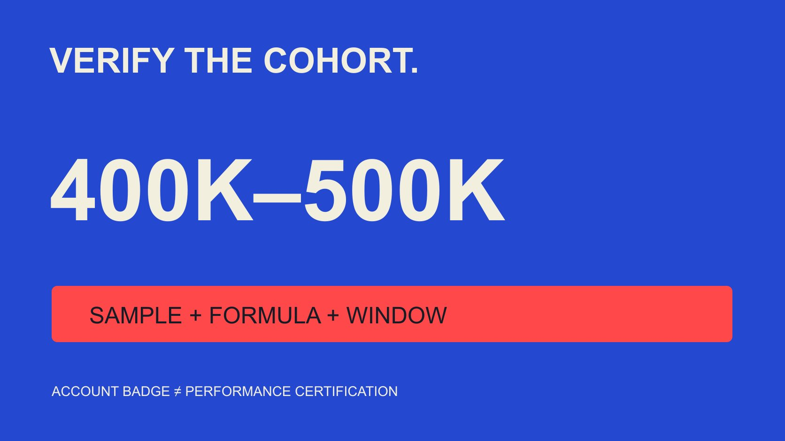

# TikTok Creators With 400K–500K Followers: Verify the Cohort

Status: local review draft; confirm the publication date before release.

When an exact cohort average is not verified, do not substitute a broad industry number. Define follower band, badge state, content and statistical method before interpreting data.

QuickKOL editorial graphic; not actual account metrics or a platform interface.

In the sources reviewed for this article on November 3, 2026, we did not obtain a fully verifiable average engagement rate for verified TikTok creators specifically in the 400K–500K follower band. A broader creator tier, brand-account sample or differently defined rate is not a substitute. Separate platform verification of account identity from verification of research inputs and method. The former does not certify performance. Publishing the precise cohort average requires a follower snapshot, badge observation, sample definition, content window, actions, denominator and aggregation method. This guide explains those checks rather than invent a benchmark or claim that no such research could exist anywhere.

## Turn the query into checkable conditions

First define whether accounts are individual creators or also brands, publishers and other organizations. Then establish whether the follower band includes its boundaries, which snapshot date applies and which regions or content categories are represented.

Average engagement rate also needs definition: average across posts, average across creator-level summaries, or total events divided by total denominators. These answer different questions and should not all be hidden behind the word average.

Rewrite the question as a complete research statement: for creators meeting account conditions and the follower band on a stated observation date, what statistic describes specified-window content under a given formula? An empty field identifies information still needed.

The exercise does not require pretending to know a live answer. An exact query is valuable because it clarifies conditions, not because it obliges an editor to turn the closest search result into a perfect match. If a report uses a wider follower range, record that range as a limitation instead of silently narrowing its label in your presentation.

## Separate an account badge from data verification

The [TikTok verified-badge explanation](https://newsroom.tiktok.com/how-to-tell-if-an-account-is-verified-on-tiktok/?lang=en), an official account published in 2019, connects the badge with the identity represented by the account and explicitly says it is not platform endorsement. It supplies neither this exact cohort’s engagement rate nor certification of every commercial report.

Record the date and source of a badge observation rather than treat verified as a guarantee of stable interaction, business outcomes or audience quality. Absence of a badge does not establish that account data are false.

Data verification checks sample, fields, formula, timing and processing records. A study can have a transparent method without restricting itself to badged accounts; a badged account can still have incomplete public data.

If a provider uses verified to mean that it checked information, establish whether that means a platform badge. Do not exchange the meanings. Use separate fields so colleagues reading the heading do not infer a stronger evidence status than the source supports. Neither label replaces the need to understand the statistic being reported.

## Use a follower snapshot to define the cohort

Follower counts change. A study may use a start, end or other explicitly chosen snapshot for cohort entry, but it should explain and maintain that choice rather than move dates to obtain a preferable result.

Rounded public displays can make precise boundary assignment unavailable. A display of 400K is not necessarily exactly 400,000, and it does not support a ranking based on a one-follower difference.

Current size does not establish that an account occupied the band months earlier. Without a historical snapshot, narrow the question to the currently observed cohort or preserve historical membership as unknown.

Treat multiple accounts associated with an entity according to the research object, not a guess based on similar names. Appropriate account identifiers and public business context serve this task; private identity information is unnecessary. A reproducible membership rule lets another analyst explain why an account was included or excluded without changing the rule after seeing its engagement result.

## Inspect actions and denominator before the percentage

The [Rival IQ engagement-rate guide](https://help.rivaliq.com/en/articles/2043672-understanding-engagement-rates) illustrates how a provider distinguishes public and authorized data and applies particular channel calculations. It shows why the tool’s definition matters, rather than proving that every platform has one inherent universal formula.

Record whether likes, comments, shares or other actions are included and whether those fields are actually available. Filling an unavailable share count with zero does not make that measure comparable with a complete share-inclusive one.

The denominator may concern views, impressions, followers or another defined object, with units explicit. Followers can define cohort membership without also serving as the rate denominator. Views do not necessarily identify unique people.

The [engagement-rate metric contract](/blog/engagement-rate-formula-metric-contract/#answer) preserves field versions, states and windows. A percentage is ready for comparison or citation only when those conditions are clear. Keep the provider-reported rate separate from an editorial recalculation if their definitions differ; the availability of both numbers does not make them interchangeable or establish that the higher one is the better representation.

## The same hypothetical inputs yield different statistics

Suppose three eligible creators each have one included post. Under the same action definition, observations are 100 interactions per 10,000 views, 600 per 20,000 and 110 per 1,000: rates of 1%, 3% and 11%. These are fictional inputs, not account observations or benchmarks.

The arithmetic mean of the three rates is 5%, while the median is 3%. Pooling interactions and views gives 810 divided by 31,000 times 100, approximately 2.61%. The difference reflects different statistical questions, not proof that one calculation is fraudulent.

A pooled rate weights higher-view items more heavily. An average creator rate can give each creator equal weight. Where one person has many posts, also decide whether aggregation occurs by creator first or directly across posts.

Name the statistic in the heading or adjacent note and retain distribution information or an appropriate range. With very few observations, identify the small sample instead of presenting a precise market rule. Showing the inputs lets readers reproduce the teaching arithmetic without mistaking the example for collected research.

## A large brand study is not the requested creator cohort

The [Emplifi Q3 2026 methodology](https://emplifi.io/resources/blog/q3-2026-social-media-benchmarks/) describes a worldwide brand benchmark including 1,301 TikTok profiles, with medians and a specified interactions-per-impression definition. Published October 15, 2026, it concerns third-quarter brand activity.

This is an example of inspectable scope, not direct evidence about verified individual creators with 400K–500K followers. Account type, follower band, badge requirement and statistic do not automatically match the query.

Even a large sample cannot fill missing eligibility conditions by size alone. Research may suit a brand’s own social-performance context without supplying a valid comparison for a precise creator cohort.

Preserve original objects and period when citing. Replacing a brand-profile median with a verified-creator average changes the research question rather than merely shortening its description. If the desired subgroup is not reported, do not derive its average from an overall number: the missing subgroup distribution is still missing. The honest report can use the broader study as context while stating that it does not resolve the requested estimate.

## Design reviewable observation and exclusion rules

Define content window, observation cutoff and content maturity before inspecting results. Newly published items and long-accumulating posts should not be compared without explaining exposure time. The [TikTok analytics-window guide](/blog/tiktok-analytics-creative-review-windows/#answer) helps organize that record.

Retain paid, organic, collaborative and unknown content states according to available evidence. Low interaction or high views alone should not establish that a post was advertised. Keep unknown separate.

Exclusion rules should follow the question, such as an ineligible account type or missing required field. Do not delete an item because it lowers the mean or collect only prominently displayed high-performing posts.

Record missing and excluded counts with reasons. The reader can then understand which observable material the statistic describes rather than assume complete coverage of every account and post. When access limitations change the sample materially, narrow the conclusion instead of treating the resulting convenience sample as a representative estimate for all eligible TikTok creators.

## Separate cohort description from a project expectation

Even if a qualifying cohort statistic becomes available, it should not become a performance promise for every creator. A cohort description concerns a specified sample and window; it does not determine the interaction a future item will receive.

A brand can use it to ask better questions: why an observation differs, whether format and maturity match, or which evidence remains missing. Falling below a reference does not alone establish collaboration failure, and exceeding it does not remove the need to consider the intended audience and task.

If an internal plan needs an assumption, record the assumed value, purpose and recheck point separately from externally observed research. Review actual available evidence after execution and explain differences between the assumption and observation. Do not relabel a planning target as a verified average simply because the same percentage is convenient for a spreadsheet.

This preserves the limited usefulness of a benchmark without turning a descriptive average into an individual guarantee, universal pricing rule or substitute for the brand’s actual definition of success.

## Hand off a decision when the exact average is unavailable

The final record can say that the exact cohort average was not verified, identifying sources reviewed and mismatched conditions. That is neither zero engagement nor a claim that no relevant public research exists anywhere.

If the project genuinely needs that benchmark, obtain appropriately authorized, eligible data and establish the method. If the real question concerns a content item’s performance, the [campaign-measurement guide](/blog/creator-campaign-measurement/#answer) can help choose a more relevant observation instead.

Do not turn the gap into a purchasing promise or imply that QuickKOL already holds complete statistics for the exact cohort. A responsible handoff states available evidence, unsupported conclusions and the information needed next. That makes the research usable even when a precise numeric answer cannot yet be supplied.

## Checks for an exact TikTok cohort average

| Condition | Needed evidence | Not a substitute |

| --- | --- | --- |

| 400K–500K | Snapshot, boundaries and precision | A broad creator tier |

| Verified | Separate platform badge and method verification | Verified in promotional copy |

| Engagement rate | Actions, denominator, window and states | An undefined percentage |

| Average | Creator/post unit; mean/median/pooled rate | An overall statistic for other account types |

No observed exact-cohort benchmark is published here; 1%, 3% and 11% are teaching inputs only.

## Before citing an exact average

Narrow the conclusion when an essential field is missing.

- [ ] Match account type and follower snapshot.

- [ ] Define verified.

- [ ] Document actions and denominator.

- [ ] Align window and content maturity.

- [ ] Trace aggregation and missing data.

- [ ] State when the exact estimate is unverified.

## Research date and limitations

Sources reviewed November 3, 2026. Methods, tables and decision rules are editorial recommendations. Hypothetical examples are not actual client results or industry benchmarks. Source geography and periods are specified where relevant. This draft is in independent local review; confirm its publication date before release.

## Sources

- [TikTok verified-badge explanation](https://newsroom.tiktok.com/how-to-tell-if-an-account-is-verified-on-tiktok/?lang=en)

- [Rival IQ engagement-rate guide](https://help.rivaliq.com/en/articles/2043672-understanding-engagement-rates)

- [Emplifi Q3 2026 methodology](https://emplifi.io/resources/blog/q3-2026-social-media-benchmarks/)
