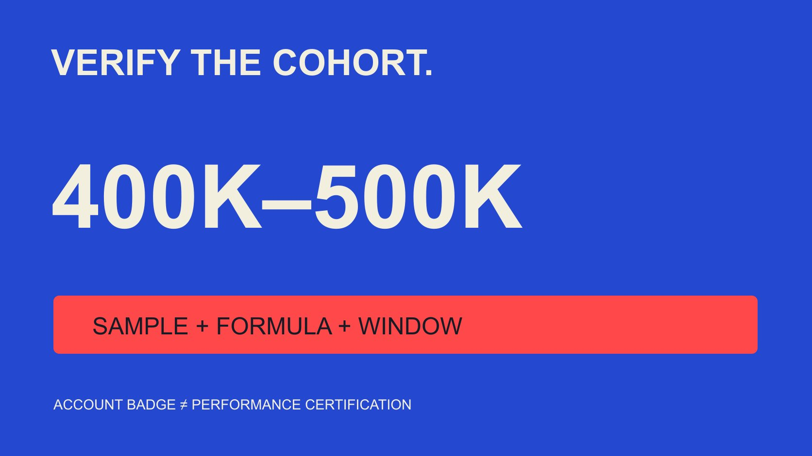

# 40万至50万粉丝TikTok达人：均值怎样才算可核验

状态：本地审阅稿；正式发布日期待确认。

没有可核验的精确群体均值时，不用宽泛行业数字替代。先界定40万至50万粉丝、认证状态、内容与统计方法，再判断数据可说什么。

QuickKOL 编辑图形；不呈现真实账号指标或平台界面。

截至2026年11月3日本次资料核对，本文未取得可完整核验的“40万至50万粉丝、认证TikTok创作者”的精确平均互动率。不能把宽泛达人层级、品牌账号或其他分母的数字当作答案。先区分两种verified：平台确认账号身份，与研究者核对数据方法；前者不证明表现。要发布这个精确群体的均值，需要明确粉丝快照、认证观察、样本、内容窗口、动作、分母与汇总方式。本文给出核对方法，不虚构基准。

## 把搜索词拆成可以检查的条件

先定义账号对象是个人创作者，还是也包含品牌、媒体和其他组织。再确认粉丝范围是否包含上下边界、依据哪天的快照，以及研究覆盖哪些地区或内容类别。

“平均互动率”也需要明确：按每条内容平均、先求每位创作者再平均，还是把全部事件和分母相加后相除。它们回答不同问题，不能只用average一个词覆盖。

可将研究问题改成完整句子：某个观察日处于规定粉丝带、符合账号条件的创作者，其指定窗口内容按给定公式计算的某种统计量是多少？填不出的字段就是需要补的资料。

这项工作不需要假装知道一个实时答案。精确查询的价值在于明确条件，而不是要求编辑把最接近的搜索结果改写成完全匹配。

## 认证标记与数据核验是不同问题

[TikTok认证标记说明](https://newsroom.tiktok.com/how-to-tell-if-an-account-is-verified-on-tiktok/?lang=en)在2019年的官方解释中，将标记与账号代表的用户身份联系起来，并明确不表示平台背书。它没有提供本关键词所需的精确群体互动率，也不认证每份商业报表。

因此记录标记观察日期与来源，不把“认证”当作互动稳定、商业效果或受众质量的保证。没有标记也不能反推账号数据不真实。

数据核验则检查样本、字段、公式、时间与处理记录。一个研究可以方法透明，却不只研究蓝标账号；一个蓝标账号也可能只有不完整的公开数据。

如果资料用verified表示供应商自己核对过资料，确认它是不是平台蓝标，不能替换含义。报告应把这两个状态用不同字段写出，避免同事看标题就误会证据强度。

## 用粉丝快照定义群体，而不是倒推历史

粉丝数会随时间变化。研究可选择窗口起点、终点或另一明确快照作为入组依据，但应说明选择理由并持续采用，不能为了得到更好结果临时换日期。

公开资料若只显示四舍五入的数字，边界附近可能不能精确归类。不要把显示400K当作精确400,000，也不要据此制造一位粉丝之差的排序。

当前粉丝数不能证明账号几个月前也处在同一带。缺少历史快照时，把问题缩为当前可观察群体，或承认历史入组状态未知。

同一实体的多个账号需按研究对象处理，不凭名字相似就合并。这里需要的是适当账号标识与公开业务语境，不是寻找私人身份资料来补齐表格。

## 先核对动作与分母，再看百分比

[Rival IQ互动率说明](https://help.rivaliq.com/en/articles/2043672-understanding-engagement-rates)展示了供应商如何区分公开和可授权数据，并对TikTok等渠道采用特定计算。它说明需要阅读工具自己的定义，不是所有平台天然只有一种公式。

记录计入点赞、评论、分享或其他动作的哪些字段，以及它们是否真正可得。不要将缺失分享填零后假装与包含分享的完整指标可比。

分母可以是观看、展示、粉丝或其他定义对象，必须明确单位。粉丝是入组条件，不表示互动率一定也以粉丝为分母；观看也不必然等于独立人数。

[互动率指标约定](/zh/blog/engagement-rate-formula-metric-contract/#answer)可以帮助保留字段版本、状态和窗口。一个百分比只有在这些条件清楚时，才适合进入比较或引用。

## 同一组假设输入可得到不同统计量

假设三位符合入组条件的创作者各有一条纳入内容。按同一动作口径，分别观察100次互动/10,000次观看、600/20,000、110/1,000，对应1%、3%和11%。这些不是实际账号或基准。

三个率的算术平均为5%，中位数为3%。合并事件与观看后是810÷31,000×100，约2.61%。差异来自统计问题不同，不是其中一种计算必然造假。

合并率让观看更多的内容贡献更大权重；平均创作者率则可以让每位创作者权重相同。若一人有很多条内容，还需决定先按人汇总还是按帖子汇总。

报告应在标题或紧邻说明中注明统计量，并保留分布或适当范围。样本只有少数个体时，写清小样本，不能包装成精确市场规律。

## 大规模品牌研究不能替代精确达人群体

[Emplifi 2026第三季度方法说明](https://emplifi.io/resources/blog/q3-2026-social-media-benchmarks/)公开描述其全球品牌研究包含1,301个TikTok资料，报告统计采用中位数及特定互动/展示口径。该资料发布日期为2026年10月15日，观察第三季度品牌活动。

这是可核对范围的例子，不是“40万至50万粉丝认证个人创作者”的直接证据。账号类型、粉丝带、认证条件与统计量没有因此自动符合本题。

即使资料样本很多，也不能仅凭规模补齐缺少的条件。研究可能适合品牌自己的社交表现，却不适合用来评价一个精确创作者群体。

引用时保留原始对象和时期。如果把“品牌资料的中位数”改成“认证达人的平均值”，就不只是简写，而是改变了原研究所回答的问题。

## 设计可复核的观察与排除规则

在看结果前说明内容窗口、观察截止和每条内容的成熟时间。刚发布与已积累很久的内容不能在不说明差异下直接比较；[TikTok分析窗口指南](/zh/blog/tiktok-analytics-creative-review-windows/#answer)可帮助组织这种记录。

付费、自然、合作发布及无法判断的内容状态应按可得证据保留。不要仅凭低互动或高观看就断言某条内容投了广告；未知单列。

排除规则需要与问题有关，如不属于指定对象或缺少必要字段。不能因为某条内容拉低均值就删除，也不应只收集首页最突出的高表现内容。

记录缺失和排除数量及原因。这样下一位读者知道统计描述的是哪些可观察内容，而不是误以为全部账号、全部内容都被完整研究。

## 把群体描述与单个项目预期分开

即使后来取得合格的群体统计，也不应把均值写进每位创作者的表现承诺。群体描述反映指定样本和窗口，不规定未来每一条内容会得到多少互动。

品牌可以用它提出更合适的问题，例如观察值为何不同、内容形式与成熟时间是否匹配、某项证据还缺什么。不能只因低于参考值就认定合作失败，也不能因高于它就忽略目标受众或实际任务。

若内部必须设规划假设，另列假设值、用途和复核点，不伪装为外部实测。执行后用实际可得数据复盘，并说明原假设与观察之间的差别。

这样可以保留基准的有限用途，同时避免把描述性平均数变成个人保证、统一报价标准或品牌最终成功的替代指标。

## 没有精确均值时怎样交接决定

最终记录可以写“未核验精确群体均值”，同时交代已经读取的来源与不匹配条件。这不是零互动，也不表示所有公开研究都不存在。

如果项目确实需要该基准，下一步是取得符合条件、权限适当的数据并建立方法；如果只需要理解某个内容表现，[活动衡量指南](/zh/blog/creator-campaign-measurement/#answer)可帮助改用更贴合任务的观察。

不要把数据缺口变成购买承诺或虚构QuickKOL已经拥有完整精确群体统计。一个负责任的交接同时说明可用证据、不能推导的结论和下一步需要补的资料。

## 精确TikTok群体均值的核验字段

| 条件 | 需要什么 | 不能替代 |

| --- | --- | --- |

| 40万至50万 | 明确日期、边界与精度 | 宽泛达人层级 |

| 认证 | 区分平台标记与方法核验 | 营销文案中的verified |

| 互动率 | 动作、分母、窗口与状态 | 没有定义的百分比 |

| 平均 | 按人/帖、均值/中位数/合并率 | 其他账号类型的总体统计 |

本篇未发布精确群体的实测基准；1%、3%、11%仅为教学输入。

## 引用精确均值前

任一关键字段缺失时，缩小结论。

- [ ] 对象和粉丝快照吻合。

- [ ] 认证含义明确。

- [ ] 动作与分母完整。

- [ ] 窗口与成熟时间可比。

- [ ] 汇总方式及缺失可追溯。

- [ ] 精确值无法核验时明确说明。

## 研究日期与使用边界

资料核验于 2026 年 11 月 3 日。文中方法、表格和决策规则为编辑建议，标为假设的示例不是实际客户结果或行业基准。外部资料的适用地区与时期按各段说明；本稿处于独立本地审阅阶段，正式发布日期待确认。

## 来源

- [TikTok认证标记说明](https://newsroom.tiktok.com/how-to-tell-if-an-account-is-verified-on-tiktok/?lang=en)

- [Rival IQ互动率说明](https://help.rivaliq.com/en/articles/2043672-understanding-engagement-rates)

- [Emplifi 2026第三季度方法说明](https://emplifi.io/resources/blog/q3-2026-social-media-benchmarks/)
