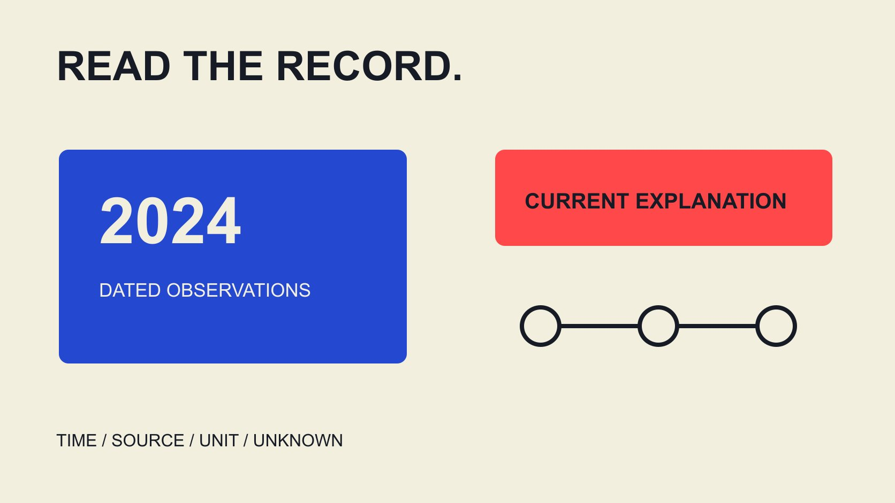

# Web3 Instagram Follower Quality in 2024: Read the Evidence

Status: local review draft; confirm the publication date before release.

An educational guide to reading 2024 Web3 and Instagram audience reports: inspect historical records, source independence and units, separating signals, interpretations and established facts.

QuickKOL editorial graphic; not actual account metrics or a platform interface.

Read web3 Instagram account follower quality analysis 2024 as a historical data-literacy question: what did records show at the time, were sources independent, and did conclusions exceed the evidence? Today’s follower count cannot reconstruct a 2024 audience, and wallet or address counts are not counts of real Instagram people. Growth anomalies, repeated interactions and model flags can prompt closer understanding without independently establishing purchased followers, intent or unlawful conduct. This educational guide concerns records and responsible wording. It provides no individual screening, authenticity ranking or promise of complete identification. Where historical evidence is absent, preserve unknown rather than manufacture certainty.

## Identify what the year 2024 refers to

The year in a title may identify report publication, content publication, measurement window or screenshot capture. These are different times and should be recorded separately. A filename containing 2024 does not establish that every input belongs to that year.

Keep the date you read the material separate as well. Opening a historical page in 2026 does not update its observations to 2026. Conversely, a definition updated today is not an account record preserved at the earlier time.

If a report gives only an annual label, narrow the statement: the report says it covers 2024, but the exact window is unspecified. Do not infer months from a chart position or URL.

This check serves brand training, report citation and historical review. It explains where a statement can responsibly be reused without constructing a personal authenticity dossier or collecting unrelated private information. A useful historical explanation begins with the records actually available, rather than with a verdict that the writer hopes those records will support.

## Keep provenance without treating integrity as accuracy

For a record, note publisher, original page, observation window, acquisition time, fields and known transformations. Preserve an appropriate copy or reference location so colleagues can find the same material, not so restricted information can be shared more widely.

A screenshot can show what an interface displayed at a time without independently describing the entire collection method. Cropping can remove units, dates or qualifications; seek the complete context before quoting.

A file checksum can help establish whether copies differ. It does not prove the original input was true, sources were independent or behavioral causes were known. Do not promote a technical integrity marker into data-accuracy certification.

The [Instagram data-definition guide](/blog/instagram-analytics-format-decision-matrix/#answer) helps interpret fields. Historical material still needs its contemporaneous definition. If only current documentation can be found, identify it as conceptual reference rather than a substitute for a missing historical version. Recording that limitation leaves the evidence usable without pretending that every uncertainty has been resolved by saving a file.

## Keep wallets, blockchain accounts and Instagram accounts distinct

The [ethereum.org wallet concepts](https://ethereum.org/wallets/) explain distinctions among wallets, accounts and addresses, including management of multiple Ethereum accounts in one application. The page reviewed was updated February 24, 2026. It is conceptual reference here, not an archival record from 2024.

A wallet interface, address, blockchain account, individual and Instagram account should therefore not be mapped one-to-one by assumption. This guide offers no method for matching addresses with social identities or guessing people from transaction records.

Even if a project report lists addresses and social follows separately, retain each object, source and window. Dividing them produces arithmetic without automatically producing a real-audience proportion or community-trust score.

Web3 community also needs definition. It may refer to a project’s stated participant group. Related labels alone do not establish asset ownership, identity or a common intention among everyone interacting. These distinctions keep a historical report from presenting technically different populations as if they were the same counted people, regardless of how neatly the totals fit a chart.

## Treat historical platform announcements as context

The [Meta spam-interaction tools announcement](https://about.fb.com/ltam/news/2023/12/protegiendo-a-los-creadores-de-interacciones-no-deseadas-con-nuevas-herramientas-proactivas-de-seguridad/) was published December 13, 2023, with a March 5, 2024 update marker. It describes a review area for suspected spam or bot followers and the ability to approve accounts considered not to be spam.

That establishes a public description of a review mechanism at the time. It does not show that a particular account was flagged in 2024 or that every account today has identical features and menus.

Preserve suspected and the source dates when paraphrasing. A platform’s providing a review mechanism should not become a claim that every flagged account is proven fraudulent. The announcement is not an independent accuracy study and cannot supply a promise of complete detection.

If a historical report cites a flag, it needs an appropriate original record and scope. Linking the announcement alone does not establish that the flag appeared in a specific record. Keep mechanism context separate from an actual observation so the reader can distinguish what the platform described from what the report can document.

## Describe unusual growth before proposing a cause

Suppose retained records show the same count changing from 10,000 to 12,000: a net addition of 2,000, or 20% relative to the starting count. These are teaching inputs, not account observations or an industry anomaly threshold.

They support a difference between two specified snapshots. They do not reveal gross follows and unfollows during the interval or establish a fake-follower percentage. Without the relevant records, do not decompose net change into invented causes.

Possible explanations can become questions to check, such as content exposure, a public event, measurement scope or platform moderation. Possibility should not be written as an established occurrence. Unknown does not mean the most adverse explanation has been proven.

The [engagement-rate metric contract](/blog/engagement-rate-formula-metric-contract/#answer) helps check actions, denominator and window. If scope or field definition changed, establish the comparability limit before calling the difference a behavioral anomaly. Retaining the simple arithmetic and its limits is more educational than assigning a precise-looking authenticity score unsupported by the available input.

## Several pages may still share one underlying source

News summaries, provider blogs and social reposts can all depend on one report. Trace the chain before treating repeated copies of a screenshot as independent confirmation.

For each claim, distinguish observer, calculator and republisher. If original collection material is unavailable, state the reproducibility limit rather than strengthen the conclusion because later wording sounds more certain.

When two sources disagree, compare dates, objects, units and definitions first. Different windows may explain a difference; sometimes the discrepancy remains unresolved. Preserving disagreement is more useful for training than selecting the number that favors a preferred account of events.

This guide does not ask readers to track personal activity or acquire restricted information. The objective is to understand how a report was formed, identify responsibly citable statements and narrow claims where evidence is insufficient. Two separately branded websites do not become two measurements merely because their layouts differ; independence concerns the underlying observation and method, not the number of pages in a bibliography.

## Legal context does not establish the facts of a case

The [FTC fake-indicator FAQ](https://www.ftc.gov/business-guidance/resources/consumer-reviews-testimonials-rule-questions-answers) is US staff guidance and notes the relevant rule’s October 21, 2024 effective date. Its fake-indicator provision has specific conduct and knowledge conditions; it should not become low interaction is unlawful or a worldwide classification rule.

An educational report can explain why fabricated social proof should not be created or misused. Whether a historical count involves particular conduct requires relevant facts and appropriate professional judgment. This guide determines no person’s or project’s liability.

In particular, do not jump from suspected followers being present to an account owner purchasing, directing or knowing about them. Conclusions about count, origin, conduct and intent require different evidence. One unusual chart cannot establish all of them.

Keep regulatory background, observations and unresolved questions separate so a regulatory link does not imply that the article has made an enforcement-level finding. The distinction matters even when a reader strongly dislikes the reported pattern: confidence in an interpretation cannot replace evidence for the specific conduct being alleged.

## Use four fields to preserve known and unknown

Use four fields: observation, interpretation, evidence limit and next question. A 20% net increase between two retained snapshots is an observation; a possible association with a public event is an interpretation to check; absence of interval records is a limit.

Do not write the question field as a presumption of wrongdoing. Ask whether windows and definitions align without demanding proof that every follower is a distinct real person. The available records may not support that complete conclusion at all.

When correcting a report, identify new evidence, changed interpretation and remaining unknowns. Removing one emphatic sentence while keeping the original accusatory heading lets the unsupported conclusion continue circulating.

If records cannot be recovered, retain the conclusion that 2024 quality cannot be determined from available material. That is a meaningful historical-literacy outcome, not a failure to be repaired with a present-day model score. A bounded statement tells the next reader precisely where the historical evidence stops and prevents a newer number from silently taking its place.

## Use the learning for more reliable reporting

Finally check that heading, summary, table and citations remain within the evidence. The report should contain no individual authenticity list, detection guarantee or precise estimate of an unknown proportion.

The [campaign-measurement guide](/blog/creator-campaign-measurement/#answer) further distinguishes counts, audience response and outcomes. The next step here is clearer explanation of records and limits, not finding individuals, producing rankings or inferring identity from wallet associations.

The reusable result is a record of time, unit, provenance and unknowns. Even when historical quality cannot be determined, a brand team can cite reports more accurately, correct misreadings and understand which appropriate records should be retained for future learning.

## Educational reading table for 2024 records

| Material | Can support | Still cannot establish |

| --- | --- | --- |

| Dated count snapshots | Count difference within recorded scope | Cause, fake proportion or intent |

| Platform-tool announcement | Mechanism publicly described at the time | Account finding or detection accuracy |

| Wallet or address counts | The originally defined object | Unique real Instagram people |

| Current conceptual documentation | Explanation of the concept read today | Missing 2024 account evidence |

Educational framework, not an individual score or identity-matching tool; 10,000 to 12,000 is a hypothetical example.

## Before quoting a historical audience claim

Separate observable records from interpretation.

- [ ] Separate publication, observation, capture and review dates.

- [ ] Do not exchange wallets, accounts and people as units.

- [ ] Trace multiple pages to original sources.

- [ ] Keep suspected flags distinct from established facts.

- [ ] Do not fill historical unknowns with current data.

- [ ] Carry corrections into headings, tables and summaries.

## Research date and limitations

Sources reviewed November 3, 2026. Methods, tables and decision rules are editorial recommendations. Hypothetical examples are not actual client results or industry benchmarks. Source geography and periods are specified where relevant. This draft is in independent local review; confirm its publication date before release.

## Sources

- [ethereum.org wallet concepts](https://ethereum.org/wallets/)

- [Meta spam-interaction tools announcement](https://about.fb.com/ltam/news/2023/12/protegiendo-a-los-creadores-de-interacciones-no-deseadas-con-nuevas-herramientas-proactivas-de-seguridad/)

- [FTC fake-indicator FAQ](https://www.ftc.gov/business-guidance/resources/consumer-reviews-testimonials-rule-questions-answers)
