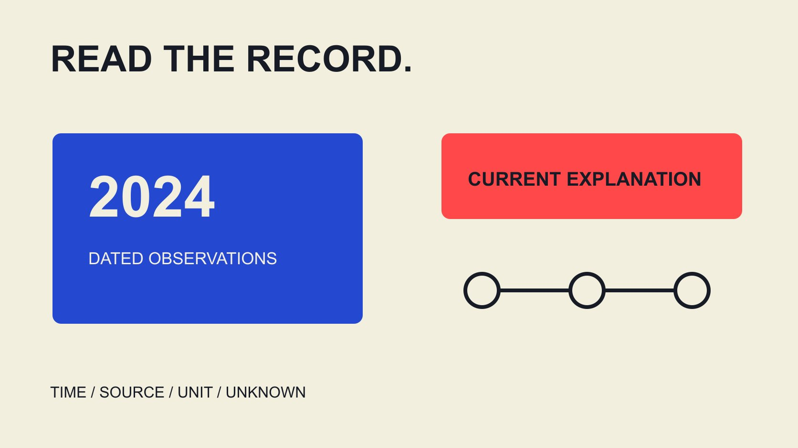

# 回看2024 Web3受众：Instagram数据的证据边界

状态：本地审阅稿；正式发布日期待确认。

教育向解读2024年Web3与Instagram受众报告：检查历史记录、来源独立性与对象单位，把可疑信号、推测和已证实事实分开。

QuickKOL 编辑图形；不呈现真实账号指标或平台界面。

“Web3 Instagram account follower quality analysis 2024”应作为历史数据素养问题来读：当年的资料记录了什么，来源是否独立，结论有没有超出证据？今天的粉丝数不能重建2024年受众，钱包或地址数量也不是Instagram真实人数。异常增长、重复互动或模型标记可以提示进一步理解，但不能单独确认购买粉丝、个人意图或违法。本文提供教育性的记录与表达方法，不提供个人筛选、真假排名或百分百识别承诺。缺少历史资料时，应保留未知，而不是补出看似确定的结论。

## 先界定2024指资料还是观察时期

标题中的2024可能指报告发表年、内容发布年、统计窗口或截图日期。这四个时间不同，必须分别记录，不能因为文件名带2024就认定全部数据属于当年。

资料阅读时间也另列。2026年打开一个网页，不会把网页中的历史观察自动更新到2026；反过来，今天更新过的定义也不能被写成当年已经保存的账号证据。

若报告只给年度标签，没有起止时间，结论应缩为“该报告声称覆盖2024，具体窗口未说明”。不要通过图形位置或URL猜出月份。

这项检查适合品牌培训、报告引用和历史复盘。它帮助读者判断一句话能被引用到哪里，不需要建立任何个人真实性档案，也不需要补采无关私人资料。

## 保存来源链，不把完整性当准确性

为一份资料记录发布者、原始页面、观察窗口、取得时间、字段与已知转换。保留适当副本或引用位置，目的在于让同事找到相同材料，而不是扩大分享受限数据。

截图可以证明某个界面当时显示了某种内容，但通常不能独立说明全部采集方法。裁切可能移除了单位、日期或限定；引用前尽量找到完整上下文。

文件校验值可以帮助比较副本是否改变，不证明原始输入为真、来源独立或账号行为原因已知。不要把技术完整性标识升级为数据准确认证。

[Instagram数据口径指南](/zh/blog/instagram-analytics-format-decision-matrix/#answer)可帮助理解字段。历史资料仍需保留当时定义；如果只能找到当前说明，明确它只是概念参考，不能自动替代缺失的历史版本。

## 钱包、链上账号与Instagram账号分别计算

[ethereum.org钱包概念说明](https://ethereum.org/wallets/)解释钱包与账号、地址的区别，并说明一个应用可以管理多个Ethereum账号。本次页面更新日期为2026年2月24日，本文只用作概念解释，不冒充2024年档案。

因此，一个钱包界面、一个地址、一个链上账号、一位自然人与一个Instagram账号不能直接一一对应。本文也不提供将地址与社交身份匹配的方法，不从交易记录猜个人身份。

即使项目报告分别列出地址数和社交关注数，也只保留各自对象、来源与窗口。把两者相除可以产生算术结果，却不能自动叫作真实受众比例或社区信任分。

“Web3社区”本身也需要定义。它可能指项目自称的参与群体，不能仅凭相关标签就认定所有互动者都持有资产、具有某种身份或代表同一种意图。

## 历史平台公告是背景，不是账号结论

[Meta垃圾互动工具公告](https://about.fb.com/ltam/news/2023/12/protegiendo-a-los-creadores-de-interacciones-no-deseadas-con-nuevas-herramientas-proactivas-de-seguridad/)发表于2023年12月13日，页面显示2024年3月5日更新。它描述将疑似垃圾或机器人关注放入复核区域，也描述用户认为非垃圾时可以批准。

这说明平台当时公开介绍过带复核的工具，不证明某个账号在2024年被标记，更不说明今天每个账号都有完全相同的功能或界面。

转述时保留“疑似”和资料时间，不把“平台提供检查机制”改成“所有标记都已证实造假”。公告也不是独立准确率研究，不能从中生成百分百检测承诺。

若历史报告引用某个标记，需要适当原始记录与范围；仅引用公告链接不足以证明标记曾出现在特定资料中。机制背景与具体观察应分栏。

## 异常增长先写成观察，不猜原因

假设留存记录显示同一计数从10,000变成12,000，净增加2,000，按起点计算增加20%。这些是教学输入，不是真实账号或行业异常阈值。

它能支持指定两个快照的计数差，不能说明期间新增与流失各是多少，也不能计算其中“假粉”比例。没有完整流量与关注变化记录时，不把净变化拆成编造的原因。

可能解释可以作为待核对问题，如内容曝光、公开活动、记录口径或平台清理；不能把任何一种可能直接写成发生事实。未知不是最不利的解释已经成立。

[互动率指标约定](/zh/blog/engagement-rate-formula-metric-contract/#answer)可帮助检查分子、分母与窗口。如果计数范围或字段定义改变，先说明不可直接比较，而不是把定义变化包装成行为异常。

## 多个网页不一定是多个独立证据

新闻摘要、供应商博客和社交转述可能都来自同一份报告。逐层追溯来源，避免把同一个截图被重复引用误当作多方独立确认。

可以为每条主张画简短来源链：谁观察、谁计算、谁转述。没有原始采集资料时说明无法复核，不因为后续页面语气更确定就升级结论。

如果两个来源不一致，先比较时间、对象、单位与定义。有时差异来自不同窗口，有时确实无法解释；保留分歧比挑一个有利数字更适合培训。

本篇不要求读者追踪个人活动或获取受限资料。目标是理解报告怎样形成，判断哪些陈述可负责任引用，并在证据不足时缩小说法。

## 法律背景不替代事实认定

[FTC虚假社交指标问答](https://www.ftc.gov/business-guidance/resources/consumer-reviews-testimonials-rule-questions-answers)是美国工作人员指导，说明相关规则于2024年10月21日生效。其虚假指标条款有具体行为和知情条件，不能改写成“互动低就是违法”或全球统一判断标准。

教育报告可以解释为何不应制造或误用虚假社会证明，但某份历史计数是否涉及具体行为，需要相应事实与适当专业判断。本文不裁定任何个人或项目违法。

尤其不要从疑似粉丝存在，直接跳到账号所有者购买、授意或知情。关于计数、来源、行为与意图的结论需要不同证据，不能共享一张异常图表作为全部证明。

在报告中把法条背景、观察和未决问题分开，避免一条监管链接让读者误以为文章已经完成了执法层面的认定。

## 用四栏表达保留已知与未知

采用观察、解释、证据限制和下一问题四栏。例如“两个留存快照净增20%”是观察；“可能与公开活动相关”是待核对解释；“没有完整期间记录”是限制。

不把问题栏写成预设有罪的追问。可问资料窗口与定义是否一致，不需要要求对方证明所有关注者都是独立真实个人；现有记录可能根本不支持这种完整结论。

报告修正时说明新增了什么证据、哪句解释改变、哪些未知仍保留。只删除一处强烈措辞却保留原标题，会让不当结论继续流传。

如果资料无法恢复，保留“不能从现有资料判断2024年质量”的结论。这是有意义的历史素养结果，不是需要用当前模型评分填补的失败。

## 把学习成果带回可靠的数据表达

最后检查标题、摘要、表格与引用是否都停在证据范围内。没有提供个人真假名单、检测保证或未知比例的精确估计。

[活动衡量指南](/zh/blog/creator-campaign-measurement/#answer)可继续帮助区分计数、受众反应与实际结果。本篇的下一步是更好地解释资料与承认限制，不是寻找个人、建立排名或根据钱包关联做身份推断。

可复用的成果是一份说明时间、单位、来源链和未知的记录。这样即使无法回答某个历史质量问题，品牌团队仍能更准确地引用报告、纠正误读，并知道未来应保留哪些适当资料。

## 2024历史资料的教育性阅读表

| 材料 | 可支持 | 仍不能推出 |

| --- | --- | --- |

| 带日期的计数快照 | 记录范围内的计数差 | 行为原因、假粉比例或意图 |

| 平台工具公告 | 当时公开描述的机制 | 具体账号结论或准确率 |

| 钱包或地址数量 | 其原始定义对象 | Instagram独立真实人数 |

| 当前概念说明 | 解释当前所读概念 | 缺失的2024账号证据 |

教育框架，不是个人评分或身份匹配工具；10,000至12,000是假设算例。

## 引用历史受众结论前

把可观察记录与解释分开。

- [ ] 区分发布、观察、截图与阅读时间。

- [ ] 单位不在钱包、账号与人之间偷换。

- [ ] 多页面追溯到原始来源。

- [ ] 疑似标记没有写成已证实事实。

- [ ] 未知没有被当前数据补成历史事实。

- [ ] 修正同步到标题、表格与摘要。

## 研究日期与使用边界

资料核验于 2026 年 11 月 3 日。文中方法、表格和决策规则为编辑建议，标为假设的示例不是实际客户结果或行业基准。外部资料的适用地区与时期按各段说明；本稿处于独立本地审阅阶段，正式发布日期待确认。

## 来源

- [ethereum.org钱包概念说明](https://ethereum.org/wallets/)

- [Meta垃圾互动工具公告](https://about.fb.com/ltam/news/2023/12/protegiendo-a-los-creadores-de-interacciones-no-deseadas-con-nuevas-herramientas-proactivas-de-seguridad/)

- [FTC虚假社交指标问答](https://www.ftc.gov/business-guidance/resources/consumer-reviews-testimonials-rule-questions-answers)
