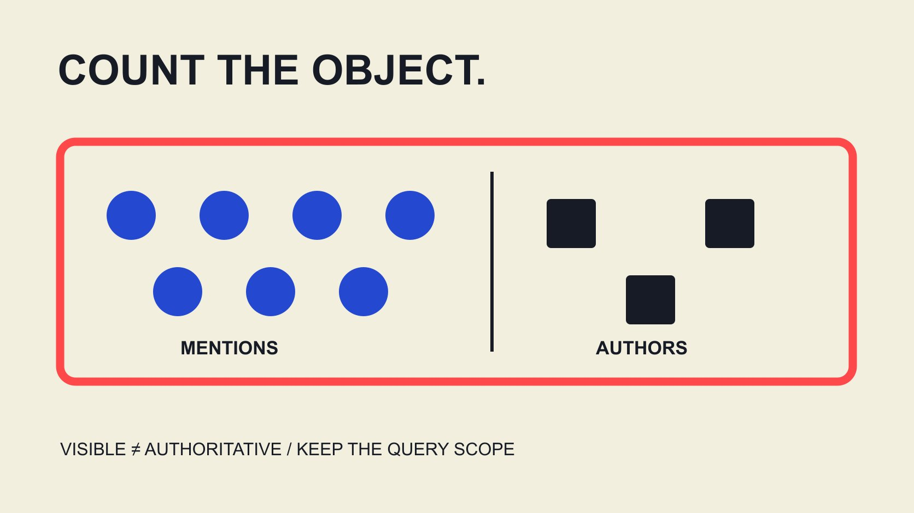

# What Is KOL in a Social Listening Report?

Status: local review draft; confirm the publication date before release.

A KOL label in a listening report needs its basis: being mentioned, posting often, estimated reach and professional authority are different. Reconstruct sources and units before interpreting voices.

QuickKOL editorial graphic; not actual account metrics or a platform interface.

KOL commonly expands to key opinion leader. In a social listening report, first ask whether it describes a professional role or a visibility label assigned by a provider or editor within a particular query. More mentions, frequent posting and estimated reach do not independently establish expertise, correctness, audience agreement or willingness to collaborate. State query, sources, window, counted object and labeling method, then examine professional contribution and actual business outcomes separately. This guide explains report interpretation rather than publish an individual ranking or turn one listening metric into certification. The useful question is what the label means in this specific record.

## Read the label definition rather than treat the acronym as proof

A report may identify key voices through mentions received, posts authored, interactions or a provider composite. These are different objects and methods, not the same professional assessment merely because the final label is KOL.

The [expert-contribution review guide](/blog/key-opinion-leader-expert-contribution-review/#answer) develops work, domain and appropriate evidence. Listening can explain which voices are visible, while professional contribution needs its own question and material.

Ask the report to identify label owner, fields and limits. If the method is unavailable, preserve that missing definition instead of guessing a meaning that includes authority, trust and commercial effectiveness automatically.

This also prevents organizations, publishers, individuals and republishers being combined without explanation. A name appearing in a query does not establish that it is a creator, original opinion source or suitable business contact. Clear labeling lets the next reader understand what the report has actually identified before taking any action based on a term that may have been used differently in another document.

## The query defines which discussion becomes visible

Record brand or topic names, variants, exclusions, languages, platforms and window. A term can be ambiguous: insufficient exclusion admits unrelated material, while excessive exclusion can remove relevant discussion.

Retain query versions and reasons for changes. Do not repeatedly tune terms after seeing results until only expected voices remain, then describe the original discussion structure as objectively and completely discovered.

The [competitor-partnership map guide](/blog/competitor-creator-partnership-map/#answer) distinguishes mentions, content appearances and actual partnerships. A brand and person appearing together does not independently establish sponsorship, endorsement or a contract.

The report should describe content meeting this query and data scope, not every opinion on the internet. State which question the query suits and which it cannot answer. A colleague needs enough detail to understand why an item was included and how a later query revision might change the population, rather than assume that a changed count necessarily reflects changed public attention.

## Source coverage and access are bounded

The [Brandwatch Listen source guide](https://social-media-management-help.brandwatch.com/en/articles/17449910-sources-for-listen-mentions) distinguishes available material by channel, such as public non-owned Instagram posts and comments requiring particular tracking. It is that product’s documentation, not one coverage rule shared by all listening tools.

Record actually enabled sources, access and known gaps. Instagram in a platform list does not establish complete collection of posts, comments and private conversations.

Check historical coverage as well. Current availability can have a lookback boundary; what is searchable today does not show that every earlier discussion was fully retained. Limit the historical statement when records are missing.

We have connected no account, run no query and changed no permissions. Public documentation explains why scope matters without verifying a client project’s coverage or every vendor input’s accuracy. The report’s own source list should remain close to its conclusions so a reader does not assume that unavailable conversations support the same patterns as the observed material.

## Interpret mentions, authors and people separately

The [Brandwatch chart-field guide](https://developers.brandwatch.com/docs/basic-charts) distinguishes aggregates such as mention volume and distinct authors, with query and dates as chart parameters. It supports identifying the counted object, not assuming identical available fields across every product or channel.

One author can publish several items, and one item can generate several republications. An author identifier is not sufficient proof of a distinct real person; account totals should not become unique-audience claims.

Handle reposts, quotations, duplicate collection and edited records under actual source definitions. They may represent different distribution actions or require deduplication. Do not invent a universal rule that removes or adds them all.

Consider a hypothetical in which one original statement is republished in several places. A report can show original opinion and subsequent distribution separately without calling every republication an independent expert endorsement. Quotation can also express disagreement. Preserve the relationship between original, republication and context before choosing aggregation for the question. There is no need to erase distribution records merely to reduce repetition, or to conceal their shared origin to make support appear broader. The record can explain both where an idea began and how it circulated.

Retain the quantity in a heading such as most-mentioned voices. Renaming that result the most influential experts adds professional and outcome judgments unsupported by the count alone. A readable chart can remain useful with the narrower label, because it tells a specific story about observed discussion without pretending to measure every kind of influence.

## A hypothetical share describes the query, not the market

Suppose a defined query and window contain 100 eligible mentions, with 20 authored by one identifier. Its share of mentions is 20%. These are teaching inputs, not a person’s observed result or market share.

That does not mean 20% of distinct people endorse the author, establish professional authority or show that the author contributed 20% of brand sales. The denominator is included mentions, not all internet users or transactions.

A frequently posting account can stand out in volume without each item being more persuasive. Depending on the question, retain content count, author object and suitable responses instead of asking one share to explain everything.

The denominator changes with query, source and window. When two reports differ, inspect the populations before discussing changing voices. Different selected material should not become a claim that the same market’s opinions suddenly changed. A percentage remains descriptive only when the reader can identify what is inside and outside its denominator.

## Return to the original content and preserve classification states

The [Brandwatch mention-reading guide](https://social-media-management-help.brandwatch.com/en/articles/17449980-viewing-listen-mentions) describes links to original publications and analysed classifications such as sentiment, while noting field differences between Quick and Saved Searches. It also states that location is unavailable for Instagram mentions in that guide; do not infer it yourself.

For consequential material, read actual wording, time and context. A negative classification does not establish opposition to everything about a brand; quotation, irony or republication may need a different interpretation.

Separate model labels from human explanation. Without sufficient original material, preserve pending review rather than let a color stand for a fact or invent author and audience geography to complete a table.

A report can use appropriately scoped material with attribution without exposing unrelated personal information. Theme analysis of public expression should serve the assignment rather than expand into a private-life dossier. This makes the listening record easier to correct when additional context changes a classification but leaves the underlying published words unchanged.

## Expert authority needs evidence relevant to the question

If the next task genuinely requires understanding professional contribution, examine relevant work, explanatory evidence, actual scope and appropriate experience. High mention volume can indicate visibility without completing those fields.

The [launch-advisory contribution guide](/blog/what-is-kol-product-launch-advisory-work/#answer) develops how advice informs product or communication decisions. Whether a voice belongs in a specialist discussion follows the actual task and evidence, not automatic confirmation from a KOL label.

Do not reverse the assumption and conclude that limited exposure means limited expertise. Someone may explain a narrow domain well; posting frequency is insufficient to determine the correctness of that knowledge.

Keep visibility, relevant professional contribution and commercial conditions in separate fields. Extensive discussion of a public figure does not establish willingness, availability, brand endorsement or acceptance of your brief. The report can make the research question clearer while leaving the business relationship unconfirmed. This boundary prevents a monitoring output from being described as a list of already qualified or consenting partners.

## A change chart needs a stable population and version record

Before comparing periods, align query, sources, unit, language and observation window. Adding a data source can increase mentions without establishing an equivalent increase in topic interest.

When labeling methods change, retain the earlier definition and effective time. Changes in the resulting KOL list should not all be described as rising or falling personal influence; some may follow measurement design.

If a comparable series cannot be established, present records separately with an explanation. Do not fill unknown periods with zero to draw a continuous line or combine weekly and monthly counts as one consistent movement.

Explain known changes, possible causes and unconfirmed differences. The business team can then decide whether to inspect content, obtain information or reformulate the question instead of simply following arrows. A consistent reporting record makes a later correction understandable and avoids attributing a data-source or query change to the conduct or importance of a particular voice.

## Deliver a report that distinguishes discussion from outcomes

The [AMEC evaluation framework](https://amecorg.com/amecframework/) separates communication outputs, audience responses, outcomes and impact. Listening mentions can supply an observation without automatically establishing understanding, changed attitudes or business contribution.

The [campaign-measurement guide](/blog/creator-campaign-measurement/#answer) develops those questions. The final report should retain query and version, source coverage, unit, labeling method, important context and unknowns, with conclusions no broader than that material.

QuickKOL can help interpret a brief, research relevant creators’ work and prepare contact. This guide does not claim it supplies every listening-product dataset or automatically certifies authority. Reading a KOL label back through its evidence makes responsible citation and the next brand decision possible.

## Interpreting KOL labels in a listening report

| Field | Can describe | Cannot establish alone |

| --- | --- | --- |

| Mention volume | Discussion records within the population | Unique people or market share |

| Author count | Author identifiers under a method | A complete real-person count |

| Sentiment label | That method’s classification of expression | All personal intention or positions |

| KOL label | The stated role or labeling rule | Expert certification, outcomes or acceptance |

Editorial interpretation framework; hypothetical 20/100=20% is mention share, not an individual score.

## Before reading a listening-based KOL conclusion

Identify what is counted before interpreting what can be said.

- [ ] Identify the label owner and definition.

- [ ] Retain query, version and window.

- [ ] Show source and access gaps.

- [ ] Separate mentions, authors and people.

- [ ] Keep context and review state with classifications.

- [ ] Support professional and business conclusions separately.

## Research date and limitations

Sources reviewed November 3, 2026. Methods, tables and decision rules are editorial recommendations. Hypothetical examples are not actual client results or industry benchmarks. Source geography and periods are specified where relevant. This draft is in independent local review; confirm its publication date before release.

## Sources

- [Brandwatch Listen source guide](https://social-media-management-help.brandwatch.com/en/articles/17449910-sources-for-listen-mentions)

- [Brandwatch chart-field guide](https://developers.brandwatch.com/docs/basic-charts)

- [Brandwatch mention-reading guide](https://social-media-management-help.brandwatch.com/en/articles/17449980-viewing-listen-mentions)

- [AMEC evaluation framework](https://amecorg.com/amecframework/)
