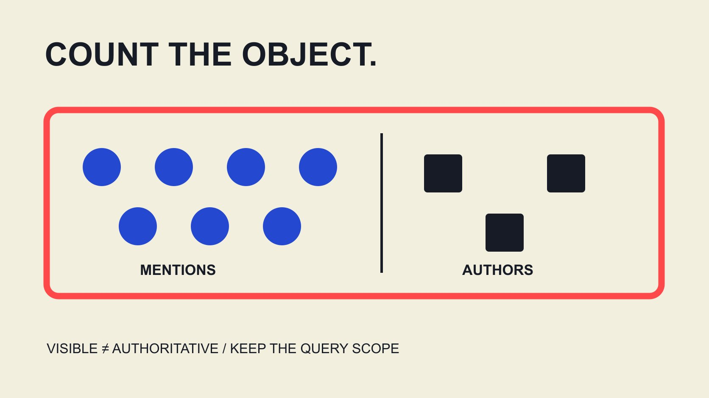

# 舆情报告里的KOL：提及量不等于专业权威

状态：本地审阅稿；正式发布日期待确认。

舆情报告里的KOL标签需要说明依据：查询内被提及、发声频繁、潜在触达与专业权威不是同一件事。先还原来源和单位，再解释声音。

QuickKOL 编辑图形；不呈现真实账号指标或平台界面。

KOL通常展开为key opinion leader，即关键意见领袖。但在舆情报告里，先问这是一种专业角色，还是供应商或编辑按特定查询建立的可见声音标签。提及多、发帖多、潜在触达高都不单独证明专业权威，也不代表观点正确、受众赞同或有合作意愿。报告应说明查询、来源、窗口、计数对象与标签方法，再把专业贡献与实际业务结果分别核对。本文解释报告如何被阅读，不发布人物排名或把一个监听指标升级成资格认证。

## 先读标签定义，不把缩写当证明

同一个报告可能按被提及次数、本人发帖、互动或供应商综合指标标出“关键声音”。这些对象和方法不同，不能因为最后都写KOL就视为同一种专业判断。

[专业贡献核对指南](/zh/blog/key-opinion-leader-expert-contribution-review/#answer)进一步说明作品、知识范围与适当依据。舆情报告可以帮助理解哪些声音可见，但是否有专业贡献需要另外的任务和资料。

要求报告写出标签提供者、所用字段与限制。没有方法时标定义未取得，不由读者猜出一个自动包含权威、可信与商业效果的含义。

这也帮助避免将企业账号、新闻媒体、个人和转述者混成一类。一个名称在查询中出现，不自动说明它是创作者、意见源头或本次应联系的合作方。

## 查询决定能看见什么讨论

记录品牌或主题名称、同义表达、排除项、语言、平台与窗口。一个词可能有歧义，缺少排除会把无关内容带入统计，过度排除又可能漏掉相关讨论。

保留查询版本与变更理由。不能在看到结果后不断调整词语，只留下符合预期的声音，然后宣称原本的讨论结构已经被客观完整发现。

[竞品合作地图指南](/zh/blog/competitor-creator-partnership-map/#answer)可帮助区分提及、内容出现与实际合作关系。一个品牌名和人物名同时出现，不单独证明赞助、认可或合同。

最终报告说明统计覆盖的是符合这一查询与资料范围的内容，而不是全网全部意见。查询适合什么问题、不能回答什么，应和结果一起交付。

## 来源覆盖与权限不是无限的

[Brandwatch Listen来源说明](https://social-media-management-help.brandwatch.com/en/articles/17449910-sources-for-listen-mentions)按渠道区分可获得资料，例如公开非自有Instagram帖子与需要特定跟踪的评论资料。它是该产品的公开文档，不是所有监听工具共享的覆盖规则。

因此报告应记录实际启用来源、权限和已知缺口，不能仅因产品列出Instagram就说已经读到全部帖子、评论与私人交流。

历史覆盖也要核对。当前资料可能有可回溯窗口，不能从今天能搜索的范围推断过去已经完整保存所有讨论。缺少历史数据时如实限定。

本文没有连接账号、运行查询或修改权限。用公开文档解释为什么范围重要，不宣称已验证某个客户项目的实际覆盖或供应商所有数据都准确。

## 提及、作者与独立人分别理解

[Brandwatch图表字段说明](https://developers.brandwatch.com/docs/basic-charts)区分提及量与不同作者等汇总，并将查询与日期作为图表参数。这支持先明确统计对象，不表示所有产品或渠道都有相同可得字段。

一位作者可发表多条内容，同一条内容也可能引起多次转述。作者标识不是现实中独立人头的充分证明；不要用账号总数直接声称独立受众规模。

转发、引用、重复抓取和编辑后的记录，按实际来源定义处理。它们可能代表不同传播动作，也可能需要去重，不能由编辑凭想象统一清除或全部相加。

再看一个假设：同一原始表达被多处转述。报告可以分别呈现原始意见与后续传播，但不能把每次转述都叫作独立专家赞同；引用也可能是在质疑。先保留原发、转述和实际语境的关系，再按问题决定怎样汇总。不需要为了降低重复而删除传播记录，也不应为了放大支持而抹去它们依赖同一源头的事实。

在标题写“提及最多的声音”时保留量词。若改成“最有影响力的专家”，就增加了原计数没有独立支持的专业与效果判断。

## 假设占比描述查询，不描述整个市场

假设指定查询与窗口内有100条合资格提及，某个作者标识贡献20条，则其提及占比为20%。这是教学输入，不是实际人物或市场份额。

这20%不等于20%的独立人认可该作者，不说明其专业权威，也不证明品牌销售中20%由其贡献。分母是纳入提及，不是全网人群或交易。

如果某个账户发布频率很高，它可能在提及量上突出，而不是每条内容更有说服力。需要按问题保留内容数量、作者对象与适当反应，不能用一个占比覆盖全部。

分母随查询、来源与窗口改变。两个报告占比不同，先核对集合是否一致，再讨论声音变化；不要把选择不同的资料当成同一市场意见突然改变。

## 回到原始内容，保留语境与分类状态

[Brandwatch提及阅读说明](https://social-media-management-help.brandwatch.com/en/articles/17449980-viewing-listen-mentions)介绍原始发布入口与情绪等分析分类，也提示Quick Search与Saved Search存在字段差异。文档还说明其Instagram提及位置字段不可用，不能自行推断地点。

对影响判断的内容，查看实际表达、时间与相关语境。分类为负面，不直接说明作者反对品牌全部事项；引用、讽刺或转述可能需要不同解释。

模型标签与人工解释分开。没有看到足够原文时，保留待复核状态，不以分类颜色代替事实，也不为了表格完整猜测作者所在地或受众地域。

报告可引用适当范围的内容与出处，不需要曝光无关个人信息。公开表达的主题分析应服务本次问题，不扩展成对个人私人生活的档案。

## 专业权威需要与问题相关的另外依据

如果报告下一步确实需要理解专业贡献，检查与主题有关的作品、解释依据、实际范围与适当经历。高提及量可以提示可见度，不自动填满这些字段。

[发布咨询贡献指南](/zh/blog/what-is-kol-product-launch-advisory-work/#answer)进一步说明意见如何影响产品或内容决定。一个声音是否值得纳入专业讨论，取决于具体任务和证据，不是报告自动给了KOL标签就完成确认。

也不要反向认为低曝光就没有专业价值。专业人士可能只在很窄领域解释得清楚，传播频率不是其知识正确性的充分评价。

把可见度、相关专业贡献与实际合作条件分栏。公众人物被讨论很多，不代表其愿意合作、当前可用或认可某个品牌，更不代表其已经接受你的Brief。

## 变化图需要稳定集合与版本记录

比较前后时期时核对查询、来源、单位、语言与观察窗口。增加一种数据源可能提高提及总量，不一定说明话题热度同步增加。

标签方法改变时保留旧定义与生效时间。不能把新规则产生的KOL名单变化全部写成个人影响力升降；部分差异可能来自测量结构。

如果无法建立可比序列，分开呈现并说明。不要为画连续折线将未知时期填零，或将按月和按周统计混接成同一种变化。

报告解释应指出已知变化、可能原因与无法确认的部分。这样业务团队可以决定需要进一步看内容、补资料还是改变问题，而不是只根据箭头追逐声音。

## 交付一份能区分声量与结果的报告

[AMEC评估框架](https://amecorg.com/amecframework/)区分传播产出、受众反应、结果与影响。舆情提及可以提供某类观察，但不自动证明受众理解、态度改变或业务贡献。

[活动衡量指南](/zh/blog/creator-campaign-measurement/#answer)可继续组织这些问题。最终报告应包含查询与版本、来源覆盖、单位、标签方法、重要语境及未知，结论不超过这些资料。

QuickKOL可以帮助理解Brief、研究相关创作者作品并准备联系；本文不声称它提供上述监听产品的全部数据或自动认证专业权威。把KOL标签读回它的证据，才便于品牌负责任地引用与继续判断。

## 舆情报告的KOL标签解释表

| 字段 | 可以描述 | 不能单独证明 |

| --- | --- | --- |

| 提及量 | 纳入集合中的讨论记录 | 独立人数或市场份额 |

| 作者数量 | 特定方法识别的作者标识 | 现实独立个人总数 |

| 情绪标签 | 该方法对表达的分类 | 个人全部意图或立场 |

| KOL称呼 | 所声明角色或筛选规则 | 专业认证、效果或合作接受 |

编辑解释框架；20/100=20%是假设提及占比，不是实际人物评分。

## 阅读舆情KOL结论前

先知道它数什么，再判断可以说什么。

- [ ] KOL标签有明确提供者与定义。

- [ ] 查询、版本与窗口保留。

- [ ] 来源和权限缺口可见。

- [ ] 提及、作者与人没有混用。

- [ ] 分类保留语境和复核状态。

- [ ] 专业与业务结论有另外依据。

## 研究日期与使用边界

资料核验于 2026 年 11 月 3 日。文中方法、表格和决策规则为编辑建议，标为假设的示例不是实际客户结果或行业基准。外部资料的适用地区与时期按各段说明；本稿处于独立本地审阅阶段，正式发布日期待确认。

## 来源

- [Brandwatch Listen来源说明](https://social-media-management-help.brandwatch.com/en/articles/17449910-sources-for-listen-mentions)

- [Brandwatch图表字段说明](https://developers.brandwatch.com/docs/basic-charts)

- [Brandwatch提及阅读说明](https://social-media-management-help.brandwatch.com/en/articles/17449980-viewing-listen-mentions)

- [AMEC评估框架](https://amecorg.com/amecframework/)
