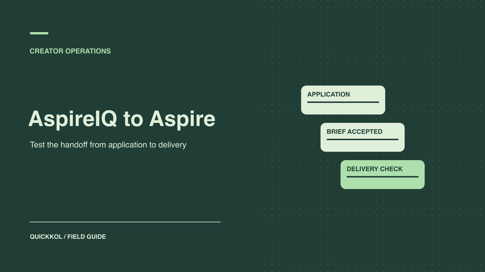

# How to Evaluate Aspire for Creator Partnerships

Status: local review draft; confirm the publication date before release.

Evaluate Aspire by following actual creator applications through selection, agreements, approval and live delivery.

QuickKOL editorial graphic; not actual account metrics or a platform interface.

AspireIQ is a former name for Aspire. Evaluate it with a small cohort of creators and a real brief. Follow applications through selection, agreement, review, publication and settlement. At each stage, verify who can establish identity, relevant work, approved version and rights. Use the trial to decide whether it improves a creator decision or reduces the actual cost of handing over the work.

## Identify the current product and any legacy workflow

[Aspire’s rebrand announcement](https://www.aspire.io/blog/aspire-new-branding) identifies Aspire as the successor name to AspireIQ. Older material and some product entry points can still show the former name. Verify the current supplier, sign-in route, agreement, payment recipient and support contact. Do not follow an old screenshot’s menus without checking the current account. Extract the important fields from the legacy process, such as applications, product shipment, review and payment. Then confirm which actions are available today. A name change does not require duplicate accounts or moving accepted files again.

Use a real trial task, such as inviting five creators to apply for a defined product pilot and completing three agreements. The size is illustrative. The point is to get procurement, production and finance through the stages they need. Choose a product, market, budget and rights scope before selecting participants. A [creator marketplace order checklist](https://www.quickkol.com/blog/collabstr-marketplace-order-checklist/#answer) can help separate the commercial transaction from work acceptance. Give each stage an owner who can actually decide what to do with its evidence.

## Test whether applications support a real selection

[Aspire’s creator marketplace page](https://www.aspire.io/influencers) describes discovery, applications, creator profiles and collaboration. Define the work, market, language, creative and usage rights first. Collect only application information that can affect selection. Ask for comparable work, the intended account and the ability to publish in the required market and period. Verify the account and role independently. An application does not establish agreement. A follower total does not establish the ability to perform the work. For applicants who do not proceed, retain only the material necessary under the project’s process.

Measure the time needed for one manual review. For example, seven of ten applications might include enough work samples and three might need clarification on market or format. Determine whether the form omitted a useful field, the tool made evidence difficult to find or the job simply requires a conversation. Revise one question and compare the follow-up rate in the next round. Use equivalent briefs and samples when comparing with a manual workflow. A narrower campaign can require less work even when the software contributes little to the change.

## Confirm the exact brief the creator accepted

[Aspire’s brief signing guide](https://help.aspireiq.com/en/articles/13641591-how-to-review-and-sign-a-brief) describes how a creator can review partnership details, sign and proceed to other campaign tasks. During the pilot, verify the signatory, version, deliverables, compensation, reporting date, uses and cancellation terms. Check whether the workflow preserves earlier approvals when the brief changes. If an agency and creator acknowledge different documents, a forwarded copy does not establish the creator accepted the revised terms. Give advertising, exclusivity and sublicensing to the responsible reviewer.

Suppose the brand changes an organic post into three months of ad use. Reopen the approval for the new version. Keep the effective time, parties and scope. If the platform says signed without exposing the exact version you need to check, refer to the approved agreement record. Use a [creator rates and usage rights framework](https://www.quickkol.com/blog/creator-rates-usage-rights/#answer) to distinguish production fees from usage. That prevents the trial from reaching settlement with one price covering several unexamined rights.

## Distinguish approved creative, detected posts and accepted delivery

[Aspire’s campaign workflow guide](https://help.aspireiq.com/en/articles/16193146-campaign-workflow-and-stages) describes stages such as content review, waiting for live posts, detected posts and payment. Detection is a reason to verify a post. It does not establish that the agreement was fulfilled. Open the original URL and confirm publisher, time, version, disclosure, destination, rights and required availability. Link the approval to the final creative. If a creator changes wording or the wrong post is detected, mark which stage needs attention and give the owner a concrete action. Keep the affected post separate from accepted work.

Test a failure. A creator might submit an approved draft on time and then publish an older caption. The trial should reveal the difference, notify the publisher, preserve the corrected URL and retain unrelated approvals. Record any status change someone had to make outside the system. When the tool cannot see a format or market, define a fallback such as manual URL submission and brand review. Only after separating detection from acceptance can the buyer estimate the work that actually went away.

## Check settlement evidence beyond the workflow status

[Aspire’s payment workflow guide](https://help.aspireiq.com/en/articles/6326989-how-do-payments-work-on-aspire) describes how completed delivery can move into a payment stage in the relevant setup. Verify supported methods, markets, currency, fees and approval roles in the actual account. Reconcile the agreement, invoice or request, approval and payment evidence. Entering a payment stage does not establish that funds arrived. In a test environment, make clear that the trial does not trigger an actual payment and verify who could authorize one. Route uncertain payment matters to the finance or agreement owner.

Suppose a creator has two deliverables. The first is accepted and the second still needs a disclosure correction. A task may appear ready to pay. Apply the actual contract to determine whether it supports partial payment. Keep both delivery states and the exception. The authorized finance owner verifies the transaction and checks whether the needed records can be exported. Do not circulate private payment details in a content review channel. Record only identifiers or amounts appropriate for that audience.

## Test offboarding with exportable evidence

At the end of the trial, ask another person to review one partnership using only the export and approved contract archive. They should be able to find the creator account, accepted version, review history, live URL, rights, reporting and payment status. If the export misses a field, determine whether it requires another plan or manual documentation. Check which material remains accessible only while permissions are active and what may be kept under the agreement. Give agencies and contractors an end date and verify access removal after the work.

Suppose another agency takes the next season. It should locate reusable files and rights expiry in an authorized handoff without signing in as the old agency. Name the new administrator, revocation owner and record keeper. If the platform can export projects but omits important evidence, include the cost of filling those gaps. Run the rehearsal during the trial. The buyer should not discover after cancellation that the approved usage terms are visible only to one former operator.

## Align tool approvals with team responsibilities

Map the minimum responsibilities for a collaboration. Sourcing verifies accounts and work. Product checks samples and stock. Production reviews content, disclosure and destinations. Finance handles settlement. Match permissions to the task. Someone who needs to view a project does not necessarily need to change rates, approve rights or send money. Run a rehearsal with actual roles. Can the creator see a revision request? Can the brand reviewer find the current version? Can finance locate supporting records? If everything requires the same administrator, find out whether that is a configuration choice or a product limitation.

Rehearse a mid-project staff change as well. Have the new owner use their authorized account and find the signed brief, latest content, approval and live URL in sequence. The former owner can transfer notes without transferring a personal login. Record time, missing fields and duplicate verification. Where notifications help, check that the status in the message, platform and contract evidence all refer to the same asset. A workflow can show review complete while the team approved a previous edit. The new owner should be able to discover the mismatch from the version history.

Preserve a baseline for comparison. Define how the manual workflow measures time per deliverable, separating time spent waiting for a creator from staff handling time. Use the same units in the platform pilot. If email decreases but staff enter the same data in two systems, report the actual work. Include any external records the team still maintains. Keep a list of how the parties would fulfill the agreement if the tool became unavailable. Testing the exit workflow helps the buyer estimate both daily operating effort and handoff cost.

## Make the procurement decision conditional on evidence

Compare time per collaboration, missing inputs, repeated data entry, publication errors and clarity of settlement status. Give important work an acceptance condition, such as being able to find the approved version and public URL for each of three assets. Lower-priority features can remain open if they do not block the primary job. Compare subscription, training, manual work and maintenance in the same period. When buying, narrowing or extending the trial, retain the tested configuration, date and evidence. If the product supports recruitment and the reporting requirement is unmet, define the purchase around recruitment.

## Measure whether the platform reduces a sourcing round

Suppose a pilot recruits creators for product demonstrations. Ten applicants provide profile links, but only seven include original work that matches the brief. The sourcing reviewer records whether each applicant has enough evidence for outreach and sends the others one focused question. Next time, replace a generic request for examples with a request for one recent comparable demo and the applicant’s role. Compare usable applications and manual follow-ups across the two rounds.

Keep the sourcing result separate from delivery. If the tool reduces messages but the brand still checks live posts and ad rights manually, record both the time saved and the remaining responsibility. The team can purchase recruitment support first while keeping its existing approval and settlement process. Creators should know what to submit and the next reviewer should be able to trace why someone was selected.

## Aspire pilot acceptance fields

| Stage | Evidence | Owner |
| --- | --- | --- |
| Application | Account, work, format and market | Sourcing |
| Agreement | Signatory, version and terms | Contract owner |
| Publication | Version, disclosure, URL and time | Publisher and brand reviewer |
| Settlement | Approval, payment evidence and offboarding | Finance and project owner |

Validate the actual plan, market and authorized roles.

## Creator operations pilot checklist

Have a second reviewer reproduce one full collaboration.

- [ ] Verify the current product and pilot scope.
- [ ] Verify application, agreement and approval versions.
- [ ] Open the live post and verify disclosure.
- [ ] Check settlement, exports and offboarding.

## Research date and limitations

Sources reviewed November 9, 2026. Methods, tables and decision rules are editorial recommendations. Hypothetical examples are not actual client results or industry benchmarks. Source geography and periods are specified where relevant. This draft is in independent local review; confirm its publication date before release.

## Start creator research with a clear task

Use QuickKOL to interpret a brief, discover relevant creators and research their work and contact routes. Verify data, commercial terms and outcomes at their source.

[Explore QuickKOL](https://www.quickkol.com/#capabilities)

## Sources

- [Aspire’s rebrand announcement](https://www.aspire.io/blog/aspire-new-branding)
- [Aspire’s creator marketplace page](https://www.aspire.io/influencers)
- [Aspire’s brief signing guide](https://help.aspireiq.com/en/articles/13641591-how-to-review-and-sign-a-brief)
- [Aspire’s campaign workflow guide](https://help.aspireiq.com/en/articles/16193146-campaign-workflow-and-stages)
- [Aspire’s payment workflow guide](https://help.aspireiq.com/en/articles/6326989-how-do-payments-work-on-aspire)
