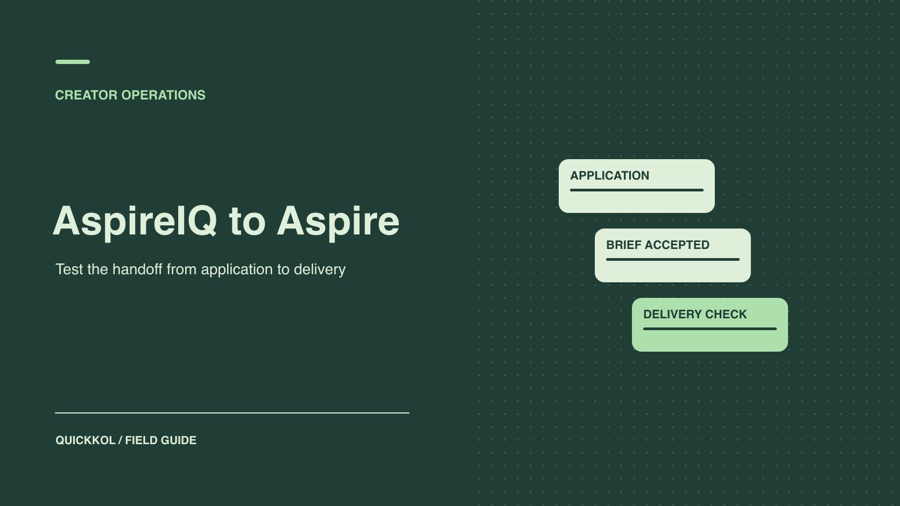

# AspireIQ 评估指南：从达人申请到作品交付

状态：本地审阅稿；正式发布日期待确认。

用一批真实申请与合作交付验证平台能否支持选人、签约、审批和交接。

QuickKOL 编辑图形；不呈现真实账号指标或平台界面。

AspireIQ 是 Aspire 的旧名称。判断它是否适合团队，可以用一批有真实 Brief 的创作者走完申请、选人、签收、内容审核、发布和结算。逐步核对谁能确认身份、作品、版本和权利。只有能支持采购决定或减少实际交接成本的功能，才进入采购建议。

## 从更名确认产品与旧流程

[Aspire 品牌名称变更公告](https://www.aspire.io/blog/aspire-new-branding)说明 AspireIQ 改名为 Aspire。旧资料和部分产品入口可能仍含旧名称。核对当前供应商、登录入口、合同、付款接收方和支持联系人。品牌如果发现早年的截图或表格写 AspireIQ，不直接照旧菜单操作。把旧流程中的核心字段提取出来，例如达人报名、产品寄送、内容审稿和付款。然后在当前账号确认哪些仍能完成。不要因为名字变了就重复迁移已验收的资料或创建多个账号。

给试点设一个真实任务，例如让五位创作者申请一项有明确用途的试用项目，再从中完成三份合作交付。这个规模是假设，不是平台限制。重点是让采购、内容和财务各走到需要的环节。选参与者前统一产品、市场、预算和使用权范围。可参照[达人市场订单检查清单](https://www.quickkol.com/zh/blog/collabstr-marketplace-order-checklist/#answer)拆开交易和作品验收。给每个阶段安排能作出决定的人。

## 测试申请信息是否足以做筛选

[Aspire 创作者市场说明](https://www.aspire.io/influencers)介绍了发现和申请机会、创作者档案和合作。品牌先写需交的作品、市场、语言、内容与使用权。申请表只收会改变筛选决定的信息。请达人给相关作品、拟合作账号和是否能在目标市场按期发布。供应商显示的账户信息与达人角色应单独复核，不能直接把申请等于同意，也不能用受众总量替代岗位能力。对未入围者只保留项目规定的必要记录。

记录一次人工核验的耗时。举例：十份申请中有七份提供足够作品，三份的市场或格式要补问。检查是筛选字段设计不足、供应商没有帮助展示材料，还是岗位本身需要进一步沟通。给下一轮改一个问题，再看补件比例变化。对比手工流程时，用同样的申请条件和样本，避免把一轮更窄的 Brief 带来的效率归给软件。

## 确认签收的是哪份 Brief

[Aspire Brief 签署说明](https://help.aspireiq.com/en/articles/13641591-how-to-review-and-sign-a-brief)介绍了创作者查看合作详情和签署后继续执行任务的流程。品牌在试点中核对签署主体、版本、交付、报酬、报表日期、素材用途和取消处理。确认更改内容时工具是否保留之前的批准和版本。若代理与达人分别签收，不把代理转发的文件视为达人签署。对涉及广告、排他和转授权的内容，让负责人审查实际约定。

假设品牌将一条自然帖改成三个月广告使用。确认版本变化后重新取得相关批准，不能沿用旧签署状态。保留更新时间、参与者和生效范围。工具里的「已签收」如果没有显示版本，就从批准的合同记录核对。用[达人报价和素材使用权框架](https://www.quickkol.com/zh/blog/creator-rates-usage-rights/#answer)拆分制作费和授权费，防止试点结算时发现一项总价里混了多种权利。

## 区分审稿通过、已检测和发布验收

[Aspire 活动阶段说明](https://help.aspireiq.com/en/articles/16193146-campaign-workflow-and-stages)介绍内容审稿、等待上线、检测到帖子和支付等环节。工具发现一条帖子，通常意味着需要复核，不自动代表合同已满足。实际验收打开原始 URL，确认账号、时间、内容版本、披露、使用权、活动链接和约定可见期。审批记录关联到最终素材。发现错帖或创作者改了文案时，标注哪一步需返回，给当前所有者一个具体操作。把有误的帖子和正确交付分开处理。

跑一个故障场景，比如达人按时提交批准样片，但正式发布时使用旧文案。试点要能发现差异、通知发布者、保留更正后的正式 URL，并让其他审批不丢失。记录是否需要在系统外手工改状态。若供应商可以检测帖子但无法看到某格式或地区，写明回退方式，例如人工提交链接和品牌复核。把检测能力和验收责任分开后，才能评估节省了多少工作。

## 核对结算记录而不只看流程状态

[Aspire 支付流程说明](https://help.aspireiq.com/en/articles/6326989-how-do-payments-work-on-aspire)描述了合适配置下从交付完成进入支付流程。品牌要核对当前支持的支付方式、地区、币种、费用和有权批准的人。准备一份合同、发票或付款请求、审批、实际支付记录的对应表。不要把进入支付阶段写成款项已经到账。若只在评估环境进行测试，明确不触发真实付款，并核对有权执行的角色。遇到无法确认的支付事项，交给财务或合同负责人。

例：一个创作者有两项交付，第一条内容已验收，第二条仍在补披露。系统可能显示某个任务可以结算，品牌按实际合同确认是否分期。保留每项结果和例外。账务的成功状态需要由有权方核对，品牌也应确认能导出所需凭证。报告只记录必要的标识和金额范围，不在内容群中转发私人支付资料。

## 用可导出的证据测试离场

试点结束后，请另一位同事只用导出文件和合同归档复查一项合作。至少应查到达人账号、签署版本、样片及审稿、正式 URL、权利范围、报表和付款状态。若导出不含某字段，确认是否需要人工补充或额外套餐。查看哪些资料只能在仍有权限时访问，哪些可按约定保留。给外包方或代理设结束日，结束后检查访问撤销和原发布权限。

例如品牌要把下季项目交给新代理。新团队应从批准的交接记录找到仍可复用的素材和权利期限，不需要用旧代理的登录。记录新管理员、撤回人和资料负责人。如果工具允许项目导出但无法保留关键证据，预算时计入补录成本。上线前先跑这个演练，避免合作结束后才发现财务或使用权资料仍依赖单个用户。

## 把线上审批和团队职责对齐

给合作画出最小职责表。选角负责账号和作品，产品负责寄样款号和库存，内容团队负责审批、披露和链接，财务负责结算。权限应符合工作，不要只因为一个人需要查项目，就让其能改报价、授权或付款。用一场带真实角色的演练核对：创作者能否看到修改要求，品牌审核能否看到当前版本，财务能否找到支持记录。若每项都只能由同一管理员进行，先核对是否是权限设置或工具限制。

另做一次项目中途换人的演练。由新负责人使用自己受授权的账号接手，按顺序定位签署版、最新样片、审批和正式链接。旧人可以移交备注，但不通过交出个人登录来继承任务。记录完成时间、待补字段和有无重复确认。若平台通过通知帮助协作，也要确认通知中的状态、工具页面和合同审批属于同一个资产。假设工具已显示审核完成，但实际批准的是上一个剪辑版，负责人应能从版本回看发现问题。

最后保存用来比较的基线。手工流程怎样计算每次交付的总时长，哪些时间是等待达人、哪些时间是团队处理。平台试点用同样单位。若邮件往来减少却新增两次人工录入，按真实负担报告。不要把试点里仍由团队维护的外部资料排除出成本。记录一份清单，写明无工具时如何继续履行协议。只有把退出流程也走通，采购团队才能判断日常使用是否值得。

## 把采购决定写成可验证的条件

对比完成一项合作的用时、补件次数、重复数据录入、错发风险和结算状态是否明确。给重要流程设门槛，例如三项内容都可找到批准版本与公开链接。低优先级功能只要不会影响关键工作，可记录为后续。产品费用、培训、手工和维护一起纳入。决定购买、缩小范围或继续测试时，保留实际配置、日期和证据。如果平台能支持招募但无法满足报表需求，明确只采购招募流程。

## 验证平台能否减少一次选人往返

假设一次试点招募产品演示达人。申请表里十个人都填写了主页链接，但只有七人交了与 Brief 相符的原创案例。选角人员记下每项是否足以发出邀约，再给缺失者一个具体补件问题。下一轮将「提供相关作品」改成「请提交一条近期的同类产品演示，并标明本人角色」，看可验证申请和人工追问是否变化。

把这个发现与交付验收分开。如果平台减少了选角邮件，但品牌仍需要手动查公开帖和广告权，记录实际省下的时间和剩余责任。采购结论可先覆盖招募，保留内容审批与结算现有流程。达人应收到清楚的提交和反馈，品牌应能从记录回溯为什么选中某人。

## Aspire 试点验收字段

| 阶段 | 证据 | 验收负责人 |
| --- | --- | --- |
| 申请 | 账号、作品、格式和市场 | 选角 |
| 签收 | 签收人、版本及条款 | 合同负责人 |
| 上线 | 版本、披露、链接和时间 | 发布与品牌审核 |
| 结算 | 批准、付款记录与权限收回 | 财务与项目所有者 |

按实际套餐、市场和授权角色验收。

## 工具试点检查清单

让第二位审核人复现至少一次完整合作。

- [ ] 确认当前产品和试点范围。
- [ ] 核对申请、签收和审批版本。
- [ ] 打开正式帖子并验证披露。
- [ ] 检查结算、导出和权限回收。

## 研究日期与使用边界

资料核验于 2026 年 11 月 9 日。文中方法、表格和决策规则为编辑建议，标为假设的示例不是实际客户结果或行业基准。外部资料的适用地区与时期按各段说明；本稿处于独立本地审阅阶段，正式发布日期待确认。

## 用清楚的任务开始达人研究

用 QuickKOL 理解 Brief、发现相关达人并研究作品与联系路径；数据、合作条件和结果仍需核验。

[了解 QuickKOL](https://www.quickkol.com/#capabilities)

## 来源

- [Aspire 品牌名称变更公告](https://www.aspire.io/blog/aspire-new-branding)
- [Aspire 创作者市场说明](https://www.aspire.io/influencers)
- [Aspire Brief 签署说明](https://help.aspireiq.com/en/articles/13641591-how-to-review-and-sign-a-brief)
- [Aspire 活动阶段说明](https://help.aspireiq.com/en/articles/16193146-campaign-workflow-and-stages)
- [Aspire 支付流程说明](https://help.aspireiq.com/en/articles/6326989-how-do-payments-work-on-aspire)
