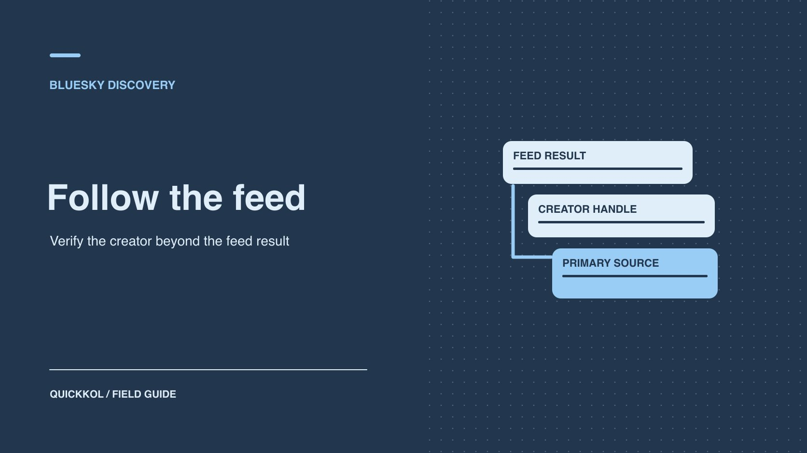

# How to Find Creators Through Bluesky Feeds

Status: local review draft; confirm the publication date before release.

Find candidates in public conversations, then use original work and identity evidence to decide who to contact.

QuickKOL editorial graphic; not actual account metrics or a platform interface.

Bluesky feeds and starter packs can help a brand find creators already discussing a relevant problem. Start with the brief’s topic, language and expected format. Record where each candidate appeared, then check original work and independent identity evidence before outreach. Feed order and posting activity are discovery signals. Each shortlisted person should have a proposed role, a work sample that supports it and one clear question to resolve before a commercial conversation.

## Turn the discovery job into a concrete search

Start with what the brand needs the creator to do. An audio equipment company might need two demonstrations and a Q&A explaining home recording setups. Translate “audio influence” into things you can observe in public work: a creator who explains input and output choices, compares recording environments and answers questions in the audience’s language. Record the target markets, language, format and credentials that need verification. When public work is enough for early screening, there is no reason to ask candidates for private audience reports.

Choose two discovery paths. One can focus on the subject and the other on a conversation tied to the intended market. Pick a separate source for identity verification, such as the creator’s own site or a video channel they link. A [Bluesky public conversation guide](https://www.quickkol.com/blog/bluesky-social-brand-public-conversation/#answer) can help separate candidate discovery from running the brand’s own account. Research can begin without the brand publishing a post. If the campaign will involve co-publication or community replies later, plan content and moderation responsibilities as a separate piece of work. That prevents public posting from becoming an implicit requirement for a private sourcing exercise.

## Record what a custom feed appears to include

[Bluesky’s custom feeds announcement](https://bsky.social/about/blog/7-27-2023-custom-feeds) describes ways to discover posts around different interests or ranking choices. Record the feed name and URL, its owner or description, the collection window and any stated inclusion rules. A name is an imperfect description of a feed. One recording feed may match a few hashtags, while another may be curated around selected accounts. If the full rules are unavailable, record that limit and retain the description you could see. Save the post source and publication date. Treat its position as an observation from that run.

Start with a handful of results to refine the vocabulary, then collect a defined slice for comparison. Deduplicate by account while keeping several representative posts as work evidence. A relevant but inactive account can still offer useful older samples. Check whether the creator now publishes on another channel. An absence from one feed does not establish that they never discuss the topic. Keep a qualified lead found elsewhere even when the main feed misses it. Record where it came from, because source diversity is part of the discovery test.

## Use starter packs to diversify where candidates come from

[Bluesky’s starter packs announcement](https://bsky.social/about/blog/06-26-2024-starter-packs) describes a way for communities to curate accounts and feeds people can follow. A pack can surface practitioners, researchers, organizations and writers around a topic. Record the curator, scope and discovery date. Confirm each account’s identity and inspect work relevant to the brief. If a pack includes brands and institutions, label their roles. A podcast team, a production company and an independent creator may require different agreements. Search a second pack or an independent channel for candidates outside the original list.

Imagine a pack focused on English-speaking recording enthusiasts while the campaign needs Portuguese content. The pack can supply useful vocabulary and referrals, but it does not cover the target language. Follow creator-provided links to public work and look for Portuguese topic and regional communities separately. Document the gap. Combining a few lists does not make them a census of the platform or a local creator market. Count how many people produced relevant work and have verifiable identities instead of treating the number of members in a pack as a measure of its usefulness.

## Use primary links to verify the creator’s identity

Follow the candidate’s public bio to a portfolio or site, then check whether you can establish a link in the other direction or from a separate official source. [Bluesky’s domain handle guide](https://bsky.social/about/blog/4-28-2023-domain-handle-tutorial) explains how an account can use a domain it controls as its handle. A verified link between the domain and the account is useful identity evidence. It does not certify professional qualifications or authority to negotiate. Some creators use a default handle and link clearly from their official site. Treat both paths as evidence to examine rather than scoring candidates by handle type.

When names overlap, compare official links, work credits, dates and public contact routes. If someone with a similar name claims to represent the creator, ask an independently verified representative to confirm the connection. Withhold private brief details and financial information until the intended recipient is established. Use a clear status such as verified, single-source or pending. If a handle changes, preserve the old value and date. That allows the next researcher to distinguish a rename from a different person and prevents earlier work samples from being reassigned to the wrong account.

## Sample recent original work against the brief

Keep three types of evidence for shortlisted creators: a recent original item in the relevant format, a public exchange demonstrating how they explain their method, and an independently verifiable credit or professional role where that matters. Frequent reposts may establish familiarity with the discussion. They do not establish production skill. Define original work, quotation and redistribution before labeling examples. For a long thread, preserve the opening context and relevant reply. Keep original language and translation separate, so a casual comment does not become an unsupported product promise in the brief.

Suppose two accounts appear in an audio feed. One consistently interprets industry announcements. The other has three videos showing a recording setup step by step. The first may be a fit for a discussion or commentary session. The second has evidence for the equipment demonstration. Ask about these roles independently, with deliverables and rates appropriate to each. Record spoken explanation, visual work, response quality and usage needs. Avoid inferring creative ability from an audience count or the prominence of a thread. If a professional credential is central to the campaign, verify it through the relevant issuer.

## Measure the discovery path rather than a creator’s popularity

Define a small observation set for one research period. For example, review 30 eligible public posts from each of two entry points. Count distinct accounts, candidates with relevant recent original work and identities supported by another source. Deduplicate overlapping candidates while retaining every discovery source. Record review time. If entry point A finds nine eligible accounts and seven also appear through B, A added two unique leads in this sample. Use that result to decide how much analyst time to spend there. It does not show that one community is more influential.

Use a [social listening query sample validation](https://www.quickkol.com/blog/social-listening-query-sample-validation/#answer) process to revise false matches and coverage rules before moving to another window. If there are no useful results, check whether the query is too narrow, whether it missed the language or whether the topic simply had little public activity during the period. A video platform or an industry directory can supplement the sample. Export the evidence status and let a second reviewer check original posts. Confirm that a rename, deleted post or unverified recommendation did not silently become an approved candidate.

## Choose outreach that fits the proposed use

After discovery, decide whether the brand wants a Bluesky post or wants the creator to produce work elsewhere. A public conversation can clarify topic fit. Use an independently verified contact path for the commercial proposal. Send an invitation that names the subject, deliverable, publisher, period and follow-up owner. Being discovered in a feed does not indicate the creator consented to a partnership. Distinguish a lack of response from an explicit decline and apply a reasonable follow-up cadence.

If the pilot is for discovery only, measure qualified candidates and replies. If it includes publication, agree in advance on who owns the post, how commercial relationships will be disclosed, who handles replies and which data the campaign can obtain. The two jobs can proceed independently. Include the date, verified work, identity source and next contact in the handoff. For a promising candidate with a gap, list one task that would resolve it. A colleague should be able to open the source and understand the proposed role without needing the full history of the discovery run.

## Turn feed discoveries into an outreach shortlist

Suppose an audio equipment company needs two partners, one to demonstrate a setup and one to host a discussion about recording. A feed contains many accounts sharing the same review. Follow the post back to its author and verify their portfolio or official site through a second source. A second creator writes useful technical replies but has no recent complete equipment demo. They can remain a Q&A candidate. Record the evidence for each role and the route for making contact.

Classify the leads as ready for outreach, in need of work samples or outside the brief. Feed frequency is a poor basis for rank. Move candidates into outreach when their work answers a question the brand actually needs resolved. Preserve the sample date, feed rules and reason for each shortlist decision. The next researcher can then compare newly discovered people with the same brief and see whether a second source actually added usable candidates. Mention the relevant public work in the initial invitation so the creator can see what prompted the outreach.

## Bluesky creator shortlist fields

| Signal | Record | Next action |
| --- | --- | --- |
| Custom feed | Feed, window and original post | Check scope |
| Starter pack | Curator and topic | Add another source |
| Identity | Handle and site or portfolio link | Verify contact route |
| Work | Recent original and proposed role | Ask about the specific brief |

Feed samples do not represent all Bluesky accounts.

## Creator sourcing checklist

Go from an observed work sample to a verified contact.

- [ ] Record the entry point, date and inclusion rules.
- [ ] Deduplicate without dropping source evidence.
- [ ] Verify identity and comparable work independently.
- [ ] Record a role, contact route and open item for each candidate.

## Research date and limitations

Sources reviewed November 9, 2026. Methods, tables and decision rules are editorial recommendations. Hypothetical examples are not actual client results or industry benchmarks. Source geography and periods are specified where relevant. This draft is in independent local review; confirm its publication date before release.

## Start creator research with a clear task

Use QuickKOL to interpret a brief, discover relevant creators and research their work and contact routes. Verify data, commercial terms and outcomes at their source.

[Explore QuickKOL](https://www.quickkol.com/#capabilities)

## Sources

- [Bluesky’s custom feeds announcement](https://bsky.social/about/blog/7-27-2023-custom-feeds)
- [Bluesky’s starter packs announcement](https://bsky.social/about/blog/06-26-2024-starter-packs)
- [Bluesky’s domain handle guide](https://bsky.social/about/blog/4-28-2023-domain-handle-tutorial)
