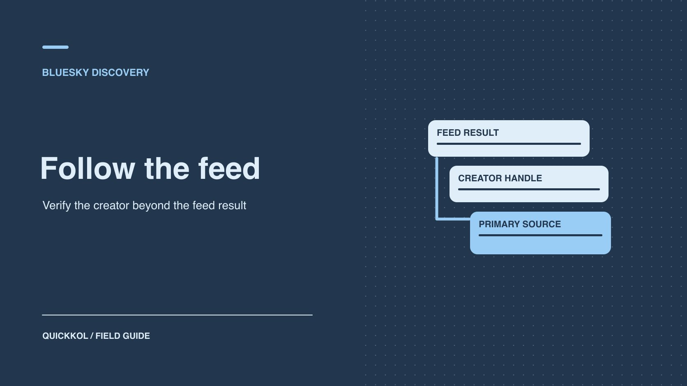

# 如何用 Bluesky 信息流找到合适的创作者

状态：本地审阅稿；正式发布日期待确认。

从公开帖子找到候选人，再凭原创作品和身份来源决定是否联系。

QuickKOL 编辑图形；不呈现真实账号指标或平台界面。

Bluesky 信息流和入门包可以帮助品牌找到正在讨论某个问题的创作者。先从合作 Brief 写出主题、语言和预期格式，再记录候选人在哪个公开入口出现。进入下一轮的人应有能完成任务的原创作品和可核对的身份。采样排名和话题活跃度只作发现线索。整理可联系名单时，让每个人都有明确角色、作品和证据缺口。

## 把发现任务写成一个可执行的搜索

先问品牌想让达人做什么。例如一个音频器材品牌想找会解释室内录音设置的创作者，活动交付是两条设备演示和一场问答。把「音频影响力」拆成可在公开作品里看到的动作：能听懂输入输出设置、能比较不同环境、能用受众熟悉的语言回答问题。列出候选市场、语言、交付格式和必须核验的资历。公开资料足以筛作品时，不要求候选人提前交出受众数据。

写下两个搜索入口，一个以垂直话题为主，一个找与目标市场相关的讨论。再选一个不同的渠道作核对，例如创作者官网或视频主页。用[品牌在 Bluesky 的公开对话指南](https://www.quickkol.com/zh/blog/bluesky-social-brand-public-conversation/#answer)区分找候选人与品牌运营账号两项任务。品牌可在不发公开帖的情况下先完成发现研究；以后要做联合发布或社区互动时，再单独安排内容和回应职责。

## 记录自定义信息流的收录范围

[Bluesky 自定义信息流说明](https://bsky.social/about/blog/7-27-2023-custom-feeds)介绍了可按不同兴趣和方式发现内容的功能。记录名称、信息流地址、所有者或介绍、采集时段和可见条件。不要把信息流名称直接当成规则。比如一个「录音设备」入口可能只抓几种标签，另一个由策展者选取少量账号。如果无法看到完整规则，就写「规则未公开」或「已查看简介」。在表里保留帖子来源和实际发布时间，把排序位置记为一次观察。

先从少量相关结果确认词汇，再按相同时间段记录若干条。对同一达人重复出现的帖子去重，以账号为单位建立候选项，以帖子为单位保留作品证据。看到一条很相关但不再活跃的账号，可以先保留旧作品作为能力证明，同时查看近期是否还在其他渠道更新。信息流没显示这位达人，也不代表他从未参与该话题。不要因一个入口没找着就删除已有的高质量候选。

## 用入门包扩大候选来源

[Bluesky 入门包说明](https://bsky.social/about/blog/06-26-2024-starter-packs)描述了社区整理的关注账号和信息流入口。它适合找一圈讨论者、研究者、组织和作者。先记入门包的策展者、范围和发现日期。逐个确认账号身份，并查看是否真的完成过 Brief 需要的内容。包里有不少品牌或机构时，给账号标类别。发现播客团队、节目制作方和独立创作者后，不直接归为同一种合作对象。再从另一份名单或独立渠道寻找不在包里的候选。

假设一个入门包以英语录音爱好者为主，品牌需要葡语内容。入口能帮助理解行业词汇或找推荐，但它没有覆盖目标语言。可以沿作者主页找到其他公开作品，另查葡语主题与地区社区。把入门包的范围缺口记下来。别以为加了几个名单就能代表平台整体或某个市场的全部创作者。与其数包的成员，更有价值的是确认找到多少有相关作品并可验证身份的候选。

## 用原始链接核实创作者身份

从候选账号简介进入其官网或作品站，再从独立路径看能否回链。[Bluesky 域名手柄说明](https://bsky.social/about/blog/4-28-2023-domain-handle-tutorial)介绍了使用控制的域名作为手柄的方法。能验证域名关联时，这是账号身份的一条证据。它不证明平台认可其专业资质，或这个人负责商业报价。也有人使用默认手柄但在自己官网和作品页有明确链接。别把手柄类型当作资格分。记录用哪条公开证据验证，哪项仍由联系人确认。

发现同名账号时，先比较官网回链、内容署名、时间和公开联系方式。若有人用相似名称声称代表创作者，直接到已核验的经纪或品牌渠道求证。没有独立证据时，不提供未公开 Brief、联系方式或资金。给身份状态设三种值：已核实、来源单一、待确认。每次更名保留旧手柄与日期。这样研究者可以辨认同一候选人，而不会把历史作品错误搬给另一个账号。

## 按 Brief 抽查近期原创作品

每位入围者收三类证据：最近一件同类原创作品、能解释方法的一次公开互动，以及能独立确认的专业背景或合作角色。转发得多可以说明经常在同一话题出现，无法证明能完成制作。筛选之前定义原创、引用和转载怎样区分。对于长串讨论，保留原帖与关键回复，不单截一句容易离开语境的话。把原文与翻译分别记录，避免把轻松评论误读成硬性产品承诺。

例如两个创作者都出现在音频信息流里。第一位擅长拆解品牌公告，第二位有三个分步搭建录音环境的实拍。前者适合主持评论讨论，后者更能证明设备演示能力。品牌可以分开询问这两种任务的兴趣与报价。将口播、画面、回答质量和使用权分开写，不从粉丝数或讨论热度直接推断。对专业度有重要影响的证书由原机构验证。

## 衡量发现入口，而不是账号热度

给同一研究周期设一个小样本。例如两条入口各看 30 条符合范围的公开帖。分别记录触达多少独立账号、多少有最近相关原创、多少能从第二来源验证身份。有重叠时只计一次候选，同时保留所有来源。需要人工阅读的时间也要记。若入口 A 找到 9 位合格账号，其中 7 位也在入口 B，A 提供的独有候选是 2 位。这个结果用于衡量研究时间，不用于声称 A 的用户更有影响力。

对照[社媒聆听查询样本验证](https://www.quickkol.com/zh/blog/social-listening-query-sample-validation/#answer)，先修订误抓和覆盖不足的规则，再换下一期时间窗。没有任何结果时，检查是否查询过窄、语种不匹配或当前活动没有公开讨论。可安排视频平台或行业组织目录作补充。把同一批候选的证据状态导出后，让第二人从原帖复核，确保样本中没有同名账号、删除内容或只由策展者推荐的人被当成已核验。

## 选择与使用计划相称的接触方式

发现候选人后，先决定品牌是否要在 Bluesky 上发内容，还是要邀请该创作者制作其他平台的作品。公开互动可以先确认话题和内容适配；商业提案用对方提供并核验的联系路径。发送前准备一段具体邀请，说明想合作的主题、交付类型、发布者、时间范围和负责跟进的人。不要把发现于信息流写成得到对方合作同意。把候选人未回应和明确拒绝分开，按合理的跟进节奏记录。

如果试点只用于发现，衡量合格候选与回应。如果涉及发布，则预先约定谁拥有原帖、如何披露商业关系、如何处理评论，以及能取得什么测量。不同任务可分别进行。报告交接要有日期、已核验作品、身份来源和后续联系人。给有潜力但证据不足的人留下一项具体待办。这样同事接到候选表就知道从哪条原始链接开始复核。

## 把信息流里的账号变成可联系的候选人

假设一家音频设备品牌需要两位创作者，一位能做布置演示，一位能主持录音问题讨论。一个信息流出现了大量转发同一篇评测的账号。研究员先找到原创者，再从第二个入口核对其官网或作品页。另一个创作者有稳定的技术答复，但没有拍过完整设备视频，可以先作为问答候选。记录两人的工作依据和实际联系路径。

把发现结果分成可询价、待补作品和无需继续三类。不要用信息流出现次数做名次。只有能回答一个真实合作问题的候选，才进入邀请名单。下次复跑保留采样时点、规则和每条入围理由，新发现的账号才可以和旧候选按同一任务比较。 第一次发邀约时直接引用那条公开作品，让创作者知道你看中了哪一项能力。

## Bluesky 候选表字段

| 线索 | 留存 | 下一步 |
| --- | --- | --- |
| 自定义信息流 | 入口、观察期及原帖 | 核对范围 |
| 入门包 | 策展者与话题 | 补其他来源 |
| 身份 | 手柄、官网或作品回链 | 确认联络路径 |
| 作品 | 近期原创与拟议角色 | 按 Brief 询价 |

信息流样本不代表全站。

## 候选交接清单

从已见作品走到可核实的合作联系人。

- [ ] 记录入口、日期和筛选规则。
- [ ] 去重并保留不同入口的证据。
- [ ] 独立确认身份及相符作品。
- [ ] 给每人明确角色、联系路径和缺口。

## 研究日期与使用边界

资料核验于 2026 年 11 月 9 日。文中方法、表格和决策规则为编辑建议，标为假设的示例不是实际客户结果或行业基准。外部资料的适用地区与时期按各段说明；本稿处于独立本地审阅阶段，正式发布日期待确认。

## 用清楚的任务开始达人研究

用 QuickKOL 理解 Brief、发现相关达人并研究作品与联系路径；数据、合作条件和结果仍需核验。

[了解 QuickKOL](https://www.quickkol.com/#capabilities)

## 来源

- [Bluesky 自定义信息流说明](https://bsky.social/about/blog/7-27-2023-custom-feeds)
- [Bluesky 入门包说明](https://bsky.social/about/blog/06-26-2024-starter-packs)
- [Bluesky 域名手柄说明](https://bsky.social/about/blog/4-28-2023-domain-handle-tutorial)
