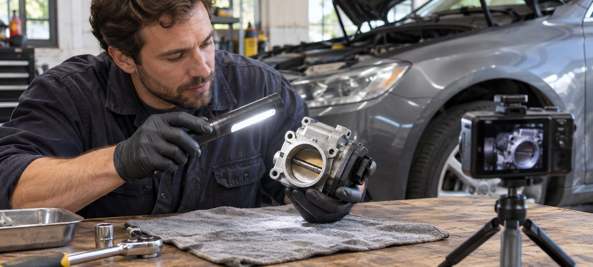

# How to Find the Right Creator for a Car Demo

Status: local review draft; confirm the publication date before release.

Use relevant work and vehicle evidence to cast and brief an automotive creator for a product demonstration.

Some women automotive creators use the phrase “car girl” to describe their interests. Use it as a discovery clue. For a commission, look for work that shows the creator can explain the particular vehicle, control or part to the intended audience. Brief the actual model, required visual evidence and limitations. Plan a controlled demonstration and verify publication, product wording and advertising uses separately.

## Select for the technical job

Define the task first: explain a control on a particular vehicle, compare two accessories, host a workshop Q&A or show consumers where to verify specifications. Find creators who have done comparable work. Candidates can be enthusiasts, project-build documentarians, working technicians or buyers’ guide creators. Different roles call for different qualifications. A self-description cannot substitute for work evidence, and the team should evaluate the explanation and production rather than a creator’s appearance. Review recent demonstrations for the actual vehicle, component, conditions and source. Route installation or safety judgments to someone with the appropriate responsibility.

Suppose an accessory brand wants someone who can explain fitment. Creator A makes polished footage without showing a model. Creator B has two examples that explain model years and part limitations. The brand can evaluate visual production and technical explanation as distinct jobs. Check audience fit and use a pilot to verify the work. Refer to an [automotive creator loan brief](https://www.quickkol.com/blog/car-youtubers-long-term-loan-brief/#answer) when long-term use is actually involved. A one-day stationary shoot does not need the same mileage or maintenance terms as a multi-week loan. Give the candidate a defined job rather than letting the search label determine the agreement.

## Identify the exact vehicle, part and evidence scope

Have the brand supply model, year, trim, market, part number and documentation. Match the filming vehicle and sample to those details, and decide what can be shown publicly and what should be obscured. If the specifications conflict with the sample, ask the product owner before drafting a conclusion. Separate observable facts, the creator’s subjective experience and performance claims requiring independent support. An accessory mounted on one vehicle establishes what was observed under those conditions. The same model name can cover different trims or markets.

If vehicle condition matters to the shoot, have the vehicle owner arrange the appropriate checks. [NHTSA’s recall lookup guide](https://www.nhtsa.gov/recalls) explains the scope and limits of its U.S. recall lookup. It cannot certify that an accessory fits or that the vehicle is suitable for the shoot. Give the reviewer a concrete question, such as whether the specific part is approved for this vehicle year and trim. Attach the source, review date and permissible wording. Leave conditions that need further testing in their own row. Audience votes after publication cannot supply missing product evidence.

## Keep the filming setup controlled

[NHTSA’s distracted driving guidance](https://www.nhtsa.gov/risky-driving/distracted-driving) explains that activity that diverts attention from driving can create risk. Schedule most demonstrations with the vehicle parked in an authorized space. Let the creator explain from an assigned position and have a camera operator take fixed exterior views. Check access, equipment, light and crew positioning first. Do not ask a driver to operate a phone, read a script or run a camera while driving. If the creative requires movement, send it to the appropriate safety and venue owners for its own plan and approval. Keep an alternative in the brief until that approval exists.

The in-article workshop image shows a removed component being lit for a detail shot. The crew can use a separate workbench setup to explain what a part looks like. To show connector orientation, film the part clearly without moving a camera into an active work area. Have the technical reviewer approve the frame and explanation. If the audience only needs to recognize the part, an already removed component and an approved view of its location may be enough. When glare obscures important evidence, pause to adjust the light instead of asking the creator to change a technical action to suit the camera.

Use a workbench close-up to show the component and keep the camera clear of active work.

## Tie public claims to the filmed conditions

A stationary video can show placement, appearance and some controls. It does not measure stopping distance, longevity, fuel savings or other performance. If the brand has evidence for a comparison, give the creator the source, test conditions and approved wording. The creator can say what they observed on the filmed vehicle under the stated configuration. Keep personal experience separate from established product facts. Identify the actual part and avoid editing footage from a different model into the result. Use a [creator publishing brief](https://www.quickkol.com/blog/write-a-useful-campaign-brief/#answer) to record the purpose, version and approver for each shot. Captions should match the approved specification.

Suppose the video says an accessory fits a certain year but the cutaway shows a newer trim. Check the vehicle and part records first. If the team cannot verify the shot, reshoot or change the wording. Do not leave unsupported compatibility in the captions. Verify price, stock, installation and support for the target market separately. Give the viewer a practical next step, such as checking their vehicle in the brand’s approved selector. Where the campaign uses a product photo or screenshot, confirm which assets may appear publicly and under what terms.

## Keep creator voice and sponsorship disclosure clear

For a U.S. campaign, [the FTC’s influencer disclosure guide](https://www.ftc.gov/business-guidance/resources/disclosures-101-social-media-influencers) emphasizes making material connections clear and close to the recommendation. Consider paid fees, gifts, vehicle loans and venue support according to the actual arrangement. Let the creator use familiar language and have the brand verify that viewers can understand it. Avoid vague wording placed only at the end or in a collapsed area. Check video, captions, description and platform label against the relationship. If the brand provides a script, retain room for the creator’s professional judgment. Do not ask someone to endorse a feature they have not used.

Approve the organic post and any ad cutdown independently. Removing the first seconds can remove the disclosure. Changing the order of shots can turn a limited experience into an apparent performance claim. Link the original, approved version and live URL. When wording changes, have the actual publisher make the correction and provide the visible result. The same specifications should guide replies to common questions. Route requests that require technical support to the brand’s responsible team.

## Accept the work before evaluating audience response

After release, verify the publisher, actual creative, disclosure, vehicle details, destination and advertising permission. If one excerpt is separately licensed, do not label the entire video reusable. Use comparable post age and format when reviewing content data. If the campaign asks whether consumers understand model fit, examine substantive questions, visits to the specification page and support evidence. Views and follower totals describe distribution context. They do not establish that every viewer understood or purchased. When comments repeatedly name unsupported vehicles, review whether the content needs a clearer condition.

Give the decision owner two columns: accepted deliverables and business outcomes still to verify. If the creator delivered the agreed demo and disclosure but the landing page shows the wrong model, retain the delivery evidence and fix the destination. Record the affected period so clicks do not conceal the shopper problem. Test revised guidance in a follow-up or a targeted reshoot. Preserve the dates of original and corrected work. Verify specifications, price and rights again before promoting the video in another market.

## Record reusable versions and open permissions

After the shoot, list approved angles, edits, publishers, advertising term and territory by asset. Keep limitations for unsupported vehicles visible so a later editor does not reuse a shot with a different model claim. Evaluate the creator on the technical explanation, relevant audience feedback and working process. Give a new vehicle or usage request its own brief and review. Retain creator approval, product approval and publication evidence. The next campaign team should be able to identify the person responsible for each issue rather than reopening every decision with the same contact.

## Assign a product owner to answer fitment questions

Before launch, give the creator a verified answer sheet covering eligible models, excluded trims, the specification route and a brand support contact. Do not ask a creator to judge installation or safety for an unfamiliar vehicle in comments. When a new question appears, check whether current documentation answers it. Refer other markets or trims to the brand. Group recurring questions for the recap without retaining unnecessary identifiers such as complete plates or private accounts.

If the brand later finds a listing error, ask the data owner to mark the affected window. Have the creator update the approved wording through their publishing route. Adjust paid delivery for the affected assets. After correction, open the listing from the same market and decide whether to resume. That response distinguishes an issue with the destination from what the creator actually demonstrated.

## Let work samples decide the pilot brief

Suppose an accessory brand finds two creators. One tells compelling stories about modifications. The other has short videos that clearly identify compatible model years and connector locations. If the brief needs consumers to recognize a particular part, ask the second creator for a stationary pilot and a plain description of the fitment conditions. If the goal is a story about garage culture, the first creator may be a better choice. Request a comparable work sample and quote for the proposed job.

After filming, verify the part number, vehicle and approved wording. If the location changes, the creator can propose a workbench close-up that shows the part without implying an installation took place. Accept the shots that answer the brief. If the sponsor wants to promote the work as an ad, confirm the exact edit, term and market in a separate approval.

## Stationary automotive creator demo

| Step | Verify | Owner |
| --- | --- | --- |
| Selection | Comparable work, role and market | Brand sourcing |
| Production | Parked vehicle, camera and part model | Producer and vehicle owner |
| Claims | Actual conditions and disclosure | Creator and reviewer |
| Release | Live URL, usage and reporting window | Publisher and analyst |

Use the approved vehicle, component and location scope.

## Automotive KOL demo checklist

Follow the evidence from past work through live publication.

- [ ] Confirm creator role and work evidence.
- [ ] Verify the vehicle, part and stationary setup.
- [ ] Approve claim scope, captions, disclosure and reuse.
- [ ] Keep the live link, audience questions and correction owner.

## Research date and limitations

Sources reviewed November 9, 2026. Methods, tables and decision rules are editorial recommendations. Hypothetical examples are not actual client results or industry benchmarks. Source geography and periods are specified where relevant. This draft is in independent local review; confirm its publication date before release.

## Start creator research with a clear task

Use QuickKOL to interpret a brief, discover relevant creators and research their work and contact routes. Verify data, commercial terms and outcomes at their source.

[Explore QuickKOL](https://www.quickkol.com/#capabilities)

## Sources

- [NHTSA’s recall lookup guide](https://www.nhtsa.gov/recalls)
- [NHTSA’s distracted driving guidance](https://www.nhtsa.gov/risky-driving/distracted-driving)
- [the FTC’s influencer disclosure guide](https://www.ftc.gov/business-guidance/resources/disclosures-101-social-media-influencers)
