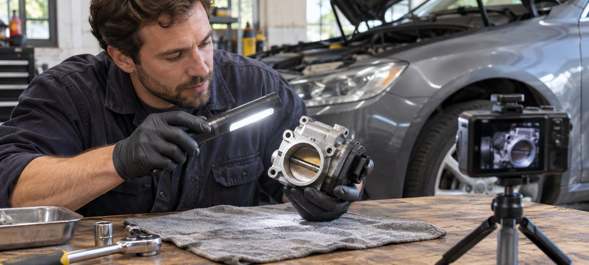

# 汽车品牌怎样选创作者做功能演示

状态：本地审阅稿；正式发布日期待确认。

用车型和技术作品判断汽车创作者能承担什么，再给出可验收的演示任务。

品牌用「car girl」寻找汽车内容时，可以把它当作部分女性创作者的自我表达。真正的筛选依据是实际作品能否证明对方能解释指定车型、操作或配件，以及其受众是否会用到这些信息。用具体车辆、镜头证据和限制条件写 Brief。安排可控的演示，再把发布、产品说法和广告使用分开验收。

## 按技术任务选人

先写品牌要做的动作：介绍某车型的操作、比较两款配件的外观、拍一条车间问答，或为消费者说明如何核对产品规格。再找做过类似任务的达人。对方可以是机械爱好者、改装项目记录者、专业从业者或购车指南作者。不同角色需要不同资历。候选人的自我标签不能代替作品，也不应让团队只评价外观。挑近期真实演示，核对其中的车型、部件、操作条件及信息来源。需要专业安装或安全判断时，把审查交给具备相应职责的人。

例如配件品牌想找会解释适配范围的创作者。A 的短片画面漂亮但没有型号，B 有两条能说明年份和部件限制的作品。可分别考虑视觉制作和技术讲解。核对两人受众与目标市场是否匹配，用试点确认内容适配。对照[汽车达人长期借车 Brief](https://www.quickkol.com/zh/blog/car-youtubers-long-term-loan-brief/#answer)，若合作仅是一日静态拍摄，就不套用长期试用的里程和保养条款。设定清楚的合作工作和证据，避免从社群关键词直接跳到合同。

## 明确车型、配件和证据范围

由品牌提供车型、年份、配置、市场、零件型号和说明。与达人核对实拍车和样品，记录哪些信息能公开、哪些需要遮盖。产品规格与实际样品冲突时先找商品负责人，不由创作者补结论。把演示分成可直接展示的事实、达人主观感受和需要独立证据的性能宣称。比如一个配件装在某一台车上，只能说明在拍摄条件下观察到的情况。即使同一车型名在多个地区出售，配置可能不同。

如果车况对拍摄有影响，由车辆负责人做实际检查。[NHTSA 召回查询说明](https://www.nhtsa.gov/recalls)介绍了美国召回查询的范围与限制。该工具不能证明某个配件适配或整个车辆适合拍摄。给审核人明确问题，例如「该配件是否适用于这台车的具体年份和配置」。把来源、核对日与可公开措辞绑定。需要后续复测的场景另列，不用发布后的评论投票代替产品证据。

## 让拍摄动作保持可控

[NHTSA 分心驾驶说明](https://www.nhtsa.gov/risky-driving/distracted-driving)强调任何把注意力从驾驶移开的行为都可能增加风险。品牌可把大部分功能展示安排在车辆停稳、场地批准的环境。达人站在指定位置口播，摄影组在车外拍固定镜头。拍摄团队先做通道、设备、照明和人员摆位检查。不要要求驾驶者拿手机、看提词器或当场兼任拍摄。对需要动态行驶的创意，交给有相应职责的安全与场地负责人审批，并另行设计，不用静态拍摄 Brief 代替。没有批准就把镜头留在替代方案里。

正文配图展示技术人员在车间用灯光拍清拆下的部件，团队可以用这样的独立机位说明零件形态。想显示接头方向，就用台面上的细节镜头，不必让摄影机进入正在操作的区域。由技术审查人批准画面和口播。无须展示操作顺序时，用已经取下的部件、批准的示意和最终位置说明。发现灯具反光挡住证据时，暂停录制并调整，不让创作者临时改变动作来追镜头。

用台面近景看清部件结构，让相机和人员远离正在操作的区域。

## 把公开宣称绑定到实际场景

一条静态视频可以展示位置、造型和某些操作，但不能证明刹车距离、耐久、节油或其他性能。品牌如果有可支持的对比，需要提供原始证据、试验条件和批准表达。达人可以说明「在这台车、这套配置下观察到什么」，将体验与证实事实分开。画面需要标明的是实际部件，不要在剪辑中把另一个版本的镜头接到结果上。用[达人发布 Brief 方法](https://www.quickkol.com/zh/blog/write-a-useful-campaign-brief/#answer)给每个镜头写明说明意图、版本和审核人。字幕用语应与正式说明一致。

假设影片说明某配件适用于某年款，但剪辑素材来自更新的配置。品牌先检查记录的部件和车辆。若缺少正确画面，用补拍或改措辞，避免把未核实的兼容范围保留在字幕。价格、库存、施工和售后按目标市场分别查。给观众一个可核对的下一步，例如从品牌车型选择器核实自己的配置。如果活动需要使用产品外观图和截图，提前确认哪些能公开及其使用范围。

## 让达人表达与商业披露同时清楚

在美国市场的适用场景中，[FTC 的达人披露指南](https://www.ftc.gov/business-guidance/resources/disclosures-101-social-media-influencers)强调实质关系应清楚而且靠近推荐。付款、赠品、借车或场地支持等关系按实际情况核对。创作者可使用自己熟悉的表达，品牌负责审查是否能让受众理解。不要只在片尾或折叠区域加入含糊词。确认视频口播、字幕、说明和平台标签都与实际合作一致。品牌如果提供脚本，允许创作者保留专业判断和经验边界，不能要求他们给未体验的功能背书。

为自然帖和广告切片分别审批。剪掉原片前几秒可能同时剪掉披露，改变结果前后顺序可能让体验看起来像客观性能。将原稿、批准版和实际公开 URL 关联。品牌需要更改措辞时，请实际发布者完成并提供验收。确保评论区可用的产品答复遵循同样的规格范围，由品牌负责需要专业支持的事项。

## 先验收作品，再看受众理解

上线后验证账号、实际素材、披露、车型信息、活动链接和广告许可。若某段是另行授权的素材，不给整个视频标通用可复用。为作品数据选同样观察时长和格式。活动想知道消费者能否区分车型，可以看有内容的问题、说明页访问及客服记录。观看量和粉丝数只能作为分发背景，不证明每个人都理解或购买。若评论出现不适用车型，汇总常见问题并回看素材是否需要加更清楚的条件。

给负责人提供两列结论：已验收交付、仍需验证的业务效果。若达人完成了演示和明确披露，但品牌落地页列错型号，保留交付证据并修正目标页。记录错误的影响时段，避免用点击数掩盖购买路径。用一次复拍或后续问答测试修订，保留原片与修订后的日期。跨地区推广时重新查车型、价格和许可，不能默认第一轮适用。

## 把可复用版本和未批准范围写进交接

拍摄结束按文件列出可用角度、剪辑、发布账号、广告期限和地区。给不适用的车型保留明确说明，方便后续剪辑不误用。候选人评估记录应聚焦对方实际完成的技术解释、观众反馈和工作流程。若有新的车型或用途，另发 Brief 并核对许可。交接时同时保留创作者批准、商品审核和发布证明，下一位团队能分清要找谁复核每一项。

## 安排产品团队回答实际车型问题

上线前给达人一份经过核验的常见问题卡：适用车型、不可用的配置、核实入口及负责回复的品牌联系。不要要求创作者在评论里判断陌生车的安装或安全。出现新问题时，先确认是否能用现有资料回答。涉及与演示不同的市场或配置，就标为需要品牌核实。对相似问题做聚合记录，避免在复盘中留完整车牌、个人账户或其他不必保存的信息。

若品牌后来发现产品页面需要更正，请数据所有者标出影响窗口。达人可在自己的发布路径更新批准的说明。品牌按受影响的素材调整付费，修复后从同一市场打开页面复验，再决定是否恢复。

## 让候选人的作品决定试拍任务

假设配件品牌找到两位汽车达人。一位擅长讲改装故事，另一位能在短片里说明配件适用的车型年份与连接位置。若活动的主要问题是用户能否识别所需部件，可以先邀请第二位试拍固定镜头和一句适用条件。若目标是展示车库文化，第一位可能更适合策划内容。让候选人各自提供最近的同类作品和合适的报价。

试拍后核对产品编号、车辆与批准说法。如果场地临时变动，可请达人改用台面近景，并在文案中说明只展示部件结构。保留表达专业性的画面，不把没演示的安装结果写进交付。若品牌要把该片用于广告，再谈具体版本、期限和适用市场。

## 汽车达人静态演示交付

| 环节 | 核对 | 负责人 |
| --- | --- | --- |
| 选人 | 同类作品、技术角色和市场 | 品牌选角 |
| 拍摄 | 停稳车辆、机位和部件型号 | 制作与车辆负责人 |
| 内容 | 实际条件与披露 | 创作者与品牌审核 |
| 发布 | 正式链接、使用范围和复盘窗 | 发布方和分析 |

演示范围以批准的车型、部件与场地为准。

## 汽车 KOL 演示验收单

从技术作品一路核对到实际发布。

- [ ] 确认创作者岗位和作品证据。
- [ ] 核对车辆、部件及静态拍摄安排。
- [ ] 审批事实范围、字幕、披露与复用。
- [ ] 保留正式链接、问题样本与更正负责人。

## 研究日期与使用边界

资料核验于 2026 年 11 月 9 日。文中方法、表格和决策规则为编辑建议，标为假设的示例不是实际客户结果或行业基准。外部资料的适用地区与时期按各段说明；本稿处于独立本地审阅阶段，正式发布日期待确认。

## 用清楚的任务开始达人研究

用 QuickKOL 理解 Brief、发现相关达人并研究作品与联系路径；数据、合作条件和结果仍需核验。

[了解 QuickKOL](https://www.quickkol.com/#capabilities)

## 来源

- [NHTSA 召回查询说明](https://www.nhtsa.gov/recalls)
- [NHTSA 分心驾驶说明](https://www.nhtsa.gov/risky-driving/distracted-driving)
- [FTC 的达人披露指南](https://www.ftc.gov/business-guidance/resources/disclosures-101-social-media-influencers)
