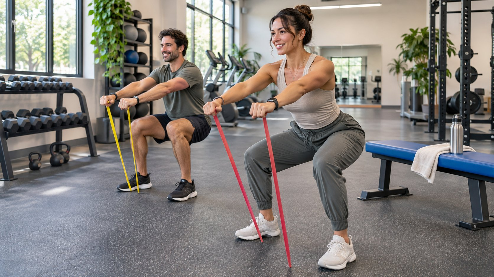

# Fitness Brands: How to Brief Creators on Product Claims

Status: local review draft; confirm the publication date before release.

Match creator expertise to apparel, equipment, training or supplements and agree what each creator can show and say.

Fitness brands should match the creator to the actual assignment. Apparel may need a fit explanation, equipment a setup demonstration, and training or supplement work a more specific check of qualifications and claims. Ask creators to show what they can safely demonstrate and verify. Give objective statements a product version, conditions, evidence and reviewer. Accept the live work, disclosure and authorized uses before evaluating the campaign against its own objective.

## Match the creator role to the product category

Start by classifying the product as apparel, equipment, training or a supplement. An apparel creator can show how a sample fits and what happens during a movement. An equipment creator should be able to identify models, parts, setup and limits. A training service may need someone with relevant experience or credentials, which the sponsor should verify against the work. Give supplement claims to an authorized reviewer. A creator can describe a real experience within its scope. For mixed categories, assign an approver for each. A fitness audience does not qualify a creator to answer every product or health question.

Suppose the brand launches resistance bands and a functional drink in the same week. A creator skilled in equipment demonstrations might film the bands. The drink script needs the relevant product and compliance owners. If the same person appears in both, give each deliverable its own scope and approved language. Use a [fitness creator pilot brief](https://www.quickkol.com/blog/fitness-influencer-pilot-brief/#answer) to compare recent work, target language and ability to deliver the task. Do not infer safety or expertise from a public follower count. A more specific brief also lets the creator decline work beyond their actual role.

## Separate observed experience from objective claims

Review the script claim by claim. Observable facts can include the equipment used, garment size, movement direction or a feature shown on screen. A first-person statement can describe experience. If the overall message implies an objective result, verify that result. For U.S. marketing, [the FTC’s health products guidance](https://www.ftc.gov/business-guidance/resources/health-products-compliance-guidance) explains that objective health-related claims need appropriate support. Check whether the evidence covers the actual product, intended population, duration, conditions and outcome. A verbal assurance from the brand cannot substitute for the source. If an effect cannot be established, remove the claim from the release version.

A creator saying the band felt easy to grip during a filmed exercise can describe a real experience. A statement that it prevents injury for everyone requires separate assessment and evidence. Do not use a single clip or edited before-and-after images to establish general results. Review title, captions, voiceover and thumbnail after editing for implications that go beyond the approved wording. Keep a source and version for each approved claim. Have the relevant owner assess differences by jurisdiction or category before the campaign publishes.

## Keep general fitness information separate from product evidence

For background, [the U.S. Physical Activity Guidelines resource](https://odphp.health.gov/our-work/nutrition-physical-activity/physical-activity-guidelines) provides general public health information. It does not establish a specific benefit from a piece of equipment, garment, training service or drink. For a supplement campaign, consult [the FDA’s dietary supplements overview](https://www.fda.gov/food/dietary-supplements) for U.S. category context and have the relevant reviewer assess the actual advertisement. Do not turn a general overview into a claim that an agency approved a particular product. Avoid asking a creator to resolve individual health questions in comments.

Suppose the brand cites general activity guidance to support a claim that its equipment helps everyone reach a goal sooner. Have the reviewer check whether the referenced evidence covers that product, population and outcome. If it does not, keep the general material as context and show the equipment’s observable features. The brief can shift from promising a benefit to helping viewers understand a setup. Those objectives require different evidence. If the team has only an individual product experience, it should not attach a superficially related source to an unsupported objective claim.

## Plan a demonstration the creator can control

Use an approved venue and equipment. Give the storyboard an owner for setup, demonstration, on-set oversight and final claim review. Let the creator choose a movement and pace appropriate to their experience. The brand should not increase load for the camera or introduce an unplanned movement. Show the product through close-ups, useful angles and visible actions. Check equipment condition and stable placement before recording. Keep access routes clear. If the required conditions cannot be met, switch to a static feature explanation or cleared diagrams. Use a [creator publishing brief](https://www.quickkol.com/blog/write-a-useful-campaign-brief/#answer) to record required conditions and fallback shots.

For a resistance band video, the brand might want to show two grips. Have the appropriate person verify the instructions and condition. Use a fixed camera position and keep enough detail to identify the sample. If the audience needs to distinguish two models, show their actual markings separately. Do not splice footage of another model into a result. When a comparison cannot be run under suitable conditions, describe the specific sample demonstrated. Use images to document what happened without presenting the shoot as a test of every person or use.

## Verify commercial disclosure and creator experience

For a U.S. campaign, use [the FTC’s influencer disclosure guide](https://www.ftc.gov/business-guidance/resources/disclosures-101-social-media-influencers) to review whether fees, gifts, commissions or other material connections are clearly disclosed. Check the real image, captions, description and platform label. Verify that someone browsing normally can understand the relationship. Let creators describe their own experience and its conditions. When the brand supplies a script, check that the creator actually tried the relevant product. Keep private records, health details and performance charts out of ad materials unless properly approved for that specific use.

Recheck disclosure and claims before running a paid edit. A 30-second version may need the sentence from the 90-second video that explains the conditions. Showing a result without its limitation can change the meaning. Give media owners a list of approved versions, required wording, markets and expiry. If a compliance question arises, send it to the owner who can inspect the underlying evidence and the actual display. Preserve publication time, reason for change and revised version. That gives the brand a way to correct one placement without editing other material unnecessarily.

## Accept deliverables before evaluating audience or business results

After release, verify account, content, disclosure, link, sample and approved claims. Accept rights by actual version and market. If the goal is to help viewers understand equipment, review substantive questions, destination visits and product support records. If the goal is conversion, use the agreed attribution source and period. Likes and follower totals cannot replace sales evidence. Sales also cannot establish efficacy. Separate organic and paid reporting and retain the content ID and campaign dates.

Suppose the creator publishes an approved demo on time and the destination records 60 eligible visits, but commenters repeatedly ask which model is shown. The brand can accept the content and then clarify the model in a follow-up test. If reach is high outside the target market, examine sourcing, release and media settings. Do not make product review responsible for a distribution issue. Change one factor in the next round, such as the specification label or creator role, and use the same observation window. Give each team feedback tied to its work instead of assigning one score to the entire partnership.

## Keep a claim record for exceptions

For each release version, keep the actual statement, source, product model, conditions, reviewer and date. Mark an unresolved claim as pending and approve replacement language separately. Give each asset an ID if several launch together. An approval for one ad should not flow to all the others. When an error appears, identify the affected version, placement and date. Correct that destination first, then decide whether to retest. Tell the creator which wording changed and where the approved version lives. The next reviewer should be able to find the specific evidence without searching across every file from the shoot.

## Assign review responsibilities by role

Have the creator, product, compliance and media teams accept different parts of the work. The creator confirms their experience and spoken wording. Product verifies the model and specifications. Compliance checks objective claims and disclosure. Media checks the version and scope it will distribute. When someone proposes a new claim, return to the evidence record. A name on a final email is insufficient if it does not identify the statement, file version, term and use being approved.

Suppose the resistance band changes during production and the edit shows another specification. The producer should ask the product owner to verify the footage and update the relevant captions. Compliance can check whether the change affects any claim about performance. The media owner needs the replacement instead of the earlier ad file. Record which placements need correction and which assets remain eligible. If a version is already live, send the URL and effective date to the report owner. This lets the sponsor distinguish one asset’s problem from how the broader fitness campaign performed.

## Make separate decisions about casting and claims

Suppose a fitness brand is launching resistance bands and a supplement in the same campaign. One candidate has clear equipment demonstrations but no verified qualifications or evidence for a nutrition claim. Commission the band setup, visible movement and conditions from that creator. Send the supplement wording to the relevant product and compliance owners. If the same creator will appear for that product, use a separate brief restricted to actual experience and approved language.

Accept each item against the creator role, product version, footage and statement that went live. Recheck supporting evidence if the sample or market changes. In the next budget discussion, ask whether each piece answered the intended audience question. Engagement on a popular video does not replace checking who is qualified for the assignment and what the brand can substantiate.

## Fitness creator review fields

| Category | Evidence | Reviewer |
| --- | --- | --- |
| Apparel | Style, size and movement footage | Product and production |
| Equipment | Model, parts and use conditions | Product and set owner |
| Training | Relevant role and qualifications | Service owner |
| Supplement | Exact claim and supporting evidence | Product and compliance |

Review each claim for its actual product and intended market.

## Fitness KOL launch checklist

Connect the image, wording and evidence.

- [ ] Confirm category, creator role and work.
- [ ] Check evidence, conditions and demonstration.
- [ ] Verify version, disclosure and ad permissions.
- [ ] Accept creative, reporting and corrections separately.

## Research date and limitations

Sources reviewed November 9, 2026. Methods, tables and decision rules are editorial recommendations. Hypothetical examples are not actual client results or industry benchmarks. Source geography and periods are specified where relevant. This draft is in independent local review; confirm its publication date before release.

## Start creator research with a clear task

Use QuickKOL to interpret a brief, discover relevant creators and research their work and contact routes. Verify data, commercial terms and outcomes at their source.

[Explore QuickKOL](https://www.quickkol.com/#capabilities)

## Sources

- [the FTC’s health products guidance](https://www.ftc.gov/business-guidance/resources/health-products-compliance-guidance)
- [the U.S. Physical Activity Guidelines resource](https://odphp.health.gov/our-work/nutrition-physical-activity/physical-activity-guidelines)
- [the FDA’s dietary supplements overview](https://www.fda.gov/food/dietary-supplements)
- [the FTC’s influencer disclosure guide](https://www.ftc.gov/business-guidance/resources/disclosures-101-social-media-influencers)
