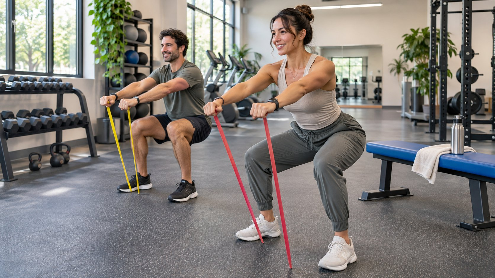

# 健身品牌怎样选达人并审核产品宣称

状态：本地审阅稿；正式发布日期待确认。

按服装、器材、训练和补充剂的不同要求，分配创作任务和审核责任。

健身品牌先按内容任务选人。服装需要解释试穿感受，器材需要展示实际设置，训练服务和补充剂则需要按任务核实资历、说法和证据。让创作者只演示符合自己经验、能现场核对的动作。给每句客观说法留产品版本、适用条件和审核人。验收时看真实成片、披露及批准用途，再按合作目标复盘。

## 按产品类别选择达人岗位

先把合作分成服装、器材、训练服务或补充剂。服装达人能展示某件样品如何穿、何处贴身和动作时发生什么。器材作者要能核对型号、部件、安装和适用条件。训练服务可能需要有资历和相关授课经验的人，品牌要验证其职责范围。补充剂项目要让有权的审核人复核宣称，创作者自己的感受只在可解释范围内使用。跨类别时给每类指定负责审稿的人，不因达人在健身领域有知名度就当他有资格处理所有问题。

例如品牌同一周要发阻力带和功能饮料。可以邀请一个擅长器材示范的达人拍阻力带，饮料稿另请品牌合规与产品负责人确认。若同一人出镜，在两个 Brief 里分开讲解内容和批准用语。用[健身达人试点 Brief](https://www.quickkol.com/zh/blog/fitness-influencer-pilot-brief/#answer) 看近期作品、目标语言和完成任务的证据，暂时不按公开粉丝量决定安全性或专业性。选择恰当的人比要求一个达人为全产品线背书更容易核对。

## 把说法分成可观察体验和客观宣称

逐句核对脚本。可观察事实包括演示使用的器材、服装尺码、动作方向和显示的功能。主观体验可用「我觉得」表达，但只要整体文案暗示一个客观结果，就要按该结果核对。[FTC 健康产品合规指南](https://www.ftc.gov/business-guidance/resources/health-products-compliance-guidance)说明美国健康相关广告应有适当证据支持客观宣称。明确证据是否涉及实际产品、适用人群、时间、使用条件和观察结果。不要把品牌团队口头说的内容直接放进口播。如果还不能核验某项效果，把它移出待发稿。

举例：达人说「这条阻力带在这次练习里好握」可以是实际体验。说「它能帮助所有人预防受伤」则是需要独立审查的健康宣称。避免用一个片段展示或经剪辑的前后照片证明普遍效果。编辑后重新检查标题、字幕、口播和缩略图，确保没有扩大原意。为每条批准宣称保存来源与版本，方便品牌在修改后追溯。适用国家或类别不同，交给对应负责人核对。

## 不要用一般健身信息证明产品效果

[美国卫生部门身体活动指南](https://odphp.health.gov/our-work/nutrition-physical-activity/physical-activity-guidelines)提供一般身体活动的公共健康资料。引用这类指南可以帮助解释背景，不证明某个器材、运动服、训练服务或饮品具有具体效果。涉及膳食补充剂的项目，可用 [FDA 膳食补充剂说明](https://www.fda.gov/food/dietary-supplements)确认美国市场的产品类型背景，并让合适的负责人审查具体广告。不要把一般说明写成官方批准某个产品。创作者不应在评论里回答针对个人健康情况的专门问题。

假设品牌用通用运动指南支持「使用我们的器材会更快达成目标」。让审核人指出指南研究的对象、内容和结果是否能支持该产品宣称。如果不能，保留一般信息作为背景，另展示设备实际使用。品牌可以把目标从说服观众获得某种效果改为让他们看懂设备设置。不同任务可用不同的证据。若团队只有产品体验，没有可用研究，不用引用看似相关但无法支持说法的资料。

## 安排创作者能控制的演示

用有批准的场地和设备，给拍摄分镜写清谁检查安装、谁示范、谁看现场、谁批准最后说法。创作者应能根据经验选择适合的动作和节奏，品牌不要为画面夸大负荷或要求未经排练动作。用近景、不同角度和真实可见的操作说明产品。拍摄前测试设备与稳定摆位，留出可用通道。无法提供安全条件时，改拍静态功能介绍或使用已获准的图示。用[达人发布 Brief 方法](https://www.quickkol.com/zh/blog/write-a-useful-campaign-brief/#answer)记录必需条件和备用分镜。

例如拍阻力带，品牌希望展示两种握法。让合适的负责人核对产品说明和设备状态，拍摄时给镜头固定位置，保留能识别样品的画面。若观众需要区分两种规格，按产品批次及标注拍近景，别让不同型号素材混剪。没有足够条件做对比时，说明本次只展示指定样品。用画面证明发生了什么，不把它描述成覆盖所有使用者的测试。

## 披露与创作者经验分别验收

适用美国规则的活动可对照 [FTC 的达人披露指南](https://www.ftc.gov/business-guidance/resources/disclosures-101-social-media-influencers)，核实费用、赠品、佣金或其他实质关系是否清楚披露。看真实画面、字幕、说明和平台标签，确认受众可以在正常浏览时理解。让达人用自然语言说明自己的经验和条件。若品牌提供脚本，确认达人实际体验过关键产品。避免把私人记录、健康数据或表现图表拿来做未批准广告素材。

复用广告时重查披露与宣称。一个 30 秒版本可能需要保留原来 90 秒版本里解释条件的句子。不得只剪出效果而丢失适用条件。给媒体团队一份可用版本列表，注明不能改动的声明、区域和到期。收到合规疑问时，不在公开评论争论专业判断。由对应负责人检查原始证据和实际显示，再做更正。保留发布时间、修订原因和新版本。

## 先验收交付，再评价受众和业务结果

发布后核对账号、内容、披露、链接、样品与批准说法。使用权按实际版本和区域验收。若目标是帮助理解器材，用有内容的提问、页面访问和产品支持记录评估；若目标是转化，用合同规定的来源和窗口。不要以点赞或粉丝数替代销量，也不要把购买结果当作产品效果证据。保持自然和付费分开，保存内容 ID 和活动时间。

例如达人按时发出一条器材演示，落地页有 60 次可归属访问，但评论反复问型号。品牌可验收作品，另修订规格表达再测试。若触达高但受众不在目标地区，调整选人、发布或投放目标，别让产品审核承担当期分发问题。下一轮可以只改一个因素，如说明标签或达人岗位，并用同一数据窗口观察。给参加团队反馈哪些结果与其任务有关。

## 用一张宣称记录管理例外

每个版本保留一句实际说法、证据来源、产品型号、适用条件、审核人和日期。审核人无法确认时标待核实，替代用语单独批准。如果合作同时上线多个素材，给每条分配 ID，避免把一条广告的许可套给其余内容。活动中发现错误时标出受影响版本、发布渠道和日期。先修正对应入口，再决定是否需要另测。给创作者说明哪些句子变了以及新版本在哪里。

## 为不同岗位分配审批责任

让创作者、产品、合规和媒体团队签收不同内容。创作者确认经验和口播，产品负责人核对型号和规格，合规核对客观宣称与披露，媒体确认投放的素材版本和范围。任何人在这条链上提出新说法，都要回到证据表。不要只把团队名字写在最终邮件里。让批准记录指向具体句子、文件版本、有效时间及用途。

假设视频在审稿时换了阻力带，镜头里用的是另一规格。拍摄团队发现后应通知产品负责人确认画面，修改涉及规格的字幕，合规再看是否改变效果说明。媒体不得沿用旧广告版本。给改动标一个范围：哪些地方须更正，哪些素材仍可用。已经上线时把正式 URL 和生效时间交给复盘负责人。品牌可以由此区别一个作品的局部问题与整套健身活动的表现。

## 选人和宣称审核可以得出不同结论

假设健身品牌在同一轮活动中发布一款阻力带和一款补充剂。候选人有清楚的阻力带演示作品，但没有能支持营养说法的资历或证据。品牌可请其拍器材设置、实拍动作和限制条件，补充剂的具体说法交给产品和合规负责人审核。若仍想让同一达人出镜，可以为另一产品签独立 Brief，只使用其真实体验与已批准表达。

交付表按创作者角色、产品版本、镜头和实际说法验收。遇到换样品或换市场，再核对支持材料。下轮预算看本次作品是否解答了目标问题，而不要让热门视频的互动数替代对专业性和产品说法的核验。

## 健身品牌的 KOL 审核项目

| 类别 | 适合的证明 | 审核人 |
| --- | --- | --- |
| 服装 | 实际款号、尺码和动作画面 | 商品与制作 |
| 器材 | 型号、部件、操作条件 | 商品及现场负责人 |
| 训练服务 | 实际职责及资历 | 项目负责人 |
| 补充剂 | 实际宣称与支持证据 | 产品及合规 |

每项宣称按实际产品和适用市场核对。

## 健身 KOL 发布检查

把画面、说法和证据对应起来。

- [ ] 确认类别、创作者岗位及近期作品。
- [ ] 逐句核对证据、条件和安全演示。
- [ ] 审核实际版本、披露及广告权。
- [ ] 分别验收内容、数据和修订。

## 研究日期与使用边界

资料核验于 2026 年 11 月 9 日。文中方法、表格和决策规则为编辑建议，标为假设的示例不是实际客户结果或行业基准。外部资料的适用地区与时期按各段说明；本稿处于独立本地审阅阶段，正式发布日期待确认。

## 用清楚的任务开始达人研究

用 QuickKOL 理解 Brief、发现相关达人并研究作品与联系路径；数据、合作条件和结果仍需核验。

[了解 QuickKOL](https://www.quickkol.com/#capabilities)

## 来源

- [FTC 健康产品合规指南](https://www.ftc.gov/business-guidance/resources/health-products-compliance-guidance)
- [美国卫生部门身体活动指南](https://odphp.health.gov/our-work/nutrition-physical-activity/physical-activity-guidelines)
- [FDA 膳食补充剂说明](https://www.fda.gov/food/dietary-supplements)
- [FTC 的达人披露指南](https://www.ftc.gov/business-guidance/resources/disclosures-101-social-media-influencers)
