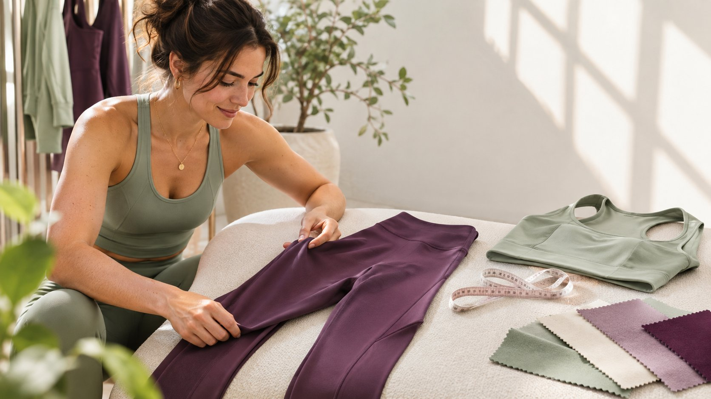
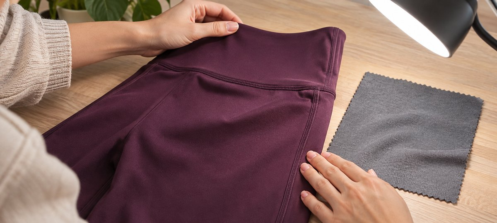

# How Gym Clothing Brands Can Run a Useful Fit Test

Status: local review draft; confirm the publication date before release.

Commission a creator try-on that answers fit questions with a traceable sample, movement footage and clear conditions.

A gym clothing brand can commission a creator try-on to answer one shopping question, such as whether a pocket is easy to use while moving. Select a creator with comparable work, then agree on the style, size, movement, lighting and visible detail. The creator describes their experience. The brand verifies the garment label, objective wording and destination listing. Agree on the scope of the test and rights before publication.

## Give each fit test one shopping question

Begin with a specific decision for the audience. Is the side pocket easy to access while walking? Does the top’s length work with a high waist? How do two fabrics look in comparable light? Convert the question into a movement and a visible detail. A three-garment series can test one primary question per item. Avoid using the same emphatic claim for every garment in place of a demonstration. Select a creator with relevant movement footage and a clear way of explaining what they experience. Give them control over movements they are comfortable filming.

Use a [creator casting brief](https://www.quickkol.com/blog/instagram-model-fit-casting-brief/#answer) to check work samples, movement and the intended context. A creator may be strong at cut analysis, low-intensity try-ons, styling or longer wear checks. A sizing task does not require them to recommend health or training outcomes. Decide whether the work appears on the creator’s profile, a brand channel or a separate ad. Price and approve each use. Once the requirements are explicit, determine whether one organic post or a set of brand-owned assets can answer the pilot question.

## Keep a traceable sample and sizing record

Record the style number, physical label, color, size, sample version and marketplace for each garment. A shared product name is not enough when production runs differ. Ask the creator to compare the received sample with the listing before recording specification language. Pause that wording if the sample differs. If the creator chooses to share a fit observation or garment measurement, collect only the relevant information they agree to share. The brand does not need weight, health records or an individual’s full set of body measurements to verify the garment label.

Suppose the creator receives a dark purple medium while the brand’s destination defaults to a black large. Verify whether fabrics, sizing and product selection are comparable across the variants. Link to the actual sample or clearly describe the difference in the copy and voiceover. Keep the creator’s observations tied to the garment worn. The viewer needs the demonstrated conditions and a way to consult the relevant size guidance. One person’s choice cannot serve as a universal size recommendation.

## Use comparable framing for movement and detail

Plan three types of view: front or side for cut, close-ups for seam, pocket or fabric, and movement footage under stated conditions. Keep light, distance and camera position comparable, especially when comparing colors or cuts. Avoid using lighting or editing to exaggerate a result. The in-article detail photograph shows garment and seam review on a worktable. Capture the static construction first, then the agreed movement. Keep the action within the creator’s comfortable range and the garment’s intended use. If the brand wants an objective durability, breathability or coverage claim, a photograph supplies limited evidence. Verify appropriate testing separately.

For a zipper comparison, use the same distance and ordinary light. If the creator moves farther in one take, record that difference. Do not use it to say one garment stretches more. Ask whether a comparable reshoot is possible. A flat-lay garment dimension can also help when a movement cannot be repeated consistently. Give the approver the final movements and timecodes so they can verify that the captions refer to the visible evidence rather than to the photographer’s setup.

Use a flat detail view for seams and material, then show how the garment moves during the try-on.

## Tie fiber and care statements to the actual style

For U.S. background, [the FTC’s textile labeling guide](https://www.ftc.gov/business-guidance/resources/threading-your-way-through-labeling-requirements-under-textile-wool-acts) explains relevant textile identification requirements and [the FTC’s care labeling guide](https://www.ftc.gov/business-guidance/resources/clothes-captioning-complying-care-labeling-rule) describes care instructions. Have the authorized brand owner verify the information required for the actual product and market. A creator should not infer fiber content, care or origin from touch. Compare the listing, sample label and approved copy, and retain the date and version. For a specific fiber, recycled material or performance claim, obtain support tied to the style. A supplier’s generic description of a material may be insufficient for the finished garment.

Suppose the brand’s standard script says the garment can be tumble dried, while the sample label says otherwise. Have product verify whether the sample differs, the listing is stale or the script applies to another style. Remove unsupported care wording until the issue is resolved. If the creator checks wear after a wash, record the method and observation window without claiming to verify every household condition. Keep the same garment, style and result in the record. A video can illustrate care while the actual product guidance remains the reference.

## Separate experience, performance claims and disclosure

A fit comment can say “this length worked for me during the overhead movement shown.” Avoid converting that into a guarantee that the hem never rides up. For objective performance, have the brand reviewer confirm evidence and conditions. In the U.S. context, [the FTC’s influencer disclosure guide](https://www.ftc.gov/business-guidance/resources/disclosures-101-social-media-influencers) emphasizes making a material connection clear. Review fees, gifts and commissions according to the actual agreement. Lack of an immediate cash payment does not remove a commercial relationship. Check whether a normal viewer can understand the disclosure, especially after cropping a short clip or adding dense text. Keep disclosure and claim approval in separate fields.

If the brand wants an ad edit from an organic post, use a [creator rates and usage rights framework](https://www.quickkol.com/blog/creator-rates-usage-rights/#answer) to confirm term, market, media, editing and transfer. Preserve the creator’s approved statement and its limitations. Permission for a brand site does not establish approval for an outside placement. Recheck any cut that loses a test condition or sponsorship label. Each approved version should trace back to the same garment so the team knows what to update if the listing or offer changes.

## Accept the same garment across the post and purchase route

Open the destination from the live post and check publisher, caption, style, default color, size, store and availability. Preserve the live URL, publication time and reviewer. If the goal is sizing help, review substantive questions, visits to the size guide and attributable steps toward purchase. A view does not establish that the viewer saw the detail shot. A high comment count does not establish broad fit. If asset-level data is unavailable, report the available aggregate with its scope. Keep organic and paid delivery separate.

Suppose the content is correct and the destination records 90 visits, but the in-app route selects an incorrect color. Accept the documented creator work separately, fix the route and record the affected period. Have someone repeat the mobile check in the target market. Next time, change one variable, such as showing the style number on the first frame or placing the sizing guidance earlier. Compare matched windows and note whether the earlier destination problem affects interpretation. That gives the brand a way to learn without treating a link failure as a problem with the creator’s fit demonstration.

## Record conditions when several creators wear one style

When several creators try the same style, keep a garment record and a separate row for each participant. Align the shopping question, setting, camera angles, sample version and movement conditions. Allow people to choose their own size and describe their own experience. Do not require a prescribed positive result. If one creator films a static indoor view and another walks outdoors, label the lighting and movement differences even when the style is identical. Summarize observed experience and explain which views cannot be compared directly.

Suppose one creator prefers a close fit and another prefers more room. The brand can show both approaches alongside its approved size guide. Those preferences do not represent conflicting test results. If color or construction looks different, have the product owner check the actual sample IDs. Avoid applying an observation from one sample to an entire production run. Give the next test one change, such as a comparable light setup or a common measurement location. In the recap, report how many people participated, which samples matched and who checked the listing. That gives viewers a scope for the evidence and helps the brand see which content answered the original shopping question.

## Identify which try-on assets can be reused

At handoff, give each shot its style, size, conditions, approved wording, permission and expiry. If the style changes, avoid reusing an older color or cut as evidence for the new product. If a creator excludes a particular pose from advertising, record the asset-specific limit and identify a detail shot that can be used instead. Preserve the connection between test footage and released creative. For a demonstration with another creator, keep the useful conditions and approved wording, while allowing the new person to describe what they actually experience.

## Use fit-test evidence to decide the next commission

Suppose two creators try the same style of gym trousers. One audience asks about ankle clearance. The other wants to know what the pocket can hold. Check whether each live video shows the relevant detail and uses the specified garment, then look at follow-up questions or visits to decide which question deserves another piece. The creators can describe their own experiences without being asked to agree on fit.

If the samples came from different production runs, label the garments and footage separately. In the next brief, one partner could demonstrate a repeatable movement and another could explain sizing. Give each creator one question, a verified sample and a visual acceptance condition. Keep a matching garment and the actual conditions for any repeat test.

## Gym clothing try-on evidence

| Step | Evidence | Check |
| --- | --- | --- |
| Sample | Style, size, color and label | Matches destination product |
| Movement | Comparable footage and timecodes | Conditions are visible |
| Claims | Experience, evidence and approved wording | Wording stays in scope |
| Publication | Disclosure, live URL and usage rights | Check real viewing context |

A try-on documents the actual sample.

## Try-on campaign checklist

Review by garment, shot and use.

- [ ] Record sample, label and destination product.
- [ ] Verify framing, movement and conditions.
- [ ] Confirm disclosure, claims and asset rights.
- [ ] Open the live path on a phone and keep the evidence.

## Research date and limitations

Sources reviewed November 9, 2026. Methods, tables and decision rules are editorial recommendations. Hypothetical examples are not actual client results or industry benchmarks. Source geography and periods are specified where relevant. This draft is in independent local review; confirm its publication date before release.

## Start creator research with a clear task

Use QuickKOL to interpret a brief, discover relevant creators and research their work and contact routes. Verify data, commercial terms and outcomes at their source.

[Explore QuickKOL](https://www.quickkol.com/#capabilities)

## Sources

- [the FTC’s textile labeling guide](https://www.ftc.gov/business-guidance/resources/threading-your-way-through-labeling-requirements-under-textile-wool-acts)
- [the FTC’s care labeling guide](https://www.ftc.gov/business-guidance/resources/clothes-captioning-complying-care-labeling-rule)
- [the FTC’s influencer disclosure guide](https://www.ftc.gov/business-guidance/resources/disclosures-101-social-media-influencers)
