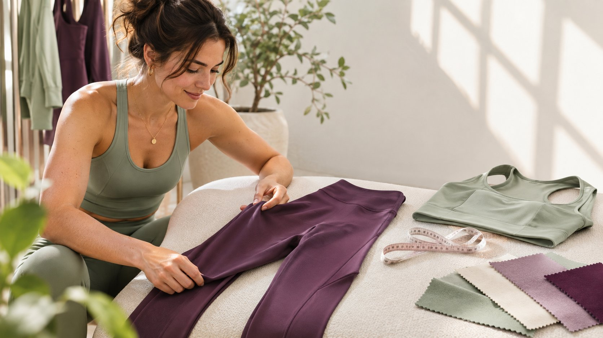
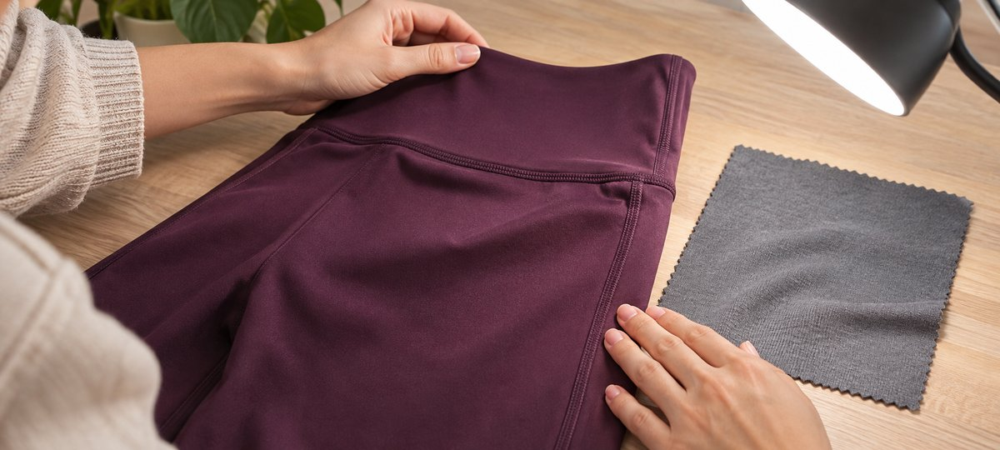

# 运动服装品牌如何做一场可复核的试穿

状态：本地审阅稿；正式发布日期待确认。

用达人实际穿着的款号、动作和图像证据回答买家对尺码与版型的问题。

运动服装品牌可以请达人用一条试穿内容回答一个购买问题，例如活动时裤袋是否方便取物。先从同类作品选人，再约定实际款号、尺码、动作、光线和要拍清的细节。让达人描述自己的真实体验，由品牌负责核对商品标签、客观说法和落地页。试穿范围和素材使用权应在发布前确认。

## 给每一条试穿内容一个购买问题

先问品牌希望受众判断什么。比如运动裤的侧袋在走动时是否容易取出手机，上衣的衣长能否与高腰裤配合，或两种面料看起来有什么区别。把问题改写成能实际拍到的动作和局部。一个系列可以有三件衣服，每件只验证一个主要问题。不要用每件商品同一段夸张口播代替展示。达人应有相关动作内容和清楚解释的能力，给对方选择舒适动作的空间。

用[达人服装拍摄筛选思路](https://www.quickkol.com/zh/blog/instagram-model-fit-casting-brief/#answer)核对作品、姿态和拟用场景。创作者可能擅长剪裁解析、强度较低的实穿、搭配或长期复测。品牌只需要尺寸判断时，不要求达人同时做健康或运动表现推荐。明确试穿是否会发在达人账号、由品牌自有账号发布或另做广告。每种用途对应价格和审批。写好条件后，判断一条自然发布或一份制作素材是否足够完成试点。

## 给实际样品和尺码留一条证据

给每件衣服记录品牌款号、实物标签、颜色、尺码、批次或版本和目标商城。若同一款名有不同生产版本，不用名称替代款号。让达人收到样品后检查颜色和标签，与品牌页面对比。样品不一致时暂停涉及规格的口播。达人选择分享穿着感或衣物测量时，只收集与任务有关且本人同意的信息。不要求提交体重、健康记录或逐一匹配身体条件。衣物规格可由品牌或制作者确认。

假设创作者收到 M 码深紫色裤子，品牌落地页默认黑色 L 码。先核对两种颜色的面料、尺寸和商品选择是否一致。改链接到实际样品，或在图注和口播里清楚说明差别。穿着反馈只关联自己所穿样品。受众需要的是知道展示条件，以及如何查看适合自己的尺码说明。不要将某位达人的选择变成所有人的固定尺码建议。

## 用相近镜头记录动作和细节

安排三种镜头：正面或侧面看剪裁，近景看接缝、口袋和面料，动作镜头看衣物在约定条件下的变化。保持光线、距离和机位接近，尤其比较颜色或两种版型时。避免用特殊灯光和剪辑制造夸大效果。正文配图展示桌面上的衣料与接缝检查，可以先拍清静态细节，再拍经批准的动作。动作应在创作者舒适范围内，以商品条件为准。若品牌要写耐磨、透气或遮盖等客观效果，单张照片的证据有限，应另核对适当测试。

例如对比两件外套的拉链位置，镜头应在相同距离、自然照明下查看。若模特动作幅度不一样，记录差异，不把第二件衣服描述成伸展更好。与达人确认是否愿意从相同角度复拍，必要时先用平铺尺寸给出客观对比。把定版动作和镜头时间码给审稿人，帮助他们判断字幕是否确实对应到画面。

平铺近景可先交代接缝和面料，再用动作镜头说明实际穿着。

## 用款号绑定纤维和护理信息

[FTC 的纺织品标签指南](https://www.ftc.gov/business-guidance/resources/threading-your-way-through-labeling-requirements-under-textile-wool-acts)介绍美国市场适用的纺织品标识背景，[FTC 的服装护理标签指南](https://www.ftc.gov/business-guidance/resources/clothes-captioning-complying-care-labeling-rule)介绍护理说明要求。品牌应按实际商品和市场由有权负责人核对需要对外发布的信息。创作者不应凭触感猜测成分、洗涤方式或产地。核对产品页、样品标签与批准文案，并保留日期和版本。对天然纤维、再生材料或功能性做法等有具体宣称时，要求品牌提供能对应实际款号的支持，而不是只给材料厂的通用说明。

假设品牌统一说「可机器烘干」，但该样品标签写不同护理方式。先让商品负责人检查是否拿错样品、页面过期或文案适用于另一款。未确定前移除未经支持的护理说法。若达人做洗后复测，在记录里写实际方法和观察窗，不声称验证了所有家庭条件。对照时保留同一件衣物、款号和结果。品牌可用视频说明护理步骤，但仍需要以正式商品指导为准。

## 分开使用感受、客观表现和披露

试穿语言可以说明「对这次举臂动作，我觉得衣长合适」，避免把这变成任何人都不卷边的保证。对客观效果，由品牌审核人核对证据和条件。[FTC 的达人披露指南](https://www.ftc.gov/business-guidance/resources/disclosures-101-social-media-influencers)在美国相关场景中强调实质关系应清楚。费用、赠品和佣金按实际活动核对，不能只因没有现付费用就忽略关系。看受众正常浏览能否理解披露，特别是短片裁切和图中文字较多的时候。把宣称与披露分别留在验收表。

如果品牌希望将自然内容剪成广告，用[达人报价和素材使用权框架](https://www.quickkol.com/zh/blog/creator-rates-usage-rights/#answer)确认期限、地区、媒介、可编辑和转交范围。保留达人认可的说法及其限制。某条照片可在官网使用，不自动包括第三方投放。广告版剪掉试穿条件或合作标识时应重审。经批准的每个版本要能追到同一件衣服，方便之后更新商品或下线。

## 在发布和购买路径做同一件商品的验收

从正式帖子打开目标页面，核对账号、文案、款号、默认颜色、尺码、商店和可用状态。保存正式 URL、发布时间和复核人。若目标是帮助用户选尺码，观察相关问题、尺码说明页访问和可归属的购买过程。不要把所有观看都当成消费者看到了特写，也不要把评论多就解释成更适合每个人。品牌若不能取得单条数据，报告相应聚合范围。自然和广告分开。

示例：试穿内容发布无误，90 次落地访问中有一部分看到错误配色，因为链接在应用内重新选择了变体。品牌可保留内容验收，修复路径并记录受影响时段。请另一个人用目标市场手机测试。下次只改一个关键因素，比如将款号移到第一个画面或让尺码说明更早出现。复盘对比相同观察窗口，并说明此前路径问题是否影响数据。

## 记录不同创作者穿同款时的条件

多个达人参与试穿时，先给同款和每位创作者各留一条记录。统一拍摄要回答的问题、场景、镜头角度、样品版本和动作条件，允许个体选择适合的尺码和表达。不要让他们重复品牌给的效果结论。若 A 在室内静态拍摄，B 在户外走动，即使是同一款，也应分别说明光线和动作差异。只汇总双方实际体验，无法比较的画面标清限制。

假设一位达人喜欢较贴身的版型，另一位偏好宽松。品牌可以呈现两种选码思路，同时链接正式尺码表。两者不是互相矛盾的测试结果。若一件衣物的色差或缝线有疑问，按样品编号让商品负责人核对。不要将一个样品的观察外推给整批。给下一轮留下明确的改动目标，例如只调整手机拍摄的光线或统一衣物测量位置。报告时写明多少人参与、多少样品一致、谁复核了实际商品。这样读者可以判断适用范围，品牌也可以看出哪项内容真正解答了购买问题。

## 明确可以复用哪些试穿画面

交接时给每个镜头填款号、尺码、条件、声明、授权和到期日。换版后不要把旧颜色画面用于新款宣称。若创作者不愿意某个姿态用于广告，给该文件单独标注，并准备可替代的局部镜头。保持测试画面与正式素材的对应关系。品牌若想让其他达人复制演示，保留动作条件和批准文字，允许各自说实际感受，不要求复制结论。

## 让试穿反馈指导下一轮选人

假设品牌请两位达人试穿同一款运动裤。一位的观众问裤脚会不会卡住，另一位的观众想知道口袋能放什么。品牌可以分别验证视频是否提供对应镜头，检查样品是否同款，再用后续评论或访问判断哪个问题值得继续拍。达人按个人感受讲述，不需要得出一致结论。

若同一款出现两个不同生产版本，将两件样品与画面分开，不把差异归给达人。下次采购时，一位可负责可比动作演示，另一位负责尺码说明。给每份 Brief 指定一个问题、一件确认过的样品和可验收的画面。准备复拍时保留同款及真实使用条件。

## 运动服试穿证据表

| 环节 | 证据 | 验收 |
| --- | --- | --- |
| 样品 | 款号、尺码、颜色和标签 | 与落地商品一致 |
| 动作 | 同一条件的画面和时间码 | 条件清楚可见 |
| 说法 | 感受、证据和批准语言 | 表达在证据范围内 |
| 发布 | 披露、正式链接及复用权限 | 核对实际视角 |

试穿是对实际样品的观察。

## 试穿合作验收单

按件、按镜头和按用途逐一核对。

- [ ] 记录样品、标签及目标商品。
- [ ] 核对镜头、动作和适用条件。
- [ ] 确认披露、说法和素材使用权。
- [ ] 从手机打开正式链接并保留报告。

## 研究日期与使用边界

资料核验于 2026 年 11 月 9 日。文中方法、表格和决策规则为编辑建议，标为假设的示例不是实际客户结果或行业基准。外部资料的适用地区与时期按各段说明；本稿处于独立本地审阅阶段，正式发布日期待确认。

## 用清楚的任务开始达人研究

用 QuickKOL 理解 Brief、发现相关达人并研究作品与联系路径；数据、合作条件和结果仍需核验。

[了解 QuickKOL](https://www.quickkol.com/#capabilities)

## 来源

- [FTC 的纺织品标签指南](https://www.ftc.gov/business-guidance/resources/threading-your-way-through-labeling-requirements-under-textile-wool-acts)
- [FTC 的服装护理标签指南](https://www.ftc.gov/business-guidance/resources/clothes-captioning-complying-care-labeling-rule)
- [FTC 的达人披露指南](https://www.ftc.gov/business-guidance/resources/disclosures-101-social-media-influencers)
