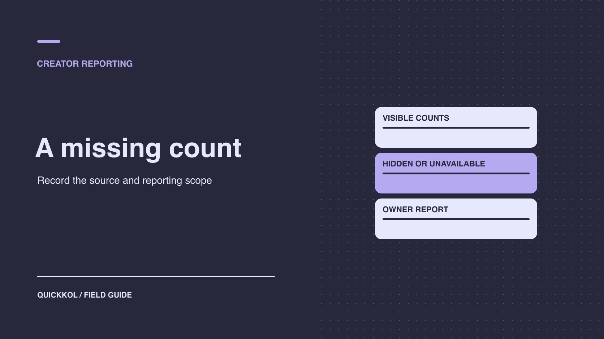

# How to Report Engagement When Instagram Likes Are Hidden

Status: local review draft; confirm the publication date before release.

Use scoped native evidence and explicit data states to report a partnership without inventing missing likes.

QuickKOL editorial graphic; not actual account metrics or a platform interface.

When a creator hides public Instagram likes, record that viewing state and request any contracted native aggregate for the asset and window. Distinguish unavailable, inapplicable and verified zero. Calculate engagement only when the numerator, denominator and scope match. Accept creative using its live URL, disclosure and agreed scope. A bonus tied to likes needs the separate evidence named in the agreement.

## Identify what the public observation establishes

[Meta’s Instagram like visibility announcement](https://about.fb.com/news/2021/05/giving-people-more-control/) distinguishes a viewing preference from public display on a post. A researcher who cannot see the number has one confirmed observation: the count was not displayed in that account context, interface and time. The reason might be a publishing control, the viewer’s setting, a format difference or unavailable access. Confirm the live URL, publisher, device and capture time. Where appropriate, ask the publisher to explain their setting or compare from a viewer account without the browsing preference. The public absence does not establish engagement quality or an intention to conceal a problem.

A report can say “the public like count was not shown in the observed audience view.” Give native data its own status. When reviewers disagree, have them compare the URL and viewing conditions. Attach the observations to the original report, so a later reader does not mistake a screenshot for an account export. If public visibility is a contract requirement, route the requested setting to the authorized publisher. Reporting does not require editing access.

## Give the worksheet explicit data states

Store a value and status separately for every metric. Verified zero requires an applicable source and time. Not displayed publicly describes the external view. Unavailable in the native report or export means the owner could not provide it or the selected report does not include it. Inapplicable means the metric does not apply to the format or deliverable. If the value exists but its definition remains unclear, retain the original and add a pending status. Do not use blank, dash and zero interchangeably. Analysts need to be able to filter by state without including missing values in an average.

Suppose 12 creators publish one carousel each. Eight provide comparable native counts, two are observed only with the count hidden, one creator has not delivered a report and one native report shows zero. Nine rows have usable values. Three cannot enter a likes-based average yet. Keep the verified zero among the nine and report coverage as nine of 12. If the team needs a program-wide result, explain the incomplete coverage instead of ranking partnerships by which creator shared the most data.

## Ask the data owner for a scoped report

Ask the creator, agency or brand data owner for the relevant aggregate. Specify account, asset ID, live URL, release date, time zone and window. Have the owner identify the view and extraction date and note whether it includes organic, paid or collaborative distribution. [Meta’s Reels metrics explainer](https://about.fb.com/news/2023/04/instagram-reels-trending-audio-and-gifts-updates/) describes platform measures such as watch time. A definition for one format does not establish identical reporting on every other asset. Verify the fields available in the account. Use an [Instagram minimum evidence request](https://www.quickkol.com/blog/instagram-follower-check-minimum-evidence-request/#answer) to set the scope and review date without asking for individual follower details or administrative control.

If the required row is absent from an export, ask whether the problem is report selection, permissions, backfill, format or capture time. [Sprout Social’s native report discrepancy guide](https://support.sproutsocial.com/hc/en-us/articles/38269086191757-Troubleshooting-Metric-Discrepancies-Between-Sprout-Social-and-Native-Network-Reports) provides first-party examples of differences between an external tool and a platform report. Use it as a prompt to check connection state, definitions and timing. The same cause should not be assumed for every tool. Keep the original native and external exports, then compare matched dates and label the remaining limitations.

## Calculate engagement only when the units match

Identify whether the denominator is reach, views, followers or impressions. Define which actions enter the numerator, whether any deduplication is applied and which fields are incomplete. Use an [engagement rate metric contract](https://www.quickkol.com/blog/engagement-rate-formula-metric-contract/#answer) to put the required columns and missing-data rule in writing. Suppose a carousel shows reach of 5,000, 80 likes, 20 comments and 30 saves. If the agreement defines engagement as those three events divided by reach, the result is 130 divided by 5,000, or 2.6%. The numerator counts events, so it does not establish that 2.6% of distinct viewers engaged. Record whether the report includes paid delivery.

A second carousel has 5,000 reach, 20 comments and 30 saves, with likes unknown. Report those actions separately or calculate the same comments-plus-saves measure for both assets and label it accordingly. Do not enter zero likes for the second carousel and report a superficially comparable 1.0%. If the correct denominator is unavailable, retain the raw interactions. Aggregate across assets with the agreed fields and describe coverage and possible selection effects.

## Correct prior reporting while keeping the original evidence

Find the cause in the affected rows. Someone may have entered zero manually, or an import may have converted blank cells. Keep the first file and original export. Record each old value, correct status, replacement and reason. When recomputing averages or rates, record the included assets and formula. Check whether the earlier figure went into a client recap, renewal offer or public material. Have the appropriate owner handle any correction to that output. Preserve the initial result so a later reader can reproduce the difference.

For example, a recap says three creator posts earned zero likes. Review confirms that one native value was zero and two counts were only hidden in public. Keep one zero, mark two unavailable and recompute over the comparable records. If the agreement requires reports for every asset, leave those fields pending instead of filling them with the average. Explain the worksheet correction separately from any visibility choice. The next team should know which error changed the figures and which findings still hold.

## Document paid and shared distribution scope

One post may receive organic creator traffic, shared distribution and brand promotion. The platform and ad system can have different metric scopes. Ask each owner to identify the content ID, ad object and relevant source. If engagement may appear in both places and cannot be deduplicated, do not add the totals. A visibility change does not create a separate audience for the same post. When comparing markets or campaign periods, verify objects, dates and units before combining anything.

If the agency only has an aggregate across all creator posts and the brand wants one creator’s results, do not allocate the average. Ask an authorized owner for detail or keep the total with its limitation. If hidden public counts require a substitute metric, confirm that the contract allows it and apply the same definition in a future round. Evaluate evidence availability separately from the creative’s observed performance. A change in how a number is shown does not establish why people engaged.

## Close acceptance, reporting and settlement independently

Give the settlement owner separate columns for accepted creative, native metrics, public observations, missing data and the applicable performance term. Publication, rights and disclosure can have their own acceptance evidence even when a like count is unavailable. When a bonus depends explicitly on likes, the authorized owner applies the agreement and the analyst explains the evidence. Assign unknown fields a review date, source owner and fallback. Avoid carrying a speculative negative label into the creator record. For a future agreement, choose viewing, visits or delivery criteria that match the actual business objective and can be supplied in the agreed window.

## Keep missing data out of creator rankings

If only creators with complete records enter an average, describe the resulting sample. Suppose six of ten creators supplied comparable reports and four did not. A median rate based on the six describes that sample only. If one format makes likes or reach harder to obtain, excluding it also changes the mix. Show format, missing share and valid count separately. Do not rank the four creators as weak because a field is absent. For a renewal, review accepted work, comparable evidence and contract terms before deciding whether to request an export or propose another test.

If a budget model automatically turns empty fields into a low score, label the missing-data condition and keep that column out of the affected decision. Use documented delivery, verified visits or work quality where they address the brief. After correction, have the report owner check both the model and downstream charts for old zeros. When evidence arrives, recompute the affected sample and preserve the time and version. Tell the creator which field is needed, why it matters and how the brand intends to use it. That makes it easier to obtain the right evidence without expanding account access.

## Correct a hidden count that affected renewal

Suppose a brand uses engagement rates to allocate renewal budget. A carousel went live on time, but the report entered zero for a public count that was hidden. Keep the original and ask the data owner whether a matching native value is available. If it is not, mark the field unavailable, recalculate the comparable sample and report its coverage. If a client recap used the old number, give its owner the old value, corrected status, affected decision and date.

Renewal can still consider accepted creative, verified visits and substantive questions. In the next brief, name the data owner, extraction date and permitted fallback. Apply the agreed metric where the evidence is comparable. That avoids penalizing a creator because of how a public number was displayed.

## Example like count states

| Status | Evidence | Action |
| --- | --- | --- |
| Verified zero | Applicable native report shows zero | Keep zero |
| Not shown publicly | Viewing context has no count | Keep value empty and mark status |
| Native unavailable | Report or field missing | Request owner review |
| Inapplicable | Metric does not apply | Exclude and label |

Record visibility and native metrics independently.

## Brand report review checklist

Verify the evidence object before interpreting blanks and calculations.

- [ ] Record URL, account, context and observation time.
- [ ] Distinguish hidden, unavailable, inapplicable and zero.
- [ ] Check window, numerator, denominator and paid scope.
- [ ] Keep the correction and affected conclusions.

## Research date and limitations

Sources reviewed November 9, 2026. Methods, tables and decision rules are editorial recommendations. Hypothetical examples are not actual client results or industry benchmarks. Source geography and periods are specified where relevant. This draft is in independent local review; confirm its publication date before release.

## Start creator research with a clear task

Use QuickKOL to interpret a brief, discover relevant creators and research their work and contact routes. Verify data, commercial terms and outcomes at their source.

[Explore QuickKOL](https://www.quickkol.com/#capabilities)

## Sources

- [Meta’s Instagram like visibility announcement](https://about.fb.com/news/2021/05/giving-people-more-control/)
- [Meta’s Reels metrics explainer](https://about.fb.com/news/2023/04/instagram-reels-trending-audio-and-gifts-updates/)
- [Sprout Social’s native report discrepancy guide](https://support.sproutsocial.com/hc/en-us/articles/38269086191757-Troubleshooting-Metric-Discrepancies-Between-Sprout-Social-and-Native-Network-Reports)
