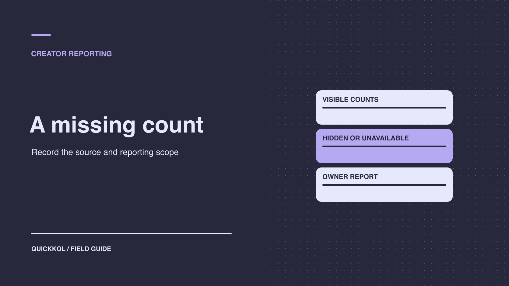

# Instagram 点赞隐藏后，合作报表怎么算

状态：本地审阅稿；正式发布日期待确认。

用原生汇总、数据状态和可比口径更正达人合作报表。

QuickKOL 编辑图形；不呈现真实账号指标或平台界面。

达人隐藏 Instagram 公开点赞后，先把观察记为「公开未显示」。向有权分享数据的人请求对应作品和窗口的原生汇总，分别记录未提供、不适用和已证实为零。只有分子、分母和范围一致时才计算互动率。品牌可以按正式 URL、商业披露和交付范围验收作品，绩效奖金按合同所需的数据另作判断。

## 识别公开观察支持什么

[Meta 的 Instagram 点赞可见性说明](https://about.fb.com/news/2021/05/giving-people-more-control/)区分个人浏览偏好和帖子的公开展示。品牌研究员只看到数字未出现，能记录的是在指定账号、时间和界面没有显示。原因可能是发布者设置、审阅人的个人偏好、格式差异或无法访问。先确认正式 URL、发布账号、设备和观察时间。必要时让发布者说明设置，或从未开启相关浏览偏好的测试账号核对。不要从「公开未显示」推断参与质量或账号在隐瞒问题。

品牌的报告可以写「指定受众视角未显示公开点赞数」，另给原生字段留状态。若有两位审阅者给出不同结果，让他们确认 URL 和浏览环境。把实际观察附在原报表，防止后续团队把浏览截图误作后台证据。对公开显示本身有要求的活动，让发布者按批准范围处理。数据团队的任务是按证据分类，不需要取得编辑权限。

## 为数据表设四种明确状态

为每个指标分别填写数值与状态。已观察到零，需有适用来源和时间。公开未显示，只交代外部视角。原生或导出未提供，表示当前所有者不能提供或报告没有这一行。不适用表示该格式、对象或交付不使用该指标。若有值但定义不清，可增加「待核实」并保留原值。不要把空字符串、破折号或 0 混用。分析同事要能用状态过滤，不把缺失数据纳入均值。

例如 12 位达人各发一条轮播，8 条有可比的原生点赞数，2 条仅公开未显示，1 条原生没交，1 条后台明确显示零。可报告有 9 条带可核对值，另外 3 条暂时无法进入以点赞为分子的平均。分母为参与统计的 9 条，已证实为零的一条应保留。如果报告目的是全部 12 条的覆盖，用「9/12 有值」独立显示。不要按数据最少或隐藏计数来排合作满意度。

## 向数据所有者请求最小范围

向达人、代理或品牌账号所有者索取与交付有关的聚合数据，写清账号、素材 ID、公开链接、上线时间、报告时区与观察窗。让所有者标出具体界面和提取日期，确认是否含自然、付费、合作分发。[Meta 的 Reels 指标说明](https://about.fb.com/news/2023/04/instagram-reels-trending-audio-and-gifts-updates/)展示了平台对观看时间等指标的定义，不能据此推断任意格式都有完全相同报表。可取得的字段按实际账号核验。用 [Instagram 最小数据请求清单](https://www.quickkol.com/zh/blog/instagram-follower-check-minimum-evidence-request/#answer)约定需要什么以及何时复查，不请求个人粉丝明细或管理员权限。

如果合同需要的行不在导出里，请数据所有者确认是报告选择、权限、回填、格式还是采集时间的问题。[Sprout Social 的原生报表差异说明](https://support.sproutsocial.com/hc/en-us/articles/38269086191757-Troubleshooting-Metric-Discrepancies-Between-Sprout-Social-and-Native-Network-Reports)给出第三方工具与平台原生报表可能不同的例子。用它提示应查连接状态、口径和时点。不要假定所有工具遇到同一原因。先分别保留原生与外部报告，再按同一窗口复查，注明不可比的部分。

## 只在口径匹配时算互动率

先确认互动率按触达、观看、粉丝还是展示做分母。明确分子有哪些事件，是否去重，以及哪些项目只有部分资产提供。使用[互动率公式口径协议](https://www.quickkol.com/zh/blog/engagement-rate-formula-metric-contract/#answer)，把必需列和缺失处理写进复盘。比如某轮播原生报表有 5,000 触达、80 点赞、20 评论和 30 保存。如果合同定义为这三项合计除触达，则是 130 ÷ 5,000 = 2.6%。不能称为有 2.6% 的独立观众互动，因为分子是事件合计。还应注明该报表是否含投放。

另一条轮播有 5,000 触达、20 评论、30 保存，点赞未知。可以单报评论和保存，或对两条按同一「评论加保存 / 触达」公式重算并清楚改名。不能把第二条点赞填为零，得到一个表面同口径的 1.0%。若没有适当分母，保留原始互动数。用同一批有数据的素材做汇总，再报告覆盖及可能偏差。

## 更正历史报表而不破坏追溯

先查受影响行的来源。可能是手工把空字段填零，也可能是模板导入时将所有空白转换为零。保留原文件和导出，给每一项标明旧值、正确状态、新值和原因。重新计算均值或互动率时，记录使用的素材范围和公式，核对品牌是否已将旧数用在客户复盘、续约或公开材料。需要更正对外材料时，由相应负责人按更新后的证据处理。不要让新版直接覆盖旧结果，导致无法解释差值。

例如报告声称三条达人帖点赞为零，核对后发现一个是真零，两个是公开未显示。新表仅保留一个零，两个改为缺失，按可比样本重算。若原合同要求全部帖提供数据，将未交字段留待处理，不用平均值补齐。把数据更正和账号设置分开解释。团队应能说明问题出在哪里，为什么调整了结果，以及哪些结论仍适用。

## 把投放与共同发布纳入范围说明

一条帖子可能同时有达人自然流量、共同发布和品牌投放。平台与广告系统可用的指标范围未必一致。要求每个数据所有者注明内容 ID、广告对象和适用来源。若同一互动已在原生帖与广告报告出现，未能确认去重时不相加。换了可见性后也不要把同一内容拆成两个独立受众。需要按市场或活动周期比较时，先确认两边对象、时间和单位，再决定能否汇总。

若代理报表只显示所有合作贴的合计，而品牌要看某位达人，不用整体平均分配。回到可提供明细的授权方，或保留总量并注明无法拆分。若因为公开未显示需要一项替代指标，品牌和达人应先确认合同允许，并按同一方式追踪下一轮。将数据可用性与实际内容表现分开评价，减少对设置的误读。

## 让验收、报表和结算分别结束

给品牌结算人一份分栏记录：已验收素材、原生指标、公开视角、待补数据和相关绩效条件。没有点赞数时，正式发布、使用权和披露仍可分别验收。若合同的绩效条款明确依赖点赞，由负责人按约定处理，分析员只说明证据。给未知项定复查日、来源所有者和替代动作。避免在创作者档案写推断性的负面标签。更新合同时可选择更符合业务目标的观看、访问或内容验收标准。

## 不要用缺失数据给创作者排位

复盘如果只有有完整数据的达人进入平均，说明样本组成。举例说，10 位创作者中 6 位交齐报表，4 位还没有。那 6 位的中位互动率只能代表现有可比样本。若恰好某个格式更难取得点赞或触达，去掉它也会改变样本。分别显示格式、缺失率和有效数，不因为一个字段少就将四位判为表现差。对于影响续约的项目，先看已验收作品、合适的可比数据与合同规定，再发出补件或试点请求。

若预算分配模型会自动将空值变成低分，先标明数据缺失条件并停止让这一列参与相关决策。品牌可以保留客观交付、实际访问和内容质量等有证据的项目。报告负责人应在更正后检查模型和下游图表，确保它们不再使用旧零值。以后加入新数据时，重算受影响的样本，并把重算时间与版本留在复盘表中。让达人知道需要补哪一项、为什么重要，以及品牌如何使用它。

## 在续约表里更正被当成零的点赞

假设品牌用互动率决定第二轮预算。有一条轮播按时发布，报表却将公开未显示的点赞当成零。保留旧版，要求数据所有者确认是否能补到同窗口的原生数据。如果无法补齐，给该条标缺失，重算同口径样本并注明覆盖率。若某份客户复盘已引用旧数据，给负责人一条更正说明，包含旧值、正确状态、影响和日期。

续约时仍可看已验收内容、实际访问和相关提问。下一份 Brief 写明原生数据交付人、日期和可接受替代项。品牌可以把适用指标用在有可比证据的达人身上，并避免因展示设置给某个创作者错误扣分。

## 点赞缺失状态示例

| 状态 | 证据 | 处理 |
| --- | --- | --- |
| 已证实零 | 适用原生报告显示 0 | 保留 0 |
| 公开未显示 | 观察视角没有计数 | 保留空值和状态 |
| 原生未提供 | 缺报表或字段 | 请所有者复核 |
| 不适用 | 格式或约定不使用此指标 | 排除并注明 |

公开展示状态与原生指标分别记录。

## 品牌报表复核单

先核对证据对象，再处理空值和计算。

- [ ] 记录 URL、账号、观察环境和时点。
- [ ] 区分公开隐藏、未提供、不适用和零。
- [ ] 核对活动窗口、分子分母和投放。
- [ ] 保留更正版本和受影响结论。

## 研究日期与使用边界

资料核验于 2026 年 11 月 9 日。文中方法、表格和决策规则为编辑建议，标为假设的示例不是实际客户结果或行业基准。外部资料的适用地区与时期按各段说明；本稿处于独立本地审阅阶段，正式发布日期待确认。

## 用清楚的任务开始达人研究

用 QuickKOL 理解 Brief、发现相关达人并研究作品与联系路径；数据、合作条件和结果仍需核验。

[了解 QuickKOL](https://www.quickkol.com/#capabilities)

## 来源

- [Meta 的 Instagram 点赞可见性说明](https://about.fb.com/news/2021/05/giving-people-more-control/)
- [Meta 的 Reels 指标说明](https://about.fb.com/news/2023/04/instagram-reels-trending-audio-and-gifts-updates/)
- [Sprout Social 的原生报表差异说明](https://support.sproutsocial.com/hc/en-us/articles/38269086191757-Troubleshooting-Metric-Discrepancies-Between-Sprout-Social-and-Native-Network-Reports)
