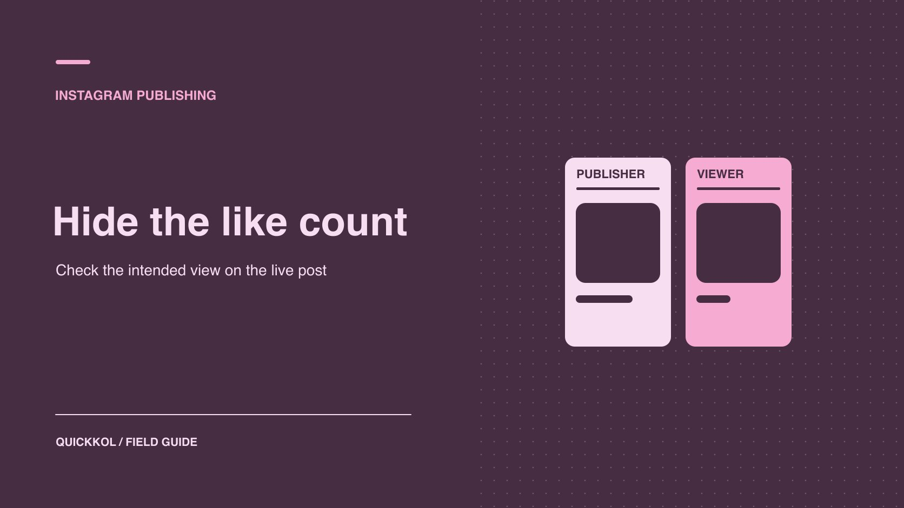

# How to Hide Likes on an Instagram Partnership Post

Status: local review draft; confirm the publication date before release.

Set like visibility on a sponsored post and verify it from an independent audience view.

QuickKOL editorial graphic; not actual account metrics or a platform interface.

To hide the public like count on your own Instagram post, have the publisher check the available control before sharing or in the options for the live post. The reviewer’s personal browsing preference can also affect what they see. If a sponsor wants a particular partnership post to hide its count, record the asset and the person authorized to change it. Verify the live link from an independent audience view, then check sponsorship disclosure and any agreed native reporting separately.

## Decide whose view should change

[Meta’s Instagram like visibility announcement](https://about.fb.com/news/2021/05/giving-people-more-control/) distinguishes hiding the public count on your own posts from hiding the counts you see while browsing. Ask the campaign owner which view should change. Do you need to control how a specific partnership post appears, or does a reviewer simply prefer a feed without counts? The latter changes the reviewer’s own view. It does not change what other people see on the creator’s post. If the brand wants a creator’s public count hidden, have the publishing owner check the setting for that object. One phone’s display cannot establish every audience view.

Give the delivery record four fields: content object, publisher, expected public display and viewer used for acceptance. For example, the creator publishes a product carousel with its public count hidden and the brand verifies it from an account without the browsing preference enabled. Confirm co-authorship, disclosure and editing rights independently. Use a [creator publishing brief](https://www.quickkol.com/blog/write-a-useful-campaign-brief/#answer) to capture the display request, reviewer and authority to change it. Otherwise a reviewer could change their own preference and report that the creator’s public post had been updated.

## Find the post control before or after sharing

Have the authorized publisher open Instagram and prepare the intended content. In the final publishing screen, look in additional or advanced settings for a control related to like counts. If available, apply the brief and preserve the current version. For a live post, have the publisher open that post’s options and look for the control to hide or restore the count. [Meta’s Instagram like visibility announcement](https://about.fb.com/news/2021/05/giving-people-more-control/) describes choosing before sharing and switching after publication. A historical menu label is not a guarantee for every account. Verify format and permissions when the control does not appear.

For three contracted assets, check all three. Applying a setting to one does not automatically apply it to the others. Record the responsible person and time for each change and preserve the live URLs. If the brief refers to a combination of likes and views, inspect which counts the current interface says it controls. Describe the actual observation, such as “The carousel’s public view did not show a total like count.” Do not broaden that statement to shares, views or every audience field. Ask the creator to confirm the documented scope if a format presents the controls differently.

## Resolve an acceptance dispute with two viewer contexts

Suppose a sponsor reviewer cannot see a total on a carousel but the agency can. Record the same live URL, observation time and viewer preferences for both. Ask the publishing creator to check the settings for that asset. Have an ordinary viewing account without the personal hide preference verify the result. If two environments still differ, describe the format and interface actually observed and set a recheck date. The creator can confirm the setting without giving the brand account credentials.

A brief can specify a concrete acceptance condition, such as whether a standard audience view shows a public total. Preserve the observation time and capture. If the format has no applicable control, agree on the default display or a different deliverable before release. Keep any change separate from publication, disclosure and native reporting. The team needs evidence that an agreed audience view was verified. It does not need every reviewer to change their own feed settings. If the review takes place before paid delivery, record the public display result in the asset approval. When the advertisement renders differently, have the media owner check its own placement and document the difference from the creator’s post. A later correction can then go to the publisher or the media owner with the right evidence.

## Confirm that collaboration and disclosure are still clear

[Meta’s Instagram Collabs announcement](https://about.fb.com/news/2023/08/music-and-collabs-on-instagram/) describes co-authorship after an invitation is accepted. For a collaborative post, confirm who initiated it and can change publishing settings, who accepts the invitation and who checks the audience view. After launch, record the actual publishing account and collaborator state. Route display changes through the publisher with the appropriate role. Removing a visible count does not remove the need to verify collaboration and sponsorship labeling.

For the U.S. context, [the FTC’s influencer disclosure guide](https://www.ftc.gov/business-guidance/resources/disclosures-101-social-media-influencers) emphasizes making material relationships easy to see. Review the live caption, content and applicable platform label so the intended audience can understand the sponsorship. Look at the ordinary view as well as any expanded caption. If the only disclosure is difficult to find, ask the responsible owner to correct it. Suppose the brand can see an author name but cannot confirm an invitation was accepted. Check with the publisher and describe what is known. A correct like-count setting does not replace acceptance of any other campaign deliverable.

## Use two real views to accept the change

First ask the publisher to verify the content ID, account, time of change and control. Then open the same live URL from an appropriate viewing account. Record whether the public total is shown, whether the view includes an interaction indication, and whether collaborators and disclosures are visible. Test on a phone if mobile is the relevant audience context. If a particular market or format matters, record the actual device and viewing conditions. A screenshot from one phone does not certify every device. Confirm that the reviewer’s own preference did not determine the result.

Suppose reviewer A sees no number on a new carousel and reviewer B sees a total. Confirm that both opened the same URL. Check A’s browsing preference, then have the publisher verify the post setting. If the display changes later, keep both the original observation and the recheck. When a public view cannot be independently verified, record “publisher confirmed, public acceptance open.” After acceptance, preserve time, viewpoint and result. The next owner can compare the observation if the post’s display is changed again.

## Keep public display separate from campaign reporting

A hidden public count cannot be entered as zero. If the agreement requires likes or an engagement rate, ask the authorized data owner for a native aggregate with the asset, period and definition. Use a [creator engagement reading method](https://www.quickkol.com/blog/read-creator-engagement-data/#answer) to verify numerator, denominator and whether paid delivery is included. If the brand does not need a like count for acceptance, it can still verify the live URL, content and disclosure. Hidden visibility does not establish a gain, loss or removal of engagement. Treat it as a presentation check rather than evidence about ranking or authenticity.

For example, a sponsor may want viewers to focus on the carousel and ask for the public count to be hidden. Its monthly report can still require a data field from the creator. Record “public count not displayed” and “native evidence pending” separately. Preserve the aggregate once it arrives without expanding account access. If the field genuinely cannot be obtained, explain that in the report and use an agreed substitute when the contract permits. Leave the original value unknown rather than inventing it.

## Keep the version and agreement when changing a live post

If the brand requests that the count be shown again, have the publisher check the agreement and current controls. Change only the intended object, record the effective time and recheck from the agreed viewer context. Tell the data owner that a display change does not by itself require a new reporting period. If the publisher changes roles, hand over the list of posts with special display requirements and who can edit them. Assign a recheck date to open items. This prevents a reviewer’s temporary browsing preference from becoming a supposed campaign-wide standard across unrelated projects.

## Make a display test comparable

If the brand wants to learn how hiding a count affects viewing experience, run a small test around a clear question. Choose comparable content, the same audience objective and equal windows. Record which post used each setting. Avoid changing the cover, creator, advertising and release time together. If different creators must publish the two items, acknowledge that the comparison cannot isolate display. Use interviews or questions about the content to understand whether viewers grasped the product. A like count is not a satisfaction measure.

At the end, record the setting, qualitative feedback and measurement limitations separately. If the decision is a creative preference, it can rest on the observed display experience. If the aim is an improvement in an observable business outcome, use measures and a comparison appropriate to that outcome.

## Plan for a missing control

If the test account has no relevant control, have the publisher confirm the version, account type, permission and format. Keep the creative under its existing approval while asking whether the default public display is acceptable or whether another format is appropriate. A missing menu option is not a reason to connect an unverified service to a creator account. Record the date, interface and decision owner so the team can revisit it after a product change. If a particular public view is essential to the campaign, make it a release condition and test it before publication. Otherwise use the approved fallback and document which part of the brief it changes.

## Like count acceptance viewpoints

| Requirement | Operator | Where to check |
| --- | --- | --- |
| Hide count on own post | Authorized creator publisher | Post setting and independent viewing context |
| Hide counts while browsing | Viewer | Personal settings and feed |
| Verify collaborators and disclosure | Brand and creator | Live URL and audience view |
| Verify campaign metric | Data owner | Native report window and definition |

Confirm controls and formats in the actual account.

## Public display acceptance checklist

Check each control from the appropriate viewpoint.

- [ ] Define whether the request concerns browsing or public display.
- [ ] Have the publisher verify the specific post.
- [ ] Open the live URL and disclosure from an independent view.
- [ ] Record time, evidence and reporting source.

## Research date and limitations

Sources reviewed November 9, 2026. Methods, tables and decision rules are editorial recommendations. Hypothetical examples are not actual client results or industry benchmarks. Source geography and periods are specified where relevant. This draft is in independent local review; confirm its publication date before release.

## Start creator research with a clear task

Use QuickKOL to interpret a brief, discover relevant creators and research their work and contact routes. Verify data, commercial terms and outcomes at their source.

[Explore QuickKOL](https://www.quickkol.com/#capabilities)

## Sources

- [Meta’s Instagram like visibility announcement](https://about.fb.com/news/2021/05/giving-people-more-control/)
- [Meta’s Instagram Collabs announcement](https://about.fb.com/news/2023/08/music-and-collabs-on-instagram/)
- [the FTC’s influencer disclosure guide](https://www.ftc.gov/business-guidance/resources/disclosures-101-social-media-influencers)
