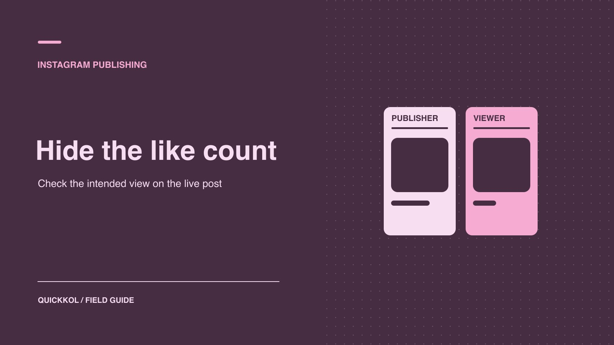

# Instagram 怎么隐藏点赞？合作帖上线前怎么核对

状态：本地审阅稿；正式发布日期待确认。

由实际发帖人核对公开显示，再用独立观众视角验收合作帖。

QuickKOL 编辑图形；不呈现真实账号指标或平台界面。

要隐藏自己 Instagram 帖子的公开点赞数，由发布者在分享前的相关设置或已发布帖的选项中查找控制。个人浏览偏好也会改变审阅者看到的数字。品牌若把隐藏点赞写入合作要求，先确认是哪一条作品、谁能操作，再用没有开启相同浏览偏好的账号验收正式链接。披露和原生数据按合同另外复核。

## 先确定要改变的是哪个视角

[Meta 的 Instagram 点赞可见性说明](https://about.fb.com/news/2021/05/giving-people-more-control/)区分了隐藏自己帖子公开点赞数、以及隐藏个人浏览时看到的点赞数。品牌发起评审前先问：需要控制广告合作帖的公开呈现，还是审阅人只想在自己界面少看计数？后一种设置会影响本人的浏览，不等于修改达人帖子。如果品牌想隐藏某位达人的公开点赞，要由实际发布者在相应对象里检查。不要从品牌手机看到的界面推断所有受众的视角。

给交付单写「哪条内容」「发布者」「预期公开显示」「从哪种账号验收」四项。例：「由达人发布的产品轮播希望隐藏公开点赞数，品牌用没有开启浏览端隐藏的普通账号验收」。发帖账号与品牌的联合身份、披露和编辑权限仍要分别确认。使用[达人发布 Brief 方法](https://www.quickkol.com/zh/blog/write-a-useful-campaign-brief/#answer)把显示需求、审核人和修改权限写进去，避免负责人只在自己手机开启了偏好就提交验收。

## 在发布前或已发布帖找对应选项

由有权发布的达人打开 Instagram，选择要发布的内容，在最后一个发布确认界面查找更多设置或高级设置中的点赞计数相关选项。若可用，按 Brief 设定，然后保存当前版本。已发布的帖子由发布者从帖子页打开选项菜单，查找隐藏或恢复点赞数的可用控制。[Meta 的 Instagram 点赞可见性说明](https://about.fb.com/news/2021/05/giving-people-more-control/)描述了发布前选择与发布后切换。不要把历史说明里的单一菜单名当成所有账号都有，也不要假设照片、轮播和 Reels 的设置一致。设置不出现时，核对当前账号、内容类型与权限。

如果一位创作者交付三条素材，逐条核对。第一条开启后不会自动套用到其他帖子。把每条设置的时间和责任人记到活动表，另外保留正式 URL。若产品要求隐藏「点赞和观看」的某种组合，先看界面实际说明控制哪些数字。报告如实写已观察的范围。例如「此轮播公开未显示点赞总数」，不要把它扩大到分享、观看和所有受众字段。

## 用两个观众视角解决验收分歧

假设品牌审核员打开同一个赞助轮播，自己看不到数字，代理却看得到。先把双方使用的正式 URL、观察时间和浏览偏好记录在验收表。发布达人检查当前内容的设置，品牌找一个未启用个人隐藏偏好的普通浏览账号复验。如果不同设备表现仍不一致，按实际观察描述具体格式和界面，并约定何时复查。别要求达人交出密码来证明页面显示。

合同也可以约定由品牌只审核一项可观察结果，例如面向普通观众的点赞总数未显示，并保留实际截图及时间。若当前格式没有这个设置，品牌和达人可以先批准另一种显示方式，或修改交付格式。任何变更都要在内容和数据验收中独立记录。两边需要保存的是公开展示与合同条件的对应关系，而不是一条供所有审阅人更改个人设置的操作说明。 验收发生在投放前时，把是否按约显示写入资产审批。若广告有单独的呈现方式，由媒体负责人另外查看实际版式，记录它与创作者原帖的差别。这样日后更正公开展示时，团队知道要联系发布者还是广告负责人。

## 确认共同作者与商业披露仍可见

[Meta 的 Instagram 合作发布说明](https://about.fb.com/news/2023/08/music-and-collabs-on-instagram/)介绍接受邀请后的共同署名。若帖子共同发布，先确认谁发起并有权调整发布选项，谁接受邀请，谁从另一个账号核对。上线后记录实际公开账号和共同作者状态。必要时根据两方角色由发布者处理显示问题。不能因为少了一个公开指标，就把共同发布或赞助标签也省掉。

[FTC 的达人披露指南](https://www.ftc.gov/business-guidance/resources/disclosures-101-social-media-influencers)强调，在美国市场适用的商业关系披露应容易被受众看到。活动需检查公开文案、画面和适用平台标签，确保受众能理解。点击展开说明前后各看一次实际内容；发现披露只在不易看到的位置，交给负责方更正。假设品牌从公开视角只看到作者名而未见合作邀请状态，要先向发布者核对，再记录已知事实。点赞显示无误也不能代替其他交付验收。

## 从两个实际视角验收

先让发布者确认内容 ID、账号、操作时间和设置，再从浏览账号打开同一正式 URL。记录是否显示公开总数、是否能看到可识别的互动提示、是否显示共同作者和商业披露。用手机复查可能的界面差异。品牌特别在意某个市场或格式时，写明实际测试位置和设备。不要把手机截图用作证明所有设备状态相同。至少确认测试账号本身没有让结果失真的浏览偏好。

比如品牌验收新轮播时，审阅人 A 看不到计数，而审阅人 B 可以看到。先确认两人打开的是同一 URL，检查 A 是否开启浏览端隐藏，再请发布者复核该帖子设置。如果显示状态变化较晚，记录初次观察和复查时间。不能独立确定时，写「发布者确认，公开验收待完成」，而非直接签收。确认后把时间、视角和结果附在活动记录，便于之后切换回正常显示时对照。

## 区分公开显示和活动报表

品牌不能把公开未显示填写为零。若合同需要点赞数或互动率，由授权数据方提供原生汇总并说明素材、时间和口径。对照[达人互动数据阅读方法](https://www.quickkol.com/zh/blog/read-creator-engagement-data/#answer)，先确认分子、分母和是否包含投放。品牌若无需点赞来验收，可以继续核对正式 URL、内容与披露。隐藏显示本身不说明互动变好、变差或消失。把公开呈现当作创作验收项，而不是算法实验或真实性结论。

例如赞助商希望消费者专注于轮播内容，要求隐藏公开计数，但月报仍需创作者提供约定字段。可以将「公开计数未显示」和「原生数据待交」分开标记。收到报表后，在保护私人信息的前提下保存汇总，不必为了指标打开账号权限。若字段确实不可得，就按合同说明并使用预先同意的替代指标，不补猜测值。

## 发布后更改时保留版本和约定

如果品牌要求恢复显示，让发布者先核对合同和产品控制。只改指定对象，更新生效时间，并从约定浏览视角重查。告知数据方无需因为显示变化重设统计窗，除非活动定义要求这么做。若发布人换岗，交接哪些帖子有特殊设置，谁可以修改。也可给未完成验收的项目指定复查日，避免一个临时浏览偏好在多个项目中变成默认标准。

## 让展示测试的结果可以比较

若品牌希望了解隐藏计数是否影响观看体验，可以安排一次有明确问题的小测试。选择相似内容、同一受众目标和等长窗口，记录哪一条使用了哪个设置。不要同时改变封面、达人、投放和时间。如果两条内容只能由不同达人发布，承认这种设计无法单独归因给显示状态。用访谈或内容问题补充读者是否理解产品，不把点赞变化等同于满意度。

结束后分别记录公开设置、内容反馈和数据限制。如果只是创意偏好，可按实际浏览体验决定是否保持设置。若目标是提高可衡量的业务结果，还要用与目标一致的指标并保留适当对照。

## 准备一个设置不可用的备选方案

如果测试账号未看到开关，先让发布者核对版本、账号类型、权限和格式。保持合作内容在批准状态，询问是否接受公开计数按默认显示，或改用实际支持的格式。不要因为找不到某个按钮就用未验证工具连接达人账号。保存当前界面的范围、日期和批准人，待产品能力变化后再核对。品牌活动如果必须满足特定的公开视角，把这一项设为上线前条件，而不是发布后补救。

## 隐藏点赞验收视角

| 要求 | 谁操作 | 看哪里 |
| --- | --- | --- |
| 隐藏自己帖的公开数 | 有权发布的达人 | 指定帖的设置与独立观看视角 |
| 自己不看其他帖的计数 | 当前浏览用户 | 个人设置与信息流 |
| 确认共同作者和披露 | 品牌与达人 | 正式 URL 与真实观众视角 |
| 核对活动指标 | 数据所有者 | 原生报表窗口和口径 |

当前菜单和格式支持以实际账号为准。

## 公开展示与发布验收清单

把每个设置和对应视角分开检查。

- [ ] 明确浏览偏好或公开展示的要求。
- [ ] 由发布所有者核对指定对象。
- [ ] 用独立账号看正式 URL 和披露。
- [ ] 记录时间、证据和指标数据来源。

## 研究日期与使用边界

资料核验于 2026 年 11 月 9 日。文中方法、表格和决策规则为编辑建议，标为假设的示例不是实际客户结果或行业基准。外部资料的适用地区与时期按各段说明；本稿处于独立本地审阅阶段，正式发布日期待确认。

## 用清楚的任务开始达人研究

用 QuickKOL 理解 Brief、发现相关达人并研究作品与联系路径；数据、合作条件和结果仍需核验。

[了解 QuickKOL](https://www.quickkol.com/#capabilities)

## 来源

- [Meta 的 Instagram 点赞可见性说明](https://about.fb.com/news/2021/05/giving-people-more-control/)
- [Meta 的 Instagram 合作发布说明](https://about.fb.com/news/2023/08/music-and-collabs-on-instagram/)
- [FTC 的达人披露指南](https://www.ftc.gov/business-guidance/resources/disclosures-101-social-media-influencers)
