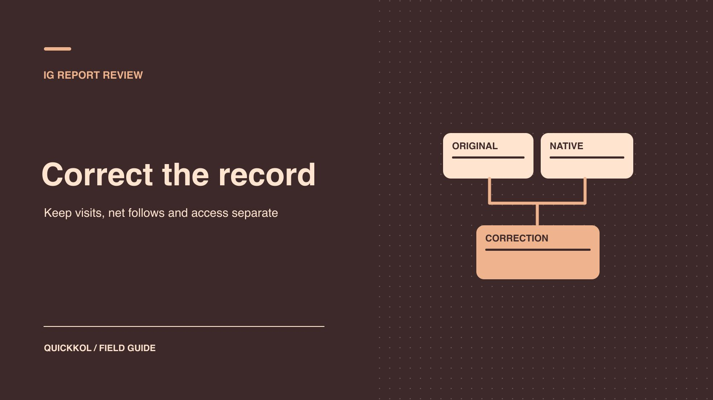

# 免费 IG 粉丝邀约出现后，代理报表怎么更正

状态：本地审阅稿；正式发布日期待确认。

把达人账号访问记录、增长口径和报表更正分开核对。

QuickKOL 编辑图形；不呈现真实账号指标或平台界面。

品牌发现免费 IG 涨粉邀约和代理报表中的异常数字时，先分别确认访问与计数。由账号所有者复核授权，分析员核对账号、时区、净增、访问和投放来源。若数据有误，保留旧版本并注明哪些报表与结算受影响。只有证据能证明具体操作时，才能将人为互动写入结论。达人已发布的作品可按约定独立验收。

## 把免费邀约变成可记录的事实

先收集邀约的原始措辞、发现时间、谁收到，以及是否有人执行。不要把「有人在群里转发」写成「代理使用过」。问清楚对方承诺的是总粉丝、每日增量、互关或其他结果，有没有索要用户名之外的信息。[Meta 虚假互动执法说明](https://about.fb.com/news/2020/10/taking-action-against-fake-engagement-and-ad-scams/)曾公开描述利用机器人及自动化抬高 Instagram 粉丝与点赞的案例。这说明存在这样的机制，不能拿旧案例判断眼前一家服务、代理或达人做过同样的事。

如果对方把结果承诺为「免费且稳定」，让业务负责人确认有没有后续收费、账号连接或自动化条件。在验收表里分别写「发现邀约」「委托记录」「支付记录」「授权记录」「交付记录」。一张截图常只支持其中一项。保留出处，避免把它搬到不相干的达人档案。需要向创作者澄清时，先分享必要的时间段和问题，不传递未核实的同行猜测。

## 由账号所有者核对四类访问

盘点公开用户名、第三方应用授权、业务资产和人员权限、实际登录凭证。用户名是公开标识。业务合作方可能只获批查看某份广告报告，也可能有发布或管理权限。把平台应用连接与代理员工的资产角色分别检查。记录已知用途、批准人、当前状态、到期及撤销人。若无人能说明用途，由真正的账号所有者复核，而非让代理提供其看不到的结论。

[Meta 仿冒页面说明](https://about.fb.com/news/2022/07/how-meta-safeguards-people-against-clone-sites/)介绍了仿冒网站如何仿制平台并欺骗使用者交出登录信息。遇到陌生页面输入密码、验证码或授权后提示异常时，优先让所有者从可信设备走官方账号安全流程，查设备与连接、处理暴露并复核内容和链接。截取访问证据时遮盖私人信息。资料留在受限位置，代理报告只填变更类别及影响。如果未观察到陌生应用，写明检查过的界面和日期。不要把有限检查写成「账号从未暴露」。

## 对齐账号、时区和指标口径

发给代理一张三列核对表：原报表的字段、原始数据所在位置、更正要求。第一行核对达人实际发布的 @账号和链接。第二行锁定时间窗和时区，包括截止日是否计入。第三行确认「粉丝增长」是期末减期初、原生净增、关注事件、净新增预估，还是跨账号汇总。若代理把跟踪器两次公开读数相减，保留两次截取时间，不把估算当原生净增。

用 [Instagram 两源对账方法](https://www.quickkol.com/zh/blog/instagram-follower-count-two-source-reconciliation/#answer)并排放原生和外部观察。与公开号差几百不一定是异常，例如显示缩写、采集时间不同、账号重命名或代理引用了另一个地区的子账号。能取得关注和取关时，用同一窗口记录两列。报表暂时缺一个日期或某人没有权限，标成未知并指派来源所有者。向创作者提出最小范围请求即可，例如一周原生趋势及筛选时间，不索要粉丝名单或凭证。

## 用内容和投放事件复核增长来源

把内容和投放的真实事件列在涨粉旁边：合作帖子发布、达人被引用、抽奖或活动开始、付费内容开启和暂停。[Meta 的 Reels 指标说明](https://about.fb.com/news/2023/04/instagram-reels-trending-audio-and-gifts-updates/)提到 Reels 观看时间和来自 Reels 的关注信息。单条内容可取得的归因，不能代替整个账号同期净增。先核对数据是否属于活动素材，检查有无品牌广告和影响来源理解的转发。口径能对上时，再看主页访问、相关评论、关注和后续回访变化。

假设报表声称增加 1,600，原生净增为 640，期间一次广告报告记录 960 次主页访问。两项刚好能加到 1,600 也不能相加，因为访问与新增粉丝是不同动作。先更正报表中的 1,600，再查是否还有来源无法解释。若发现有人未经许可提交授权，另走安全流程；数字误加不证明它来自那次授权。以[达人互动数据阅读方法](https://www.quickkol.com/zh/blog/read-creator-engagement-data/#answer)检查参与质量，避免将评论语言、关注国别或发布时间当作单项证明。

## 写清楚更正版本的影响范围

收到补充材料后，要求代理保留原件并提供新版本。更正记录写旧值、可核对的新值、原因、来源、责任人、日期和下游影响。「粉丝新增 1,600」更正为「净增 640；另有 960 次广告主页访问」。这只是示例。未确定的自然与付费归因仍可标未知。若原数字出现在会议纪要、自动仪表板、活动案例或续约报价里，给相应所有者同一条更正记录。注明哪些材料已经改版。

更正后看绩效是否影响支付。制作、发布、品牌使用权和数据奖励各有验收证据。对已确认但归因不清的净增，不自动归为代理成果，也不自动拒绝视频费用。发生付款争议时，交由合同负责人判断哪些条款要求独立证明。若确实存在人为放大，写明什么证据证明什么机制，并限定受影响的账号和期间。保留可追溯的答复，让达人能指出数据截取或身份关联的错误。

## 把未知状态交给下一轮复查

未知不是临时空白。每一项都填证据缺口、是否影响安全或付款、谁能补和最晚复查日。原生数值已更正但来源仍未知时，给分析员一个查看同窗数据的约定。权限问题有迹象时单独通知账号负责人。若争议仅是代理的指标命名错误，保留更正并关闭安全检查，不扩大到要求达人提供额外个人数据。团队可以只向有业务需要的人分享处理结果。

举例说，一个经纪人确认陌生增长服务仅发送过链接，没有发现授权记录。同期涨幅仍不明，日报可写「未观察到该连接；增长原因未知」。如果之后达人发现登录异常，重新打开权限项，记录新的观察时间。是否接受一条内容，可以根据交付标准独立决定。这样复查表成为任务记录，而不是公开评价名单。

## 核对报表中的品牌和达人职责

代理可能对达人数据只做汇总，对广告后台却有完整管理权限。请他们分别注明谁生成截图、谁下载报表、谁做计算。比如某行内容出自创作者自行导出，另一行由品牌的投放账户提供。发现二者时区不同，先在保留原始文件的条件下，重新按统一区间导出或标注不可比。不要要求代理代表达人确认没有授权异常。相应的账号管理员需要签收这一项。

如果代理更换了承包商，追加两列「访问发起人」和「批准人」，确认旧角色是否已经按约定到期。已经核实的角色不能只因为当月换代理就改成未知，也不能因曾有批准而推断今天仍有效。选择一位品牌负责人维护当前名单，让创作者有一个能直接确认更正和暂停授权的联系点。

向内部发更正时，注明发布时间和生效范围。例：「周二起，续约材料使用经核验的 640；前三周的历史日报保留并附更正」。保留一份能被复算的记录，但对外只用更新后的数字和适用限制。下一位分析员应当能找到来源，复现计算，并说明为什么两个指标不相加。

## 在代理交接时防止同一错误再发生

假设代理把品牌广告的主页访问与达人账号净增相加，再将结果填入续约建议。先从原生来源复算旧数，记录哪一页需要更正及谁接收新版。请签约达人仅确认实际账号和必要窗口，品牌媒体负责人确认广告对象，代理分析员负责替换合并值。若作品按约发布，验收单照实际交付记录。

下一轮签约时，把报表来源、提取日和谁可分享数据写进 Brief。先用一条达人内容走通原生报表与品牌媒体的核对，检查零和缺失的标记是否正确。若报表无法区分推广来源，结算采用可观察的其他交付，或将绩效归因保留为待定。不要为了方便报数扩大对创作者账号的访问。

## 代理更正记录的四列

| 记录 | 例子 | 负责人 |
| --- | --- | --- |
| 原数字 | 报表写新增 1,600 | 代理分析 |
| 更正值 | 净增 640；访问单列 | 数据所有者 |
| 权限状态 | 审核窗口未见陌生应用 | 账号所有者 |
| 影响范围 | 更新复盘和续约页 | 品牌活动负责人 |

假设数字仅示范更正格式。

## 品牌复核检查单

逐项确认后，再签发更正和结算决定。

- [ ] 保留邀约文字与已知实际动作。
- [ ] 分别核对应用、角色、凭证和设备。
- [ ] 让后台与外部观察使用可比较的窗口。
- [ ] 给旧值、新值、原因和下游材料留记录。

## 研究日期与使用边界

资料核验于 2026 年 11 月 9 日。文中方法、表格和决策规则为编辑建议，标为假设的示例不是实际客户结果或行业基准。外部资料的适用地区与时期按各段说明；本稿处于独立本地审阅阶段，正式发布日期待确认。

## 为异常增长建立证据标准

按信号、解释与事实记录各项信息。

[查看异常证据阅读方法](https://www.quickkol.com/zh/blog/fake-followers-anomaly-evidence-literacy/)

## 来源

- [Meta 虚假互动执法说明](https://about.fb.com/news/2020/10/taking-action-against-fake-engagement-and-ad-scams/)
- [Meta 仿冒页面说明](https://about.fb.com/news/2022/07/how-meta-safeguards-people-against-clone-sites/)
- [Meta 的 Reels 指标说明](https://about.fb.com/news/2023/04/instagram-reels-trending-audio-and-gifts-updates/)
