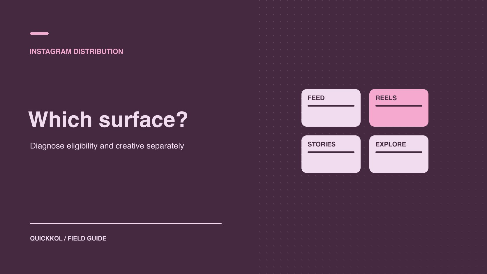

# How the Instagram Algorithm Affects Sponsored Reach

Status: local review draft; confirm the publication date before release.

Use publishing evidence, format and known paid activity to diagnose an Instagram creator partnership’s reach.

QuickKOL editorial graphic; not actual account metrics or a platform interface.

Instagram personalizes distribution across several surfaces. If a creator partnership falls short on reach, check the agreed live publication and any recommendation status the account owner can see. Compare organic work in the same format and window, and note when collaboration or advertising began. The sponsor can then decide whether to test another format, revise the opening or request more relevant audience evidence. A single low result cannot establish a distribution restriction.

## Define what each Instagram surface should accomplish

[Meta’s Instagram ranking systems explainer](https://about.fb.com/news/2023/06/how-ai-ranks-content-on-facebook-and-instagram/amp/) distinguishes ranking and personalization across Feed, Stories, Reels and other discovery contexts. Start a partnership with a purpose. A Reel can show a product action, a Feed carousel can leave a useful reference and a Story can give an established audience a next step. Explore or another recommendation surface can support discovery, but a brand cannot secure a particular placement simply by choosing a format. Replace “the platform will push this” with an observable job and audience. Use an [Instagram distribution roles guide](https://www.quickkol.com/blog/instagram-and-influencers-distribution-roles/#answer) to separate creative work, publication and advertising.

For example, a KOL can demonstrate a tool in a Reel and use a Story for a reminder. The Reel can test whether unfamiliar viewers understand the context, while the Story tests whether relevant people can find the link. The two items do not need the same engagement rate. Their views cannot automatically be combined into unique reach. If the objective is product knowledge that remains easy to find, prioritize clear material and destinations. Name the publishing and reporting owners before launch.

## Check publication separately from recommendation eligibility

First confirm the live URL, publisher, approved version and intended visibility. Have the account owner check any available native recommendation or account status. [Meta’s recommendation guidelines explainer](https://about.fb.com/news/2020/08/recommendation-guidelines/) distinguishes content that may remain on the platform from material eligible for recommendation to people who do not follow the account. Public availability does not establish recommendation eligibility, and eligibility does not promise a fixed amount of reach. Ask the owner to record the actual interface, object and time. The sponsor does not need broad account access.

If a specific status appears, give its wording and affected object to the publisher. Pause or review the affected creative as appropriate while retaining unrelated delivery evidence. If the reviewer sees no notice, record that observation within the scope checked. It does not establish that every potential issue was examined. For reduced non-follower reach, continue checking format, creative, dates, promotion and audience. Avoid describing an unverified case as a shadow ban. Ask for the smallest native report that can address the remaining question.

## Identify original work, collaboration and reuse

[Meta’s creator discovery update](https://about.fb.com/ltam/news/2024/05/ayudando-a-los-creadores-a-encontrar-nuevas-audiencias/) describes historical changes that included attention to original content and original sources in recommendation contexts. Use it as background and verify the actual account and asset. Creator-shot material, a brand reupload, collaborative publishing, advertising and a cutdown should not share a single source label. Record the original footage, publisher, approved version and permitted use. Republishing the same work on multiple accounts does not establish that the system favors it. Check platform eligibility and contractual rights independently.

Suppose a creator explains a product with original photos and the brand prepares a carousel and an ad edit. Label the original post, co-published item, brand reupload and advertising version when comparing results. If later versions use different cover images or subtitles, the creative and audience may also have changed. Do not attribute all variation to originality. The brand can test one independent creative difference, such as showing the real product action earlier. Obtain permission for the edit and document which publishing object is actually under review.

## Compare performance within format and time window

Record actual publication time, format, publisher, co-authorship, paid or organic scope and extraction time. A one-day count and a seven-day count describe different post ages. Use an [Instagram format measurement guide](https://www.quickkol.com/blog/instagram-analytics-format-decision-matrix/#answer) to choose appropriate fields. For a Story, destination use or completion of the intended action might matter. For a Reel, available viewing time, reach and content-attributed follows can provide context. [Meta’s Reels metrics explainer](https://about.fb.com/news/2023/04/instagram-reels-trending-audio-and-gifts-updates/) describes watch time and other metrics. Confirm the fields that the participating account can actually supply. Distinguish plays, reach and watch time, and verify the denominator before reporting a rate.

Suppose one Reel reaches 15,000 accounts and a carousel reaches 8,000 but supplies more verified destination visits. The two may serve different jobs. A larger reach number does not establish stronger buying action. If the report splits follower and non-follower activity, keep matched dates. Label unavailable fields. Do not infer reach from a public like screenshot or present an external tool’s visible sample as complete distribution.

## Choose a creative or distribution change based on the evidence

When performance falls short, ask in order whether the post was available as planned, whether the scope is comparable, whether the opener fulfills its promise, whether the audience fits the brief and whether the destination works. Controllable changes include the cover, order of demonstration, caption and publishing role. Change one major element while keeping format, objective and window comparable. Log a creator change, new advertising or destination edit as concurrent activity. Without a design that isolates the change, present the result as observational. The aim is a better creative decision, not reverse engineering signal weights.

Suppose two carousels explain sizing. One opens with a product name and the other shows exactly where to measure. Keep the destination and other creative elements comparable and look at saves, substantive questions and visits in the same window. If the question is clarity, add a brief walkthrough with a viewer. A pilot without a measurable lift can still reveal a missing instruction or broken route. Avoid adding unrelated prompts simply to inflate an interaction count.

## Keep collaborative and paid evidence in its own scope

Record when collaborators accepted, which account published and when paid delivery began. Co-authorship can change presentation. It does not establish how many people came from each account. Native reports, ad reports and destination analytics may not support deduplication across accounts. Without a supported method, do not sum them as distinct people. If organic discovery is the primary test, document advertising separately and consider an agreed organic observation window before promotion begins.

Suppose the creator publishes Monday, the brand accepts a collaboration Tuesday and ads begin Wednesday. Put all three events on a timeline with their actual times. Inspect whether the reports can separate delivery. If they cannot, report the aggregate and overlapping activity. A budget for a later paid test should use ad-system delivery or an agreed action, rather than assigning all native engagement to the ad. For a replacement post or a corrected caption, retain separate versions for the original, change and actual placement. That helps the next reviewer know which version the audience could have seen.

## Compare two surfaces against one business goal

Suppose a brand wants people looking for a new product use to see the actual process. Ask the creator for a short demonstration and a Feed carousel. Keep the actual creative, publisher, timing and report for each. Establish a common outcome, such as reaching the same instructions page, and compare appropriate process evidence separately. The short may need a clearer opening second. The carousel may need a first slide that makes the sequence obvious. A field called views in both reports does not necessarily count the same event. Confirm the unit and coverage with each data owner.

Imagine the short reaches more accounts while the carousel generates more tagged visits. Keep both observations. For the next short, test a clearer next step. If visits are unavailable for one format, do not estimate them from reach or enter zero. If a promotion was unavailable in some markets at release, record the affected period and ask the brand to fix the route. Check whether the intended business action can be observed independently of content distribution. That prevents a broken page from becoming an explanation about ranking.

For a procurement recap, make one decision per format: whether it fits the current role, what evidence is missing and who owns the follow-up. Date an observation that applies to one campaign. It does not justify changing formats for every creator. Expand the test or its budget only when the creative, channel and actual objective can be evaluated together.

## Use the reach gap to choose the next creator brief

Suppose a brand buys a short demo and Stories from the same creator so viewers can understand a product and find its specifications. The demo reaches fewer non-followers than comparable work, while Story visits meet the brief. Ask the creator to check available eligibility and report scope. Review the two deliverables under matched windows. To test discovery again, commission one more demo and change only the opening use case. To serve the existing audience, retain Stories and their observable visit measure.

Record verified publication, possible explanations, missing evidence and the next option for each asset. If the account cannot provide a format or source breakdown, accept the work and link on their evidence and leave future reach open. Ask only for reporting that can change the renewal decision.

## Hand off verified findings and the next review date

Keep the live URL, publisher, format, dates, any eligibility notice, organic and paid evidence, intended action and next step. Separate confirmed facts, plausible explanations and hypotheses to test. A finding could read: “This Reel’s non-follower reach was below recent same-format examples. No notice was observed in the checked view. The next test changes only the opening.” Avoid claiming that one setting explains all variation. Give the owner an observation window and metric they can interpret. The handoff should remain useful even when a menu or report changes before the next pilot.

## Instagram creator distribution checks

| Question | Verify | Test |
| --- | --- | --- |
| Can people see it? | URL, visibility and version | Correct publisher or path |
| Recommendation eligibility | Owner-visible status and time | Review the stated issue |
| Which audience received it? | Matched format, window and paid scope | Change one creative or distribution factor |
| Did viewers act? | Verifiable visits or interaction | Check promise and destination |

Examples do not establish rank or guaranteed reach.

## Instagram distribution diagnosis checklist

Verify publication and eligibility before testing creative.

- [ ] Confirm live asset, publisher and target surface.
- [ ] Separate eligibility, organic, shared and paid delivery.
- [ ] Check source, denominator and window.
- [ ] Change one factor and record the review date.

## Research date and limitations

Sources reviewed November 9, 2026. Methods, tables and decision rules are editorial recommendations. Hypothetical examples are not actual client results or industry benchmarks. Source geography and periods are specified where relevant. This draft is in independent local review; confirm its publication date before release.

## Start creator research with a clear task

Use QuickKOL to interpret a brief, discover relevant creators and research their work and contact routes. Verify data, commercial terms and outcomes at their source.

[Explore QuickKOL](https://www.quickkol.com/#capabilities)

## Sources

- [Meta’s Instagram ranking systems explainer](https://about.fb.com/news/2023/06/how-ai-ranks-content-on-facebook-and-instagram/amp/)
- [Meta’s recommendation guidelines explainer](https://about.fb.com/news/2020/08/recommendation-guidelines/)
- [Meta’s creator discovery update](https://about.fb.com/ltam/news/2024/05/ayudando-a-los-creadores-a-encontrar-nuevas-audiencias/)
- [Meta’s Reels metrics explainer](https://about.fb.com/news/2023/04/instagram-reels-trending-audio-and-gifts-updates/)
