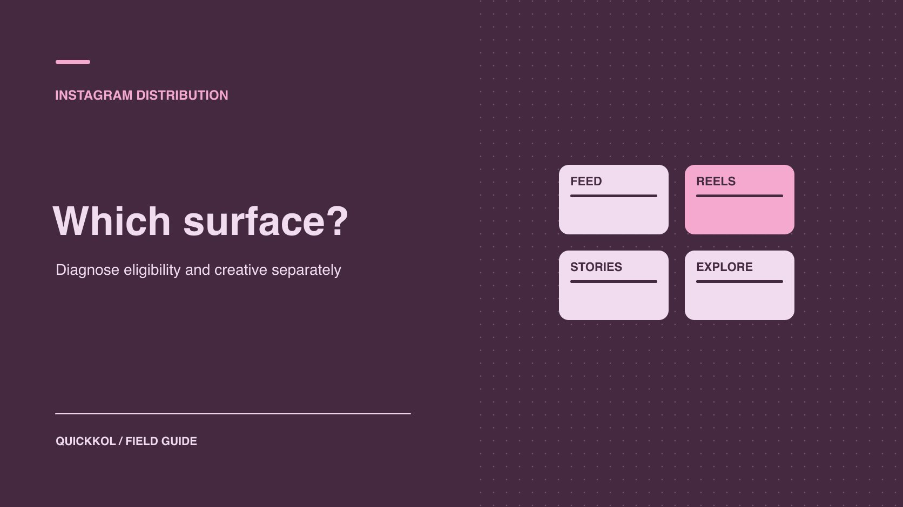

# Instagram 算法怎么影响合作内容的触达

状态：本地审阅稿；正式发布日期待确认。

结合发布资格、内容格式和已知投放，判断一次达人合作的触达差距来自哪里。

QuickKOL 编辑图形；不呈现真实账号指标或平台界面。

Instagram 会按不同界面做个性化分发。达人合作触达偏低时，先确认作品已按约公开，并由账号所有者核对可见的推荐资格。再比较同格式、同窗口的自然表现，检查共同发布和广告启动时间。品牌需要决定是换内容形式、改创意，还是补测目标受众。单次触达偏低无法独立证明内容受到限制。

## 先确定活动要从哪个入口获得什么

[Meta 的 Instagram 排序系统说明](https://about.fb.com/news/2023/06/how-ai-ranks-content-on-facebook-and-instagram/amp/)区分了 Feed、Stories、Reels 和其他发现界面的排序与个性化。品牌做达人合作时先确定目标：通过 Reels 讲清新产品动作，通过 Feed 轮播留下可参考的说明，或通过 Stories 为已有观众提供下一步。Explore 或其他推荐入口可以带来新的发现机会，无法保证具体位置。把「平台会推」改成可核对的用途和目标受众。用 [Instagram 分发角色指南](https://www.quickkol.com/zh/blog/instagram-and-influencers-distribution-roles/#answer)区分创作、发布和广告。

例如一位 KOL 用 Reels 演示工具，另在 Stories 放一条提醒。Reels 可测试陌生观众能否看懂使用情境，Story 可测试目标受众能否找到链接。两项不需要同一个互动率，也不必把两条的曝光相加。若目标是长期可查的产品知识，品牌可优先清楚的内容和链接，而不追求每一类推荐分发。给每项交付明确谁拥有原帖和报告，之后才知道该向谁问数据。

## 发布状态与推荐资格分别检查

先确认正式 URL 能打开、账号与实际发布版本相符、受众和地域可见范围如约。再由账号所有者查看可以获得的原生资格或账号状态。[Meta 的推荐资格说明](https://about.fb.com/news/2020/08/recommendation-guidelines/)区分了平台允许存在的内容与适合推荐给非关注者的内容。公开可见不保证推荐资格；资格状态也不承诺固定触达。请所有者记录界面、涉及对象与时间，品牌不需要拿到广泛账号权限。

如果有明确提示，将原文和对象交给发布者处理。品牌先暂停受影响创意和待办，保留其他交付。若没有看到限制提示，只能说当前检查未观察到相关提示，不能据此保证平台已覆盖所有情况。减少非关注者触达时，继续看格式、创意、期间、付费和受众变化。避免用「限流」或「影子封禁」给未核实情况定性。实际证据不足时让数据所有者补最少范围的报告。

## 识别原创、合作发布和素材复用

[Meta 的创作者发现更新](https://about.fb.com/ltam/news/2024/05/ayudando-a-los-creadores-a-encontrar-nuevas-audiencias/)介绍了相关历史措施，包括在推荐场景关注原创内容和原始来源。品牌应把这份资料当成背景，按当前账号和内容核实表现。达人原拍、品牌重新上传、共同发布、授权广告和剪辑不能用同一个来源字段。标记原始素材、发布者、批准版本及使用范围。不能只把相同的稿件发到多个账号，再把出现次数解释为算法支持。对平台政策和合同权利分别核对。

例如同一位达人用自己的照片解释产品，品牌准备剪成轮播和广告。比较结果时标清原帖、共同发布、品牌重传和广告版本。如果后两者有不同封面或字幕，画面和目标受众也可能变了。不要把任何变化自动归因于「原创度」。品牌可以测试一个独立创意差异，例如剪辑先展示实际步骤，同时按原合同取得相应许可并记录对象。

## 用同格式、同窗口的表现做比较

给每条记录实际上线时间、格式、账号、是否共同发布、自然和投放范围，以及采集时间。同一个素材若一天后有新评论、七天后有更多触达，不把两个不同年龄的数当作同一表现。使用 [Instagram 格式数据判断指南](https://www.quickkol.com/zh/blog/instagram-analytics-format-decision-matrix/#answer)选合适字段。例如 Story 主要看实际访问或完成预定动作，Reels 可能看观看时间、触达和可用的内容关注。[Meta 的 Reels 指标说明](https://about.fb.com/news/2023/04/instagram-reels-trending-audio-and-gifts-updates/)给出观看时间等信息，具体能取哪些仍以实际账号为准。区分播放、触达与观看时间，任何平均率要确认分母。

假设一条 Reel 触达 15,000，另一条轮播触达 8,000，但后者给活动页带来更多有证据的访问。两者任务不同，不能因为 Reel 的数大就判定它更适合销售。若报告提供粉丝和非粉丝分解，按同窗保留。缺失切片标不可用。报告不要从一张公开号的点赞截图倒算触达，也不把外部工具的可见样本写成完整分发。

## 按证据选择创意或分发改动

发现表现不如预期时，按顺序问：内容是否按计划公开、范围能否比较、首图或开头能否兑现承诺、实际观众与 Brief 是否一致、落地路径是否可用。可控改动包括首图、演示顺序、说明和发布角色。一次只改一个主要因素，保持形式、目标和时长。若同时换达人、开始投放或改落地页，把其他动作记录为干扰。没有随机对照时，解释为一次观察。目标是找到可改善的决定，不是倒推平台信号权重。

例如两条轮播都想解释如何选尺码，一条首图用产品名，另一条直接展示需要测量的位置。保持目的地和素材范围接近，按同一窗口检查保存、相关提问和访问。若品牌只是想知道哪种表达更清楚，可以加入一次读者走查。试点即使没有显著差异，也能发现内容或落地缺口。不要为提高一个数加入与品牌任务无关的诱导互动。

## 把共同发布和广告证据留在原有范围

品牌需要注明协作者何时接受、哪个账号发帖、付费何时开始。共同发布会改变实际呈现，不能直接推断平台分别触达两方多少人。原生报表、投放报告与品牌站点数据也不一定能够跨账号去重。没有可支持的去重口径时，不相加为独立人数。若活动目标是自然发现，给广告另留时间和范围，必要时约定先自然观察，再开始投放。

假设达人周一发布，品牌周二接受共同发布，周三开启推广。先把三次事件和实际时间写清。查看报表是否能够区分各自送达；不能分时，报告整体结果与重合信息。若品牌需要估计下一次付费测试的成本，使用广告系统的合格展示或约定的目标动作，而不是把全部原生互动填为广告。再次发布或更正文案时，给旧稿、新稿和实际投放保留独立版本。

## 用同一业务目标对比两个入口

假设品牌希望让正在寻找新产品用法的人看到真实操作。请达人做一个短演示和一个 Feed 轮播。两者分别保留实际内容、发布者、时段和报告。先定共同结果，例如进入同一个产品说明页，再分别看合适的过程指标。Reels 的观众可能需要一个更清楚的第一秒；轮播读者可能需要在首图看出有步骤。不要因为两种格式都显示一个「观看」字段，就认为其事件定义一致。向数据所有者核对报告单位和覆盖。

假如短演示触达更多账号，但轮播带来的有标签访问更多。可以同时保留两条发现，下一轮只在短演示测试更明确的下一步。若其中一条无法测访问，不能从触达估算效果或给它填零。若帖子发布时不同地区促销未生效，标明影响期，并让品牌先解决路径。核对业务动作是否能独立于内容分发被观察，避免把页面故障写成算法结果。

对于用于采购复盘的版本，给每种格式写一条决定：是否适合当前角色、还有哪个缺口、下一步由谁完成。如果结论只适用于一次活动，保留日期和素材。不能依照同一个比较要求所有达人改格式。只有当内容、渠道和目标实际对应时，品牌才有理由扩大测试或增加预算。

## 从触达差距决定下次买什么内容

假设品牌从同一达人买了一条短演示和一组 Stories，目的是让观众理解新品并找到规格页。短演示的非粉丝触达低于同类作品，Stories 的规格页访问却达到预期。先由达人确认能看到的资格状态和报告范围，再用相同窗口分开看两项交付。品牌如果要补新受众，可以继续买一条短演示，只改第一秒的使用场景。若目标是服务已有受众，可以保留 Stories 和实际访问指标。

给这次合作分别记录已核实的发布、可能解释、待补证据和下一轮方案。若后台没有格式或来源切片，品牌仍能验收作品与链接，但不据此承诺新的分发量。续约沟通只问能改变购买决定的字段。

## 交接时写清可确认的结论与复查日

最后保留正式链接、账号、格式、时间、适用资格提示、自然与付费证据、目标动作和下一步。分别用「已确认」「可能解释」「待验证」三列。可以写「该 Reel 的非关注者触达低于本账号近期同格式样本，未观察到资格提示；下轮只测试开头」。不要断言某项设置造成全部变化。给负责人一个观察窗口和可以解释的指标。这样即使平台功能变化，下一轮也知道该复核哪个问题。

## Instagram 达人分发排查表

| 问题 | 先确认 | 可测试 |
| --- | --- | --- |
| 能否公开看到 | URL、可见性和实际版本 | 修复发布对象或路径 |
| 能否被推荐 | 所有者能查到的状态与时间 | 按明确提示复核 |
| 哪类观众看到 | 同格式、窗口及付费范围 | 改变一项创意或分发要素 |
| 是否采取行动 | 可核对的访问或互动 | 检查内容承诺和落地路径 |

观察示例不构成平台排序或触达保证。

## Instagram 分发诊断清单

先核对发布和资格，再设计创意测试。

- [ ] 确认正式内容、账号和目标界面。
- [ ] 分开资格、自然、联合和投放。
- [ ] 核对报告、分母与观察窗口。
- [ ] 只改一个因素并记录复查时间。

## 研究日期与使用边界

资料核验于 2026 年 11 月 9 日。文中方法、表格和决策规则为编辑建议，标为假设的示例不是实际客户结果或行业基准。外部资料的适用地区与时期按各段说明；本稿处于独立本地审阅阶段，正式发布日期待确认。

## 用清楚的任务开始达人研究

用 QuickKOL 理解 Brief、发现相关达人并研究作品与联系路径；数据、合作条件和结果仍需核验。

[了解 QuickKOL](https://www.quickkol.com/#capabilities)

## 来源

- [Meta 的 Instagram 排序系统说明](https://about.fb.com/news/2023/06/how-ai-ranks-content-on-facebook-and-instagram/amp/)
- [Meta 的推荐资格说明](https://about.fb.com/news/2020/08/recommendation-guidelines/)
- [Meta 的创作者发现更新](https://about.fb.com/ltam/news/2024/05/ayudando-a-los-creadores-a-encontrar-nuevas-audiencias/)
- [Meta 的 Reels 指标说明](https://about.fb.com/news/2023/04/instagram-reels-trending-audio-and-gifts-updates/)
