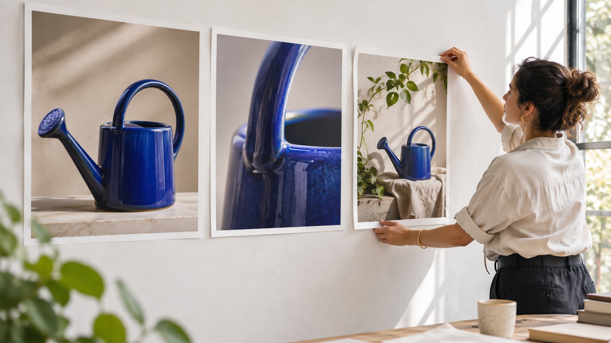
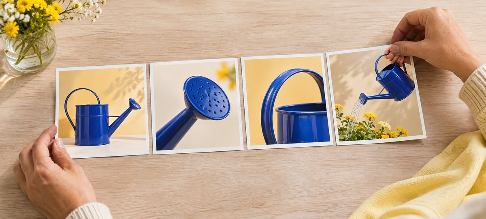

# Instagram 轮播怎么拍才方便读者做选择

状态：本地审阅稿；正式发布日期待确认。

用具体问题、试拍和验收安排一条创作者能讲明白的产品轮播。

适合赞助轮播的问题，通常需要读者按顺序看几个证据。品牌先写清想帮助谁做什么决定，再由创作者安排首图、细节、动作和条件。用自己的产品示范兑现首图承诺，在相关位置说明合作关系。验收时从手机按顺序滑读，确认说法、裁切和下一步都清楚。若核心证据依赖持续动作或声音，可把完整演示交给更适合的格式。

## 明确什么时候轮播适合达人任务

[Meta 的 Instagram 多媒体轮播说明](https://about.fb.com/ja/news/2017/02/instagram_sharemultiple/)介绍了把多张照片或视频发在同一帖的能力。对品牌而言，重点是读者能按自己的节奏查看细节。一位园艺达人可以依次说明浇水壶的握持、喷头和水流，受众可以停在关心的画面。若必须靠声音或动作连贯性才能说明，短视频可能更合适。只需给读者快速更新时，可参考 [Instagram Story 达人序列 Brief](https://www.quickkol.com/zh/blog/instagram-story-brand-sequence-brief/#answer) 为限时内容安排节奏。选择格式前确认创作者的实际发布入口、照片和视频支持，不从历史公告推断当前张数上限。

把目标写成受众能完成的动作，比如「看完能选对适合窗台花盆的喷头」或「能看出手柄对小手是否好握」。如果团队的唯一目标是曝光，先问达人有无适合首屏的一次性信息，再决定要不要多图。轮播数量和长度应服从内容需要。为每一页写一句「它回答什么」。两页回答同一问题时，保留画面更明确的那页，把预算留给缺少的关键动作。

## 按判断顺序安排首图和分镜

假设一个园艺品牌邀请达人演示浇水壶。首图显示目标场景，例如狭窄窗台，标题告诉读者后面会比较什么。第二页给喷头近景，用手或花盆说明大小。第三页展示手柄和用水姿势。第四页展示实际水流和使用限制。最后一页给下一步，比如核对适合自家花盆的规格。画面连续使用同一款道具、同一照明逻辑，品牌负责人看得出镜头分别回应了哪些购买疑问。

开始拍之前，给每页记录「预计画面、核心信息、可见证据和批准人」。与达人确认哪一页需要全景，哪一页需要局部对焦。把看不懂的地方标给拍摄者，例如「喷头孔在左上角，会不会被手机裁掉」。只要画面把证据说清，不必给每页都叠产品口号。示例中的蓝色浇水壶分镜用于说明页序，展示整件产品、喷头、握法和使用情境。

从整件产品到使用情境，每张分镜回答一个问题。

## 把产品宣称交给证据核对

逐页区分展示、达人主观感受和客观性能。比如一张图能展示水流细、壶体倾斜角度和土壤状态。只有可靠证据能够支持「适合所有室内植物」。让品牌提供批准措辞与规格来源，达人可结合实际拍摄说明「我在这种花盆使用时，更容易控制水流」。对于有条件的结果，把条件放在同一画面或相邻文字里，例如换过喷头、只使用了半壶水或在户外拍摄。不要等最后一页才补影响前面说法的限制。

若品类有明显安全要求，预先标出不能用的镜头、必须出现的步骤及谁复查。中途发现新卖点时，先确认有没有相应证据，再决定是否补拍。把批准过的文字和素材版本绑定。创作者收到两个不同批次的样品时，记录实际出镜型号，否则同一帖可能把新版规格叠到旧版产品图上。

## 让披露在第一次看到时可理解

有商业关系时，按市场和品牌要求安排清楚的披露。[FTC 的达人披露指南](https://www.ftc.gov/business-guidance/resources/disclosures-101-social-media-influencers)在美国适用语境下强调披露应容易看到、与推荐放在一起，并考虑图像内容内的呈现。创作者可在适合的首图或内容画面清晰显示，再配合说明和适用平台标签。不要让读者必须滑到最后一页、点开隐藏文字或从一个含混缩写猜出合作关系。确认屏幕上有足够对比、图片裁切不会挡住，所用语言也与读者匹配。

共同发布时，[Meta 的 Instagram 合作发布说明](https://about.fb.com/news/2023/08/music-and-collabs-on-instagram/)介绍了接受邀请后的共同作者模式。要在 Brief 里分开填共同发布和商业披露。加了品牌为共同作者，仍要按适用要求清楚披露。品牌、达人和经纪应先确认是谁发起、谁负责同意、谁能在紧急时改文案。打开发布后的实际帖子，核对合作关系是否如约呈现，必要时由发布所有者处理。

## 让设计稿通过真实手机检查

输出前拿一台普通手机按页滑读。首图能否在不放大的情况下看清产品和主要信息，第二到第四页是否有裁切、漏字或顺序错误。检查常用深色或浅色背景、色弱可读性和翻译后的字数。图里可见的信息要能用文字表达，给重要图片准备替代文字或适合的说明。文案和图中文字不要互相冲突；语言版本单独复查。若用剪辑工具，[Meta 的 Edits 轮播制作公告](https://about.fb.com/ja/news/2026/10/carousal-creation-on-edits/)可以作为能力线索，实际交付仍以达人账号可以预览和导出的结果为准。

尝试用屏幕亮度较低、稍小屏幕查看。首图最多有一个行动提示，其余留给正文。不要把折扣码和披露贴到容易被裁掉的位置。为文件名加上明确序号、语言和版本，发送给发布方时附低清缩略图和最终版；收稿人可以核对次序，避免把去掉旧宣称前的版本重新传上去。

## 在上线前先读一遍滑动逻辑

找一位没看过 Brief 的同事先不读说明，只看各页。请他复述首图承诺、第四页说明了什么，以及最后一页要做什么。如果他说不出第三页和第四页有什么区别，检查是否少了动作结果，或者两张图片只是角度不同。把问题交给达人决定重排还是重拍；画面真实但顺序不清时，先试改顺序。补拍时请写明需要的证据，例如「显示喷头换装后的水流」，而不是简单说「再拍漂亮点」。

如果轮播含视频，另查静音时是否能理解关键动作，首帧能否代表视频，画面方向有没有意外变化。把口播的重要限制放进可读文字或字幕。检查翻页前后视线落点，确保与同一产品有关。给品牌产品、合规和达人三方分别指定验收项，避免最后只剩一个人凭审美判断全部内容。

## 品牌验收意见要指向缺少的画面证据

假设园艺达人交了五页浇水壶轮播。产品与首图正确，第三、四页却都只是喷头特写，读者看不到换喷头后水流有何变化。品牌可以反馈「需要同一喷头装上后的水流与使用条件」，由达人决定补拍还是换页。和内容验收直接相关的修改应绑定页码、文件名和批准版本。

如果活动另买了广告切片，给它自己的审核清单。删掉一页可能同时删掉声明、披露或关键动作。把自然帖页序和广告版页序分开交接，由发布者从实际账号确认素材、合作标记和跳转。品牌得到的是可以复核的交付，创作者也保留自己的视觉表达空间。

## 用发布验收和结果复盘闭环

发布后，从合作双方约定的浏览视角打开帖子。检查 URL、账号、页序、披露、文案和约定的跳转。记录是否共同发布或付费分发，保留发布时刻和原始截图。活动目标若是帮助选款，优先找与选款有关的行动证据，例如有内容的留言、保存或到达指定页面的数据。用 [Instagram 格式数据判断指南](https://www.quickkol.com/zh/blog/instagram-analytics-format-decision-matrix/#answer)分开看触达与具体行为。若后台不能提供单页完成数据，不能把保存或互动写成读完率。

举例：轮播触达 8,000 个账号，得到 55 次保存，最后一页引导到主页链接，活动归因访问 24 次。报告可以分别列这三行。不能说 24 人看完轮播，也不能把保存和访问相加当购买意向。下一轮只改一个关键变量，比如把产品实拍从第三页提前到第二页。保留同格式和观察时间，再看相关提问是否减少，或到达页面后能否完成约定动作。

## 产品轮播的五页分镜

| 页序 | 任务 | 验收 |
| --- | --- | --- |
| 1 场景 | 让人知道为什么滑动 | 首图易读，披露醒目 |
| 2 细节 | 展示喷头和尺度 | 局部清楚 |
| 3 动作 | 展示握持与角度 | 方向与使用吻合 |
| 4 结果 | 展示水流与使用条件 | 限制就在相关画面旁 |
| 5 下一步 | 给规格核对或落地页 | 能找到同款 |

示例页数按创意需要设计。

## 轮播发布验收单

发布人和品牌各签收一次。

- [ ] 按序查看首图、细节、动作、限制和下一步。
- [ ] 实机检查裁切、字号和披露。
- [ ] 核对账号、文案、跳转与共同发布。
- [ ] 保存真实 URL 与复盘窗口。

## 研究日期与使用边界

资料核验于 2026 年 11 月 9 日。文中方法、表格和决策规则为编辑建议，标为假设的示例不是实际客户结果或行业基准。外部资料的适用地区与时期按各段说明；本稿处于独立本地审阅阶段，正式发布日期待确认。

## 用清楚的任务开始达人研究

用 QuickKOL 理解 Brief、发现相关达人并研究作品与联系路径；数据、合作条件和结果仍需核验。

[了解 QuickKOL](https://www.quickkol.com/#capabilities)

## 来源

- [Meta 的 Instagram 多媒体轮播说明](https://about.fb.com/ja/news/2017/02/instagram_sharemultiple/)
- [FTC 的达人披露指南](https://www.ftc.gov/business-guidance/resources/disclosures-101-social-media-influencers)
- [Meta 的 Instagram 合作发布说明](https://about.fb.com/news/2023/08/music-and-collabs-on-instagram/)
- [Meta 的 Edits 轮播制作公告](https://about.fb.com/ja/news/2026/10/carousal-creation-on-edits/)
