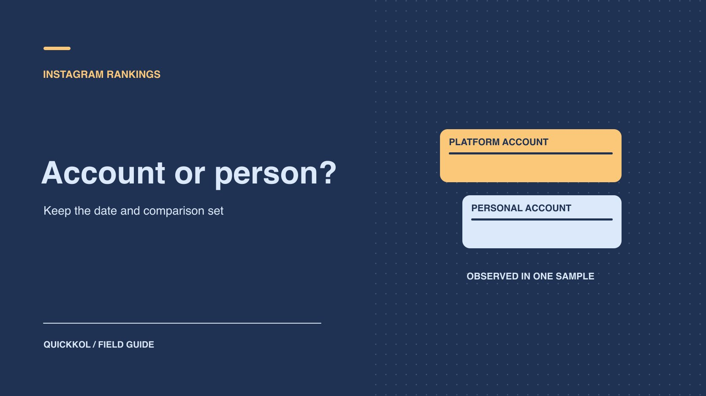

# Who Has the Most Instagram Followers? What Rankings Tell You

Status: local review draft; confirm the publication date before release.

Use a dated Instagram ranking as a discovery lead and check each candidate against the work a brand actually needs.

QuickKOL editorial graphic; not actual account metrics or a platform interface.

In a November 8, 2026 third-party snapshot of 21 large public Instagram accounts, @instagram led the sample at about 686 million followers. Cristiano Ronaldo’s @cristiano led the personal accounts in the same sample at about 681 million. Keep the date, sample and account category beside the figure. For a brand, the next question is whether a particular creator can make or distribute the work the brief calls for. Compare recent examples, audience evidence for the intended market and the rights the account can actually offer.

## Define who belongs in the ranking

A platform account, personal account, institution and collective can all have large audiences. A display name alone does not determine the category. [SocialCrawl’s public-account ranking snapshot](https://www.socialcrawl.dev/data/most-followed-on-instagram) ranks 21 large public accounts by follower count. In its November 8, 2026 observation, @instagram led the list and @cristiano was the largest account after the platform’s own. The observation supports the order within that comparison set. It does not scan every Instagram account, and a high entry in the list is not necessarily available for an influencer partnership. Put the date, source, sample size and platform inclusion next to the values wherever the ranking is shared.

When the reader wants the largest individual account, answer in the individual category. When a buyer wants a leading creator in a specific sector, define the sector and eligible account types first. A training brand might consider athletes, instructors and analysis creators. Give event organizers a separate row: they can have large audiences and still require a media arrangement rather than an individual endorsement. An [Instagram creator account role classification](https://www.quickkol.com/blog/top-instagram-influencers-by-account-role/#answer) helps the buyer understand who would actually create or distribute the work.

## Keep historical records separate from current observations

[Guinness’s Instagram follower record](https://www.guinnessworldrecords.com/world-records/397515-most-followers-on-instagram) lists Cristiano Ronaldo at 621,979,902 followers on February 19, 2024. Describe it as a dated Guinness record. Keep it outside the current snapshot column, and avoid using it to guarantee that today’s order cannot change. The two sources have different dates, comparison sets and precision. Store both observations separately unless you explicitly intend to compare a period and have checked their definitions. Put the observation date next to the claim. A headline does not need to promise a live leaderboard.

Keep the handle, profile URL, original displayed value, observation time and source name. If the original reads 681M, communicate it as an approximation. Writing 681,000,000 as an exact measured count suggests access to precision the source did not supply. When two abbreviated values are close, the visible figures may be inadequate to establish their order. Group the candidates into a scale band and check the information that could change the brief, such as reach from relevant language content. If the material will be reused next month, put a refresh date on the record and identify which fields need to be checked again.

## Separate follower totals from campaign reach

A follower total describes an account’s subscriber base. A sponsorship usually needs to know how many people in the target group may see one piece of content, understand it and take the agreed action. [Meta’s Instagram reach explainer](https://about.fb.com/br/news/2026/10/numero-de-seguidores-nao-determina-o-alcance/) points out that a global celebrity’s followers may be absent during distribution or see other content ranked higher. A public total cannot be converted directly into sellable impressions for the next video. Format, topic, release timing and paid distribution can each change what reaches people.

Ask shortlisted creators for a small evidence packet: links and dates for comparable content, the same observation window, available native reach and whether the figures include advertising or collaboration distribution. Use a [creator engagement reading method](https://www.quickkol.com/blog/read-creator-engagement-data/#answer) to keep views, reach, interactions and their denominators in separate columns. If the brief targets English-speaking viewers in Manila, an overall follower geography and a post-level reach breakdown each have their own scope. Both can offer context. Multiplying a global public total by a geography percentage does not establish deliverable local exposure. For paid targets, have the ad owner verify geographic settings and actual delivery against the same window.

## Check content roles before comparing scale

One sports brand may need a launch spokesperson, a creator who can demonstrate a training movement, and a specialist who can answer questions about equipment. Different accounts can satisfy different parts of the brief. A large account might be a good launch partner; a smaller account might show how the product works. Make each candidate’s recent work demonstrate something specific, such as on-camera explanation, a particular spoken language or an accurate product demonstration. Record availability and exclusivity where those terms affect the plan. A creator unavailable for a local campaign could remain an option for another market.

Suppose a running shoe company needs a 45-second explanation of when to use the shoe in a training routine. A celebrity candidate brings broad potential awareness. A coaching candidate has three recent videos that explain running sessions end to end. Give them different requests. The celebrity’s team can propose launch distribution. The coach can send an outline and two comparable demonstrations. Compare what each would deliver and the proof available for that role. Turning the public follower counts into a single eligibility score would obscure the differences and leave production and usage rights unanswered.

## Build a planning range from comparable content

Choose recent items of the same format with clear evidence. Flag unusual circumstances such as a video tied to a major match, a co-published giveaway or a post that the brand paid to distribute. Match observation windows and capture dates. If you need a planning range, use several eligible items to show a median and spread, and disclose the number of observations. When the sample is too small or reach is unavailable, test one asset rather than treating public likes as a proxy for reach.

For example, a hypothetical creator supplies native reach of 180,000, 200,000, 230,000, 250,000 and 900,000 for five comparable videos. Ask what was different about the high result. It might reflect coverage from an event or an unusually strong piece of content. A median of 230,000 is one planning input for creative and budget discussions. Even an accurate historical export cannot guarantee the next video will reach the same figure. Usage rights, revisions, market exclusivity and timing affect whether the proposed rate makes sense. Preserve the comparable posts with the range so someone reviewing the rate can see what drove it.

## Turn geography into a data request someone can answer

Keep the target sales market separate from follower geography. A city shown in a post or a language listed in a bio cannot replace audience data. Ask the creator for aggregate evidence they are authorized to share, and label whether the data describes followers, viewers or accounts reached. If the launch covers two countries, ask whether a small test is possible in those markets with the proposed language and format. A missing aggregate field does not justify requesting individual follower records.

When a screenshot has no visible window, ask a direct question: “Does this show accounts reached in the past 30 days, or the current follower breakdown?” After the owner answers, use the evidence only in that scope. When a market slice is unavailable, a localized script or a collaboration with a local creator can be part of a follow-up test. Neither provides the missing reach measurement. An evidence-status column helps the team decide whether to request a native sample, run a pilot, or compare a different candidate without inventing a precise local ranking from a global follower total.

## Confirm who can commit the account

The brand may find an agent’s address through a public bio. If the proposed deliverable requires publication on the main account, ask the contact to confirm the account represented, content deliverable, contracting entity and approver. A team can manage several related accounts. Put the exact account and any co-publication option on the quote. Confirm who can publish, which regions are available for promotion and who controls original assets before negotiating on scale. A professional-looking profile link does not authenticate later payment instructions or an unexpected change of address.

Check where earlier partnerships actually appeared. A celebrity might feature prominently in a video published by the brand. When the current brief requires creator-side distribution, establish whether it means a main-account post, a co-published asset or permission for the brand to run the footage. Each may fit a different objective and require a different fee and evidence. An old sample demonstrates an appearance in that asset. It does not commit a particular publishing account for the new campaign. Keep that distinction in the contract confirmation field until the authorized owner responds.

## Build the shortlist around the work being bought

Suppose a running brand needs to promote beginner classes in two cities. A prominent athlete could help announce the launch. A creator who has published local route guides and can share reach for comparable work may be the better fit for explaining how to join. The platform’s own account belongs in a separate category because it would need a different commercial route. Give the first candidate an awareness brief and ask the second for a local demonstration, then request work samples, reporting and rates suited to those roles.

Record category, public scale, relevant work, audience evidence, timing and usage rights in the shortlist. The public figure can be refreshed next month while the brief and verified work stay on record. If local reach is still unknown, define a limited pilot with a real destination and ask the creator what they can report. The buyer should be able to explain why each person is on the list even after the public rank changes.

## Evidence for Instagram rankings and creator buying

| Question | Keep | Next check |
| --- | --- | --- |
| Largest account | Date, account set and precision | Check if the platform account is included |
| Largest individual | Individual scope and dated source | Record historical and current values separately |
| Best fit for the brief | Role, comparable work, audience and rights | Request matched native evidence |
| Potential reach of next post | Comparable format range | Test in a pilot; no fixed guarantee |

Ranking sources were reviewed November 9, 2026.

## Ranking handoff checklist

Define the scope before deciding how to use the rank.

- [ ] Separate platform, personal and institutional accounts.
- [ ] Keep source, date and precision for each observation.
- [ ] Check comparable native reach and target market.
- [ ] Confirm that rates, rights and role remain relevant.

## Research date and limitations

Reviewed November 9, 2026. The two recent approximate values come from SocialCrawl’s November 8 sample, which does not cover all Instagram accounts. The Guinness value is a historical observation. Procurement examples are hypothetical. Confirm the publication date before release.

## Start creator research with a clear task

Use QuickKOL to interpret a brief, discover relevant creators and research their work and contact routes. Verify data, commercial terms and outcomes at their source.

[Explore QuickKOL](https://www.quickkol.com/#capabilities)

## Sources

- [SocialCrawl’s public-account ranking snapshot](https://www.socialcrawl.dev/data/most-followed-on-instagram)
- [Guinness’s Instagram follower record](https://www.guinnessworldrecords.com/world-records/397515-most-followers-on-instagram)
- [Meta’s Instagram reach explainer](https://about.fb.com/br/news/2026/10/numero-de-seguidores-nao-determina-o-alcance/)
