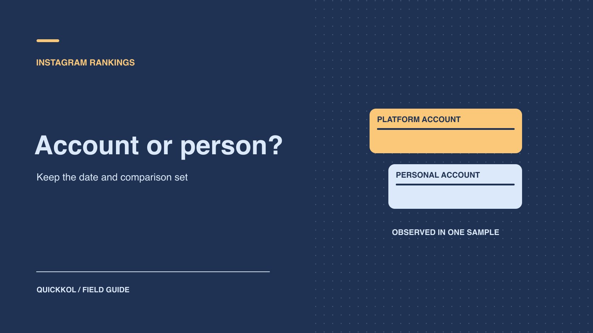

# Instagram 谁的粉丝最多？榜单怎样用来选人

状态：本地审阅稿；正式发布日期待确认。

区分平台账号和个人账号，再把榜单线索转成一份可核验的合作候选表。

QuickKOL 编辑图形；不呈现真实账号指标或平台界面。

按 2026 年 11 月 8 日的一份第三方快照，21 个受追踪的大型公开账号中，@instagram 约有 6.86 亿粉丝，位居样本首位。个人账号 @cristiano 约有 6.81 亿，在该样本个人账号中居首。把日期、样本和账号类别一起带进报告。品牌要买的是某位创作者在特定市场完成的内容或分发，接下来需要对照其近期作品、相关受众和可购买的使用范围。

## 先确定「谁」的范围

平台账号、个人账号、机构或组合账号不能只靠显示名称区分。[SocialCrawl 的公开账号排名快照](https://www.socialcrawl.dev/data/most-followed-on-instagram)对 21 个大型公开账号按粉丝数排序，2026 年 11 月 8 日把 @instagram 列为第一，把 @cristiano 列为除平台官方号以外最大的账号。这个样本足以回答其名单里的相对次序。它没有遍历平台全部账号，也不代表这些账号可以接受同类达人合作。发布给采购团队时，把来源、日期、样本规模和是否含平台账号写到数据旁边。

如果读者问的是「最大的个人账号」，以个人类别回答；若问某个品类的头部 KOL，先定义类目及入选资格。比如体育训练品牌的筛选可以包括运动员、教练和分析型创作者，但单独给赛事机构一列。赛事机构拥有广泛受众，却可能以媒体合同合作。用 [Instagram 达人账号角色分类](https://www.quickkol.com/zh/blog/top-instagram-influencers-by-account-role/#answer)说明候选人在内容里的职责，别让榜单混合媒体采购和个人代言。

## 区分历史纪录和当前观测

[吉尼斯 Instagram 粉丝纪录](https://www.guinnessworldrecords.com/world-records/397515-most-followers-on-instagram)记录 Cristiano Ronaldo 在 2024 年 2 月 19 日有 621,979,902 位粉丝。可以在文稿里称为「吉尼斯当日记录」，不要把它带到 2026 年数据列，也不能拿它证明今天个人榜不会改变。两个来源更新周期、样本定义和精度不同。除非明确在计算跨年变化且核对口径，否则将各自的值分别保留。把最新观察的日期写在句子里，标题无需承诺实时榜。

操作时保留手柄、账号链接、原样显示值、取数时点和来源名称。如果原值写 681M，就按约数转述。用 681,000,000 当作精准人数，会让团队误以为已观察到完整后台计数。两个约数差不大时，可能无法从显示档位判断次序。品牌可以先把候选人放在同一量级，再核对明确与合作有关的数据，例如特定语言内容的触达和对应受众。若材料会在下个月重新使用，标出更新时间和需重新核对的字段。

## 把粉丝数和活动触达分开

粉丝是订阅账号的人群规模。品牌投放想知道某条内容有多少目标人群看到、是否听懂、以及是否采取行动。[Meta 的 Instagram 触达说明](https://about.fb.com/br/news/2026/10/numero-de-seguidores-nao-determina-o-alcance/)指出，全球名人的关注者可能在某条内容分发时没有使用平台，也可能看到排序更靠前的内容。因此不能从公开号直接算出下一条视频的可卖曝光。不同格式、主题、时间和投放都可能让触达差异很大。

向进入下一轮的达人请求最小证据包：同类内容的链接与日期、相同观察窗口、可提供的原生触达，及是否含广告和合作分发。用[达人互动数据阅读方法](https://www.quickkol.com/zh/blog/read-creator-engagement-data/#answer)分别记录观看、触达、互动和分母。比如一个品牌要覆盖马尼拉英语受众，菲律宾总体关注比例和单条视频的英语地区触达各有范围。两种数据都可作背景，但要注明覆盖和缺失，不能用全球总量乘一个百分比就预测可交付量。需要确定投放目标时，先由投放负责人验证地域设置和同窗口的实际送达。

## 先验内容角色，再比较量级

同一个运动品牌可能需要一位主视觉代言人、一位训练示范创作者和一位能回答器材问题的专业 KOL。把这些职责拆开后，大号也许适合带动首发，小号也许更能解释使用细节。让每个候选人的作品证明一件事，例如镜头表现、特定语言口播或真实产品演示。记录与合同相关的可用性和排他范围。粉丝很大但暂时无法在当地投放的候选人，仍可保留为其他市场的选项。

假设一个跑鞋品牌需要 45 秒讲清鞋款适用的训练场景。名人候选有大量广泛曝光，教练候选最近发布三条完整的跑步训练讲解。品牌可以给两者不同的作业：前者提供首发传播提案，后者提供简短演示脚本和相关作品链接。比较各自能交付的任务与验证方式。两个账号的粉丝数不需要换算成单一合格分，也不能取代对内容制作和素材使用权的确认。

## 用同格式样本建立采购范围

从每位入围达人最近的同格式作品里，挑选有完整来源的样本。排除或标注明显不同的作品，例如大型体育赛事当天的视频、联合发布的抽奖帖、品牌追加投放的内容。保持截图日期和窗口一致。若想要建立合理范围，可用若干符合条件的样本作中位和区间，并在旁边写明样本数。样本少或触达不可见时，改用试点确认，不把公共点赞换成触达数据。

例如，A 达人的 5 条可比视频原生触达分别为 18 万、20 万、23 万、25 万、90 万。先解释 90 万的来源，可能有活动引用，也可能只是一次高表现。中位 23 万适合作为素材和预算讨论的参考之一。即使这组数来自真实报表，也不能变成下条 23 万的保证。关注成本只是其中一项，使用权、修改次数、地区排他和交付时间都影响报价是否有意义。

## 把地域问题改成可回答的数据请求

把投放区域与达人粉丝分布分开。公开内容中出现某座城市，或简介里写着母语，不能代替受众地区报告。请达人提供允许共享的聚合信息，并标清统计对象是账号关注者、观看者还是触达账号。品牌的上线目标如果只包含两个国家，请询问可否用该市场、语言和格式做一个小测试。不要要求逐个提交粉丝记录来补一个聚合字段。

截图上如果没有时间窗，给数据所有者一个明确的问题：「请确认这张分布图是最近 30 天触达，还是当前账号粉丝构成。」得到回复后，按实际范围使用。找不到市场切片也可以安排语言脚本或当地合作达人作为后续验证；它们仍不是当地触达的替代数据。用一列标注「证据状态」，比在全球榜上做精确却没有来源的国家排名更可靠。

## 确认账号方有权承诺交付

品牌可能从公开简介找到经纪人邮箱。若要购买主账号发帖，要求联系人确认所代表的账号、交付内容、签约主体和批准人。团队可能同时管理若干类似账号，品牌应在报价上写明唯一的账号与共同发布选项。先确认能否由该个人账号发布、哪些地区允许推广、谁持有原始素材，再讨论量级。不要因为某个主页链接看起来正式，就把付款指示或改地址的邮件自动视为真实。

还可以检查以往合作实际从哪个账号发布。例如某运动员出现在品牌视频里，但发布者是品牌账号。如果本次采购需要达人侧分发，双方要确认是在主号发帖、共同发布，还是品牌取得素材自行投放。三个方案都可能适配，成本和证据却不同。样片只能说明某次出现，不能证明之后的账号承诺。把这一项留在合同确认栏，等正式负责人回复。

## 从榜单留下谁取决于要买的交付

假设运动品牌要在两个城市推广初学者跑步课程。第一位候选人有大范围曝光，可以考虑用于首发。第二位候选人有多条本地路线讲解，并能提供同类视频的地区触达，可以考虑做课程导流。平台账号即便高居榜首，也应按是否存在可采购的合作方式单独处理。把两位候选人分别放进「首发曝光」与「本地讲解」两列，向他们请求不同的作品、报告和报价。

让团队在候选表记录账号类别、公开量级、与任务对应的作品、受众证据及发布日期和权利。下个月榜单数字改变时，可以直接刷新观察列。若本地触达尚未取得，采购结论应写成一次限范围的试点，先验证目标市场和落地路径。

## Instagram 排名和达人采购的不同证据

| 问题 | 保留字段 | 下一步 |
| --- | --- | --- |
| 哪个账号最大 | 日期、账号集合和取值精度 | 确认是否含官方平台号 |
| 哪个人最大 | 个人分类和当期来源 | 历史与当前观察分别记录 |
| 谁适合 Brief | 岗位、相关内容、受众与权利 | 向候选人请求同窗原生证据 |
| 下条能触达多少 | 同格式历史范围 | 用试点核对，无固定保证 |

榜单数据复查于 2026 年 11 月 9 日。

## 榜单交接核对项

先定范围，再决定是否需要看排名。

- [ ] 分开平台、个人与机构账号。
- [ ] 为每个观察值保留来源、日期和精度。
- [ ] 检查同格式原生触达和目标市场。
- [ ] 确认报价、权利和岗位仍适配。

## 研究日期与使用边界

核验于 2026 年 11 月 9 日。两个当前近似值取自 11 月 8 日 SocialCrawl 样本，非 Instagram 全站实时榜。吉尼斯数值是其页面注明的历史纪录。采购示例为假设。正式发布日期待确认。

## 用清楚的任务开始达人研究

用 QuickKOL 理解 Brief、发现相关达人并研究作品与联系路径；数据、合作条件和结果仍需核验。

[了解 QuickKOL](https://www.quickkol.com/#capabilities)

## 来源

- [SocialCrawl 的公开账号排名快照](https://www.socialcrawl.dev/data/most-followed-on-instagram)
- [吉尼斯 Instagram 粉丝纪录](https://www.guinnessworldrecords.com/world-records/397515-most-followers-on-instagram)
- [Meta 的 Instagram 触达说明](https://about.fb.com/br/news/2026/10/numero-de-seguidores-nao-determina-o-alcance/)
