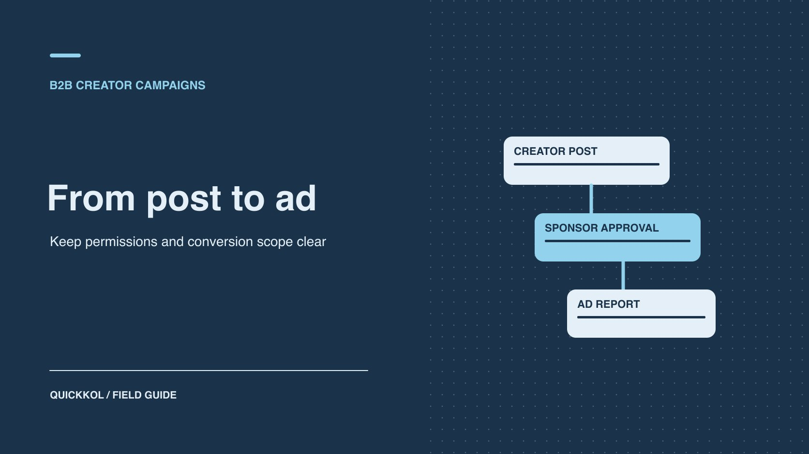

# How to Promote a Creator’s Post in LinkedIn Campaign Manager

Status: local review draft; confirm the publication date before release.

Verify author approval, account roles, paid delivery and conversion scope when promoting a creator post.

QuickKOL editorial graphic; not actual account metrics or a platform interface.

To promote a creator’s public post in LinkedIn Campaign Manager, check ad account and Page permissions, eligibility of the actual post and approval from its author. Verify paid delivery using the ad record and retain organic post activity separately. If the sponsor needs leads, confirm the objective and route supported by the format, then define what qualifies in the CRM.

## Confirm the purchase is distribution of the creator’s own post

[LinkedIn’s Campaign Manager overview](https://business.linkedin.com/advertise/ads/campaign-manager) describes the place to create, manage and measure LinkedIn ads. Define the deliverable before buying. The creator might produce and publish from a personal account, the brand might license assets for its own creative, or it might sponsor an eligible post using Thought Leader Ads. The publisher, permissions and reporting differ across those options. Record the format, objective, account and version for each. Sponsoring a member’s original post is a separate permission from promoting content on a company Page.

For example, a B2B software firm commissions an industry specialist to publish a post about work in the field, then wants to buy additional distribution. Let the creator decide what they are willing to publish. The brand can verify its product and commercial language without taking over the creator’s independent viewpoint. Use a [LinkedIn lead ad preflight](https://www.quickkol.com/blog/linkedin-ads-b2b-lead-preflight/#answer) to distinguish distribution from lead acquisition. If the campaign requires a specific form or objective, check whether the proposed post format supports it before requesting permission. That saves the parties from approving an asset the planned campaign cannot use.

## Check ad account, Page and post permissions separately

[LinkedIn’s Campaign Manager roles guide](https://www.linkedin.com/help/lms/answer/a425731/user-roles-and-permissions-in-campaign-manager?lang=en) distinguishes ad account roles and additional Page permissions required for certain tasks. Record the ad account, associated Page, business owner, billing owner and media operator. Give team members the access needed for their actual work. A person who can sign in may still lack the creative or Page role required to create an ad. [LinkedIn’s Thought Leader Ads creation guide](https://www.linkedin.com/help/lms/answer/a5977275) also requires requesting permission from the post author. A brand’s Page or ad account admin cannot approve on the creator’s behalf.

Have the media operator, Page owner and creator each confirm their part. Document which roles are necessary, when they begin and who handles expiry. The creator does not need to share personal sign-in details. If an agency operates the ads, have the business owner grant its actual role through the approved workflow. When access is missing, contact the administrator for that object instead of sharing another person’s identity. Review account and ad access after the campaign ends, under the brand’s normal process.

## Verify original-post eligibility, objective and next action

[LinkedIn’s Thought Leader Ads format guide](https://www.linkedin.com/help/lms/answer/a1450002) distinguishes eligible member posts, formats and available calls to action. Open the live original and check author, public state, format, version and destination. If a repost is ineligible, identify the original author. Standard image, video and document versions may not have a separate call-to-action button, while event formats can differ. Check the actual ad set and format. Verify any destination in the post or supported text. Do not assume a media operator can rewrite the creator’s copy or attach a form to any post. Match available objectives to the intended job.

Suppose the creator publishes an industry observation with a link to a detailed article. The sponsor wants qualified people to visit. Open the destination under an approved review context and verify the market and content. Then check that the selected format displays the intended route. If the brand instead needs a direct lead form and the format cannot support it, arrange a suitable separate ad. Do not reject an accepted awareness deliverable at settlement for failing to produce a form the campaign never provided. Name the owners who will observe and report the result.

## Give the creator the exact post and approval scope

[LinkedIn’s post sponsorship permissions guide](https://www.linkedin.com/help/lms/answer/a5964111) describes how a creator can receive and manage sponsorship requests. Tell them which post, company or ad account, dates, markets and planned budget scope are involved. Avoid asking for generic permission with no context. Check whether approval is for one post or another supported scope. If the post or campaign changes, have the creator and media owner confirm the replacement. Keep the appropriate audience-facing sponsorship disclosure in the publication and ad review. Platform approval does not replace communication with the people who see the post.

Suppose the creator approves four weeks of promotion for a public post and later removes permission or changes the post. Record the effective time, affected ads and whether any other assets remain active. Follow the agreement and avoid substituting a similar post without approval. If the creator authorizes a new object, enable only the approved replacement. Preserve the original URL, author approval and delivery log so the handoff does not present an expired permission as still active.

## Verify actual delivery with a scoped test

Before launch, verify ad account, Page, ad object, objective, markets, budget, dates, billing and approval. Use the preview to check actual presentation, including creator identity, disclosure and the intended link where applicable. Once approved, verify delivery against the objective and scope. Keep the ad ID, first delivery time and report. A saved or active status does not establish that impressions occurred. If no delivery appears, check review, dates, budget, audience and permission before acting. Do not credit the ad with organic activity the post already had.

For example, permission arrives Monday, the ad set is created Tuesday and actual delivery begins Wednesday. Record all three events. If the creator publishes a similar post Thursday, do not add that post’s organic interactions to the ad report. Report ad sets for different markets separately where useful. Use a [creator campaign measurement framework](https://www.quickkol.com/blog/creator-campaign-measurement/#answer) to preserve organic, paid and destination evidence. Agree in advance what observation justifies continuing. A small test can reveal an approval or destination problem before the sponsor commits to a larger flight.

## Use separate conversion and CRM definitions

[LinkedIn’s conversion tracking guide](https://www.linkedin.com/help/lms/answer/a420539) covers creating conversions, associating them with campaigns and setting attribution periods. Have the ads owner verify the actual configuration and applicable ad sets. Define submissions, qualified leads, booked meetings and sales stages independently in the destination or CRM. Match date, market and campaign identifiers where possible and keep click-through and view-through attribution distinct. When the brand lacks a direct measurement route, it cannot assign every new CRM contact to a creator post. An ad-platform conversion is also not automatically a sales-qualified opportunity.

Suppose ad reporting shows 18 attributed conversions, the website records 14 identifiable submissions and the CRM confirms nine eligible leads. Report their objects, windows and rules alongside the values. Subtracting them does not establish lost leads. Review duplicates, consent, dates, time zones and qualification criteria, then state what the evidence supports. Keep customer data with its authorized owners. Preserve creator fees and media costs separately so the buyer can discuss investment without using a single outcome value to stand for all cost and performance.

## Reconcile the public post and paid report

Before promotion, record the original post’s visible interactions, release time and snapshot time. After launch, obtain the ad report the sponsor is authorized to inspect. Identify ad set, objective, reported event and window. Public interactions can change because of organic discovery, paid exposure and concurrent activity. Tell the reader which value is a public observation and which is from the ad system. Avoid adding them or subtracting one to derive a single source. If the brand needs an estimate of incremental effect, agree in advance on a comparison by audience, market or time and document the design limits.

Suppose the organic post showed 32 visible interactions before promotion and 95 by the end. Campaign Manager shows a separate paid engagement measure. The 63-interaction difference cannot all be assigned to ads. Check the paid report and timestamp on the public snapshots, then retain dates for organic release, shares, replies and paid delivery. If the sponsor bought creator content rather than campaign management, name separate owners for the creative, media and destination. The buyer can use that evidence to decide whether to continue the original post, change the media objective or test a brand-owned asset separately. Verify author approval and format for any change. One approved post cannot authorize an entire campaign. Keep report versions and distinguish an updated source from a change in definitions.

## Prepare for revoked permissions and exceptions

Permissions can change and the original post can become unavailable. Give the media owner a route to check status, contact the creator and pause affected delivery. An ad set may contain other ads. Verify the relevant object rather than reporting that a single revocation stopped the entire campaign. When an exception occurs, record time, ad and actual impact before choosing a replacement or closing the flight. Recheck author approval, objective, destination and budget before resuming any affected placement.

## Decide whether to renew the post or commission a different asset

Suppose a B2B company hires a technical specialist to publish a viewpoint and promotes it from the brand’s ad account. The approved original explains the problem and the ad delivers, but the format does not give the team a way to verify direct leads. Accept the creative, permission and media delivery. Then decide whether the next brief needs expert distribution or a measurable acquisition action. For the former, negotiate the post’s continued use within a defined scope. For lead acquisition, test a suitable format and destination and clear any new creator asset separately.

Keep author, post, approved dates and markets, ad ID and CRM definition in the handoff. Give each proposed purchase an owner for content, permission and reporting.

## LinkedIn creator ad handoff

| Item | Evidence | Owner |
| --- | --- | --- |
| Account and Page | Roles, objective and billing owner | Brand media owner |
| Creator post | Public URL, author and approval | Creator and sponsor |
| Ad delivery | Ad ID, period, market and delivery | Media operator |
| Outcomes | Conversion rules, CRM definition and scope | Analytics and CRM owners |

Verify objectives, permissions and formats in the current product.

## Thought Leader Ad checklist

Verify permission first, then delivery.

- [ ] Confirm ad account, Page, objective and original post.
- [ ] Have the author approve the specific use and period.
- [ ] Check ad state, actual delivery and disclosure.
- [ ] Separate ad metrics, CRM outcomes and expiry.

## Research date and limitations

Sources reviewed November 9, 2026. Methods, tables and decision rules are editorial recommendations. Hypothetical examples are not actual client results or industry benchmarks. Source geography and periods are specified where relevant. This draft is in independent local review; confirm its publication date before release.

## Start creator research with a clear task

Use QuickKOL to interpret a brief, discover relevant creators and research their work and contact routes. Verify data, commercial terms and outcomes at their source.

[Explore QuickKOL](https://www.quickkol.com/#capabilities)

## Sources

- [LinkedIn’s Campaign Manager overview](https://business.linkedin.com/advertise/ads/campaign-manager)
- [LinkedIn’s Campaign Manager roles guide](https://www.linkedin.com/help/lms/answer/a425731/user-roles-and-permissions-in-campaign-manager?lang=en)
- [LinkedIn’s Thought Leader Ads creation guide](https://www.linkedin.com/help/lms/answer/a5977275)
- [LinkedIn’s Thought Leader Ads format guide](https://www.linkedin.com/help/lms/answer/a1450002)
- [LinkedIn’s post sponsorship permissions guide](https://www.linkedin.com/help/lms/answer/a5964111)
- [LinkedIn’s conversion tracking guide](https://www.linkedin.com/help/lms/answer/a420539)
