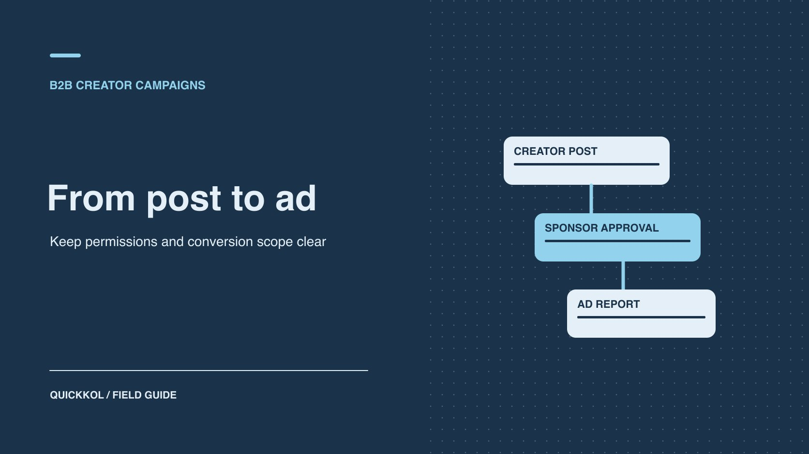

# 如何用 LinkedIn Campaign Manager 推广创作者原帖

状态：本地审阅稿；正式发布日期待确认。

核对 Thought Leader Ads 的作者批准、投放权限、真实送达和转化范围。

QuickKOL 编辑图形；不呈现真实账号指标或平台界面。

在 LinkedIn Campaign Manager 推广达人公开个人帖前，品牌需要确认广告账户与主页权限、原帖是否符合条件，以及作者是否批准该用途。然后按实际广告送达验收，保留个人帖的自然活动和付费数据。若项目目标是线索，先核对选定格式支持的目标和入口，再定义 CRM 中什么结果算合格。

## 先确认购买的是达人原帖的分发

[LinkedIn Campaign Manager 产品说明](https://business.linkedin.com/advertise/ads/campaign-manager)将其描述为广告创建、管理和衡量入口。品牌采购前先定交付：达人创作并用个人账号发布、品牌取得使用权自行制作广告，或通过 Thought Leader Ads 推广一条合格原帖。三种方式涉及的发布者、权限和数据不同。给每项记录拟用格式、目的、账号和版本。不要把品牌主页的 Sponsored Content 与个人帖的赞助请求当成同一个授权。

例如一家 B2B 软件公司请行业专家发一条现场经验分享，再希望用预算扩大分发。创作者应先确定自己愿意发布什么。品牌可以审核自己的产品和商业表述，保留独立创作者的观点边界。用 [LinkedIn 线索广告投放前检查](https://www.quickkol.com/zh/blog/linkedin-ads-b2b-lead-preflight/#answer)区分内容传播和获客。若目标严格需要某种表单或目标，先核对该原帖的广告格式是否支持，再决定是否用它完成需求。确认范围后再申请权限，避免先拿到授权才发现对象不适用。

## 分开查广告账户、主页和原帖权限

[LinkedIn Campaign Manager 角色说明](https://www.linkedin.com/help/lms/answer/a425731/user-roles-and-permissions-in-campaign-manager?lang=en)区分广告账户角色，以及特定操作所需的额外主页权限。先记录广告账户、关联主页、业务所有者、付款负责人及投放人。给每位团队成员完成任务所需的角色。创建广告的人可能需要相应的创意权限和主页权限，不能只因为他能登录就认定有资格。[LinkedIn 思想领袖广告创建说明](https://www.linkedin.com/help/lms/answer/a5977275)还要求向帖子作者请求赞助批准。品牌的主页或广告账户管理员不能替作者完成授权。

让媒体负责人、公司主页所有者和达人各自确认。记录哪些权限属于正式工作、何时生效、到期谁处理。达人不需要把个人账号密码提供给品牌。若代理负责操作，让业务所有者通过实际的受控流程分配角色。没有合适访问时，先找对应管理员，不要让其他人共用个人身份。任务结束后按内部安排复查账户和广告访问。

## 核对原帖资格、目标和行动入口

[LinkedIn 思想领袖广告格式说明](https://www.linkedin.com/help/lms/answer/a1450002)区分可推广的个人帖、不同格式和行动入口。先打开正式原帖，核对作者、公开状态、格式、内容版本和链接。转发不适合时找到原始作者。普通图像、视频或文档的 Thought Leader Ads 可能没有独立 CTA 按钮，活动格式等可能不同。以所选广告组和实际界面为准。需要跳转时验证原帖或受支持文本中的链接，不能假定投放者能改作者文案或随意附上表单。活动目标用产品支持的选项与实际需求对照。

假设创作者发一条含长文链接的行业观点，品牌目标是吸引相关人士访问。先用审核账号打开目标页，确认市场与内容，再查所用格式能否显示正确路径。如果品牌真正需要直接获客表单，而选定格式不支持，另安排合适的广告类型。不要在结算时因为没有表单线索否决一项只买了内容传播的交付。写清楚结果由谁查看和报告。

## 让创作者看到具体帖子和授权范围

[LinkedIn 创作者赞助授权说明](https://www.linkedin.com/help/lms/answer/a5964111)描述创作者收到并管理赞助请求。品牌向达人说明要推广哪条帖、所用账户或公司、时间、市场和预期预算范围，避免只发「请授权」的空白消息。确认批准的是单帖或其他可用批准范围。需要变更版本或重新提交时，让作者与媒体负责人共同核对。适用的商业关系披露也应在发布和广告审查中单列，不能用后台授权代替受众能看到的说明。

假设达人同意在四周内让品牌推广一条公开帖，之后撤销或修改原帖。负责人记录授权变更的时间、受影响的广告和是否还有其他素材在投。品牌按照合同处理，不擅自用相似帖子替代。若重新授权，只对新的批准对象启用。保留原帖 URL、作者确认和投放记录，以免在归档里将已结束的批准写成仍然有效。

## 用小预算检查实际送达

上线前核对广告账户、主页、广告对象、目标、地区、预算、日期、付款和授权。用广告预览查看实际显示，必要时核对是否保留创作者身份、披露与合适链接。批准后检查活动是否符合目标和范围，保留广告 ID、送达时点与实际报告。已保存或已启用不代表已产生送达。若没有展示，先核对状态、审批、日期、预算、受众范围和权限，找到具体证据再处理。不要把原帖已有互动当成广告结果。

例如品牌周一收到授权，周二创建广告组，周三实际开始送达。把三件事分别记录。若达人周四发另一条类似内容，不把其自然互动加给付费报告。品牌若在不同地区运行两个广告组，也分别写报告。用[达人活动衡量框架](https://www.quickkol.com/zh/blog/creator-campaign-measurement/#answer)保留自然、付费和后续页面证据。投放前先确定何种观察足以继续，避免把大量预算投到尚未验证的路径。

## 转化跟踪与 CRM 用自己的口径

[LinkedIn 转化跟踪指南](https://www.linkedin.com/help/lms/answer/a420539)介绍创建转化、连接活动和指定归因时段。让广告负责人确认实际设置与哪些广告组关联。品牌落地页与 CRM 应另定义提交、合格线索、已预约或销售阶段。用同一日期、地区和活动标识核对，保留点击与浏览归因的区别。若品牌没有直接测量路径，不把所有 CRM 新增联系人归给一条达人帖。广告系统记录的转化也不自动等于销售团队验收的机会。

假设广告报表显示 18 次归因转化，网站录得 14 次可识别提交，CRM 确认 9 条符合资格。报告应并列各自对象、窗口和规则。不要简单相减后称为丢失线索。复核表单重复、同意设置、窗口、时区和销售筛选标准，按最有力证据解释。需要客户资料的字段只由获授权的团队处理。将创作者费用和广告费用分别保留，便于品牌讨论预算，而不是让一个结果数字代替全部成本。

## 把公开互动和付费报告对齐

在投放前记录原帖的公开互动、实际发布时间及快照时间。投放后取品牌有权查看的广告报表，区分广告组、目标、已报告事件和窗口。原帖的互动可能因为自然发现、付费曝光和同期分发一起变化。报告要让读者知道哪一个值是公开观察，哪一个来自广告系统，不能把二者相加或按差值推算单一来源。如果要评估创作者带来的增量，提前约定对照方式、地区或时间，保留实验限制。

例：原帖推广前显示 32 次可见互动，活动结束显示 95 次，Campaign Manager 另有付费互动指标。不能把 63 次差值都写成广告效果。先查实际付费报告和公开截图的采集时点，并保留自然发布、转发、后续回复和广告分发时间。如果品牌买的是创作者内容而非管理服务，给报告按内容、媒体和页面各指定一个负责人。营销主管可以据此决定是否继续用原帖、改广告目标，或者单独测试品牌拥有的素材。选择新方案时重新核对作者许可和所用格式，避免用一条已批准的帖子为整个活动自动授权。保留两个报表版本，复查时说明更新的是来源还是口径。

## 准备权限撤销和异常处理

平台授权可能发生变化，原帖也可能删除或不再公开。交接给媒体负责人如何查看状态、谁联系达人和何时暂停受影响广告。广告组可能还有其他广告，要按对象核对，不能把一条撤销写成所有活动停止。发生错误时先记录时间、广告和实际影响，再决定替代素材或结束。恢复前检查作者批准、目标、落地和预算。

## 按合作目标决定下一轮用原帖还是另做素材

假设一家 B2B 公司让技术专家发布一条行业观点，再用品牌广告账户扩大发布。作者批准的原帖适合解释问题，广告有实际送达，但品牌未能从所用格式核对直接线索。复盘先验收作品、授权和媒体报告。再判断下一轮究竟需要专家观点的分发，还是一个可核对的获客动作。如果仍需解释问题，可以谈原帖续期和具体范围。如果目标改成线索，由品牌测试合适的格式与目的地，并为新素材重新取得许可。

交接表保留作者、帖子、批准地区和时间、广告 ID 与 CRM 定义。为每个新采购项标明谁交内容、谁批准使用、谁报告结果。

## LinkedIn 达人广告交接表

| 项目 | 可核对证据 | 责任 |
| --- | --- | --- |
| 账户与主页 | 角色、目标与付款负责人 | 品牌媒体负责人 |
| 达人原帖 | 公开 URL、作者与批准 | 创作者和品牌 |
| 广告交付 | 广告 ID、时间、地区和送达 | 媒体操作 |
| 结果 | 转化规则、CRM 定义与范围 | 分析和 CRM 所有者 |

目标、权限和格式按当前产品验证。

## 思想领袖广告检查清单

先验收权限，再验收送达。

- [ ] 确认广告账户、主页、目标和原帖。
- [ ] 让作者批准具体用途和时间。
- [ ] 复查广告状态、实际送达和披露。
- [ ] 分开广告指标、CRM 结果和到期权限。

## 研究日期与使用边界

资料核验于 2026 年 11 月 9 日。文中方法、表格和决策规则为编辑建议，标为假设的示例不是实际客户结果或行业基准。外部资料的适用地区与时期按各段说明；本稿处于独立本地审阅阶段，正式发布日期待确认。

## 用清楚的任务开始达人研究

用 QuickKOL 理解 Brief、发现相关达人并研究作品与联系路径；数据、合作条件和结果仍需核验。

[了解 QuickKOL](https://www.quickkol.com/#capabilities)

## 来源

- [LinkedIn Campaign Manager 产品说明](https://business.linkedin.com/advertise/ads/campaign-manager)
- [LinkedIn Campaign Manager 角色说明](https://www.linkedin.com/help/lms/answer/a425731/user-roles-and-permissions-in-campaign-manager?lang=en)
- [LinkedIn 思想领袖广告创建说明](https://www.linkedin.com/help/lms/answer/a5977275)
- [LinkedIn 思想领袖广告格式说明](https://www.linkedin.com/help/lms/answer/a1450002)
- [LinkedIn 创作者赞助授权说明](https://www.linkedin.com/help/lms/answer/a5964111)
- [LinkedIn 转化跟踪指南](https://www.linkedin.com/help/lms/answer/a420539)
