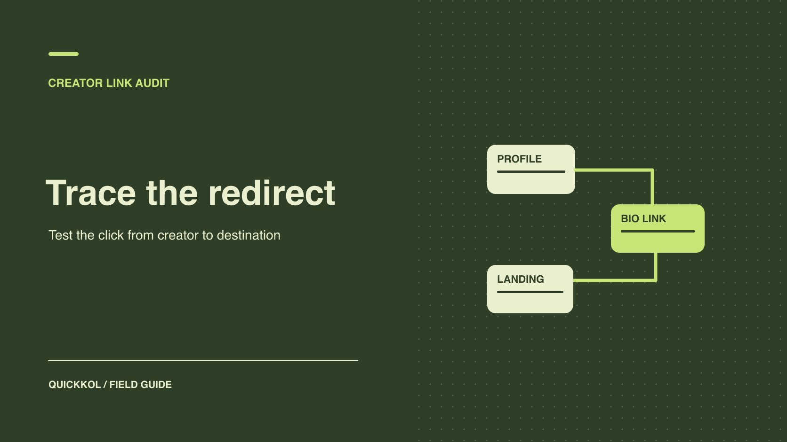

# Linktree Clicks: How to Reconcile a Sponsored Link

Status: local review draft; confirm the publication date before release.

Trace a sponsored post through the creator’s Linktree and reconcile button activity with the brand’s own records.

QuickKOL editorial graphic; not actual account metrics or a platform interface.

Start with the sponsored post, follow the agreed Linktree button and verify the destination and next action. Identify who controls each step and record campaign parameters, market and change times. Button clicks, site sessions and orders each have their own reporting scope. Accept delivery against the live route and publication time. Evaluate outcomes using the data source named in the agreement. A discrepancy should lead to a specific check the creator or brand can perform.

## Assign an owner to each step

Before production, have the creator supply the real account, placement and button label. The brand supplies the intended market, destination and action. The route can include a creator profile, short URL, affiliate redirect and app page. List each step instead of keeping only the final destination. Name who can edit the button, who controls the short URL, who maintains the brand domain and who reports orders. If the same link appears in a post, profile and email, identify the sources separately or explain that the data can only be reported in aggregate. A [creator link destination hierarchy](https://www.quickkol.com/blog/linktree-brand-destination-hierarchy/#answer) helps establish which button owns the primary action.

Suppose an apparel campaign leads from a creator’s Instagram profile through Linktree to a size guide for a specific style. The creator can edit the button. The brand controls the size guide. The agency can see campaign sessions. Give each a check to perform. If the agency observes a problem, send the actual route and time to the appropriate owner without taking over the creator’s account. Log the effective time of any change. If an older campaign reused the short URL for another product, preserve that earlier scope.

## Test the real mobile route and market behavior

Use the public preview or approved live page and start from the intended creator account on a phone. Check whether the button appears in the expected position and wording, whether there is an intermediate prompt, and whether the final page reaches the intended marketplace and action. Include relevant environments such as an in-app browser and a regular mobile browser. Log operating system and market differences rather than accepting the route from one desktop check. Have an authorized owner verify any path that needs account access.

For example, a button may say “Open the summer size guide.” An in-app browser opens the home page, while an external browser reaches the guide. Both tests produced observations. The in-app route still fails the acceptance requirement. Save the final page, device, market and visible redirect behavior. If necessary, have the brand provide a web destination and retry from the same starting point. After a correction, check where a shopper returns when navigating back, especially when a deep link opens a different app. That can expose a problem a successful destination check missed.

## Verify campaign parameters at the destination

For tagged reporting, [the Google Analytics campaign parameter guide](https://support.google.com/analytics/answer/10917952?hl=en) explains using UTM parameters to identify referral and ad traffic, including source, medium and campaign. Agree on a parameter dictionary before asking the creator to use it in an approved destination. If the brand needs creative-level comparison, choose a stable asset identifier for an appropriate field. Do not put private personal information into URLs. For affiliate links, external apps or destinations with their own parameter rules, ask the relevant owner what additions are allowed. Account for existing query fields so a tracking edit does not overwrite affiliate or platform parameters.

Record the entry URL, the URL after the button and the parameters visible at the destination and in brand reporting. A link builder’s output does not establish that every redirect preserved the tags. Suppose the intended campaign value is summer_fit and one creator posts an older URL with no tag. The public content can still meet its publication requirement. The same measurement rule may not attribute those sessions. Keep the earlier URL and time, retest the corrected version and report the two windows separately. The difference can matter even if the visible destination stayed the same.

## Distinguish overall Linktree activity from the campaign button

[Linktree’s analytics overview](https://linktr.ee/help/articles/5434178-understanding-your-insights) distinguishes page views, clicks and unique measures across a Linktree. If a brand purchases one campaign button, ask for the corresponding link or eligible aggregate. The whole page’s clicks include other destinations. [Linktree’s individual link insights guide](https://linktr.ee/help/articles/5434172-individual-link-insights) explains that tables and charts in the single-link view can use different periods. Verify the displayed view and dates before selecting a value. Compare page, button and landing metrics only after confirming the object and window are compatible.

Suppose the campaign button receives 90 clicks in one week and another button receives 300. A page total of 390 cannot be credited to the campaign button. If the creator can see only a last-seven-days single-link value while the brand reports calendar weeks, record the mismatch. Obtain a comparable period if possible, or retain the limitation. Do not infer daily counts from a lifetime value. If the agreement requires a same-day report, ask the data owner to demonstrate before publication that the necessary scope is available. Document any plan limitations that affect what the brand will actually receive.

## Reconcile clicks, sessions and outcomes without collapsing them

Give the creator button, brand destination sessions and target outcome separate columns. Clicks can repeat. Sessions follow the destination analytics rules and may depend on browser behavior, consent and page loading. Orders can use another attribution period and can change with return or validation status. Align time zone and window, and keep the collection source and time. Use a [creator destination attribution process](https://www.quickkol.com/blog/link-in-bio-destination-attribution/#answer) to distinguish directly attributable actions from observations in the same period. A shared label such as conversion does not establish the same event in two systems.

Suppose the button shows 100 clicks, brand reporting records 72 tagged sessions, and the order system confirms six eligible orders. Report the three values independently. The difference does not establish that 28 people abandoned the journey. The six orders cannot automatically be assigned to one creator post unless the evidence supports it. Use diagnostic fields for repeat clicking, exits, lost parameters, window differences and missing access. Update the explanation when evidence arrives rather than forcing the systems to agree by adjusting a count.

## Agree on button changes, expiry and retesting

Before release, agree on the button’s live dates, editing authority and response to stock loss or campaign expiry. If the brand switches to a fallback page, log the actual time and reason and review the creator’s live wording. A new destination without the earlier discount needs a corresponding change to the public promise. If the creator cannot edit the original post, the brand can pause its own delivery and use an approved alternative under the agreement. Have the current owner make the change. Sharing broad access is unnecessary for a defined correction.

After the switch, test the original platform entry, final page and report separately. Use distinct identifiers or keep an explicit cutoff when possible. At expiry, open any still-public posts and check whether their destination remains useful. Preserve or remove buttons according to the agreement. For example, replacing a campaign discount with a standard size guide changes the purpose of the visit. Update the label and report the earlier offer and later evergreen windows separately. The publisher and analyst should agree on the cutoff before any recap is sent.

## Limit an incident report to the affected scope

If one creator’s button led to an older page for part of the campaign, record the account, entry point, dates, device and viewing conditions. Do not treat every creator’s delivery as affected without equivalent evidence. Correct the impacted route and retain the verified replacement. Have the data owner note the reporting limitation for that period. The settlement owner can distinguish accepted content, observed clicks and unavailable order attribution. If a similar discrepancy occurs in the next campaign, the evidence sheet should show which step needs to be tested again and who has authority to correct it.

## Reproduce the sponsored route before settlement

Suppose the sponsor buys a short creator video and one week of bio placement, with commission on eligible orders. The agency reports 100 button clicks and the brand sees 72 tagged sessions. Open the live short, follow the profile route and confirm the button, market, tags and destination. The creator can show placement on the contracted dates. The brand analyst verifies site events and order rules. The difference between two reporting units cannot determine a deduction from the creator’s fee.

Label preview and test activity in the evidence. The brand can use an approved test window to verify parameter delivery and a controlled environment for the downstream action. Use the actual publication window for the official report. If the tool includes internal tests in its total, note the scope and seek usable detail. If the button changes during the campaign, attach the old address, effective time and approver. Review production, placement and performance against their respective contract terms. Each party then knows which part of the route it can verify.

## Hand off one reproducible route

The final record should include the source account, button, original and final URLs, marketplace or market, parameters, check time and update owner. Attach the object and dates for both click and landing evidence. Have a second person repeat the journey from the creator’s public page. If that person cannot reach the same destination, record the exact difference before acceptance. The next owner should be able to distinguish visits through Linktree, traffic from brand advertising and outcomes that can only be observed for the overall period.

## Creator Linktree route audit

| Checkpoint | Evidence | Owner |
| --- | --- | --- |
| Creator entry | Handle, post URL and button placement | Creator |
| Redirect | Device, market, final URL and tags | Link owner |
| Destination | Load result, variant or action | Brand |
| Reporting | Object, period, source and version | Data owners |

Verify units at each source before comparing.

## Campaign link checklist

Repeat the checks from the real mobile entry point.

- [ ] Confirm account, button and final action.
- [ ] Check redirects and final campaign parameters.
- [ ] Separate clicks, sessions and orders by source.
- [ ] Name owners for changes, expiry and retesting.

## Research date and limitations

Sources reviewed November 9, 2026. Methods, tables and decision rules are editorial recommendations. Hypothetical examples are not actual client results or industry benchmarks. Source geography and periods are specified where relevant. This draft is in independent local review; confirm its publication date before release.

## Start creator research with a clear task

Use QuickKOL to interpret a brief, discover relevant creators and research their work and contact routes. Verify data, commercial terms and outcomes at their source.

[Explore QuickKOL](https://www.quickkol.com/#capabilities)

## Sources

- [the Google Analytics campaign parameter guide](https://support.google.com/analytics/answer/10917952?hl=en)
- [Linktree’s analytics overview](https://linktr.ee/help/articles/5434178-understanding-your-insights)
- [Linktree’s individual link insights guide](https://linktr.ee/help/articles/5434172-individual-link-insights)
