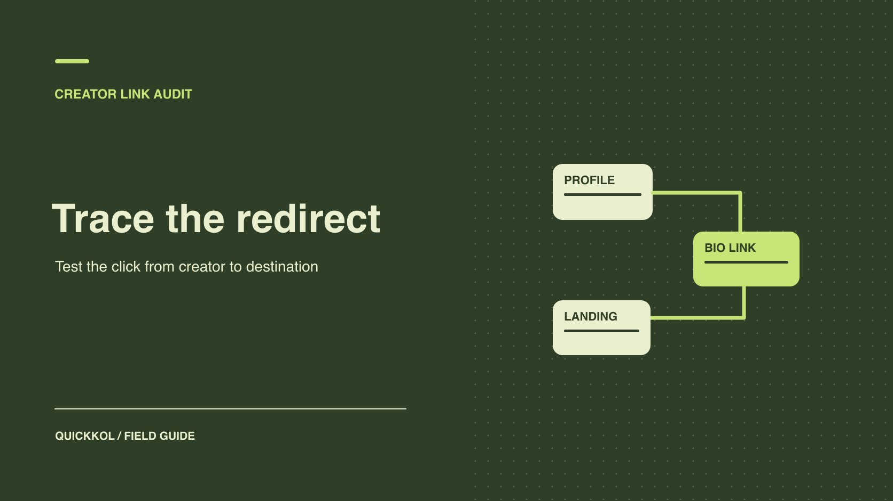

# linktr.ee 链接的点击怎样对到账

状态：本地审阅稿；正式发布日期待确认。

沿创作者实际发布路径核对跳转、有效访问与结算证据。

QuickKOL 编辑图形；不呈现真实账号指标或平台界面。

品牌通过达人的 Linktree 做推广时，从正式内容进入约定按钮，再检查最终页面和可完成的动作。先确认各跳由谁维护，标出活动参数、市场和改动时间。Linktree 的按钮点击、网站会话和订单各有报告口径。交付看实际链接和上线时间，绩效看合同认定的数据源。这样能够确定差异在哪一步，以及品牌和达人分别可以修复什么。

## 给每一跳一个所有者

制作前由达人提供真实账号、使用位置和按钮名称，由品牌提供目标市场、落地页和预期动作。链接可能经过创作者主页、短链、联盟重定向和应用页面。把每一跳分开，不要只保存最终页面。记录谁有权改按钮、谁能改短链、谁负责品牌域名和谁报告订单。若同一链接同时出现在帖文、简介和邮件，单列来源或明确只能报告汇总。用[达人链接目的地层级指南](https://www.quickkol.com/zh/blog/linktree-brand-destination-hierarchy/#answer)先确认哪一个按钮承担主要动作。

假设一个服装活动从达人的 Instagram 进入 Linktree，再进入指定款式的尺码页面。达人能编辑按钮，品牌能改尺码页，代理能查看活动会话。给三人明确校验责任。代理发现问题时将实际跳转与时间交给相应所有者，不需要临时接管达人账号。把更改生效时刻写进共享日志；如果同一个短地址过去用于其他款式，保留早期活动的历史范围。

## 验证手机实跳和地区切换

用公开预览或已经批准的实际页面，在手机上从对应的账号进入。检查按钮是否按预计位置和文案显示，点击后是否有中间提示、是否进错商城或登录页，最终能否完成预期动作。选择至少两种与受众相关的入口，例如应用内浏览器和常规手机浏览器。不同操作系统或地区的差异记录在测试表，避免一台电脑访问成功就签收全部。需要登录或按权限处理的路径由已有授权的所有者验证。

例如按钮文案写「领取夏季尺码指南」，应用内浏览器跳到首页，外部浏览器则打开目标页面。两个测试都可写为有结果；应用内视角仍未达到验收条件。保存最终页面、设备或市场、跳转方式和屏幕所见。必要时让品牌提供独立手机落地页，按同样路径重试。修复后别忘了检查用户返回时是否回到预期页面，尤其是在深链将受众带进应用的情况下。

## 从最终页面检查活动参数

[Google Analytics 活动参数指南](https://support.google.com/analytics/answer/10917952?hl=en)说明可用 UTM 参数标记推荐或广告流量，例如来源、媒介和活动。先约定参数字典，再交给达人加到允许编辑的活动目的地。品牌希望看到合作素材时，可把一项清楚、稳定的素材标识放在适当字段。不要把私密个人信息放到 URL 里。若是联盟链接、第三方应用或有特殊协议的参数，先让对应所有者确认允许怎样添加。拼接时注意已经存在的查询参数，不因修改标签而覆盖联盟或渠道需要的字段。

测试时记录入口地址、按下按钮后的地址，以及最终页中的参数和品牌报表里的活动值。只看短链生成页不能证明参数在各跳保留。假设活动名需要统一为 summer_fit，某位达人转发了未加参数的旧地址。品牌仍可以验证公开交付，但无法用同一规则归因这些会话。将旧地址和生效时间留档，提供正确链接后再次测试，再把两段窗口单列。

## 核对 Linktree 总量和指定按钮

[Linktree 数据概览说明](https://linktr.ee/help/articles/5434178-understanding-your-insights)区分整个主页的浏览、点击及唯一指标。品牌只买了一个活动按钮时，应向达人要对应的链接或适用的汇总，而不是整页所有按钮的总点击。[Linktree 单链接统计说明](https://linktr.ee/help/articles/5434172-individual-link-insights)指出不同单链接表和图使用的时间范围可能不同。选择报表前先确认具体视图和显示日期。只有在窗口和对象匹配时，才比较整页、按钮和落地会话。

例如活动按钮前一周收 90 次点击，另一个按钮收 300 次。整页 390 不能算作该活动的点击。如果作者只有近七天的单链接字段，而品牌报告使用自然周，明确哪些时间段不重合。必要时另导出可比数据，或保留不完全对齐的限制。不要从累计值倒推出看不到的每日数据。对需要同日报告的活动，发布前让数据所有者证明能提供指定范围。

## 从点击到会话，再到结果各自对账

给三类数据单独留列：达人按钮点击、品牌落地会话和目标动作。点击可以包含重复操作；会话按落地分析系统规则计数，受浏览器、同意设置和页面加载影响；订单又受转化窗口、退货或系统归因规则影响。统一报告时区和时间窗，保留数据源与统计时点。用[达人落地页归因规则](https://www.quickkol.com/zh/blog/link-in-bio-destination-attribution/#answer)核对哪些动作可直接归属，哪些只能当作同一期间观察。不要因两份报告都写「转化」就把它们合并。

假设按钮 100 次点击，品牌报表看到 72 次有对应标签的会话，订单系统显示 6 个符合范围的已确认订单。可分别报告三个数；不能断言 28 人中途放弃，也不能说 6 位顾客都来自一条具体创作者帖子，除非额外数据支持。给差异设诊断项：重复点击、退出、参数丢失、报表时间和权限等。找到证据再更新解释。

## 约定按钮变更、下线和复测

交付前约定按钮在线日期、修改权限、商品缺货或活动结束时的处理。如果临时换成备用页面，给日志写实际生效时间和原因，同时复查原帖文案。新页面没有旧优惠时要同步改文案，避免受众被带到无法兑现的承诺。若达人无权改原帖，品牌可按约定暂停投放并使用已经批准的替代说明。由当前所有者执行修改，不能把多人访问当作应急方案。

更换后分别测试原始平台入口、最终页和报表。若可能，保留两个不混用的活动标记或明确时间切点。结束时复查仍公开的帖文是否指向失效页面，按约定保留或移除按钮。例：活动结束后将促销按钮改为常规尺码页，也要更新文案，记录这是不同目的的访问。报告按旧促销窗与后续常规窗分开。

## 把异常影响限制在已知范围

如果一位达人在一段期间指向旧版页面，记录涉及的账号、入口、日期、设备和可见条件。其余达人没有同样证据时，不要统一归为活动失败。品牌可先更正受影响入口，提供实际修复路径，再让数据所有者标注该时段的报表限制。与合同相关的结算问题交给负责人，区分已验收的内容、已观察的点击和无法核实的销售。以后出现相似差异，可以从同一证据表找出需要复测的步骤。

## 结算前用一条签约链接重走证据

假设品牌购买一条达人短片和一周主页入口，另按合格订单计算佣金。代理汇报一百次按钮点击，品牌只能看到七十二次带标签会话。先从短片进入达人主页，打开该按钮，确认市场、活动参数和页面。创作者可以证明在约定日期放置了正确入口，品牌分析员核对网站事件与订单规则。两者统计对象不同，差值无法直接用来扣减达人费用。

预览或试点点击要标在记录里。品牌可以用受控的测试窗口核对页面是否传参，并用批准的测试环境验证后续动作。正式报告使用真实发布的观察窗。若测试点击混在工具汇总中，说明范围，等待可核对的明细。若活动中更换了按钮，把旧地址、修改时间和批准人附在交付记录中。按合同分别结算内容、入口保留和绩效，复盘就能说明哪个结果属于谁。

## 在合作交接里保留可复现的一条路径

最后提供入口账号、按钮、原始与最终链接、商城或地区、参数、测试时点和负责更改的人。附上点击与落地报表各自的日期和对象。让另一位同事从达人公开页面重走一次。若他无法到达同一目标，标出实际差别再验收。接手人应能清楚区分哪些访问经过 Linktree、哪些来自品牌投放，以及哪些结果只能按活动期间观察。

## 达人 Linktree 跳转检查表

| 检查点 | 证据 | 所有者 |
| --- | --- | --- |
| 达人入口 | 账号、发布 URL、按钮位置 | 达人 |
| 跳转 | 设备、地区、最终 URL 和参数 | 链接负责人 |
| 落地页 | 加载情况、款式或转化动作 | 品牌 |
| 报表 | 对象、窗口、来源和版本 | 各数据所有者 |

各数据源的单位先核实再比较。

## 活动链接验收清单

用真实移动路径重复检查。

- [ ] 确认账号、按钮和最终动作。
- [ ] 核对各跳及最终参数。
- [ ] 按来源区分点击、会话与订单。
- [ ] 记录更换、下线与复测负责人。

## 研究日期与使用边界

资料核验于 2026 年 11 月 9 日。文中方法、表格和决策规则为编辑建议，标为假设的示例不是实际客户结果或行业基准。外部资料的适用地区与时期按各段说明；本稿处于独立本地审阅阶段，正式发布日期待确认。

## 用清楚的任务开始达人研究

用 QuickKOL 理解 Brief、发现相关达人并研究作品与联系路径；数据、合作条件和结果仍需核验。

[了解 QuickKOL](https://www.quickkol.com/#capabilities)

## 来源

- [Google Analytics 活动参数指南](https://support.google.com/analytics/answer/10917952?hl=en)
- [Linktree 数据概览说明](https://linktr.ee/help/articles/5434178-understanding-your-insights)
- [Linktree 单链接统计说明](https://linktr.ee/help/articles/5434172-individual-link-insights)
