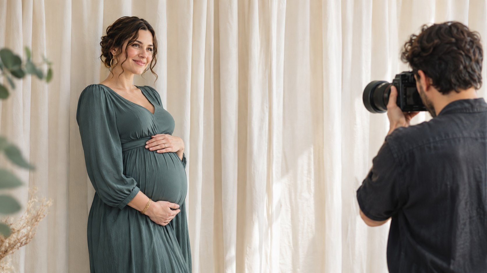

# How to Work With a Maternity Photography Creator

Status: local review draft; confirm the publication date before release.

Use portfolio and permissions evidence to decide whether to commission production, creator publication or both.

When a brand hires a maternity photographer, define whether it needs production, publication on the photographer’s account or a separate on-camera creator. Verify what each candidate actually did in the portfolio, then confirm capture and publication with the adult participant. Track appearance permission, photo copyright and paid advertising use separately. Include enough set detail to verify the commissioned shots. Base the purchase on relevant work, the actual publishing account and the asset uses each party can approve.

## Define the photography creator’s role

A photographer can be a production supplier or a creator who explains lighting and composition to an audience on their own account. A second creator could appear on camera and narrate the experience. Decide which audience and deliverable the brand needs. A maternity apparel company might want a daylight photo set and a short video where the photographer explains the styling. The photo set calls for shooting, retouching and usage rights. The video calls for creator explanation, publication and reporting. Separate the work so that ownership, delivery and pricing are clear.

Ask candidates for two comparable public sets or samples they are authorized to share. Have them describe their role in shooting, styling, appearing and editing. A watermark or page avatar alone does not establish who did every job. Use a [creator casting brief](https://www.quickkol.com/blog/instagram-model-fit-casting-brief/#answer) to evaluate lighting, composition and audience fit instead of relying on public scale. If the brand only buys production, the photographer does not automatically become an endorser. If they will publish, review their recent comparable work and ask about native performance evidence at the appropriate scope.

## Agree on capture boundaries with the adult participant

Explain the purpose, length, crew size, location, clothing choices and any behind-the-scenes recording in the invitation. Give the adult participant a separate route to communicate preferences before the shoot. Agree which angles, wardrobe choices and frames require an on-set check, who may be present and what will not be captured. Set a simple pause signal. Make clear that the participant can stop, adjust or skip a shot. Share operational instructions with the people who need them without circulating the private reasons behind them. Where comfort, health or other personal circumstances affect the plan, follow the participant’s decision and the project’s applicable process.

Suppose the brand planned a full-length side portrait and the adult participant requests a seated, waist-up frame. Adjust the light and composition. Let the reviewer decide if the alternative still demonstrates the garment. Ask separately before adding a different frame. Production timing should not force the team to keep an original storyboard panel. For a small campaign, plan a fallback that does not increase exposure, such as a garment detail on a stand. That lets the shoot continue while respecting the person’s choices.

## Use the test shoot to verify the commissioned shots

If a brand commissions a photography creator to demonstrate the cut of a maternity garment, start the storyboard with two deliverables. Product stills should show fabric and construction. The creator’s short should explain fit or styling in a clear sequence. Record what each frame needs to show, who approves it and where it can appear. Have the participant confirm comfortable positions and agreed coverage before the photographer sets the camera and light. The softbox, reference image and shooting area in the figure illustrate a pre-shoot check for required shots and clear access.

Suppose the sponsor wants a length comparison and the pilot shows only a waist-up frame. Ask the participant and photographer whether an approved seated position or a flat lay can supply the missing evidence. If the requested shot would exceed consent, note the limit and use an approved alternative. Give the product stills, creator short and backstage material separate IDs. The buyer can then verify what was captured, which version the creator can publish and which frames belong in internal selection only.

Confirm lighting, background and access before inviting the participant onto the set.

## Separate photographic copyright, appearance and advertising use

For U.S. copyright, [the U.S. Copyright Office’s photographer guide](https://www.copyright.gov/engage/photographers/) explains that the photographer generally owns the initial copyright, with exceptions such as qualifying work made for hire. The actual arrangement can differ, so have the relevant owner verify the contract and jurisdiction. When the brand needs a license or transfer, describe the files, media, territory, term, permitted edits and agency access. Independently confirm the intended use of the adult participant’s likeness. A photographer’s license, raw file delivery and appearance consent establish different parts of the permission chain. A brand site use may not cover retailer advertising or a recut.

List organic social, the brand site, retailer pages, paid ads, behind-the-scenes footage and the photographer’s portfolio separately. Distinguish product promotion from a personal story. Approval for a clothing detail where a person is minimally identifiable does not establish approval for an interview about their pregnancy. Use a [creator rates and usage rights framework](https://www.quickkol.com/blog/creator-rates-usage-rights/#answer) to price those uses separately. If the campaign needs a longer term or an additional market, check both the rights agreement and appearance permission first. Describe the added use clearly enough for the relevant people to decide whether they will approve it.

## Keep unnecessary personal information out of delivery

The job needs a schedule, location, appearance permissions and responsible contacts. It may have no need to put personal history, health details or a home address in the brief. In the U.S., [the FTC’s business data protection guide](https://www.ftc.gov/business-guidance/resources/protecting-personal-information-guide-business) emphasizes retaining information required for the business and limiting access. Use a venue contact and project ID where possible. Store required approvals separately. Before delivery, review filenames, metadata, studio backgrounds and selection pages for identity or location details that do not need to become public. Limit sample galleries to their reviewers and define an end date. Give the photographer a way to remove expired previews.

Imagine a review link that also shows unapproved backstage material. Put backstage and approved selects in different access-controlled locations. Verify who can download the files before delivery. Publish approved versions instead of opening the entire shoot archive. If the brand needs to retain production evidence, retain the necessary project records under its agreed process. Give the participant a clear contact for checking what was approved or raising a correction. The answer should come from an owner who can inspect the actual version and use, not from someone who only saw a production schedule.

## Review disclosure and imagery in the creator post

When the photographer or on-camera creator publishes, identify who writes the caption, checks the commercial disclosure and owns the final version. For the U.S. market, [the FTC’s influencer disclosure guide](https://www.ftc.gov/business-guidance/resources/disclosures-101-social-media-influencers) emphasizes clear visibility for material connections in the U.S. context. If a creator is paid or receives a gift, assess the applicable disclosure and placement. Keep product information to claims the brand can support. Avoid turning a photo into an unsupported health, body or performance promise. Use the participant’s own words within the agreed scope and preserve context when editing.

Send the creator a review package with the actual frames, crops, captions, description, links and publishing account. Review the paid version separately, especially if it changes audio, visual emphasis or use. If a vertical crop changes which part of the image is prominent, take that version back to the relevant approver. At launch, have the publisher and brand each open the post and check the actual creative, disclosure and destination. Preserve the real publication time and supporting capture. The approved design file is useful evidence of intent. It does not establish what viewers saw.

## Accept actual deliverables and close access

Accept finished photos, editable files, appearance permission, publication URLs and advertising scope separately. If only some photos are approved for ads, attach a verifiable permission label and restrict the ad export to those files. At expiry, have the owner review which posts, ads and shared links may continue under the agreement. When a new use is proposed, document the scenario and approval before it starts. Use a delivery sheet for approved assets and a separate performance report for agreed views or visits. The quality of the photography alone cannot establish conversion.

Send the participant and creator the final scope and responsible contact. Keep the confirmation date. Record exceptions such as a skipped frame, replaced photo, unavailable use and the next owner. If only the agreement and final versions need to remain after expiry, reduce shared access under the project’s retention process. This gives a future reviewer enough evidence to check use without keeping unnecessary permissions to the creator’s account or working archive.

## Use the pilot to decide whether to buy production or distribution

Suppose a maternity apparel company wants ecommerce images and a short styling explanation on a creator’s account. Photographer A has a strong daylight portfolio and little relevant publishing work. Creator B has recent styling explainers and can provide appropriate reporting. The brand could hire A for the stills and B for the explanation, or ask B for separate production and publishing quotes. Use evidence suited to each job.

Accept the pilot against approved selects, the agreed account and the adult participant’s approved uses. If the brand later wants to turn ecommerce photos into ads, check the actual files and appearance permissions first. A license for organic publication allows the team to accept that work while leaving advertising pending. The handoff should show who made the work, who published it and which approval the next buyer still needs. If the short lacks the agreed comparison shot, hold the corresponding product claim. Accept the stills separately if they meet the brief.

## Maternity photography handoff

| Deliverable | Verify | Owner |
| --- | --- | --- |
| Production | Role, storyboard, lighting and set boundaries | Photographer and producer |
| Appearance | Frames and uses approved by the adult participant | Participant and designated owner |
| Rights | Version, territory, media and term | Agreement owner |
| Release | Live version, disclosure and URL | Creator or brand publisher |

Verify permissions for the actual partnership and jurisdiction.

## Shoot and release checklist

Keep production evidence and permissions separately.

- [ ] Confirm photography, appearance and publication roles.
- [ ] Agree on set and publication boundaries with the adult participant.
- [ ] Review copyright, appearance and advertising separately.
- [ ] Preserve the approved version, live record and expiry handling.

## Research date and limitations

Sources reviewed November 9, 2026. Methods, tables and decision rules are editorial recommendations. Hypothetical examples are not actual client results or industry benchmarks. Source geography and periods are specified where relevant. This draft is in independent local review; confirm its publication date before release.

## Start creator research with a clear task

Use QuickKOL to interpret a brief, discover relevant creators and research their work and contact routes. Verify data, commercial terms and outcomes at their source.

[Explore QuickKOL](https://www.quickkol.com/#capabilities)

## Sources

- [the U.S. Copyright Office’s photographer guide](https://www.copyright.gov/engage/photographers/)
- [the FTC’s business data protection guide](https://www.ftc.gov/business-guidance/resources/protecting-personal-information-guide-business)
- [the FTC’s influencer disclosure guide](https://www.ftc.gov/business-guidance/resources/disclosures-101-social-media-influencers)
