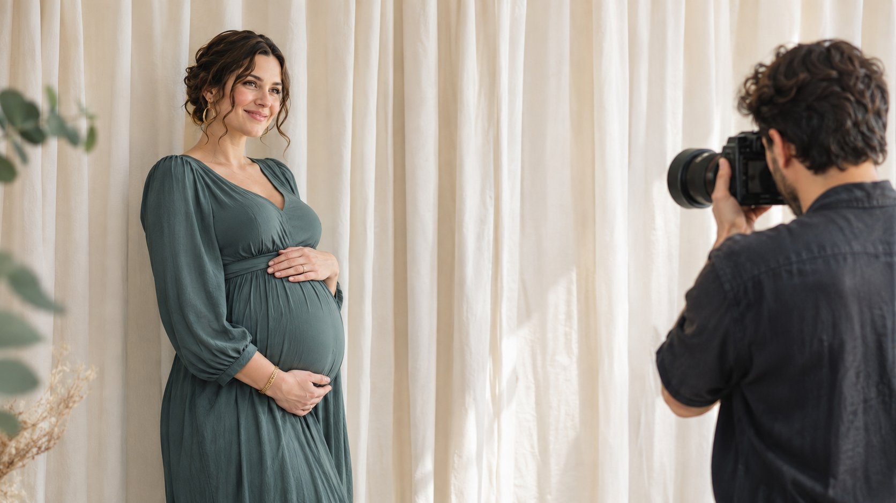
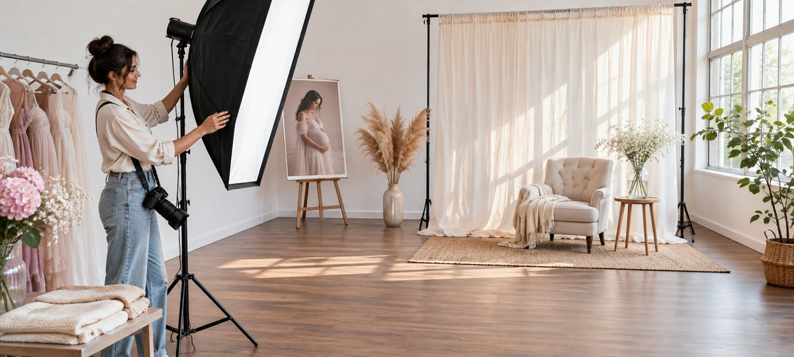

# 品牌如何与孕妇摄影创作者合作

状态：本地审阅稿；正式发布日期待确认。

从作品筛选、参与者确认和内容授权，判断应采购拍摄、出镜还是账号发布。

品牌找孕妇摄影师合作时，先明确购买的是拍摄制作、摄影师在本人账号的发布，还是另请创作者出镜。用已核实的作品角色来筛人，并和成年参与者分别确认拍摄及发布范围。出镜许可、照片版权和付费投放是三项独立交付条件。机位和布光只写到足够验收承诺画面的程度，商务决定以作品、实际账号和批准的素材范围为准。

## 给摄影型达人一个明确的角色

摄影师可以作为制作供应商，也可以作为独立创作者，解释布光和画面选择并在自己账号发布。另一个达人可以作为出镜和叙事者。品牌应先决定哪种受众与交付最重要。例如孕期服装品牌需要一组可用的自然光照片和一条摄影师讲解造型的短片。前者涉及拍摄、修图和素材授权；后者涉及摄影型达人的表达、发布和报告。把两项写成不同的交付，有助于确定负责人与报价。

请候选人分享两组与 Brief 相似的公开作品或其有权分享的样张，说明摄影、造型、出镜与编辑分别由谁完成。不要从水印或页面头像直接推断候选人拍了全部作品。用[达人服装拍摄筛选思路](https://www.quickkol.com/zh/blog/instagram-model-fit-casting-brief/#answer)记录光线、构图和目标受众，而不是只看账号量级。若品牌只购买制作，摄影师未必需要成为公开代言人。若品牌要其发布，另查近期同类作品和能够获得的合适原生表现证据。

## 先确认成年参与者的拍摄和现场边界

在正式邀请里说明项目目的、拍摄时长、团队人数、场地、服装选择和是否有幕后录制。给成年出镜者单独的确认渠道，让其能在没有现场压力的情况下沟通需要。确认哪些角度、服装和画面需要在拍摄时先询问，谁可以在场，哪些画面不拍。安排一个明确的暂停信号，明确当事人可以停下、调整或跳过镜头。把这些指示发给实际执行人员，不把私人原因发给全组。涉及健康、个人处境或拍摄舒适度时，遵循参与者的选择和项目已有的适用流程。

例如品牌原本计划侧面全身照，成年参与者希望改为坐姿半身。当天可以调整布光和构图，并让负责人判断是否仍满足服装展示。若要拍新的画面，再单独询问。不要用交付进度逼迫完成原分镜。对于一次品牌试点，可以预设一个无需增加出镜范围的替代镜头，保护活动进度和参与者决定。

## 在试拍中核对合作需要的画面

品牌若请摄影创作者演示孕期服装的剪裁，分镜先列两类交付。商品图需要看清布料与细节，达人发布的短片需要用连贯画面解释穿着或搭配。每一帧写明拍到什么、谁确认和用于哪一版。先让参与者确认姿势和可拍范围，再由摄影师决定机位和灯位。配图中的柔光箱、参考画面和主要拍摄区域可以用来说明团队怎样在开拍前核对所需镜头与通道。

假设品牌想要衣长对比，试拍却只交了半身图。采购负责人先和参与者、摄影师确认能否用其已批准的坐姿或衣物平铺补足证据。若补拍会超出出镜同意，记录范围并换成经批准的画面。把商品图、达人短片与幕后素材分别编号，方便品牌查看实际拍到什么、发布者能用哪一版，以及哪些图只供内部筛选。

拍摄前先确认灯位、背景和出入通道，再请出镜者入场。

## 区分版权、出镜与投放

[美国版权局摄影师版权指南](https://www.copyright.gov/engage/photographers/)解释，照片的初始版权一般由摄影师拥有，符合特定条件的雇佣作品等情况除外。实际创作和合同可能不同，交给相应地区及合同负责人核实。品牌需要摄影作品的授权或转让时，写清图片、媒介、地区、期限、允许编辑和能否交给代理。另向成年出镜者确认人物形象的特定用途。摄影师许可、原图交付和人物出镜许可是不同证据。允许品牌网页展示，不一定包含零售商的广告或重新剪辑。

把自然社媒、品牌网站、零售商页面、付费广告、幕后和摄影师作品集分别列出。对产品宣传和人物故事也分开确认。比如允许只看得见衣物和轮廓的电商图，不自动包括谈论孕期经历的采访。用[达人报价和素材使用权框架](https://www.quickkol.com/zh/blog/creator-rates-usage-rights/#answer)拆开费用。若活动想延长展示时间或扩大地区，先核对合同和出镜许可，再发出追加申请。用清楚的用途描述，方便参与者了解具体要授权什么。

## 从交付流程排除不必要的个人资料

项目需要拍摄时间、地点、出镜确认和负责人，未必需要把个人经历、健康细节或家庭地址留在 Brief。[FTC 的个人信息保护指南](https://www.ftc.gov/business-guidance/resources/protecting-personal-information-guide-business)强调只保留业务必要的信息，并限制访问。可以使用场地联系人与项目编号，分开保存必要的授权文件。照片交接前查看文件名、元数据、影棚背景和选择页是否包含不必公开的身份或地点信息。候选样张仅提供给审阅人，记录访问范围和截止时间。让摄影师有办法移除过期预览链接。

例如一个样张链接能看到尚未确认发布的幕后图。把幕后和正式候选分到不同的受限目录，先确认谁能下载，再按协议交付。发布时选批准版本，避免开放整套原始拍摄。若品牌需要参考前期流程，仅保留项目所需的记录并按约定管理。向参与者提供明确的联络方式，方便他们提出修正或确认交付范围。

## 审核达人发布时的披露和画面

摄影师或出镜达人自己发布时，确认谁负责编写文案、适用的商业披露、谁持有最终版本。[FTC 的达人披露指南](https://www.ftc.gov/business-guidance/resources/disclosures-101-social-media-influencers)强调美国市场下实质关系应清楚可见。若创作者获得费用或赠品，应检查相应关系是否需要披露及所在位置。产品信息以可支持的事实为准。避免从照片里延伸出关于身体、健康或效果的没有根据的承诺。参与者自己的话也要按约定的范围使用，剪辑后保留语境。

给达人审核的文件包含实际画面、裁切、字幕、说明、链接和发布账号。品牌投放版另做一次审批，尤其检查是否改变声音、强调位置或用途。假如选中图被裁成竖图后重点改变，先回到相关批准者确认。上线时由发布者和品牌各打开一次，看是否显示正确的稿件、披露和目标链接。保存真实发布时间及同一截图，不把设计稿当实际发布证据。

## 按实际交付完成验收和撤场

交付按成片、可编辑文件、出镜许可、发布 URL 和投放范围分别验收。若一组照片里只有部分同意用作广告，给这些文件加可查的权限标签，限制导出清单。活动到期由指定人员复查哪些帖子、广告和共享链接按合同继续或结束。如果使用方提出新增授权，注明新场景和批准记录再开始。用内容交付与活动表现两张表，前者验收批准素材，后者只报告约定的观看或访问，不从摄影效果推断转化。

向参与者与创作者分别发送最终范围与联络人，保留确认日期。整理一次例外记录，例如没拍的镜头、被替换的图、未能许可的用途及谁负责后续。如果到期只需要保留合同和最终版本，就按项目规定缩减共享权限。一个可交接的收尾能让以后有人复核内容使用，同时少占用达人的账号和素材管理权限。

## 从试拍作品决定买制作还是买分发

假设孕期服装品牌需要一组电商图和一条摄影师讲解造型的短片。候选 A 的作品显示其擅长自然光拍摄，但很少在本人账号发布。候选 B 有多条公开的造型讲解，也能提交适用的发布数据。品牌可以先买 A 的拍摄，另请 B 解释产品细节，也可以请 B 报一份制作与发布分列的价格。每项都要看独立证据。

小试验收看批准样张、发布账号和参与者允许的用途。若想把电商图转成广告，先核对具体版本和出镜许可。如果目前只获自然发布许可，可以先验收约定内容，把广告另列待确认。最终交接应让下一位采购同事知道谁创作、谁发布、哪项权利仍待补。如果短片里的对比画面没拍到，先暂停对应卖点的发布，单独验收符合约定的商品图。

## 孕期摄影合作交接表

| 交付 | 确认什么 | 负责人 |
| --- | --- | --- |
| 制作 | 角色、分镜、布光及现场界限 | 摄影师与制作方 |
| 出镜 | 成年出镜者同意的画面和用途 | 参与者和指定负责人 |
| 授权 | 版本、地区、媒介及有效期 | 合同负责人 |
| 发布 | 实际版本、披露和链接 | 达人或品牌发布方 |

团队应按实际合作和适用地区确认许可。

## 拍摄与发布检查清单

交接时将制作证据和许可分别留档。

- [ ] 确认摄影、出镜和发布各自负责人。
- [ ] 与成年参与者确认现场与发布边界。
- [ ] 分开复核摄影版权、出镜和投放。
- [ ] 留存批准版本、发布记录和到期处理。

## 研究日期与使用边界

资料核验于 2026 年 11 月 9 日。文中方法、表格和决策规则为编辑建议，标为假设的示例不是实际客户结果或行业基准。外部资料的适用地区与时期按各段说明；本稿处于独立本地审阅阶段，正式发布日期待确认。

## 用清楚的任务开始达人研究

用 QuickKOL 理解 Brief、发现相关达人并研究作品与联系路径；数据、合作条件和结果仍需核验。

[了解 QuickKOL](https://www.quickkol.com/#capabilities)

## 来源

- [美国版权局摄影师版权指南](https://www.copyright.gov/engage/photographers/)
- [FTC 的个人信息保护指南](https://www.ftc.gov/business-guidance/resources/protecting-personal-information-guide-business)
- [FTC 的达人披露指南](https://www.ftc.gov/business-guidance/resources/disclosures-101-social-media-influencers)
