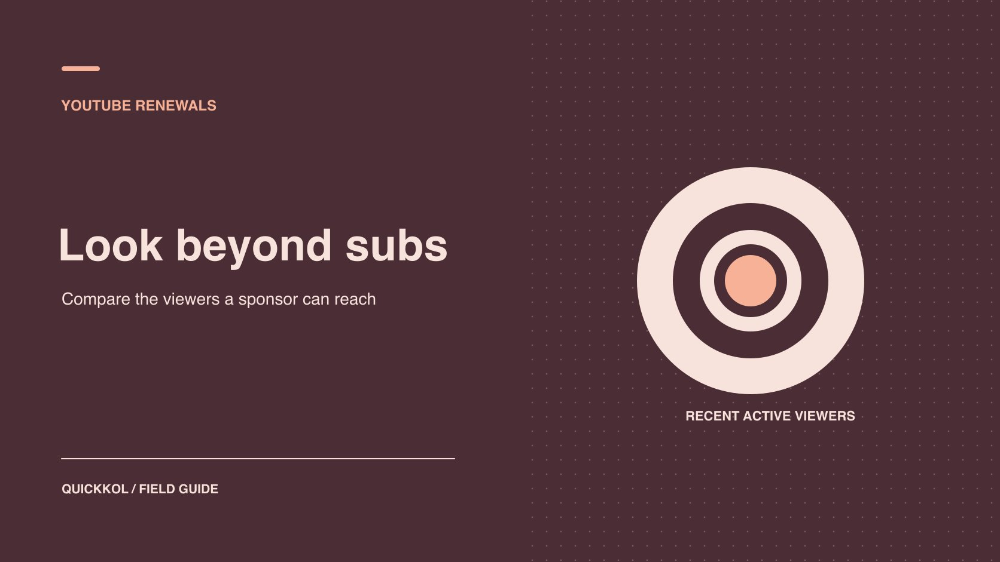

# Do YouTube Subscribers Still Watch? A Sponsor’s Guide

Status: local review draft; confirm the publication date before release.

Use comparable videos, active audience evidence and sponsored delivery to decide how much to renew.

QuickKOL editorial graphic; not actual account metrics or a platform interface.

When a sponsor asks about real YouTube subs, the practical question is whether a creator can reach relevant viewers again. Public subscribers indicate scale. For renewal, compare the same format and post age and review unique viewers, return behavior, known paid delivery and evidence for the sponsor segment. Use those findings to decide whether to book a season, test one more video or commission production and rights without a distribution commitment.

## Start with the work the sponsor might renew

If the renewal covers four long-form integrations, ask whether the creator’s usual long-form work reaches relevant viewers and whether they stay through the integration. If the purchase is paid advertising use, the evidence may instead center on licensable footage, delivery and acquisition paths. Public subscribers establish identity context and general scale. There is no need to ask the creator to prove each subscriber is a person. Use a guide to [YouTube subscribers and active viewers](https://www.quickkol.com/blog/youtube-subscribers-count-and-active-viewers/#answer) to set realistic questions before reviewing figures. Start with contracted work and then choose the evidence.

Give each metric a specific question. Unique viewers estimates the number of viewers during a period. Returning audience helps show whether people who watched before came back. Video-level data answers whether people viewed a particular item. When the contract needs qualified visits, use the agreed links and landing evidence separately. Two creators can meet the production requirement and still warrant different distribution terms because the measurement is different. A missing private report does not, by itself, suggest artificial activity. It can justify a smaller trial or a different success measure.

## Read monthly audience, return behavior and unique viewers in scope

[YouTube’s audience reports guide](https://support.google.com/youtube/answer/9314416?hl=en) defines monthly audience as unique viewers over the past 28 days and groups the audience by viewing behavior. Returning viewers and the regular-viewer category have their own definitions. Keep them separate. When a report arrives, check the date, channel, format and metric. A new video can lift the monthly audience without establishing that those viewers saw a later sponsor segment. For renewal, ask whether comparable work has repeatedly reached relevant viewers over a similar period after publication.

[YouTube’s unique viewers guide](https://support.google.com/youtube/answer/7577916?hl=en) explains that unique viewers are estimated and that a person can count as a unique viewer for several individual videos while counting once at the channel level. Adding three video-level figures does not establish deduplicated channel reach. Keep the Shorts estimation context in any comparison. The brand cannot match estimated viewers one by one with public subscribers, and it does not need to. Treat each figure as describing a different observable population and use it only within the applicable window and definition.

## Build a comparable set of recent uploads

Select recent long-form videos, Shorts, streams or replays that match the proposed renewal. Record video ID, release date, time elapsed at measurement, paid distribution, topic and sponsorship. If the sponsor wants long videos, a breakout Short should not be the main baseline. Use the same time after publication instead of comparing lifetime totals at different video ages. A [YouTube campaign audience cohorts](https://www.quickkol.com/blog/youtube-analytics-sponsored-content-cohorts/#answer) approach keeps series, format and paid distribution in separate fields. Ask about seasonal releases, prominent references and promotion so a reviewer can identify special cases.

Suppose five long videos have seven-day unique viewer figures ranging from 16,000 to 28,000. One gained more viewing around a major industry event. Keep the observation and flag the event. Present the median and range for the comparable set as planning evidence, without promising the same result on the next video. If the sample is sparse, buy one more test in the relevant format. Define an accepted piece of work and an observation period that can be verified rather than asking for a guaranteed increase in subscribers.

## Check which audiences engaged with sponsored work

Examine the actual sponsored video: integration timestamp, approved publication and any available view or retention evidence in the agreed window. A high view count for the whole video does not establish how many people saw the integration. If the product appears eight minutes in, do not report all starts as product exposure. When the creator can supply only an aggregate, use it within that scope. Where an appropriate market or language slice is available, request it as an aggregate. The language spoken, language of comments and geography of viewers describe different things.

Consider a hypothetical channel with 250K subscribers and a first-week median of 22,000 unique viewers on recent long videos. One integration reached 25,000 unique viewers in its first week and produced recorded visits to the agreed destination. Decide whether that evidence supports the next brief. Keep its audience and measurement boundaries. The public 250K is not a deliverable number of views. If the sponsor can obtain only channel-level evidence, it can still buy production and publication, with a smaller test for any claim about distribution to the target audience.

## Review paid delivery and organic viewing separately

One video may receive brand media, a creator reshare and external press. Ask both parties to log the verified traffic events and their timing. Match the video ID and report scope. Viewing purchased by the sponsor cannot be counted unconditionally as the channel’s organic audience. If the evidence cannot separate paid and organic, attach the known paid period and describe the limitation. A public follower change cannot be inverted into a number of ad-driven subscriptions. [YouTube’s subscriber count guide](https://support.google.com/youtube/answer/6051134?hl=en) also explains public abbreviation and possible removal of closed or spam accounts.

Suppose the public count barely moves over a month, while comparable videos maintain viewing and the returning audience meets the sponsor’s objective. That evidence may still support a renewal for predictable creator content. A rising public count would not by itself justify a fee increase. Check accepted work, asset rights and relevant audience evidence. If you see an unexpected change, ask for documented sources and metric definitions first. An anomaly label should not replace the contract decision. Send any access or security concern to the channel owner as a separate matter.

## Give an incomplete renewal review a fallback

If the creator cannot supply an older report slice, confirm what is still available. A verified video report, comparable work and a prospective pilot can support a narrower purchase. State whether the next deal is a smaller distribution test or a production-only agreement. Stop requesting a metric when it cannot change the decision. The sponsor does not need credentials or general channel access to obtain an appropriate aggregate.

One option is to renew a single relevant topic with a predefined comparison set, a seven-day observation, a tagged destination and a review date. Accept publication from the actual live URL and inspect the result once the window has elapsed. If the brief shifts to brand-owned distribution, price production and media separately. Keep the differences between the available options visible. A smaller test is a response to evidence and scope, not a public conclusion about the creator. Avoid inferring anything about individual subscribers from campaign data that cannot identify them.

## Check renewal signals outside audience counts

Renewal depends on the working relationship too. Record script revisions, release reliability, disclosure, useful audience questions and how easily rights can be handed over. One channel might reach the right viewers but need a long negotiation for every usage extension. Another might be smaller and provide consistent work with clear terms. Those factors can shape procurement without being folded into a single audience-quality score. Keep evidence such as approved copy, a sample of relevant questions or the rights sheet.

Suppose two candidates have similar first-week viewing. A can supply usage rights and a dedicated demonstration. B’s viewers often ask about specifications, but B has not approved brand advertising reuse. The sponsor can select the work that matches the goal, such as buying A’s assets or inviting B to host an organic Q&A. Explain why rights and creative format support different choices. Public subscriber totals should not turn those two viable arrangements into one generic ranking.

## Decide what evidence would justify another episode

Suppose a creator’s long-form viewing is steady but the old agreement did not ask for evidence around the sponsor segment. Renew one video in the same format. Agree on the integration timestamp, definition of a qualified visit, comparison window and review date before filming. Ask which aggregate fields the creator can share and note when paid delivery starts. Discuss a larger booking if the first-week evidence fits the sponsor’s objective. Set the threshold from that brief and budget.

If the pilot still cannot supply segment or geography evidence, accept documented production and publication under their own terms and narrow the next distribution commitment. Comparable creative and audience questions may still support buying footage for a brand-owned placement. Record which work the evidence supports and give the creator a focused request for any remaining data.

## Write the renewal decision for the next owner

Record the contract task, sample, estimated metrics, gaps, decision and review window. For example: “Renew one long video based on three matched examples and the accepted integration. Do not include a fixed audience guarantee.” If the team is considering an increase, specify the public deliverable, native evidence and next action required. Keep unverified fields open. The next owner should be able to open the links, reproduce the sample and understand why the brand chose a one-video test, a full season or a pause. Give rights and production acceptance separate owners. This creates a decision record that remains useful even when the public subscriber number has changed by the next review.

## YouTube renewal evidence

| Question | Evidence | Use |
| --- | --- | --- |
| Channel scale | Public subscribers and observation date | Context |
| Recent audience | Matched unique and return evidence | Compare formats |
| Sponsored delivery | Live URL, timestamp and report | Accept contracted content |
| Renewal decision | Goal, gap and test conditions | Set renewal scope |

Hypothetical data illustrates the review method.

## Before renewing a creator

Collect evidence that can change the renewal decision.

- [ ] Identify production, publication or licensing.
- [ ] Sample comparable formats and elapsed time.
- [ ] Separate subscribers, unique viewers, return and paid delivery.
- [ ] Record renewal scope and review date.

## Research date and limitations

Sources reviewed November 9, 2026. Methods, tables and decision rules are editorial recommendations. Hypothetical examples are not actual client results or industry benchmarks. Source geography and periods are specified where relevant. This draft is in independent local review; confirm its publication date before release.

## Start creator research with a clear task

Use QuickKOL to interpret a brief, discover relevant creators and research their work and contact routes. Verify data, commercial terms and outcomes at their source.

[Explore QuickKOL](https://www.quickkol.com/#capabilities)

## Sources

- [YouTube’s audience reports guide](https://support.google.com/youtube/answer/9314416?hl=en)
- [YouTube’s unique viewers guide](https://support.google.com/youtube/answer/7577916?hl=en)
- [YouTube’s subscriber count guide](https://support.google.com/youtube/answer/6051134?hl=en)
