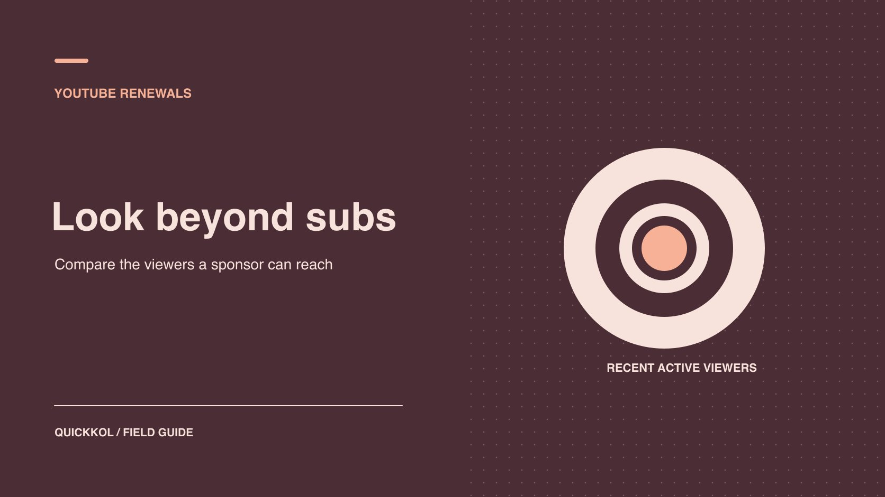

# YouTube 订阅者还在看吗？品牌续约前怎么判断

状态：本地审阅稿；正式发布日期待确认。

用同格式视频、活跃受众和赞助片段证据确定续约范围。

QuickKOL 编辑图形；不呈现真实账号指标或平台界面。

品牌搜索「real YouTube subs」时，通常要判断的是下一期还有多少相关观众愿意看。公开订阅数提供频道量级。续约前，先找同格式、同发布后时长的作品，再看独立观众、回访、已知投放和赞助段证据。最后按预算决定继续一季、续一条试点，还是只买制作与授权。

## 从要续的交付反推观众问题

如果续的是四条长视频植入，重点是常规长视频能不能触达相关观众，以及这些观众是否愿意看到植入部分。如果续的是品牌付费广告使用权，核心证据可能变成可授权素材、实际观看和获客路径。公开号只做身份与量级背景，不必要求创作者证明每位订阅者。用 [YouTube 订阅人数与活跃观看者指南](https://www.quickkol.com/zh/blog/youtube-subscribers-count-and-active-viewers/#answer)把可观察字段写入续约问卷。先谈合同交付，再决定该看哪些指标。

让每个指标回答一句明确问题。独立观众回答特定期间有多少估算观看者；回访回答此前看过的人有无再次观看；内容表现回答这些人是否看到特定作品。若项目最关心带来合格访问，另用合同同意的链接和落地数据。两位创作者都能交付内容时，可根据证据范围决定是否需要不同的续约条件。不要把缺少某个私有报表直接解释成数据虚假。

## 读懂月度受众、回访和独立观众

[YouTube 受众报告指南](https://support.google.com/youtube/answer/9314416?hl=en)将月度受众描述为过去 28 天观看内容的独立观众，并按观看行为划分新、偶尔和常看观众。回访指标和常看分类有各自口径，不互换。收到数据先看区间、频道、格式和指标。若最近一部作品带来新观众，频道月度数可能上涨，但不说明这批人都看了以后赞助的节目。对于续约，更有用的问题是可比内容在相近发布后窗口是否持续接触目标受众。

[YouTube 独立观众说明](https://support.google.com/youtube/answer/7577916?hl=en)指出独立观众是估算，同一人在多个视频里可分别计为单视频独立观众，而频道层面会合并。品牌不能把三支视频的独立观众相加，再称为全频道去重触达。Shorts 的估算与相关观看口径也要保留。不要把报告中的观看者与公共订阅者逐一比对。二者面向不同人群与期间，合适的做法是按定义分别使用。

## 建立一组可比的近期内容

从最近长视频、Shorts、直播或回放里选出与续约交付匹配的作品。每条记录视频 ID、发布时点、到观察日的时长、是否有投放、主题和是否包含赞助。目标是续长视频时，不拿一条爆发的 Shorts 作为主要基线。将旧内容到观察日的累计值换成同样的上线后时长，或明确不可比。用 [YouTube 达人活动受众分组](https://www.quickkol.com/zh/blog/youtube-analytics-sponsored-content-cohorts/#answer)给系列、格式和广告单独留列。让达人说明节日、重大引用或付费推广，以便判断哪些作品需要单列。

例如一组 5 条长视频的七日独立观众区间为 16,000 至 28,000，其中一条因大型行业活动明显多出观看。保留它但另说明。续约估算可同时显示可比样本的中位和区间，不承诺下一条达到同一数字。如果数据中位数受样本很少影响，先买一条同格式试点。把试点设成有可核对的交付与观察窗，而非保证订阅数。

## 查哪类观众参与了赞助内容

从实际赞助视频取证：植入时点、是否按批准发布、对应时间窗内的观看与可用保留数据。看到整条视频观看高时，还要核对观众是否可能看到植入。比如品牌产品在第八分钟出现，不能直接把全部播放写成产品曝光。若只能取得整条的聚合数，按其范围报告。目标市场或语言如果可用，要求创作者按合适区间提供聚合切片。视频内容的语言、评论语言和地理报告各有区别。

给定一个假设案例：频道有 250K 订阅，近期长视频首周独立观众中位 22,000。某次植入视频首周到 25,000，另有约定的落地访问。品牌应判断该作品和素材是否支持下轮目标，保留观众覆盖范围，不把 250K 作为可交付观看。若预算主要用于相关受众，取目标内容与访问证据做决定。如果只有全频道数据，也可以签署制作和发布，另设小额验证性的分发项目。

## 把付费和自然结果分开看

同一支视频可能有品牌广告、创作者转发和站外报道。请双方列出明确的流量事件和时间，核对视频 ID 与报告范围。品牌媒体买到的观看不应无条件写成频道自然受众。若数据源不能拆分，将已知付费时间与报告一起呈现。不要按公开号变化反推广告带来的订阅；不同指标和对象没有这种对应关系。[YouTube 订阅数说明](https://support.google.com/youtube/answer/6051134?hl=en)还指出公开号会缩写，且关闭或垃圾账号可能被移除。

假设订阅数一个月没有明显变化，但同期同格式观看稳定且回访表现符合目标。若续约买的是有稳定受众的内容，这仍可能支持续约。反过来，订阅上涨也不足以支持抬高费用，需要看真实交付、素材权利和目标观众证据。遇到意外变化，先问可解释来源和数据口径，避免用异常标签替代商务判断。对于异常导致的安全风险，由频道所有者单独查权限。

## 给资料不足的续约设定一个替代路径

如果达人无法提供某个过去区间的细分报表，让其确认哪些字段仍可获取。可以用原生可见的一条视频数据、已核验作品和一次未来试点替代需要完整旧数据的采购条件。把限制写进下一份合同，明确是缩小试点还是只采购制作。若一项指标对续约没有帮助，就不要继续索要。别要求频道访问或登录，品牌只需获取能支持商业判断的汇总。

下一步可以先续一条相关题材，预先定对照内容、上线后七日数据、落地页和复查安排。用实际发布的 URL 签收，按指定时间窗看结果。若整体合作目标改成品牌自投，分别结算制作和传播。保留方案之间差异，避免把较小的测试标成拒绝达人。也不要用与内容无关的数据猜测某个人是否真实订阅。

## 记录观众数字之外的续约信号

续约也取决于合作过程。记录脚本修改次数、发布是否按期、披露是否准确、观众问题是否得到回应、素材许可是否易于交接。一个频道可能具备合适观众，却在每次使用权更新时需要很长沟通；另一个频道的量级小些，但有稳定内容和明确权利。这些因素可以影响采购，不需要混入同一项观众质量分。给每一项记录来源，例如已批准文案、评论样本或许可表。

假设两个候选人的首周观看相似。A 能提供匹配使用权和专属演示，B 的观众更常问产品规格，但没有批准品牌广告复用。让品牌分别选择和目标一致的工作，如购买 A 的素材或邀请 B 做原生问答。报告解释权利与创意为什么支持不同选择。这样不会因为两人的订阅数差异，把两种可用合作混成一个名次。

## 写明什么证据足以多买一期

假设达人近期长视频观看稳定，但旧合同没有要求交付赞助段的数据。品牌可以先续一条同格式内容，预先约定植入时间、有效访问的定义、同窗对照和复查日期。让达人确认可提供哪些聚合字段，把付费开始时间写入报告。若首周观察与目标范围匹配，再谈两条或一季。阈值由该品牌的预算和目标设定。

若新试点仍无法取得片段或地理证据，可以按已验收制作和发布结算，下一轮调整采购范围。对照近期同类内容的创作质量和观众提问，也能判断是否适合买品牌自行分发的素材。报告说明证据支持的工作和待核实的字段，为达人留下清楚的答复路径。

## 将结论写给下一位决策人

交接要写明合同任务、样本、估算指标、缺口、结论与复查期。比如「续一条长视频，基于三条同窗内容和已验收植入，暂不承诺特定受众量」。如计划增加预算，注明必须观察到的公开交付、原生报表和下一步。对未经核实的指标保持未知。下一位负责人拿到表，就能沿视频链接和日期复算区间，了解为什么方案是续一条、续全季或暂停。把权利与内容留给合同负责人分别确认。

## YouTube 续约证据表

| 问题 | 看什么 | 使用范围 |
| --- | --- | --- |
| 频道量级 | 公开订阅显示和观察日 | 只作背景 |
| 近期受众 | 同窗独立和回访证据 | 选择可比格式 |
| 具体交付 | 实际 URL、时点和报告 | 验收已购买的内容 |
| 下一轮决定 | 目标、缺口和测试条件 | 确定续约范围 |

示例数据用于展示复核方法。

## 续约前的核对清单

只收集能改变续约决定的证据。

- [ ] 明确要续的是制作、发布还是使用权。
- [ ] 按相同格式和上线后时长抽样。
- [ ] 区分订阅、独立观看、回访和付费。
- [ ] 写清续约范围和复查日期。

## 研究日期与使用边界

资料核验于 2026 年 11 月 9 日。文中方法、表格和决策规则为编辑建议，标为假设的示例不是实际客户结果或行业基准。外部资料的适用地区与时期按各段说明；本稿处于独立本地审阅阶段，正式发布日期待确认。

## 用清楚的任务开始达人研究

用 QuickKOL 理解 Brief、发现相关达人并研究作品与联系路径；数据、合作条件和结果仍需核验。

[了解 QuickKOL](https://www.quickkol.com/#capabilities)

## 来源

- [YouTube 受众报告指南](https://support.google.com/youtube/answer/9314416?hl=en)
- [YouTube 独立观众说明](https://support.google.com/youtube/answer/7577916?hl=en)
- [YouTube 订阅数说明](https://support.google.com/youtube/answer/6051134?hl=en)
