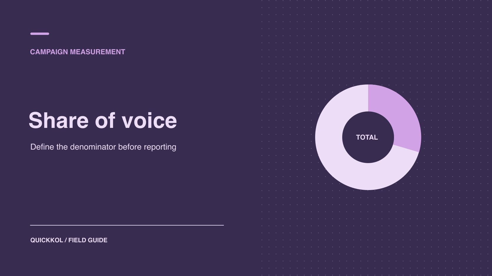

# How to Calculate Share of Voice for a Creator Campaign

Status: local review draft; confirm the publication date before release.

Define a comparable share of voice and show how contracted creator posts contributed to the count.

QuickKOL editorial graphic; not actual account metrics or a platform interface.

Share of voice is a brand’s eligible mentions divided by all eligible mentions in the comparison set. Before using it to evaluate a creator campaign, define competitors, platforms, dates and the counting unit. Label contracted posts, independent mentions and known paid delivery. The share can rise because the brand gained mentions or because competitors lost them. Present the numerator, denominator and accepted creator work together so the sponsor can decide whether to repeat the brief.

## Choose the unit of voice for the report

[Brandwatch’s share of voice guide](https://www.brandwatch.com/blog/share-of-voice/) describes distinct applications across social conversation, media, search and advertising. For a creator campaign, define voice as eligible posts, authors or another unit that can be collected consistently. Do not combine public mentions, ad impressions and unique viewers in one numerator. A launch visibility report could count eligible post-brand pairs. A community report might instead count distinct authors who mention each brand. If you present both, label them as different measures.

Give the campaign owner a definition that can be checked, such as “eligible mentions of activewear brands in public post captions in the specified languages and markets, counted once per post and brand.” Say whether comments, reposts, brand-owned accounts and sponsored creator posts qualify. Put the unit and source on the first page of the report. Ask two reviewers to classify ten examples independently. If they interpret a case differently, adjust the rule before running the full count. The purpose is to produce a fraction another analyst can reproduce. A broad-looking result is of limited value if the team cannot say what one counted unit represents.

## Freeze competitor, source and date scope

Choose the comparison brands and document why each qualifies. They might sell in the same market, compete for a similar audience and have names that can be distinguished in a query. For a name that is also an ordinary word, use handles, category terms or exclusions and retain examples. Specify time zone, date inclusivity, platforms, public object types, languages and how geography is assigned. [Brandwatch’s listening sources documentation](https://social-media-management-help.brandwatch.com/en/articles/17449910-sources-for-listen-social-listening-mentions) describes different access and coverage conditions by social source. Identical query text does not make the comparison fair when source access differs.

Record known gaps by source. A brand may see comments on its own profile that cannot be collected in the same way for competitors. Compare the common public scope, or report owned comments separately. Do not add the extra private coverage to the brand’s numerator alone. Use [social listening query sample validation](https://www.quickkol.com/blog/social-listening-query-sample-validation/#answer) to check aliases, false matches and inclusion rules. If a competitor or source is added mid-campaign, rerun both the baseline and campaign period with the new definition where feasible. Otherwise present a separate view and explain the break in the comparison.

## Specify how multi-brand posts and reposts count

One creator can compare two brands in a single post. If the unit is a post-brand pair, count one eligible mention for each brand. That post contributes two units to the denominator. If the denominator instead counts unique posts, dividing the same brand numerators by it could produce shares that add up to more than 100%. You can use an allocation rule, but show how it handles several brands in one item. If a caption names the same brand four times and the unit is once per brand per post, it still contributes one.

Define repost treatment before launch. For original conversation, deduplicate by source post and give amplification a separate count. If the goal is observable distribution actions, label reposts separately or include them through the same rule for all brands. Keep the post ID, timestamp, author and relationship to the original. Cross-posting can create several platform objects. Report them within their respective channels and use a creative ID to show reuse. Counts from different platforms do not establish the number of distinct people who posted.

## Keep organic, contracted and amplified activity visible

Creators may post because they are contracted, discuss a product independently or have their original work promoted as an ad. Classify evidence as brand-owned, verified partnership, other public activity or unknown. Keep a separate paid delivery record. A brand name in a caption does not prove that a contract exists. Preserve unknown cases rather than guessing. If the sponsor primarily wants to understand independent conversation, show the overall tracked share and any separate view excluding known partnerships. Explain how contractual status was determined and what cannot be verified for competitors.

Suppose 18 of 55 brand mentions came from documented partnerships. Show those 18 alongside the total. The brand can confirm its own contracts, while equivalent information for competitors may be incomplete. If you exclude confirmed partnerships from the brand’s count but cannot apply the same rule to competitors, disclose that asymmetry and avoid a direct organic-only comparison. Do not turn paid impressions on the same post into additional public mentions. Use a [creator campaign measurement framework](https://www.quickkol.com/blog/creator-campaign-measurement/#answer) to report delivery, conversation and outcomes in parallel.

## Recalculate the share alongside absolute volume

Suppose the baseline week has 40 mentions of your brand, 100 of competitor A and 60 of competitor B. The denominator is 200 and the brand share is 20%. During the campaign, the counts are 55, 70 and 50. The denominator is 175 and the share is about 31.4%. The brand gained 15 mentions and its share rose by about 11.4 percentage points. The total also fell. The share change cannot be assigned entirely to the campaign. Show each count, the total and the fraction together, then add contracted creator releases and unusual events in a separate record.

If there are zero eligible mentions in the set, report the share as undefined. If the denominator is very small, show the counts and avoid decimal precision that hides instability. Distinguish percentage points from relative changes. If the periods have different lengths, use equal-length windows or clearly limit the comparison. Mark a major competitor launch, product recall or unexpected press event on the timeline. It can move the denominator without saying anything about the quality of the creator’s work.

## Check whether one channel or language drives the change

Break eligible mentions down by comparable platform and language, and recalculate the denominator within each group. Suppose the combined share rose but one English-language platform explains most of the movement, with little evidence from a second target market. Report the aggregate snapshot and its limit. Avoid taking a simple average of platform shares. If you combine counts, first verify consistent objects and collection rules, then sum eligible numerators and denominators and disclose potential cross-channel duplication.

When reading interactions, distinguish product questions, comparisons, favorable comments, criticism and unrelated matches. A share increase can arise from negative attention and cannot stand in for brand preference. Review the categories that drive the most volume and retain examples where automated sentiment misread the context. Summarize eligible material only, with a source for any quotation. If one creator repeatedly posted about the brand, review unique authors alongside post volume. That helps distinguish repeat publishing from contributions by additional people without changing the original definition.

## Read contracted delivery alongside category conversation

Suppose the brand’s share increases in launch week and the worksheet shows that most new mentions came from contracted creators publishing on schedule. Other visible discussion changes little. The campaign owner can report that the creator deliverables went live. If the next objective is to involve creators outside the paid roster, review authorship and the relationship between original posts and reshares to see whether new participants actually appeared. Where competitor sponsorships are not identifiable, disclose that coverage and retain the overall share.

Give the next brief a measurable discussion task. A contracted creator might pose a product-use question that other people can answer independently. Track new original authors, substantive questions and accepted work in separate rows. Keep the competitor set and observation window comparable, then check whether the new discussion matches the campaign objective. The sponsor can recognize delivered work and still leave the reason for broader category movement open until the evidence supports it. If excluding one frequently reshared asset reverses the result, preserve both counting rules and identify the asset that accounts for the difference.

## Use the result according to the campaign objective

If the goal is to enter a category conversation, use share and substantive questions to decide whether to add a different type of creator. If the goal is sales, use separately verified visits, orders and attribution. A mention share is not a return on investment. Before expanding a partnership, use a suitable time comparison or pilot to distinguish ordinary variation from potential campaign contribution. Hand off the brand count, total, percentage, main drivers, known gaps and next review date. Give the decision owner one defensible sentence, such as “Mention share rose in the tracked set; native reach and sales are reported separately.” That leaves room to act without asking the metric to answer a question it cannot measure.

If the brand only needs to know what the creator partnership visibly delivered, report accepted creative and relevant public replies in a separate row. You can show the contracted posts next to the overall mention count when you label any overlap. Before changing the budget, identify the market or content role that needs better coverage and test one small brief against it. Increasing the frequency of repeated posts just to hit a share target will not establish that the partnership reached more relevant people.

## Share of voice in two matched periods

| Window | Brand | Competitor A | Competitor B | Total | Brand share |
| --- | --- | --- | --- | --- | --- |
| Baseline week | 40 | 100 | 60 | 200 | 20.0% |
| Campaign week | 55 | 70 | 50 | 175 | 31.4% |

Hypothetical example. Each brand counts once per post. The denominator is all eligible post-brand pairs.

## Share of voice review checklist

Keep both the numerator and denominator in the report.

- [ ] Freeze brands, sources, languages and observation windows.
- [ ] Define multi-brand posts, reposts and paid scope.
- [ ] Show absolute counts and share changes together.
- [ ] Record coverage limits and the decision they inform.

## Research date and limitations

Sources reviewed November 9, 2026. Methods, tables and decision rules are editorial recommendations. Hypothetical examples are not actual client results or industry benchmarks. Source geography and periods are specified where relevant. This draft is in independent local review; confirm its publication date before release.

## Start creator research with a clear task

Use QuickKOL to interpret a brief, discover relevant creators and research their work and contact routes. Verify data, commercial terms and outcomes at their source.

[Explore QuickKOL](https://www.quickkol.com/#capabilities)

## Sources

- [Brandwatch’s share of voice guide](https://www.brandwatch.com/blog/share-of-voice/)
- [Brandwatch’s listening sources documentation](https://social-media-management-help.brandwatch.com/en/articles/17449910-sources-for-listen-social-listening-mentions)
