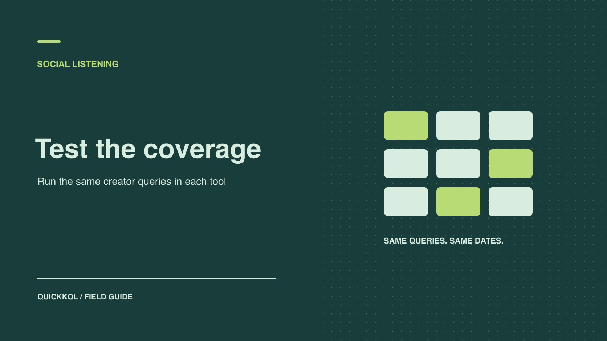

# How to Choose Social Listening Tools for Creator Research

Status: local review draft; confirm the publication date before release.

Compare tools against known creator work and verifiable URLs for a specific sourcing or delivery job.

QuickKOL editorial graphic; not actual account metrics or a platform interface.

Choose social listening tools against a creator job the team actually needs to do. Start with one task, such as finding prospective partners in a topic or recovering contracted creators’ live posts. Build a human-verified sample and compare recovery, irrelevant results, delay and exports under the same account, platform and date scope. Make the purchase decision on evidence the team can retrieve and use in its sourcing or delivery workflow.

## Choose one creator workflow the tool must support

Start with one primary job: find creators, confirm publication, route questions or produce a campaign recap. These jobs require different inputs. Discovery may use public language and relevant accounts. Delivery checks need a known roster and specific links. A response workflow needs timestamps and assignment history. Write down who uses the results, which objects the tool must find and how old a result can be before it loses value. A brand might want to identify product questions on posts by 20 contracted creators. Establish which visible comments are in scope. Private comments and unrelated accounts should not enter the comparison as if every tool were expected to see them.

Set two required conditions and one optional benefit. Recovering most known campaign posts and exporting working source URLs might be required. The dashboard layout can be optional. A [social listening query sample validation](https://www.quickkol.com/blog/social-listening-query-sample-validation/#answer) process can help establish the vocabulary and inclusion rules before vendor testing. Name the person who will use the weekly report and what they will do with it. A vendor can return more results while creating more manual work and missing the one creator workflow that justified the budget.

## Compare collection objects and permissions before channel logos

A platform logo does not establish that a tool can collect every post and comment from that service. [Brandwatch’s listening sources documentation](https://social-media-management-help.brandwatch.com/en/articles/17449910-sources-for-listen-social-listening-mentions) describes different collection and availability conditions by source. [Sprout Social’s listening data availability guide](https://support.sproutsocial.com/hc/en-us/articles/360056024132-Social-Listening-data-availability-and-limitations) distinguishes public Instagram hashtag posts from data available for connected business profiles, and includes YouTube video descriptions in a scope that excludes comments. Treat each distinction as something to test under the relevant account and permissions. Ask whether coverage comes from public collection, an authorized connection, a supplier feed or limited backfill. Check what happens to future collection when a connection expires.

Build a matrix with platform, object, permission, backfill, refresh and handoff fields. Name the actual object, such as a public video description or a comment on a post owned by a connected profile. Distinguish an unsupported object type from an eligible item that should have been collected but was missed. In a purchase agreement, identify who controls the connection, the exit conditions and the amount of history that can be exported. Keep trial access proportionate to the workflow. A vendor demonstrating comment monitoring does not need to publish on behalf of creators.

## Use human-verified examples to measure recovery

Sample contracted creators, comparable public conversations and ordinary noise. Keep the original URL, publication time, account, language, platform, object type and inclusion reason. Hold some examples back from the vendors until after their initial test. A vendor export cannot serve as the complete reference set. The pilot measures performance against known observations. For each creator or brand, include the expected handles, brand spellings, market language and a few useful variants. Include samples from before the test and samples published after collection started, so the team can distinguish historical backfill from ongoing collection.

Build semantically equivalent queries, allowing syntax differences where tools require them. Log quotation rules, exclusions, language filters and dates. Reopen the original public examples near the end of the pilot. Put content that became private, disappeared or changed tags into a separate group. When a vendor attributes a miss to platform restrictions, compare the claim with its documentation and the actual trial permissions. An unsupported object belongs in the scope gap column. An eligible item with no explanation for its absence belongs in a different column. Both findings matter, for different procurement reasons.

## Measure recovery and relevance separately

Suppose 40 target samples remain public and meet the agreed scope. Tool A recovers 32, for 80% recovery of the test set. Tool B recovers 36, for 90%. Review 50 returned items from each candidate separately. A produces 42 useful matches and B produces 33. B recovered more of the known set, while A required less filtering in the separate sample. Neither result generalizes to the entire platform. Report the sample size, selection method and exclusion rules next to each number. Keep the two denominators visible in the decision deck.

Then identify what each tool missed. B’s extra results may be news syndication, while A’s gaps may include creator comments that the brand promised to address. The sponsor could prioritize comment coverage or keep that part of the workflow in native tools. Group findings by object type, market and language. A weighted score can help compare options after the team identifies disqualifying gaps. Do not bury those differences in one score before the buyer sees them.

## Time both first availability and review effort

Record original publication time, first appearance in the tool, notification time and the moment a reviewer can open a usable source link. Set observation windows based on the campaign’s needs. Test the claim during an actual collection period. A post might appear in the report after six hours, trigger an alert after eight and remain inaccessible to customer support until the next morning. If the job is rapid response, access, routing and manual confirmation contribute to the elapsed time. Test at least one weekend or out-of-hours release, and distinguish refresh delay from lack of permissions.

Estimate the weekly labor as well. A reviewer who spends an average of 40 seconds on each of 100 results uses roughly 67 minutes before deduplication, source lookup and handoff. Record disagreements between two reviewers and resolve them through an inclusion rule the team can use later. Choose a sustainable sample rate and name the channel used for escalation. That gives the buyer a measurable operating cost beyond the vendor’s subscription price and an estimate of how the team will use the tool after the trial.

## Use export rows to test handoff

Ask the vendor to produce an actual trial export. Keep a usable source URL, date, account, platform, object type, matched term, language and evidence state on each row. Have the vendor explain which fields may disappear when authorization ends. Give the export to a second person and ask them to spot duplicates, confirm the author and identify a row where the original can no longer be opened. Check whether exports require a different plan and what licensed summaries can be retained after cancellation.

Use a [creator campaign measurement framework](https://www.quickkol.com/blog/creator-campaign-measurement/#answer) to distinguish listening evidence, native performance and conversion records. Matching a query establishes that the tool found a mention under a defined rule. It does not establish total reach or product revenue. Give publication review, customer support and creator research each a practical filter. The person who owns the queue should be able to tell which rows require action and which are reference only. Validate the complete handoff before deciding that the tool will reduce repeated review after procurement.

## Retest the cases the tools missed

After the first round, select several misses and false positives and review what changes when queries are adjusted. If a brand alias is also a generic product word, adding a creator handle or category phrase might reduce noise and miss discussions that omit the handle. Give keyword noise, a broken connection, unsupported objects and insufficient backfill different reason codes. Allow each tool the same time to adjust its configuration, then rerun the same set and retain the original result. A different date window or eligibility rule creates a separate test. The earlier figures should remain visible.

Include one failure rehearsal. For example, disconnect the trial account and observe whether previously collected rows can still be exported, when new collection stops and who receives an alert. Give the trial only the necessary access and have its owner revoke it when the evaluation ends. If ongoing value depends on maintenance, name who verifies connections and who can replace the account owner. The ability to find a post during a demo does not establish a reliable support or reporting workflow. After the retest, add the owner and fallback for each important failure to the buying worksheet. A required object with no viable fallback is a reason to reduce scope or decline the purchase.

## Set acceptance rules for sourcing and delivery

Suppose an agency compares two tools with the same set of verified posts. One finds more industry discussion but misses two commissioned videos. The other recovers the live sponsored posts but fills much of its discovery list with repost accounts. The sourcing lead should count new candidates with verifiable identities and relevant original work. The delivery lead should check whether the contracted assets are traceable. Those teams can reach different buying decisions.

Attach a consequence to each missed item. A missing discovery lead may be recoverable through manual research. A missed contracted post needs the creator’s live URL and a record of the tool’s coverage limit. The purchase memo should say which workflow each tool supports, who checks the evidence before outreach or acceptance and what kind of repeated failure would trigger another trial. Have the delivery reviewer open one sponsored post from the export and recover the account, asset and publication time.

## Listening pilot fields

| Measure | Test | Use |
| --- | --- | --- |
| Scope | List by platform and object | Identify gaps in required coverage |
| Recovery | Verified matches ÷ eligible sample | Compare on the same examples |
| Relevance | Useful rows ÷ rows reviewed | Estimate review effort |
| Handoff | Have a second reviewer trace exports | Verify that evidence can be used |

Examples compare one pilot and do not set an industry threshold.

## Pre-purchase acceptance checklist

Keep the original samples and each tool’s query.

- [ ] Name one primary task and maximum detection delay.
- [ ] Confirm scope by platform, object and access.
- [ ] Measure recovery, relevance and latency separately.
- [ ] Ask a second reviewer to trace the export and confirm exit terms.

## Research date and limitations

Sources reviewed November 9, 2026. Methods, tables and decision rules are editorial recommendations. Hypothetical examples are not actual client results or industry benchmarks. Source geography and periods are specified where relevant. This draft is in independent local review; confirm its publication date before release.

## Start creator research with a clear task

Use QuickKOL to interpret a brief, discover relevant creators and research their work and contact routes. Verify data, commercial terms and outcomes at their source.

[Explore QuickKOL](https://www.quickkol.com/#capabilities)

## Sources

- [Brandwatch’s listening sources documentation](https://social-media-management-help.brandwatch.com/en/articles/17449910-sources-for-listen-social-listening-mentions)
- [Sprout Social’s listening data availability guide](https://support.sproutsocial.com/hc/en-us/articles/360056024132-Social-Listening-data-availability-and-limitations)
